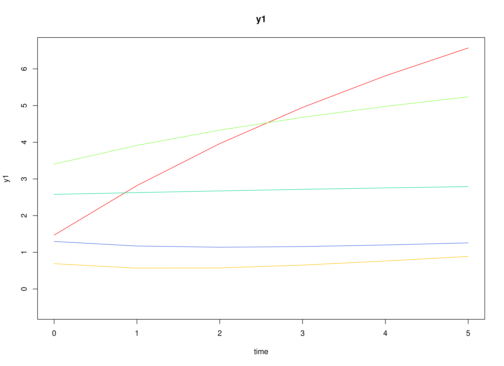
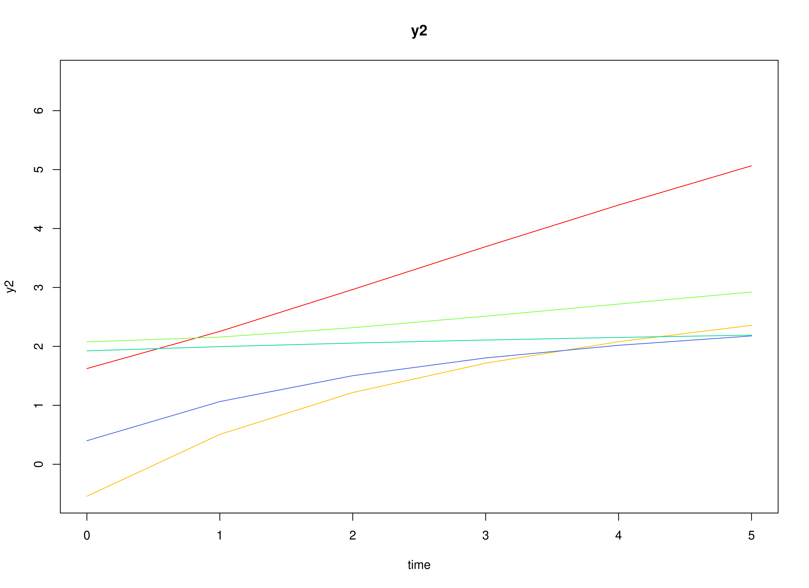
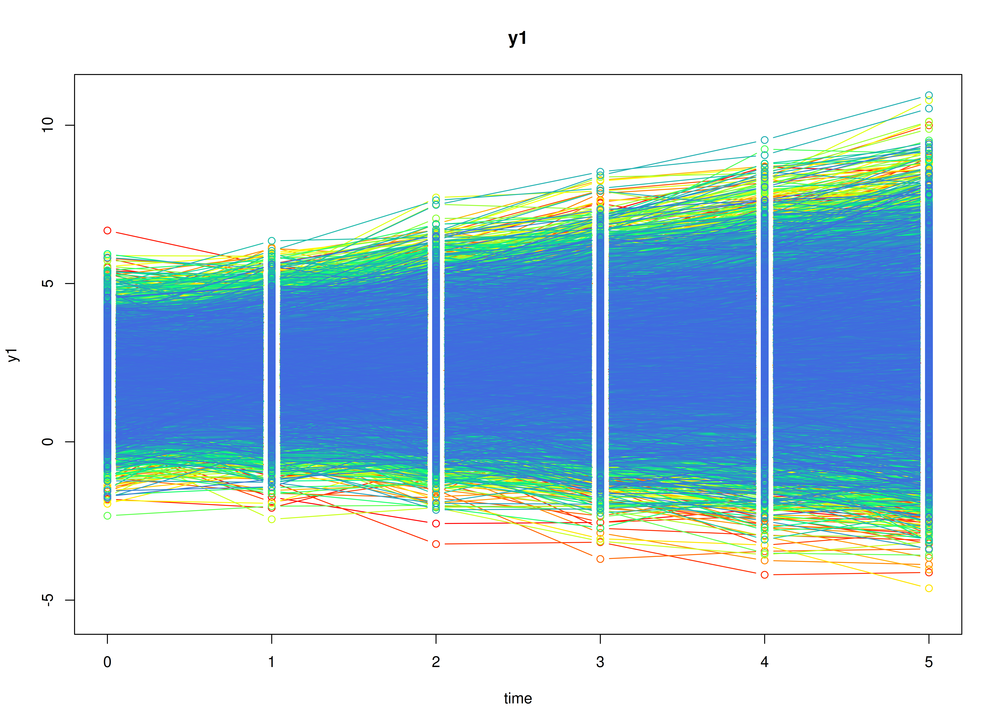
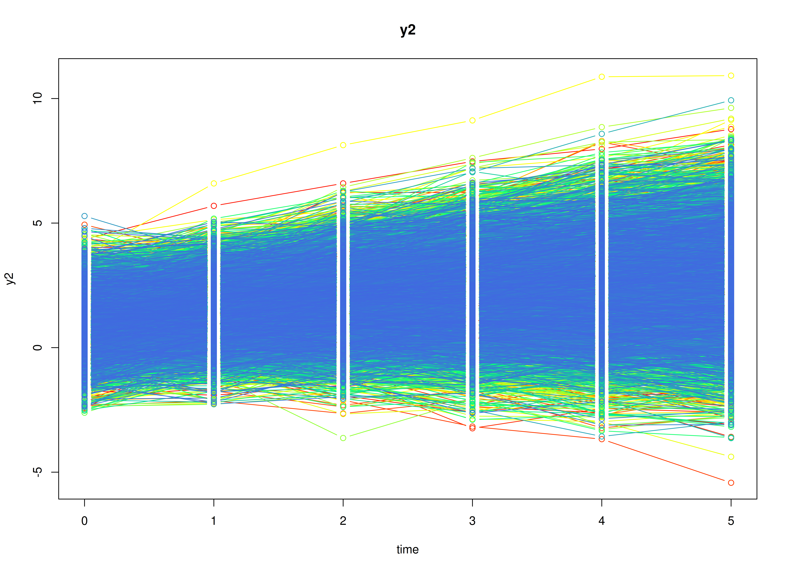
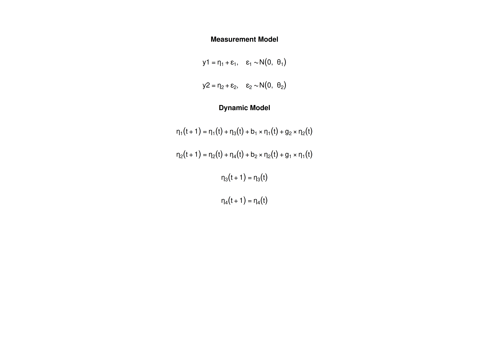

# The Bivariate Dual Change Score Model

## Overview

Latent change score models describe change itself (McArdle, 2009). Take
vocabulary and reading comprehension measured once a year in children.
From one occasion to the next, each child’s vocabulary changes. In the
dual change score model, the change has two sources: a constant amount
each child gains every year (the slope), and an amount that depends on
where the child stood the year before (the self-feedback). In the
bivariate model, the change in one variable can also depend on the
previous level of the other variable (the coupling), for example, if
children with a larger vocabulary gain more in reading comprehension.

The dual change score model is usually fitted as a structural equation
model (SEM). It can also be written as a state space model: the true
levels of the two variables are latent states, and the slopes are latent
states that never change.

This tutorial does three things:

1.  It writes the bivariate dual change score model as a state space
    model.
2.  It simulates data from the model with
    [`SimSSMFixed()`](https://github.com/jeksterslab/simStateSpace/reference/SimSSMFixed.md).
3.  It fits the model to the simulated data with `dynr` (state space)
    and with `lavaan` (SEM), and compares both sets of estimates with
    the values used to simulate the data.

No prior knowledge of state space models is needed.

## Model

The measurement model is given by \\\[\begin{equation} \left(
\begin{array}{c} Y\_{1\_{i, t}} \\\\ Y\_{2\_{i, t}} \\\\ \end{array}
\right) = \left( \begin{array}{cccc} 1 & 0 & 0 & 0 \\\\ 0 & 1 & 0 & 0
\\\\ \end{array} \right) \left( \begin{array}{c} \eta\_{1\_{i, t}} \\\\
\eta\_{2\_{i, t}} \\\\ \eta\_{3\_{i, t}} \\\\ \eta\_{4\_{i, t}} \\\\
\end{array} \right) + \left( \begin{array}{c} \varepsilon\_{1\_{i, t}}
\\\\ \varepsilon\_{2\_{i, t}} \\\\ \end{array} \right), \quad
\mathrm{with} \quad \left( \begin{array}{c} \varepsilon\_{1\_{i, t}}
\\\\ \varepsilon\_{2\_{i, t}} \\\\ \end{array} \right) \sim \mathcal{N}
\left( \mathbf{0}, \left( \begin{array}{cc} \theta\_{11} & 0 \\\\ 0 &
\theta\_{22} \\\\ \end{array} \right) \right) \end{equation}\\\] where
\\(Y\_{1\_{i, t}}\\) and \\(Y\_{2\_{i, t}}\\) are the two observed
variables at time \\(t\\) and individual \\(i\\), \\(\eta\_{1\_{i,
t}}\\) and \\(\eta\_{2\_{i, t}}\\) are their true levels,
\\(\eta\_{3\_{i, t}}\\) and \\(\eta\_{4\_{i, t}}\\) are their slopes,
and \\(\theta\_{11}\\) and \\(\theta\_{22}\\) are the measurement error
variances.

In words, each observed score is the true level plus measurement error.
The slopes have loadings of 0: they affect the scores only through the
change in the true levels.

The change in the true level of the first variable from occasion \\(t -
1\\) to occasion \\(t\\) is \\\[\begin{equation} \Delta \eta\_{1\_{i,
t}} = \eta\_{3\_{i, t - 1}} + b\_{1} \eta\_{1\_{i, t - 1}} + g\_{12}
\eta\_{2\_{i, t - 1}} , \end{equation}\\\] and similarly for the second
variable, \\(\Delta \eta\_{2\_{i, t}} = \eta\_{4\_{i, t - 1}} + b\_{2}
\eta\_{2\_{i, t - 1}} + g\_{21} \eta\_{1\_{i, t - 1}}\\). The true level
at occasion \\(t\\) is the previous true level plus the change,
\\(\eta\_{1\_{i, t}} = \eta\_{1\_{i, t - 1}} + \Delta \eta\_{1\_{i,
t}}\\).

Writing the change into the level gives the dynamic structure
\\\[\begin{equation} \left( \begin{array}{c} \eta\_{1\_{i, t}} \\\\
\eta\_{2\_{i, t}} \\\\ \eta\_{3\_{i, t}} \\\\ \eta\_{4\_{i, t}} \\\\
\end{array} \right) = \left( \begin{array}{cccc} 1 + b\_{1} & g\_{12} &
1 & 0 \\\\ g\_{21} & 1 + b\_{2} & 0 & 1 \\\\ 0 & 0 & 1 & 0 \\\\ 0 & 0 &
0 & 1 \\\\ \end{array} \right) \left( \begin{array}{c} \eta\_{1\_{i, t -
1}} \\\\ \eta\_{2\_{i, t - 1}} \\\\ \eta\_{3\_{i, t - 1}} \\\\
\eta\_{4\_{i, t - 1}} \\\\ \end{array} \right) . \end{equation}\\\]

In words, \\(b\_{1}\\) and \\(b\_{2}\\) are the self-feedback effects: a
negative value means that individuals who stand higher gain less, so the
levels level off over time. \\(g\_{12}\\) is the coupling from the
second variable to the first: a positive value means that a higher level
of the second variable is followed by a larger gain in the first.
\\(g\_{21}\\) is the reverse. The slopes stay the same over time. As in
most applications of the model, there is no process noise: once the
initial levels and the slopes are set, the true trajectories are fixed.

The initial condition holds the means, variances, and covariances of the
initial true levels and the slopes, \\\[\begin{equation}
\boldsymbol{\eta}\_{i, 0} \sim \mathcal{N} \left(
\boldsymbol{\mu}\_{\boldsymbol{\eta} \mid 0},
\boldsymbol{\Sigma}\_{\boldsymbol{\eta} \mid 0} \right) .
\end{equation}\\\]

For example, a positive covariance between the initial level and the
slope of the same variable means that individuals who start higher also
tend to gain more each year.

## Data Generation

### Notation

Let \\(t = 6\\) be the number of time points and \\(n = 10000\\) be the
number of individuals.

Let the self-feedback effects be \\(b\_{1} = -0.2\\) and \\(b\_{2} =
-0.3\\), and the coupling effects be \\(g\_{12} = 0.1\\) and \\(g\_{21}
= 0.2\\), so that

\\\[\begin{equation} \boldsymbol{\beta} = \left( \begin{array}{cccc} 0.8
& 0.1 & 1 & 0 \\\\ 0.2 & 0.7 & 0 & 1 \\\\ 0 & 0 & 1 & 0 \\\\ 0 & 0 & 0 &
1 \\\\ \end{array} \right) . \end{equation}\\\]

Let the initial condition be

\\\[\begin{equation} \boldsymbol{\mu}\_{\boldsymbol{\eta} \mid 0} =
\left( \begin{array}{c} 2 \\\\ 1 \\\\ 0.5 \\\\ 0.4 \\\\ \end{array}
\right) \quad \mathrm{and,} \quad
\boldsymbol{\Sigma}\_{\boldsymbol{\eta} \mid 0} = \left(
\begin{array}{cccc} 1 & 0.3 & 0.15 & 0.05 \\\\ 0.3 & 1 & 0.05 & 0.15
\\\\ 0.15 & 0.05 & 0.25 & 0.05 \\\\ 0.05 & 0.15 & 0.05 & 0.25 \\\\
\end{array} \right) , \end{equation}\\\]

and the measurement error variances be \\(\theta\_{11} = 0.2\\) and
\\(\theta\_{22} = 0.2\\).

### R Function Arguments

The simulation functions take covariance matrices as lower triangular
Cholesky factors (the arguments ending in `_l`). There is no process
noise, so `psi` and `psi_l` are zero matrices.

\
`n`\
`#> [1] 10000`\
`time`\
`#> [1] 6`\
`mu0`\
`#> [1] 2.0 1.0 0.5 0.4`\
`sigma0`\
`#>      [,1] [,2] [,3] [,4]`\
`#> [1,] 1.00 0.30 0.15 0.05`\
`#> [2,] 0.30 1.00 0.05 0.15`\
`#> [3,] 0.15 0.05 0.25 0.05`\
`#> [4,] 0.05 0.15 0.05 0.25`\
`sigma0_l`` ``# sigma0_l <- t(chol(sigma0))`\
`#>      [,1]        [,2]       [,3]      [,4]`\
`#> [1,] 1.00 0.000000000 0.00000000 0.0000000`\
`#> [2,] 0.30 0.953939201 0.00000000 0.0000000`\
`#> [3,] 0.15 0.005241424 0.47694080 0.0000000`\
`#> [4,] 0.05 0.141518453 0.08755435 0.4688355`\
`alpha`\
`#> [1] 0 0 0 0`\
`beta`\
`#>      [,1] [,2] [,3] [,4]`\
`#> [1,]  0.8  0.1    1    0`\
`#> [2,]  0.2  0.7    0    1`\
`#> [3,]  0.0  0.0    1    0`\
`#> [4,]  0.0  0.0    0    1`\
`psi`\
`#>      [,1] [,2] [,3] [,4]`\
`#> [1,]    0    0    0    0`\
`#> [2,]    0    0    0    0`\
`#> [3,]    0    0    0    0`\
`#> [4,]    0    0    0    0`\
`psi_l`\
`#>      [,1] [,2] [,3] [,4]`\
`#> [1,]    0    0    0    0`\
`#> [2,]    0    0    0    0`\
`#> [3,]    0    0    0    0`\
`#> [4,]    0    0    0    0`\
`nu`\
`#> [1] 0 0`\
`lambda`\
`#>      [,1] [,2] [,3] [,4]`\
`#> [1,]    1    0    0    0`\
`#> [2,]    0    1    0    0`\
`theta`\
`#>      [,1] [,2]`\
`#> [1,]  0.2  0.0`\
`#> [2,]  0.0  0.2`\
`theta_l`` ``# theta_l <- t(chol(theta))`\
`#>           [,1]      [,2]`\
`#> [1,] 0.4472136 0.0000000`\
`#> [2,] 0.0000000 0.4472136`

### Visualizing the Dynamics Without Measurement Error (n = 5 with Different Initial Condition)

Without measurement error, each individual’s true levels follow smooth
curves that bend as the self-feedback slows the gains.



### Using the `SimSSMFixed` Function from the `simStateSpace` Package to Simulate Data

Now we add the measurement error and simulate the full data set.
[`as.data.frame()`](https://rdrr.io/r/base/as.data.frame.html) returns
the data in long format, one row per individual and time point, with the
columns `id`, `time`, `y1`, and `y2`.

\
[`library`](https://rdrr.io/r/base/library.html)`(`[`simStateSpace`](https://github.com/jeksterslab/simStateSpace)`)`\
`sim`` ``<-`` `[`SimSSMFixed`](https://github.com/jeksterslab/simStateSpace/reference/SimSSMFixed.md)`(`\
`  n ``=`` ``n``,`\
`  time ``=`` ``time``,`\
`  mu0 ``=`` ``mu0``,`\
`  sigma0_l ``=`` ``sigma0_l``,`\
`  alpha ``=`` ``alpha``,`\
`  beta ``=`` ``beta``,`\
`  psi_l ``=`` ``psi_l``,`\
`  nu ``=`` ``nu``,`\
`  lambda ``=`` ``lambda``,`\
`  theta_l ``=`` ``theta_l``,`\
`  type ``=`` ``0`\
`)`\
`data`` ``<-`` `[`as.data.frame`](https://rdrr.io/r/base/as.data.frame.html)`(``sim``)`\
[`head`](https://rdrr.io/r/utils/head.html)`(``data``)`\
`#>   id time       y1           y2`\
`#> 1  1    0 1.239124 -0.034741096`\
`#> 2  1    1 2.372287 -0.050275519`\
`#> 3  1    2 2.550748 -0.363167146`\
`#> 4  1    3 3.417814 -0.164406246`\
`#> 5  1    4 3.685087  0.007406512`\
`#> 6  1    5 3.473986 -0.348501993`\
[`summary`](https://rdrr.io/r/base/summary.html)`(``data``)`\
`#>        id             time           y1               y2         `\
`#>  Min.   :    1   Min.   :0.0   Min.   :-4.626   Min.   :-5.4249  `\
`#>  1st Qu.: 2501   1st Qu.:1.0   1st Qu.: 1.474   1st Qu.: 0.8794  `\
`#>  Median : 5000   Median :2.5   Median : 2.462   Median : 1.8642  `\
`#>  Mean   : 5000   Mean   :2.5   Mean   : 2.543   Mean   : 1.9673  `\
`#>  3rd Qu.: 7500   3rd Qu.:4.0   3rd Qu.: 3.524   3rd Qu.: 2.9522  `\
`#>  Max.   :10000   Max.   :5.0   Max.   :10.947   Max.   :10.9199`\
[`plot`](https://rdrr.io/r/graphics/plot.default.html)`(``sim``)`



## Model Fitting

We first fit the model with `dynr`, which estimates state space models
by maximum likelihood using the Kalman filter.

A `dynr` model is built from pieces that match the equations above: the
data, the initial condition, the measurement model, the dynamic model,
and the noise. Each parameter gets a name (for example, `g_1_2` for
\\(g\_{12}\\)), and the same name used in two places means one shared
parameter. The starting values are set to the population values for
convenience; with real data, they would be rough guesses.

### Prepare Data

Tell `dynr` which columns hold the individual, the time, and the
observed variables.

\
`dynr_data`` ``<-`` ``dynr``::`[`dynr.data`](https://rdrr.io/pkg/dynr/man/dynr.data.html)`(`\
`  dataframe ``=`` ``data``,`\
`  id ``=`` ``"id"``,`\
`  time ``=`` ``"time"``,`\
`  observed ``=`` `[`c`](https://rdrr.io/r/base/c.html)`(``"y1"``, ``"y2"``)`\
`)`

### Prepare Initial Condition

The means, variances, and covariances of the initial true levels and the
slopes are all estimated.

\
`dynr_initial`` ``<-`` ``dynr``::`[`prep.initial`](https://rdrr.io/pkg/dynr/man/prep.initial.html)`(`\
`  values.inistate ``=`` ``mu0``,`\
`  params.inistate ``=`` `[`c`](https://rdrr.io/r/base/c.html)`(``"mu0_1_1"``, ``"mu0_2_1"``, ``"mu0_3_1"``, ``"mu0_4_1"``)``,`\
`  values.inicov ``=`` ``sigma0``,`\
`  params.inicov ``=`` `[`matrix`](https://rdrr.io/r/base/matrix.html)`(`\
`    data ``=`` `[`c`](https://rdrr.io/r/base/c.html)`(`\
`      ``"sigma0_1_1"``, ``"sigma0_2_1"``, ``"sigma0_3_1"``, ``"sigma0_4_1"``,`\
`      ``"sigma0_2_1"``, ``"sigma0_2_2"``, ``"sigma0_3_2"``, ``"sigma0_4_2"``,`\
`      ``"sigma0_3_1"``, ``"sigma0_3_2"``, ``"sigma0_3_3"``, ``"sigma0_4_3"``,`\
`      ``"sigma0_4_1"``, ``"sigma0_4_2"``, ``"sigma0_4_3"``, ``"sigma0_4_4"`\
`    ``)``,`\
`    nrow ``=`` ``4`\
`  ``)`\
`)`

### Prepare Measurement Model

The loadings are fixed.

\
`dynr_measurement`` ``<-`` ``dynr``::`[`prep.measurement`](https://rdrr.io/pkg/dynr/man/prep.measurement.html)`(`\
`  values.load ``=`` ``lambda``,`\
`  params.load ``=`` `[`matrix`](https://rdrr.io/r/base/matrix.html)`(``data ``=`` ``"fixed"``, nrow ``=`` ``2``, ncol ``=`` ``4``)``,`\
`  state.names ``=`` `[`c`](https://rdrr.io/r/base/c.html)`(``"eta_1"``, ``"eta_2"``, ``"eta_3"``, ``"eta_4"``)``,`\
`  obs.names ``=`` `[`c`](https://rdrr.io/r/base/c.html)`(``"y1"``, ``"y2"``)`\
`)`

### Prepare Dynamic Process

The first two formulas read as “the new true level is the previous level
plus the change”, with the change made of the slope, the self-feedback,
and the coupling. The slopes carry over unchanged.

\
`dynr_dynamics`` ``<-`` ``dynr``::`[`prep.formulaDynamics`](https://rdrr.io/pkg/dynr/man/prep.formulaDynamics.html)`(`\
`  formula ``=`` `[`list`](https://rdrr.io/r/base/list.html)`(`\
`    ``eta_1`` ``~`` ``eta_1`` ``+`` ``eta_3`` ``+`` ``b_1`` ``*`` ``eta_1`` ``+`` ``g_1_2`` ``*`` ``eta_2``,`\
`    ``eta_2`` ``~`` ``eta_2`` ``+`` ``eta_4`` ``+`` ``b_2`` ``*`` ``eta_2`` ``+`` ``g_2_1`` ``*`` ``eta_1``,`\
`    ``eta_3`` ``~`` ``eta_3``,`\
`    ``eta_4`` ``~`` ``eta_4`\
`  ``)``,`\
`  startval ``=`` `[`c`](https://rdrr.io/r/base/c.html)`(`\
`    b_1 ``=`` ``b_1``, b_2 ``=`` ``b_2``,`\
`    g_1_2 ``=`` ``g_1_2``, g_2_1 ``=`` ``g_2_1`\
`  ``)``,`\
`  isContinuousTime ``=`` ``FALSE`\
`)`

### Prepare Process Noise

The process noise is fixed at zero, and the two measurement error
variances are estimated.

\
`dynr_noise`` ``<-`` ``dynr``::`[`prep.noise`](https://rdrr.io/pkg/dynr/man/prep.noise.html)`(`\
`  values.latent ``=`` ``psi``,`\
`  params.latent ``=`` `[`matrix`](https://rdrr.io/r/base/matrix.html)`(``data ``=`` ``"fixed"``, nrow ``=`` ``4``, ncol ``=`` ``4``)``,`\
`  values.observed ``=`` ``theta``,`\
`  params.observed ``=`` `[`matrix`](https://rdrr.io/r/base/matrix.html)`(`\
`    data ``=`` `[`c`](https://rdrr.io/r/base/c.html)`(`\
`      ``"theta_1_1"``, ``"fixed"``,`\
`      ``"fixed"``, ``"theta_2_2"`\
`    ``)``,`\
`    nrow ``=`` ``2`\
`  ``)`\
`)`

### Prepare the Model

The pieces are put together into one model. `dynr` writes the model as C
code to `outfile` and compiles it.

\
`model`` ``<-`` ``dynr``::`[`dynr.model`](https://rdrr.io/pkg/dynr/man/dynr.model.html)`(`\
`  data ``=`` ``dynr_data``,`\
`  initial ``=`` ``dynr_initial``,`\
`  measurement ``=`` ``dynr_measurement``,`\
`  dynamics ``=`` ``dynr_dynamics``,`\
`  noise ``=`` ``dynr_noise``,`\
`  outfile ``=`` ``"lcs.c"`\
`)`

The plot below shows the model equations with the parameter names.



### Fit the Model

\
`results`` ``<-`` ``dynr``::`[`dynr.cook`](https://rdrr.io/pkg/dynr/man/dynr.cook.html)`(`\
`  ``model``,`\
`  debug_flag ``=`` ``TRUE``,`\
`  verbose ``=`` ``FALSE`\
`)`\
`#> [1] "Get ready!!!!"`\
`#> using C compiler: ‘gcc (Ubuntu 15.2.0-16ubuntu1) 15.2.0’`\
`#> Optimization function called.`\
`#> Starting Hessian calculation ...`\
`#> Finished Hessian calculation.`\
`#> Original exit flag:  3 `\
`#> Modified exit flag:  3 `\
`#> Optimization terminated successfully: ftol_rel or ftol_abs was reached. `\
`#> Original fitted parameters:  -0.202338 -0.2992614 0.1033187 0.1967423 -1.61751 `\
`#> -1.613147 2.022656 1.001674 0.511175 0.4046414 -0.004442931 0.2905909 0.1520702 `\
`#> 0.05344748 -0.07850012 -0.0001924172 0.139024 -1.458823 0.1612331 -1.510621 `\
`#> `\
`#> Transformed fitted parameters:  -0.202338 -0.2992614 0.1033187 0.1967423 `\
`#> 0.1983921 0.1992595 2.022656 1.001674 0.511175 0.4046414 0.9955669 0.2893027 `\
`#> 0.151396 0.05321054 1.008571 0.04381642 0.1439905 0.2555325 0.04555527 `\
`#> 0.2475296 `\
`#> `\
`#> Doing end processing`\
`#> Successful trial`\
`#> Total Time: 5.482355 `\
`#> Backend Time: 5.475349`

## Summary

The summary lists each estimate with its standard error, \\(t\\) value,
confidence interval, and \\(p\\) value.

\
[`summary`](https://rdrr.io/r/base/summary.html)`(``results``)`\
`#> Coefficients:`\
`#>             Estimate Std. Error t value  ci.lower  ci.upper`\
`#> b_1        -0.202338   0.004387 -46.126 -0.210936 -0.193740`\
`#> b_2        -0.299261   0.003588 -83.397 -0.306294 -0.292228`\
`#> g_1_2       0.103319   0.003646  28.339  0.096173  0.110464`\
`#> g_2_1       0.196742   0.004332  45.420  0.188253  0.205232`\
`#> theta_1_1   0.198392   0.001405 141.231  0.195639  0.201145`\
`#> theta_2_2   0.199259   0.001418 140.495  0.196480  0.202039`\
`#> mu0_1_1     2.022656   0.010712 188.829  2.001662  2.043650`\
`#> mu0_2_1     1.001674   0.010812  92.642  0.980483  1.022866`\
`#> mu0_3_1     0.511175   0.009376  54.519  0.492798  0.529552`\
`#> mu0_4_1     0.404641   0.009274  43.631  0.386464  0.422819`\
`#> sigma0_1_1  0.995567   0.015910  62.574  0.964383  1.026750`\
`#> sigma0_2_1  0.289303   0.011681  24.766  0.266408  0.312198`\
`#> sigma0_3_1  0.151396   0.006071  24.939  0.139498  0.163294`\
`#> sigma0_4_1  0.053211   0.006363   8.362  0.040738  0.065683`\
`#> sigma0_2_2  1.008571   0.016296  61.891  0.976631  1.040510`\
`#> sigma0_3_2  0.043816   0.006092   7.193  0.031876  0.055756`\
`#> sigma0_4_2  0.143990   0.005868  24.538  0.132489  0.155492`\
`#> sigma0_3_3  0.255533   0.005438  46.990  0.244874  0.266191`\
`#> sigma0_4_3  0.045555   0.003570  12.762  0.038559  0.052552`\
`#> sigma0_4_4  0.247530   0.004588  53.948  0.238537  0.256522`\
`#>                        Pr(>|t|)    `\
`#> b_1        < 0.0000000000000002 ***`\
`#> b_2        < 0.0000000000000002 ***`\
`#> g_1_2      < 0.0000000000000002 ***`\
`#> g_2_1      < 0.0000000000000002 ***`\
`#> theta_1_1  < 0.0000000000000002 ***`\
`#> theta_2_2  < 0.0000000000000002 ***`\
`#> mu0_1_1    < 0.0000000000000002 ***`\
`#> mu0_2_1    < 0.0000000000000002 ***`\
`#> mu0_3_1    < 0.0000000000000002 ***`\
`#> mu0_4_1    < 0.0000000000000002 ***`\
`#> sigma0_1_1 < 0.0000000000000002 ***`\
`#> sigma0_2_1 < 0.0000000000000002 ***`\
`#> sigma0_3_1 < 0.0000000000000002 ***`\
`#> sigma0_4_1 < 0.0000000000000002 ***`\
`#> sigma0_2_2 < 0.0000000000000002 ***`\
`#> sigma0_3_2    0.000000000000322 ***`\
`#> sigma0_4_2 < 0.0000000000000002 ***`\
`#> sigma0_3_3 < 0.0000000000000002 ***`\
`#> sigma0_4_3 < 0.0000000000000002 ***`\
`#> sigma0_4_4 < 0.0000000000000002 ***`\
`#> ---`\
`#> Signif. codes:  0 '***' 0.001 '**' 0.01 '*' 0.05 '.' 0.1 ' ' 1`\
`#> `\
`#> -2 log-likelihood value at convergence = 259171.90`\
`#> AIC = 259211.90`\
`#> BIC = 259391.94`

## The Dual Change Score Model in Structural Equation Modeling

The same model in SEM form, fitted with `lavaan`, should give nearly the
same estimates. In SEM, each variable at each occasion is a separate
observed variable in one row per individual (wide format). Each observed
score has a true-level factor; each true level after the first is the
previous true level plus a change factor; and each change factor is the
slope plus the self-feedback and coupling effects.

### Wide Data Set

[`as.data.frame()`](https://rdrr.io/r/base/as.data.frame.html) with
`long = FALSE` returns the data in wide format.

\
`data`` ``<-`` `[`as.data.frame`](https://rdrr.io/r/base/as.data.frame.html)`(``sim``, long ``=`` ``FALSE``)`\
[`head`](https://rdrr.io/r/utils/head.html)`(``data``)`\
`#>   id     y1_0       y2_0     y1_1        y2_1     y1_2        y2_2     y1_3`\
`#> 1  1 1.239124 -0.0347411 2.372287 -0.05027552 2.550748 -0.36316715 3.417814`\
`#> 2  2 1.414760 -1.7045943 1.880544 -0.62495355 2.246019 -0.23016644 1.492737`\
`#> 3  3 1.076995  1.6913778 2.687536  2.38251121 3.147829  3.29079426 3.582296`\
`#> 4  4 3.371977  0.2882310 2.850104  1.22590392 2.501115  1.20157000 2.255159`\
`#> 5  5 2.953999  0.3501444 1.791110 -0.73608084 1.715968  0.05072464 1.850961`\
`#> 6  6 1.076737 -1.5194131 0.735993  1.07098420 1.650132  1.57132134 2.070286`\
`#>         y2_3     y1_4         y2_4     y1_5       y2_5`\
`#> 1 -0.1644062 3.685087  0.007406512 3.473986 -0.3485020`\
`#> 2 -0.7540751 1.117000  0.347719984 1.811812  0.3486327`\
`#> 3  4.0998228 4.878402  4.993348339 4.269622  4.8999756`\
`#> 4  1.7383942 2.659687  1.991782688 2.388665  2.2080090`\
`#> 5 -0.8198842 1.300108 -1.526556346 1.172956 -0.7951067`\
`#> 6  1.7259835 1.860267  1.958970444 1.452103  2.4188041`

### Model

The model has the same structure for every occasion, so we write it with
[`paste0()`](https://rdrr.io/r/base/paste.html). The parameter labels
match the dynr names. Giving the self-feedback and coupling effects and
the measurement error variances the same label on every occasion
constrains them to be equal over time, as in the state space model.

\
`waves`` ``<-`` ``0``:``(``time`` ``-`` ``1``)`\
`now`` ``<-`` ``waves``[``-``1``]`\
`before`` ``<-`` ``waves``[``-``time``]`\
`model`` ``<-`` `[`paste`](https://rdrr.io/r/base/paste.html)`(`\
`  `[`c`](https://rdrr.io/r/base/c.html)`(`\
`    ``"# true levels"``,`\
`    `[`paste0`](https://rdrr.io/r/base/paste.html)`(``"l1_"``, ``waves``, ``" =~ 1 * y1_"``, ``waves``)``,`\
`    `[`paste0`](https://rdrr.io/r/base/paste.html)`(``"l2_"``, ``waves``, ``" =~ 1 * y2_"``, ``waves``)``,`\
`    ``"# each true level is the previous level plus the change"``,`\
`    `[`paste0`](https://rdrr.io/r/base/paste.html)`(``"l1_"``, ``now``, ``" ~ 1 * l1_"``, ``before``)``,`\
`    `[`paste0`](https://rdrr.io/r/base/paste.html)`(``"l2_"``, ``now``, ``" ~ 1 * l2_"``, ``before``)``,`\
`    `[`paste0`](https://rdrr.io/r/base/paste.html)`(``"l1_"``, ``now``, ``" ~~ 0 * l1_"``, ``now``)``,`\
`    `[`paste0`](https://rdrr.io/r/base/paste.html)`(``"l2_"``, ``now``, ``" ~~ 0 * l2_"``, ``now``)``,`\
`    `[`paste0`](https://rdrr.io/r/base/paste.html)`(``"d1_"``, ``now``, ``" =~ 1 * l1_"``, ``now``)``,`\
`    `[`paste0`](https://rdrr.io/r/base/paste.html)`(``"d2_"``, ``now``, ``" =~ 1 * l2_"``, ``now``)``,`\
`    ``"# the change: self-feedback and coupling"``,`\
`    `[`paste0`](https://rdrr.io/r/base/paste.html)`(``"d1_"``, ``now``, ``" ~ b_1 * l1_"``, ``before``, ``" + g_1_2 * l2_"``, ``before``)``,`\
`    `[`paste0`](https://rdrr.io/r/base/paste.html)`(``"d2_"``, ``now``, ``" ~ b_2 * l2_"``, ``before``, ``" + g_2_1 * l1_"``, ``before``)``,`\
`    `[`paste0`](https://rdrr.io/r/base/paste.html)`(``"d1_"``, ``now``, ``" ~~ 0 * d1_"``, ``now``)``,`\
`    `[`paste0`](https://rdrr.io/r/base/paste.html)`(``"d2_"``, ``now``, ``" ~~ 0 * d2_"``, ``now``)``,`\
`    ``"# the change: slopes"``,`\
`    `[`paste0`](https://rdrr.io/r/base/paste.html)`(``"s1 =~ "``, `[`paste0`](https://rdrr.io/r/base/paste.html)`(``"1 * d1_"``, ``now``, collapse ``=`` ``" + "``)``)``,`\
`    `[`paste0`](https://rdrr.io/r/base/paste.html)`(``"s2 =~ "``, `[`paste0`](https://rdrr.io/r/base/paste.html)`(``"1 * d2_"``, ``now``, collapse ``=`` ``" + "``)``)``,`\
`    ``"# initial true levels and slopes: means"``,`\
`    ``"l1_0 ~ mu0_1_1 * 1"``,`\
`    ``"l2_0 ~ mu0_2_1 * 1"``,`\
`    ``"s1 ~ mu0_3_1 * 1"``,`\
`    ``"s2 ~ mu0_4_1 * 1"``,`\
`    ``"# initial true levels and slopes: variances and covariances"``,`\
`    ``"l1_0 ~~ sigma0_1_1 * l1_0"``,`\
`    ``"l2_0 ~~ sigma0_2_2 * l2_0"``,`\
`    ``"s1 ~~ sigma0_3_3 * s1"``,`\
`    ``"s2 ~~ sigma0_4_4 * s2"``,`\
`    ``"l1_0 ~~ sigma0_2_1 * l2_0"``,`\
`    ``"l1_0 ~~ sigma0_3_1 * s1"``,`\
`    ``"l1_0 ~~ sigma0_4_1 * s2"``,`\
`    ``"l2_0 ~~ sigma0_3_2 * s1"``,`\
`    ``"l2_0 ~~ sigma0_4_2 * s2"``,`\
`    ``"s1 ~~ sigma0_4_3 * s2"``,`\
`    ``"# measurement error variances, equal over time; no observed intercepts"``,`\
`    `[`paste0`](https://rdrr.io/r/base/paste.html)`(``"y1_"``, ``waves``, ``" ~~ theta_1_1 * y1_"``, ``waves``)``,`\
`    `[`paste0`](https://rdrr.io/r/base/paste.html)`(``"y2_"``, ``waves``, ``" ~~ theta_2_2 * y2_"``, ``waves``)``,`\
`    `[`paste0`](https://rdrr.io/r/base/paste.html)`(``"y1_"``, ``waves``, ``" ~ 0 * 1"``)``,`\
`    `[`paste0`](https://rdrr.io/r/base/paste.html)`(``"y2_"``, ``waves``, ``" ~ 0 * 1"``)`\
`  ``)``,`\
`  collapse ``=`` ``"\n"`\
`)`\
[`cat`](https://rdrr.io/r/base/cat.html)`(``model``)`\
`#> # true levels`\
`#> l1_0 =~ 1 * y1_0`\
`#> l1_1 =~ 1 * y1_1`\
`#> l1_2 =~ 1 * y1_2`\
`#> l1_3 =~ 1 * y1_3`\
`#> l1_4 =~ 1 * y1_4`\
`#> l1_5 =~ 1 * y1_5`\
`#> l2_0 =~ 1 * y2_0`\
`#> l2_1 =~ 1 * y2_1`\
`#> l2_2 =~ 1 * y2_2`\
`#> l2_3 =~ 1 * y2_3`\
`#> l2_4 =~ 1 * y2_4`\
`#> l2_5 =~ 1 * y2_5`\
`#> # each true level is the previous level plus the change`\
`#> l1_1 ~ 1 * l1_0`\
`#> l1_2 ~ 1 * l1_1`\
`#> l1_3 ~ 1 * l1_2`\
`#> l1_4 ~ 1 * l1_3`\
`#> l1_5 ~ 1 * l1_4`\
`#> l2_1 ~ 1 * l2_0`\
`#> l2_2 ~ 1 * l2_1`\
`#> l2_3 ~ 1 * l2_2`\
`#> l2_4 ~ 1 * l2_3`\
`#> l2_5 ~ 1 * l2_4`\
`#> l1_1 ~~ 0 * l1_1`\
`#> l1_2 ~~ 0 * l1_2`\
`#> l1_3 ~~ 0 * l1_3`\
`#> l1_4 ~~ 0 * l1_4`\
`#> l1_5 ~~ 0 * l1_5`\
`#> l2_1 ~~ 0 * l2_1`\
`#> l2_2 ~~ 0 * l2_2`\
`#> l2_3 ~~ 0 * l2_3`\
`#> l2_4 ~~ 0 * l2_4`\
`#> l2_5 ~~ 0 * l2_5`\
`#> d1_1 =~ 1 * l1_1`\
`#> d1_2 =~ 1 * l1_2`\
`#> d1_3 =~ 1 * l1_3`\
`#> d1_4 =~ 1 * l1_4`\
`#> d1_5 =~ 1 * l1_5`\
`#> d2_1 =~ 1 * l2_1`\
`#> d2_2 =~ 1 * l2_2`\
`#> d2_3 =~ 1 * l2_3`\
`#> d2_4 =~ 1 * l2_4`\
`#> d2_5 =~ 1 * l2_5`\
`#> # the change: self-feedback and coupling`\
`#> d1_1 ~ b_1 * l1_0 + g_1_2 * l2_0`\
`#> d1_2 ~ b_1 * l1_1 + g_1_2 * l2_1`\
`#> d1_3 ~ b_1 * l1_2 + g_1_2 * l2_2`\
`#> d1_4 ~ b_1 * l1_3 + g_1_2 * l2_3`\
`#> d1_5 ~ b_1 * l1_4 + g_1_2 * l2_4`\
`#> d2_1 ~ b_2 * l2_0 + g_2_1 * l1_0`\
`#> d2_2 ~ b_2 * l2_1 + g_2_1 * l1_1`\
`#> d2_3 ~ b_2 * l2_2 + g_2_1 * l1_2`\
`#> d2_4 ~ b_2 * l2_3 + g_2_1 * l1_3`\
`#> d2_5 ~ b_2 * l2_4 + g_2_1 * l1_4`\
`#> d1_1 ~~ 0 * d1_1`\
`#> d1_2 ~~ 0 * d1_2`\
`#> d1_3 ~~ 0 * d1_3`\
`#> d1_4 ~~ 0 * d1_4`\
`#> d1_5 ~~ 0 * d1_5`\
`#> d2_1 ~~ 0 * d2_1`\
`#> d2_2 ~~ 0 * d2_2`\
`#> d2_3 ~~ 0 * d2_3`\
`#> d2_4 ~~ 0 * d2_4`\
`#> d2_5 ~~ 0 * d2_5`\
`#> # the change: slopes`\
`#> s1 =~ 1 * d1_1 + 1 * d1_2 + 1 * d1_3 + 1 * d1_4 + 1 * d1_5`\
`#> s2 =~ 1 * d2_1 + 1 * d2_2 + 1 * d2_3 + 1 * d2_4 + 1 * d2_5`\
`#> # initial true levels and slopes: means`\
`#> l1_0 ~ mu0_1_1 * 1`\
`#> l2_0 ~ mu0_2_1 * 1`\
`#> s1 ~ mu0_3_1 * 1`\
`#> s2 ~ mu0_4_1 * 1`\
`#> # initial true levels and slopes: variances and covariances`\
`#> l1_0 ~~ sigma0_1_1 * l1_0`\
`#> l2_0 ~~ sigma0_2_2 * l2_0`\
`#> s1 ~~ sigma0_3_3 * s1`\
`#> s2 ~~ sigma0_4_4 * s2`\
`#> l1_0 ~~ sigma0_2_1 * l2_0`\
`#> l1_0 ~~ sigma0_3_1 * s1`\
`#> l1_0 ~~ sigma0_4_1 * s2`\
`#> l2_0 ~~ sigma0_3_2 * s1`\
`#> l2_0 ~~ sigma0_4_2 * s2`\
`#> s1 ~~ sigma0_4_3 * s2`\
`#> # measurement error variances, equal over time; no observed intercepts`\
`#> y1_0 ~~ theta_1_1 * y1_0`\
`#> y1_1 ~~ theta_1_1 * y1_1`\
`#> y1_2 ~~ theta_1_1 * y1_2`\
`#> y1_3 ~~ theta_1_1 * y1_3`\
`#> y1_4 ~~ theta_1_1 * y1_4`\
`#> y1_5 ~~ theta_1_1 * y1_5`\
`#> y2_0 ~~ theta_2_2 * y2_0`\
`#> y2_1 ~~ theta_2_2 * y2_1`\
`#> y2_2 ~~ theta_2_2 * y2_2`\
`#> y2_3 ~~ theta_2_2 * y2_3`\
`#> y2_4 ~~ theta_2_2 * y2_4`\
`#> y2_5 ~~ theta_2_2 * y2_5`\
`#> y1_0 ~ 0 * 1`\
`#> y1_1 ~ 0 * 1`\
`#> y1_2 ~ 0 * 1`\
`#> y1_3 ~ 0 * 1`\
`#> y1_4 ~ 0 * 1`\
`#> y1_5 ~ 0 * 1`\
`#> y2_0 ~ 0 * 1`\
`#> y2_1 ~ 0 * 1`\
`#> y2_2 ~ 0 * 1`\
`#> y2_3 ~ 0 * 1`\
`#> y2_4 ~ 0 * 1`\
`#> y2_5 ~ 0 * 1`

[`lavaan::lavaan()`](https://rdrr.io/pkg/lavaan/man/lavaan.html) adds
nothing to the model by itself, so every parameter above is exactly the
one written.

\
`fit`` ``<-`` ``lavaan``::`[`lavaan`](https://rdrr.io/pkg/lavaan/man/lavaan.html)`(`\
`  model ``=`` ``model``,`\
`  data ``=`` ``data`\
`)`\
`lavaan``::``summary``(``fit``)`\
`#> lavaan 0.7-3 ended normally after 48 iterations`\
`#> `\
`#>   Estimator                                         ML`\
`#>   Optimization method                           NLMINB`\
`#>   Number of model parameters                        46`\
`#>   Number of equality constraints                    26`\
`#> `\
`#>   Number of observations                         10000`\
`#> `\
`#> Model Test User Model:`\
`#>                                                       `\
`#>   Test statistic                                72.843`\
`#>   Degrees of freedom                                70`\
`#>   P-value (Chi-square)                           0.385`\
`#>                                                       `\
`#>   Browne's residual (NT model-based) test             `\
`#>   Test statistic                                72.381`\
`#>   Degrees of freedom                                70`\
`#>   P-value (Chi-square)                           0.399`\
`#> `\
`#> Parameter Estimates:`\
`#> `\
`#>   Standard errors                             Standard`\
`#>   Information                                 Expected`\
`#>   Information saturated (h1) model          Structured`\
`#> `\
`#> Latent Variables:`\
`#>                    Estimate  Std.Err  z-value  P(>|z|)`\
`#>   l1_0 =~                                             `\
`#>     y1_0              1.000                           `\
`#>   l1_1 =~                                             `\
`#>     y1_1              1.000                           `\
`#>   l1_2 =~                                             `\
`#>     y1_2              1.000                           `\
`#>   l1_3 =~                                             `\
`#>     y1_3              1.000                           `\
`#>   l1_4 =~                                             `\
`#>     y1_4              1.000                           `\
`#>   l1_5 =~                                             `\
`#>     y1_5              1.000                           `\
`#>   l2_0 =~                                             `\
`#>     y2_0              1.000                           `\
`#>   l2_1 =~                                             `\
`#>     y2_1              1.000                           `\
`#>   l2_2 =~                                             `\
`#>     y2_2              1.000                           `\
`#>   l2_3 =~                                             `\
`#>     y2_3              1.000                           `\
`#>   l2_4 =~                                             `\
`#>     y2_4              1.000                           `\
`#>   l2_5 =~                                             `\
`#>     y2_5              1.000                           `\
`#>   d1_1 =~                                             `\
`#>     l1_1              1.000                           `\
`#>   d1_2 =~                                             `\
`#>     l1_2              1.000                           `\
`#>   d1_3 =~                                             `\
`#>     l1_3              1.000                           `\
`#>   d1_4 =~                                             `\
`#>     l1_4              1.000                           `\
`#>   d1_5 =~                                             `\
`#>     l1_5              1.000                           `\
`#>   d2_1 =~                                             `\
`#>     l2_1              1.000                           `\
`#>   d2_2 =~                                             `\
`#>     l2_2              1.000                           `\
`#>   d2_3 =~                                             `\
`#>     l2_3              1.000                           `\
`#>   d2_4 =~                                             `\
`#>     l2_4              1.000                           `\
`#>   d2_5 =~                                             `\
`#>     l2_5              1.000                           `\
`#>   s1 =~                                               `\
`#>     d1_1              1.000                           `\
`#>     d1_2              1.000                           `\
`#>     d1_3              1.000                           `\
`#>     d1_4              1.000                           `\
`#>     d1_5              1.000                           `\
`#>   s2 =~                                               `\
`#>     d2_1              1.000                           `\
`#>     d2_2              1.000                           `\
`#>     d2_3              1.000                           `\
`#>     d2_4              1.000                           `\
`#>     d2_5              1.000                           `\
`#> `\
`#> Regressions:`\
`#>                    Estimate  Std.Err  z-value  P(>|z|)`\
`#>   l1_1 ~                                              `\
`#>     l1_0              1.000                           `\
`#>   l1_2 ~                                              `\
`#>     l1_1              1.000                           `\
`#>   l1_3 ~                                              `\
`#>     l1_2              1.000                           `\
`#>   l1_4 ~                                              `\
`#>     l1_3              1.000                           `\
`#>   l1_5 ~                                              `\
`#>     l1_4              1.000                           `\
`#>   l2_1 ~                                              `\
`#>     l2_0              1.000                           `\
`#>   l2_2 ~                                              `\
`#>     l2_1              1.000                           `\
`#>   l2_3 ~                                              `\
`#>     l2_2              1.000                           `\
`#>   l2_4 ~                                              `\
`#>     l2_3              1.000                           `\
`#>   l2_5 ~                                              `\
`#>     l2_4              1.000                           `\
`#>   d1_1 ~                                              `\
`#>     l1_0     (b_1)   -0.202    0.004  -46.128    0.000`\
`#>     l2_0    (g_1_)    0.103    0.004   28.352    0.000`\
`#>   d1_2 ~                                              `\
`#>     l1_1     (b_1)   -0.202    0.004  -46.128    0.000`\
`#>     l2_1    (g_1_)    0.103    0.004   28.352    0.000`\
`#>   d1_3 ~                                              `\
`#>     l1_2     (b_1)   -0.202    0.004  -46.128    0.000`\
`#>     l2_2    (g_1_)    0.103    0.004   28.352    0.000`\
`#>   d1_4 ~                                              `\
`#>     l1_3     (b_1)   -0.202    0.004  -46.128    0.000`\
`#>     l2_3    (g_1_)    0.103    0.004   28.352    0.000`\
`#>   d1_5 ~                                              `\
`#>     l1_4     (b_1)   -0.202    0.004  -46.128    0.000`\
`#>     l2_4    (g_1_)    0.103    0.004   28.352    0.000`\
`#>   d2_1 ~                                              `\
`#>     l2_0     (b_2)   -0.299    0.004  -83.055    0.000`\
`#>     l1_0    (g_2_)    0.197    0.004   45.372    0.000`\
`#>   d2_2 ~                                              `\
`#>     l2_1     (b_2)   -0.299    0.004  -83.055    0.000`\
`#>     l1_1    (g_2_)    0.197    0.004   45.372    0.000`\
`#>   d2_3 ~                                              `\
`#>     l2_2     (b_2)   -0.299    0.004  -83.055    0.000`\
`#>     l1_2    (g_2_)    0.197    0.004   45.372    0.000`\
`#>   d2_4 ~                                              `\
`#>     l2_3     (b_2)   -0.299    0.004  -83.055    0.000`\
`#>     l1_3    (g_2_)    0.197    0.004   45.372    0.000`\
`#>   d2_5 ~                                              `\
`#>     l2_4     (b_2)   -0.299    0.004  -83.055    0.000`\
`#>     l1_4    (g_2_)    0.197    0.004   45.372    0.000`\
`#> `\
`#> Covariances:`\
`#>                    Estimate  Std.Err  z-value  P(>|z|)`\
`#>   l1_0 ~~                                             `\
`#>     l2_0    (s0_2)    0.289    0.012   24.739    0.000`\
`#>     s1    (s0_3_1)    0.151    0.006   24.944    0.000`\
`#>     s2    (s0_4_1)    0.053    0.006    8.352    0.000`\
`#>   l2_0 ~~                                             `\
`#>     s1    (s0_3_2)    0.044    0.006    7.203    0.000`\
`#>     s2    (s0_4_2)    0.144    0.006   24.545    0.000`\
`#>   s1 ~~                                               `\
`#>     s2    (s0_4_3)    0.045    0.004   12.734    0.000`\
`#> `\
`#> Intercepts:`\
`#>                    Estimate  Std.Err  z-value  P(>|z|)`\
`#>     l1_0    (m0_1)    2.023    0.011  188.807    0.000`\
`#>     l2_0    (m0_2)    1.002    0.011   92.590    0.000`\
`#>     s1      (m0_3)    0.511    0.009   54.486    0.000`\
`#>     s2      (m0_4)    0.404    0.009   43.571    0.000`\
`#>    .y1_0              0.000                           `\
`#>    .y1_1              0.000                           `\
`#>    .y1_2              0.000                           `\
`#>    .y1_3              0.000                           `\
`#>    .y1_4              0.000                           `\
`#>    .y1_5              0.000                           `\
`#>    .y2_0              0.000                           `\
`#>    .y2_1              0.000                           `\
`#>    .y2_2              0.000                           `\
`#>    .y2_3              0.000                           `\
`#>    .y2_4              0.000                           `\
`#>    .y2_5              0.000                           `\
`#> `\
`#> Variances:`\
`#>                    Estimate  Std.Err  z-value  P(>|z|)`\
`#>    .l1_1              0.000                           `\
`#>    .l1_2              0.000                           `\
`#>    .l1_3              0.000                           `\
`#>    .l1_4              0.000                           `\
`#>    .l1_5              0.000                           `\
`#>    .l2_1              0.000                           `\
`#>    .l2_2              0.000                           `\
`#>    .l2_3              0.000                           `\
`#>    .l2_4              0.000                           `\
`#>    .l2_5              0.000                           `\
`#>    .d1_1              0.000                           `\
`#>    .d1_2              0.000                           `\
`#>    .d1_3              0.000                           `\
`#>    .d1_4              0.000                           `\
`#>    .d1_5              0.000                           `\
`#>    .d2_1              0.000                           `\
`#>    .d2_2              0.000                           `\
`#>    .d2_3              0.000                           `\
`#>    .d2_4              0.000                           `\
`#>    .d2_5              0.000                           `\
`#>     l1_0    (s0_1)    0.996    0.016   62.526    0.000`\
`#>     l2_0    (s0_2)    1.009    0.016   61.769    0.000`\
`#>     s1      (s0_3)    0.255    0.005   46.955    0.000`\
`#>     s2      (s0_4)    0.248    0.005   53.860    0.000`\
`#>    .y1_0    (t_1_)    0.198    0.001  141.226    0.000`\
`#>    .y1_1    (t_1_)    0.198    0.001  141.226    0.000`\
`#>    .y1_2    (t_1_)    0.198    0.001  141.226    0.000`\
`#>    .y1_3    (t_1_)    0.198    0.001  141.226    0.000`\
`#>    .y1_4    (t_1_)    0.198    0.001  141.226    0.000`\
`#>    .y1_5    (t_1_)    0.198    0.001  141.226    0.000`\
`#>    .y2_0    (t_2_)    0.199    0.001  140.463    0.000`\
`#>    .y2_1    (t_2_)    0.199    0.001  140.463    0.000`\
`#>    .y2_2    (t_2_)    0.199    0.001  140.463    0.000`\
`#>    .y2_3    (t_2_)    0.199    0.001  140.463    0.000`\
`#>    .y2_4    (t_2_)    0.199    0.001  140.463    0.000`\
`#>    .y2_5    (t_2_)    0.199    0.001  140.463    0.000`

## Table of Parameters and Estimates

The table below puts each population value used to simulate the data
next to its estimate. Bias is the estimate minus the population value.
Because the model is fitted to a single simulated data set, this is the
error of one estimate, not a Monte Carlo bias, which would average over
many replications. The 95% confidence interval is the Wald interval,
\\(\hat{\theta} \pm 1.96 \times \mathrm{SE}\\), and `Covers` shows
whether it contains the population value.

\
`EstimatesTable`` ``<-`` ``function``(``population``, ``estimate``, ``se``)`` ``{`\
`  ``z`` ``<-`` ``stats``::`[`qnorm`](https://rdrr.io/r/stats/Normal.html)`(``p ``=`` ``0.975``)`\
`  ``ll`` ``<-`` ``estimate`` ``-`` ``z`` ``*`` ``se`\
`  ``ul`` ``<-`` ``estimate`` ``+`` ``z`` ``*`` ``se`\
`  `[`data.frame`](https://rdrr.io/r/base/data.frame.html)`(`\
`    Parameter ``=`` `[`names`](https://rdrr.io/r/base/names.html)`(``population``)``,`\
`    Population ``=`` `[`unname`](https://rdrr.io/r/base/unname.html)`(``population``)``,`\
`    Estimate ``=`` `[`unname`](https://rdrr.io/r/base/unname.html)`(``estimate``)``,`\
`    SE ``=`` `[`unname`](https://rdrr.io/r/base/unname.html)`(``se``)``,`\
`    Bias ``=`` `[`unname`](https://rdrr.io/r/base/unname.html)`(``estimate`` ``-`` ``population``)``,`\
``     `2.5%`  ```=`` `[`unname`](https://rdrr.io/r/base/unname.html)`(``ll``)``,`\
``     `97.5%`  ```=`` `[`unname`](https://rdrr.io/r/base/unname.html)`(``ul``)``,`\
`    Covers ``=`` `[`unname`](https://rdrr.io/r/base/unname.html)`(``population`` ``>=`` ``ll`` ``&`` ``population`` ``<=`` ``ul``)``,`\
`    check.names ``=`` ``FALSE`\
`  ``)`\
`}`

\
`population`` ``<-`` `[`c`](https://rdrr.io/r/base/c.html)`(`\
`  mu0_1_1 ``=`` ``mu0``[``1``]``,`\
`  mu0_2_1 ``=`` ``mu0``[``2``]``,`\
`  mu0_3_1 ``=`` ``mu0``[``3``]``,`\
`  mu0_4_1 ``=`` ``mu0``[``4``]``,`\
`  sigma0_1_1 ``=`` ``sigma0``[``1``, ``1``]``,`\
`  sigma0_2_1 ``=`` ``sigma0``[``2``, ``1``]``,`\
`  sigma0_3_1 ``=`` ``sigma0``[``3``, ``1``]``,`\
`  sigma0_4_1 ``=`` ``sigma0``[``4``, ``1``]``,`\
`  sigma0_2_2 ``=`` ``sigma0``[``2``, ``2``]``,`\
`  sigma0_3_2 ``=`` ``sigma0``[``3``, ``2``]``,`\
`  sigma0_4_2 ``=`` ``sigma0``[``4``, ``2``]``,`\
`  sigma0_3_3 ``=`` ``sigma0``[``3``, ``3``]``,`\
`  sigma0_4_3 ``=`` ``sigma0``[``4``, ``3``]``,`\
`  sigma0_4_4 ``=`` ``sigma0``[``4``, ``4``]``,`\
`  b_1 ``=`` ``b_1``,`\
`  b_2 ``=`` ``b_2``,`\
`  g_1_2 ``=`` ``g_1_2``,`\
`  g_2_1 ``=`` ``g_2_1``,`\
`  theta_1_1 ``=`` ``theta``[``1``, ``1``]``,`\
`  theta_2_2 ``=`` ``theta``[``2``, ``2``]`\
`)`

### dynr

\
`estimates`` ``<-`` `[`coef`](https://rdrr.io/r/stats/coef.html)`(``results``)``[`[`names`](https://rdrr.io/r/base/names.html)`(``population``)``]`\
`se`` ``<-`` `[`sqrt`](https://rdrr.io/r/base/MathFun.html)`(`[`diag`](https://rdrr.io/r/base/diag.html)`(`[`vcov`](https://rdrr.io/r/stats/vcov.html)`(``results``)``)``)`\
[`names`](https://rdrr.io/r/base/names.html)`(``se``)`` ``<-`` `[`names`](https://rdrr.io/r/base/names.html)`(`[`coef`](https://rdrr.io/r/stats/coef.html)`(``results``)``)`\
`knitr``::`[`kable`](https://rdrr.io/pkg/knitr/man/kable.html)`(`\
`  x ``=`` ``EstimatesTable``(`\
`    population ``=`` ``population``,`\
`    estimate ``=`` ``estimates``,`\
`    se ``=`` ``se``[`[`names`](https://rdrr.io/r/base/names.html)`(``population``)``]`\
`  ``)``,`\
`  digits ``=`` ``3``,`\
`  caption ``=`` ``"Population values and dynr estimates (one simulated data set)"`\
`)`

| Parameter  | Population | Estimate |    SE |   Bias |   2.5% |  97.5% | Covers |
|:-----------|-----------:|---------:|------:|-------:|-------:|-------:|:-------|
| mu0_1_1    |       2.00 |    2.023 | 0.011 |  0.023 |  2.002 |  2.044 | FALSE  |
| mu0_2_1    |       1.00 |    1.002 | 0.011 |  0.002 |  0.980 |  1.023 | TRUE   |
| mu0_3_1    |       0.50 |    0.511 | 0.009 |  0.011 |  0.493 |  0.530 | TRUE   |
| mu0_4_1    |       0.40 |    0.405 | 0.009 |  0.005 |  0.386 |  0.423 | TRUE   |
| sigma0_1_1 |       1.00 |    0.996 | 0.016 | -0.004 |  0.964 |  1.027 | TRUE   |
| sigma0_2_1 |       0.30 |    0.289 | 0.012 | -0.011 |  0.266 |  0.312 | TRUE   |
| sigma0_3_1 |       0.15 |    0.151 | 0.006 |  0.001 |  0.139 |  0.163 | TRUE   |
| sigma0_4_1 |       0.05 |    0.053 | 0.006 |  0.003 |  0.041 |  0.066 | TRUE   |
| sigma0_2_2 |       1.00 |    1.009 | 0.016 |  0.009 |  0.977 |  1.041 | TRUE   |
| sigma0_3_2 |       0.05 |    0.044 | 0.006 | -0.006 |  0.032 |  0.056 | TRUE   |
| sigma0_4_2 |       0.15 |    0.144 | 0.006 | -0.006 |  0.132 |  0.155 | TRUE   |
| sigma0_3_3 |       0.25 |    0.256 | 0.005 |  0.006 |  0.245 |  0.266 | TRUE   |
| sigma0_4_3 |       0.05 |    0.046 | 0.004 | -0.004 |  0.039 |  0.053 | TRUE   |
| sigma0_4_4 |       0.25 |    0.248 | 0.005 | -0.002 |  0.239 |  0.257 | TRUE   |
| b_1        |      -0.20 |   -0.202 | 0.004 | -0.002 | -0.211 | -0.194 | TRUE   |
| b_2        |      -0.30 |   -0.299 | 0.004 |  0.001 | -0.306 | -0.292 | TRUE   |
| g_1_2      |       0.10 |    0.103 | 0.004 |  0.003 |  0.096 |  0.110 | TRUE   |
| g_2_1      |       0.20 |    0.197 | 0.004 | -0.003 |  0.188 |  0.205 | TRUE   |
| theta_1_1  |       0.20 |    0.198 | 0.001 | -0.002 |  0.196 |  0.201 | TRUE   |
| theta_2_2  |       0.20 |    0.199 | 0.001 | -0.001 |  0.196 |  0.202 | TRUE   |

Population values and dynr estimates (one simulated data set) {.table
style="width:99%;"}

### lavaan

\
`pe`` ``<-`` ``lavaan``::`[`parameterEstimates`](https://rdrr.io/pkg/lavaan/man/parameterEstimates.html)`(``fit``)`\
`# a label shared by several occasions is one parameter`\
`pe`` ``<-`` ``pe``[``pe``$``label`` ``!=`` ``""`` ``&`` ``!`[`duplicated`](https://rdrr.io/r/base/duplicated.html)`(``pe``$``label``)``, ``]`\
[`rownames`](https://rdrr.io/r/base/colnames.html)`(``pe``)`` ``<-`` ``pe``$``label`\
`knitr``::`[`kable`](https://rdrr.io/pkg/knitr/man/kable.html)`(`\
`  x ``=`` ``EstimatesTable``(`\
`    population ``=`` ``population``,`\
`    estimate ``=`` ``pe``[`[`names`](https://rdrr.io/r/base/names.html)`(``population``)``, ``"est"``]``,`\
`    se ``=`` ``pe``[`[`names`](https://rdrr.io/r/base/names.html)`(``population``)``, ``"se"``]`\
`  ``)``,`\
`  digits ``=`` ``3``,`\
`  caption ``=`` ``"Population values and lavaan estimates (one simulated data set)"`\
`)`

| Parameter  | Population | Estimate |    SE |   Bias |   2.5% |  97.5% | Covers |
|:-----------|-----------:|---------:|------:|-------:|-------:|-------:|:-------|
| mu0_1_1    |       2.00 |    2.023 | 0.011 |  0.023 |  2.002 |  2.044 | FALSE  |
| mu0_2_1    |       1.00 |    1.002 | 0.011 |  0.002 |  0.981 |  1.023 | TRUE   |
| mu0_3_1    |       0.50 |    0.511 | 0.009 |  0.011 |  0.493 |  0.529 | TRUE   |
| mu0_4_1    |       0.40 |    0.404 | 0.009 |  0.004 |  0.386 |  0.423 | TRUE   |
| sigma0_1_1 |       1.00 |    0.996 | 0.016 | -0.004 |  0.964 |  1.027 | TRUE   |
| sigma0_2_1 |       0.30 |    0.289 | 0.012 | -0.011 |  0.266 |  0.312 | TRUE   |
| sigma0_3_1 |       0.15 |    0.151 | 0.006 |  0.001 |  0.139 |  0.163 | TRUE   |
| sigma0_4_1 |       0.05 |    0.053 | 0.006 |  0.003 |  0.041 |  0.066 | TRUE   |
| sigma0_2_2 |       1.00 |    1.009 | 0.016 |  0.009 |  0.977 |  1.041 | TRUE   |
| sigma0_3_2 |       0.05 |    0.044 | 0.006 | -0.006 |  0.032 |  0.056 | TRUE   |
| sigma0_4_2 |       0.15 |    0.144 | 0.006 | -0.006 |  0.133 |  0.156 | TRUE   |
| sigma0_3_3 |       0.25 |    0.255 | 0.005 |  0.005 |  0.245 |  0.266 | TRUE   |
| sigma0_4_3 |       0.05 |    0.045 | 0.004 | -0.005 |  0.038 |  0.052 | TRUE   |
| sigma0_4_4 |       0.25 |    0.248 | 0.005 | -0.002 |  0.238 |  0.257 | TRUE   |
| b_1        |      -0.20 |   -0.202 | 0.004 | -0.002 | -0.211 | -0.194 | TRUE   |
| b_2        |      -0.30 |   -0.299 | 0.004 |  0.001 | -0.306 | -0.292 | TRUE   |
| g_1_2      |       0.10 |    0.103 | 0.004 |  0.003 |  0.096 |  0.110 | TRUE   |
| g_2_1      |       0.20 |    0.197 | 0.004 | -0.003 |  0.188 |  0.205 | TRUE   |
| theta_1_1  |       0.20 |    0.198 | 0.001 | -0.002 |  0.196 |  0.201 | TRUE   |
| theta_2_2  |       0.20 |    0.199 | 0.001 | -0.001 |  0.196 |  0.202 | TRUE   |

Population values and lavaan estimates (one simulated data set) {.table
style="width:99%;"}

## References

Chow, S.-M., Ho, M. R., Hamaker, E. L., & Dolan, C. V. (2010).
Equivalence and differences between structural equation modeling and
state-space modeling techniques. *Structural Equation Modeling: A
Multidisciplinary Journal*, *17*(2), 303–332.
<https://doi.org/10.1080/10705511003661553>

McArdle, J. J. (2009). Latent variable modeling of differences and
changes with longitudinal data. *Annual Review of Psychology*, *60*(1),
577–605. <https://doi.org/10.1146/annurev.psych.60.110707.163612>

Ou, L., Hunter, M. D., & Chow, S.-M. (2019). What’s for dynr: A package
for linear and nonlinear dynamic modeling in R. *The R Journal*,
*11*(1), 91. <https://doi.org/10.32614/rj-2019-012>

R Core Team. (2026). *R: A language and environment for statistical
computing*. R Foundation for Statistical Computing.
<https://www.R-project.org/>

Rosseel, Y. (2012). lavaan: An R package for structural equation
modeling. *Journal of Statistical Software*, *48*(2).
<https://doi.org/10.18637/jss.v048.i02>
