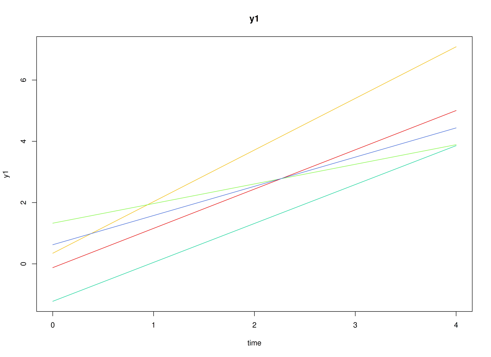
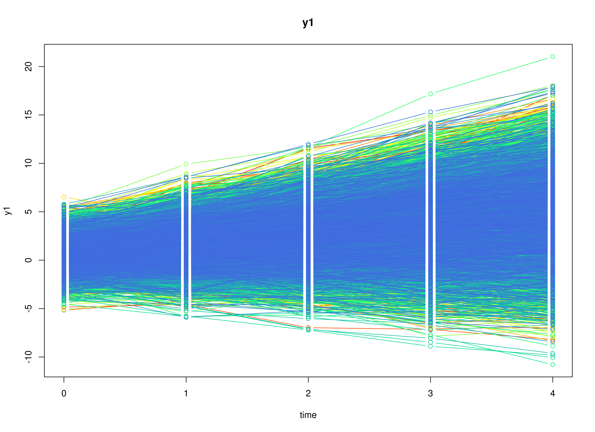
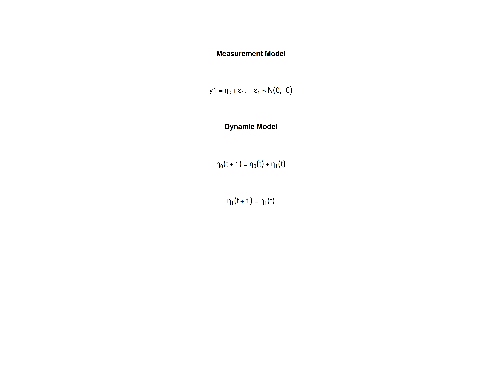

# The Linear Growth Curve Model

## Overview

The linear growth curve model describes individuals who each follow
their own straight-line trajectory over time, for example, reading
scores that start at different levels and grow at different rates. Each
individual has a latent intercept (the level at the first occasion) and
a latent slope (the change per occasion). The model estimates the
average intercept and slope, how much individuals differ in them, and
how much the measurements scatter around each trajectory.

The growth curve model is usually fitted as a structural equation model
(SEM). It can also be written as a state space model: the intercept and
slope are latent states that are set at the first occasion and then
follow a fixed rule.

This tutorial does three things:

1.  It writes the linear growth curve model as a state space model.
2.  It simulates data from the model with
    [`SimSSMLinGrowth()`](https://github.com/jeksterslab/simStateSpace/reference/SimSSMLinGrowth.md).
3.  It fits the model to the simulated data with `dynr` (state space)
    and with `lavaan` (SEM), and compares both sets of estimates with
    the values used to simulate the data.

No prior knowledge of state space models is needed.

## Model

The measurement model is given by \\\[\begin{equation} Y\_{i, t} =
\left( \begin{array}{cc} 1 & 0 \\\\ \end{array} \right) \left(
\begin{array}{c} \eta\_{0\_{i, t}} \\\\ \eta\_{1\_{i, t}} \\\\
\end{array} \right) + \boldsymbol{\varepsilon}\_{i, t}, \quad
\mathrm{with} \quad \boldsymbol{\varepsilon}\_{i, t} \sim \mathcal{N}
\left( 0, \theta \right) \end{equation}\\\] where \\(Y\_{i, t}\\),
\\(\eta\_{0\_{i, t}}\\), \\(\eta\_{1\_{i, t}}\\), and
\\(\boldsymbol{\varepsilon}\_{i, t}\\) are random variables and
\\(\theta\\) is a model parameter. \\(Y\_{i, t}\\) is the observed
random variable at time \\(t\\) and individual \\(i\\), \\(\eta\_{0\_{i,
t}}\\) (intercept) and \\(\eta\_{1\_{i, t}}\\) (slope) form a vector of
latent random variables at time \\(t\\) and individual \\(i\\), and
\\(\boldsymbol{\varepsilon}\_{i, t}\\) a vector of random measurement
errors at time \\(t\\) and individual \\(i\\). \\(\theta\\) is the
variance of \\(\boldsymbol{\varepsilon}\\).

In words, the observed score is the current level of the trajectory,
\\(\eta\_{0\_{i, t}}\\), plus measurement error. The loading of the
slope is 0, because the slope affects the score only through its effect
on the level over time.

The dynamic structure is given by \\\[\begin{equation} \left(
\begin{array}{c} \eta\_{0\_{i, t}} \\\\ \eta\_{1\_{i, t}} \\\\
\end{array} \right) = \left( \begin{array}{cc} 1 & 1 \\\\ 0 & 1 \\\\
\end{array} \right) \left( \begin{array}{c} \eta\_{0\_{i, t - 1}} \\\\
\eta\_{1\_{i, t - 1}} \\\\ \end{array} \right) . \end{equation}\\\]

In words, the level at each occasion is the previous level plus the
slope, \\(\eta\_{0\_{i, t}} = \eta\_{0\_{i, t - 1}} + \eta\_{1\_{i, t -
1}}\\), and the slope stays the same, \\(\eta\_{1\_{i, t}} =
\eta\_{1\_{i, t - 1}}\\). There is no process noise, so once an
individual’s intercept and slope are set, the trajectory is a straight
line. All the variation in the trajectories between individuals comes
from the initial condition below.

The mean vector and covariance matrix of the intercept and slope are
captured in the mean vector and covariance matrix of the initial
condition given by \\\[\begin{equation}
\boldsymbol{\mu}\_{\boldsymbol{\eta} \mid 0} = \left( \begin{array}{c}
\mu\_{\eta\_{0}} \\\\ \mu\_{\eta\_{1}} \\\\ \end{array} \right) \quad
\mathrm{and,} \end{equation}\\\]

\\\[\begin{equation} \boldsymbol{\Sigma}\_{\boldsymbol{\eta} \mid 0} =
\left( \begin{array}{cc} \sigma^{2}\_{\eta\_{0}} & \sigma\_{\eta\_{0},
\eta\_{1}} \\\\ \sigma\_{\eta\_{1}, \eta\_{0}} & \sigma^{2}\_{\eta\_{1}}
\\\\ \end{array} \right) . \end{equation}\\\]

Here, \\(\mu\_{\eta\_{0}}\\) and \\(\mu\_{\eta\_{1}}\\) are the average
intercept and slope, \\(\sigma^{2}\_{\eta\_{0}}\\) and
\\(\sigma^{2}\_{\eta\_{1}}\\) are how much individuals differ in them,
and \\(\sigma\_{\eta\_{0}, \eta\_{1}}\\) is their covariance, for
example, positive if individuals who start higher also grow faster.

### Diagrams


Path diagram of the linear growth curve model.

The model as a path diagram. The intercept \\(\eta\_{0}\\) loads on
every occasion with a loading of 1, and the slope \\(\eta\_{1}\\) with
loadings \\(0, 1, 2, \ldots, T - 1\\), so the slope is the change per
occasion. \\(\varepsilon\_{t}\\) is the measurement error, with variance
\\(\theta\\), and \\(\sigma\_{\eta\_{0}, \eta\_{1}}\\) is the covariance
of the intercept and the slope.


State space form of the linear growth curve model.

The same model in state space form. The state holds the current level
\\(\eta\_{0}\\) and the slope \\(\eta\_{1}\\). \\(\boldsymbol{\beta}\\)
adds the slope to the level at each occasion and keeps the slope,
\\(\boldsymbol{\Lambda}\\) picks the level, and \\(\theta\\) is the
measurement error variance. There is no process noise: the loadings of
the path diagram are produced by the transition, and the differences
between individuals come from the initial condition.
[`SimSSMLinGrowth()`](https://github.com/jeksterslab/simStateSpace/reference/SimSSMLinGrowth.md)
fixes \\(\boldsymbol{\beta}\\) and \\(\boldsymbol{\Lambda}\\) and takes
`mu0` and the Cholesky factors of the initial covariance matrix and of
\\(\theta\\) (`sigma0_l` and `theta_l`).

## Data Generation

### Notation

Let \\(t = 5\\) be the number of time points and \\(n = 10000\\) be the
number of individuals.

Let the measurement error variance \\(\theta\\) be given by

\\\[\begin{equation} \theta = 0.6 . \end{equation}\\\]

Let the initial condition \\(\boldsymbol{\eta}\_{0}\\) be given by

\\\[\begin{equation} \boldsymbol{\eta}\_{0} \sim \mathcal{N} \left(
\boldsymbol{\mu}\_{\boldsymbol{\eta} \mid 0},
\boldsymbol{\Sigma}\_{\boldsymbol{\eta} \mid 0} \right)
\end{equation}\\\]

\\\[\begin{equation} \boldsymbol{\mu}\_{\boldsymbol{\eta} \mid 0} =
\left( \begin{array}{c} 0.615 \\\\ 1.006 \\\\ \end{array} \right)
\end{equation}\\\]

\\\[\begin{equation} \boldsymbol{\Sigma}\_{\boldsymbol{\eta} \mid 0} =
\left( \begin{array}{cc} 1.932 & 0.618 \\\\ 0.618 & 0.587 \\\\
\end{array} \right) . \end{equation}\\\]

### R Function Arguments

The simulation functions take covariance matrices as lower triangular
Cholesky factors (the arguments ending in `_l`).

\
`n`\
`#> [1] 10000`\
`time`\
`#> [1] 5`\
`mu0`\
`#> [1] 0.615 1.006`\
`sigma0`\
`#>       [,1]  [,2]`\
`#> [1,] 1.932 0.618`\
`#> [2,] 0.618 0.587`\
`sigma0_l`` ``# sigma0_l <- t(chol(sigma0))`\
`#>           [,1]      [,2]`\
`#> [1,] 1.3899640 0.0000000`\
`#> [2,] 0.4446158 0.6239525`\
`theta`\
`#> [1] 0.6`\
`theta_l`` ``# theta_l <- t(chol(theta))`\
`#> [1] 0.7745967`

### Visualizing the Dynamics Without Measurement Error (n = 5 with Different Initial Condition)

Without measurement error, each of the five simulated individuals
follows an exact straight line, with its own intercept and slope.



### Using the `SimSSMLinGrowth` Function from the `simStateSpace` Package to Simulate Data

Now we add the measurement error and simulate the full data set.
[`as.data.frame()`](https://rdrr.io/r/base/as.data.frame.html) returns
the data in long format, one row per individual and time point, with the
columns `id`, `time`, and `y1`.

\
[`library`](https://rdrr.io/r/base/library.html)`(`[`simStateSpace`](https://github.com/jeksterslab/simStateSpace)`)`\
`sim`` ``<-`` `[`SimSSMLinGrowth`](https://github.com/jeksterslab/simStateSpace/reference/SimSSMLinGrowth.md)`(`\
`  n ``=`` ``n``,`\
`  time ``=`` ``time``,`\
`  mu0 ``=`` ``mu0``,`\
`  sigma0_l ``=`` ``sigma0_l``,`\
`  theta_l ``=`` ``theta_l``,`\
`  type ``=`` ``0`\
`)`\
`data`` ``<-`` `[`as.data.frame`](https://rdrr.io/r/base/as.data.frame.html)`(``sim``)`\
[`head`](https://rdrr.io/r/utils/head.html)`(``data``)`\
`#>   id time       y1`\
`#> 1  1    0 1.723564`\
`#> 2  1    1 2.148702`\
`#> 3  1    2 3.384974`\
`#> 4  1    3 6.225426`\
`#> 5  1    4 5.993965`\
`#> 6  2    0 1.951861`\
[`summary`](https://rdrr.io/r/base/summary.html)`(``data``)`\
`#>        id             time         y1          `\
`#>  Min.   :    1   Min.   :0   Min.   :-10.7863  `\
`#>  1st Qu.: 2501   1st Qu.:1   1st Qu.:  0.3943  `\
`#>  Median : 5000   Median :2   Median :  2.1839  `\
`#>  Mean   : 5000   Mean   :2   Mean   :  2.5978  `\
`#>  3rd Qu.: 7500   3rd Qu.:3   3rd Qu.:  4.4536  `\
`#>  Max.   :10000   Max.   :4   Max.   : 21.0250`\
[`plot`](https://rdrr.io/r/graphics/plot.default.html)`(``sim``)`



## Model Fitting

We first fit the model with `dynr`, which estimates state space models
by maximum likelihood using the Kalman filter.

A `dynr` model is built from pieces that match the equations above: the
data, the initial condition, the measurement model, the dynamic model,
and the noise. Each parameter gets a name (for example, `sigma0_01` for
\\(\sigma\_{\eta\_{0}, \eta\_{1}}\\)\`), and the same name used in two
places means one shared parameter. The starting values are set to the
population values for convenience; with real data, they would be rough
guesses. The intercept and slope are indexed 0 and 1 in the parameter
names.

### Prepare Data

Tell `dynr` which columns hold the individual, the time, and the
observed variables.

\
`dynr_data`` ``<-`` ``dynr``::`[`dynr.data`](https://rdrr.io/pkg/dynr/man/dynr.data.html)`(`\
`  dataframe ``=`` ``data``,`\
`  id ``=`` ``"id"``,`\
`  time ``=`` ``"time"``,`\
`  observed ``=`` ``"y1"`\
`)`

### Prepare Initial Condition

The mean and covariance of the initial state are the means, variances,
and covariance of the intercept and slope, so these are the main
parameters of the growth model. The covariance matrix is symmetric, so
`sigma0_01` appears both above and below the diagonal.

\
`dynr_initial`` ``<-`` ``dynr``::`[`prep.initial`](https://rdrr.io/pkg/dynr/man/prep.initial.html)`(`\
`  values.inistate ``=`` ``mu0``,`\
`  params.inistate ``=`` `[`c`](https://rdrr.io/r/base/c.html)`(``"mu0_0"``, ``"mu0_1"``)``,`\
`  values.inicov ``=`` ``sigma0``,`\
`  params.inicov ``=`` `[`matrix`](https://rdrr.io/r/base/matrix.html)`(`\
`    data ``=`` `[`c`](https://rdrr.io/r/base/c.html)`(`\
`      ``"sigma0_00"``, ``"sigma0_01"``,`\
`      ``"sigma0_01"``, ``"sigma0_11"`\
`    ``)``,`\
`    nrow ``=`` ``2`\
`  ``)`\
`)`

### Prepare Measurement Model

The loadings \\(\left( 1, 0 \right)\\) are fixed.

\
`dynr_measurement`` ``<-`` ``dynr``::`[`prep.measurement`](https://rdrr.io/pkg/dynr/man/prep.measurement.html)`(`\
`  values.load ``=`` `[`matrix`](https://rdrr.io/r/base/matrix.html)`(``data ``=`` `[`c`](https://rdrr.io/r/base/c.html)`(``1``, ``0``)``, nrow ``=`` ``1``)``,`\
`  params.load ``=`` `[`matrix`](https://rdrr.io/r/base/matrix.html)`(``data ``=`` ``"fixed"``, nrow ``=`` ``1``, ncol ``=`` ``2``)``,`\
`  state.names ``=`` `[`c`](https://rdrr.io/r/base/c.html)`(``"eta_0"``, ``"eta_1"``)``,`\
`  obs.names ``=`` ``"y1"`\
`)`

### Prepare Dynamic Process

The two formulas are the two rows of the dynamic equation. They have no
free parameters.

\
`dynr_dynamics`` ``<-`` ``dynr``::`[`prep.formulaDynamics`](https://rdrr.io/pkg/dynr/man/prep.formulaDynamics.html)`(`\
`  formula ``=`` `[`list`](https://rdrr.io/r/base/list.html)`(`\
`    ``eta_0`` ``~`` ``eta_0`` ``+`` ``eta_1``,`\
`    ``eta_1`` ``~`` ``eta_1`\
`  ``)``,`\
`  isContinuousTime ``=`` ``FALSE`\
`)`\
`#> Warning in dynr::prep.formulaDynamics(formula = list(eta_0 ~ eta_0 + eta_1, :`\
`#> You provided no start values: length(startval)==0. If you have no free`\
`#> parameters, keep calm and carry on.`

### Prepare Process Noise

The process noise is fixed at zero, and the measurement error variance
\\(\theta\\) is estimated.

\
`dynr_noise`` ``<-`` ``dynr``::`[`prep.noise`](https://rdrr.io/pkg/dynr/man/prep.noise.html)`(`\
`  values.latent ``=`` `[`matrix`](https://rdrr.io/r/base/matrix.html)`(``data ``=`` ``0``, nrow ``=`` ``2``, ncol ``=`` ``2``)``,`\
`  params.latent ``=`` `[`matrix`](https://rdrr.io/r/base/matrix.html)`(``data ``=`` ``"fixed"``, nrow ``=`` ``2``, ncol ``=`` ``2``)``,`\
`  values.observed ``=`` ``theta``,`\
`  params.observed ``=`` ``"theta"`\
`)`

### Prepare the Model

The pieces are put together into one model. `dynr` writes the model as C
code to `outfile` and compiles it.

\
`model`` ``<-`` ``dynr``::`[`dynr.model`](https://rdrr.io/pkg/dynr/man/dynr.model.html)`(`\
`  data ``=`` ``dynr_data``,`\
`  initial ``=`` ``dynr_initial``,`\
`  measurement ``=`` ``dynr_measurement``,`\
`  dynamics ``=`` ``dynr_dynamics``,`\
`  noise ``=`` ``dynr_noise``,`\
`  outfile ``=`` ``"lin-growth.c"`\
`)`

The plot below shows the model equations with the parameter names.



### Fit the Model

\
`results`` ``<-`` ``dynr``::`[`dynr.cook`](https://rdrr.io/pkg/dynr/man/dynr.cook.html)`(`\
`  ``model``,`\
`  debug_flag ``=`` ``TRUE``,`\
`  verbose ``=`` ``FALSE`\
`)`\
`#> [1] "Get ready!!!!"`\
`#> using C compiler: ‘gcc (Ubuntu 15.2.0-16ubuntu1) 15.2.0’`\
`#> Optimization function called.`\
`#> Starting Hessian calculation ...`\
`#> Finished Hessian calculation.`\
`#> Original exit flag:  3 `\
`#> Modified exit flag:  3 `\
`#> Optimization terminated successfully: ftol_rel or ftol_abs was reached. `\
`#> Original fitted parameters:  -0.5089635 0.60732 0.9952181 0.6477021 0.3152438 `\
`#> -0.9463643 `\
`#> `\
`#> Transformed fitted parameters:  0.6011183 0.60732 0.9952181 1.911144 0.6024764 `\
`#> 0.5780766 `\
`#> `\
`#> Doing end processing`\
`#> Successful trial`\
`#> Total Time: 23.52865 `\
`#> Backend Time: 23.1697`

## Summary

The summary lists each estimate with its standard error, \\(t\\) value,
confidence interval, and \\(p\\) value.

\
[`summary`](https://rdrr.io/r/base/summary.html)`(``results``)`\
`#> Coefficients:`\
`#>           Estimate Std. Error t value ci.lower ci.upper            Pr(>|t|)    `\
`#> theta     0.601118   0.004909  122.46 0.591498 0.610739 <0.0000000000000002 ***`\
`#> mu0_0     0.607320   0.015086   40.26 0.577753 0.636887 <0.0000000000000002 ***`\
`#> mu0_1     0.995218   0.007990  124.56 0.979558 1.010878 <0.0000000000000002 ***`\
`#> sigma0_00 1.911144   0.032311   59.15 1.847815 1.974473 <0.0000000000000002 ***`\
`#> sigma0_01 0.602476   0.013013   46.30 0.576971 0.627982 <0.0000000000000002 ***`\
`#> sigma0_11 0.578077   0.009043   63.92 0.560353 0.595801 <0.0000000000000002 ***`\
`#> ---`\
`#> Signif. codes:  0 '***' 0.001 '**' 0.01 '*' 0.05 '.' 0.1 ' ' 1`\
`#> `\
`#> -2 log-likelihood value at convergence = 167712.56`\
`#> AIC = 167724.56`\
`#> BIC = 167777.48`

### Estimated Parameters

The estimates arranged as the matrices in the model, to compare with the
population values in the Data Generation section.

\
`mu0_hat`\
`#> [1] 0.6073200 0.9952181`\
`sigma0_hat`\
`#>           [,1]      [,2]`\
`#> [1,] 1.9111442 0.6024764`\
`#> [2,] 0.6024764 0.5780766`\
`theta_hat`\
`#>     theta `\
`#> 0.6011183`

## Linear Growth Curve Model in Structural Equation Modeling

The same model in SEM form, fitted with `lavaan`, should give nearly the
same estimates. In SEM, the five occasions are five observed variables
in one row per individual (wide format). The intercept factor has
loadings of 1 on all occasions, and the slope factor has loadings 0, 1,
2, 3, and 4.

### Wide Data Set

[`as.data.frame()`](https://rdrr.io/r/base/as.data.frame.html) with
`long = FALSE` returns the data in wide format.

\
`data`` ``<-`` `[`as.data.frame`](https://rdrr.io/r/base/as.data.frame.html)`(``sim``, long ``=`` ``FALSE``)`\
[`head`](https://rdrr.io/r/utils/head.html)`(``data``)`\
`#>   id        y1_0       y1_1        y1_2        y1_3       y1_4`\
`#> 1  1  1.72356430  2.1487019  3.38497364  6.22542609  5.9939649`\
`#> 2  2  1.95186051  2.6140623  5.60107919  5.59791920  7.6881040`\
`#> 3  3  0.07909854 -1.1410633 -0.02940765  0.07103948 -0.4998955`\
`#> 4  4 -0.14827866 -0.6478676 -0.33440620 -0.29683127 -0.6950588`\
`#> 5  5  1.14625267  2.3844799  0.39101270 -0.76159166  1.6750324`\
`#> 6  6  1.02604168  2.1852479  2.55168739  2.13223414  4.1499727`

### Model

The parameter labels match the dynr names. Giving the five error
variances the same label, `theta`, constrains them to be equal, as in
the state space model.

\
`model`` ``<-`` ``"`\
`  # factor loadings`\
`  eta0 =~ 1 * y1_0 + 1 * y1_1 + 1 * y1_2 + 1 * y1_3 + 1 * y1_4`\
`  eta1 =~ 0 * y1_0 + 1 * y1_1 + 2 * y1_2 + 3 * y1_3 + 4 * y1_4`\
`  # means of latent variables`\
`  eta0 ~ mu0_0 * 1`\
`  eta1 ~ mu0_1 * 1`\
`  # variances and covariances of latent variables`\
`  eta0 ~~ sigma0_00 * eta0`\
`  eta0 ~~ sigma0_01 * eta1`\
`  eta1 ~~ sigma0_11 * eta1`\
`  # constrain error variance theta to be equal`\
`  y1_0 ~~ theta * y1_0`\
`  y1_1 ~~ theta * y1_1`\
`  y1_2 ~~ theta * y1_2`\
`  y1_3 ~~ theta * y1_3`\
`  y1_4 ~~ theta * y1_4`\
`"`

\
`fit`` ``<-`` ``lavaan``::`[`growth`](https://rdrr.io/pkg/lavaan/man/growth.html)`(`\
`  model ``=`` ``model``,`\
`  data ``=`` ``data`\
`)`\
`lavaan``::``summary``(``fit``)`\
`#> lavaan 0.7-3 ended normally after 34 iterations`\
`#> `\
`#>   Estimator                                         ML`\
`#>   Optimization method                           NLMINB`\
`#>   Number of model parameters                        10`\
`#>   Number of equality constraints                     4`\
`#> `\
`#>   Number of observations                         10000`\
`#> `\
`#> Model Test User Model:`\
`#>                                                       `\
`#>   Test statistic                                 5.386`\
`#>   Degrees of freedom                                14`\
`#>   P-value (Chi-square)                           0.980`\
`#>                                                       `\
`#>   Browne's residual (NT model-based) test             `\
`#>   Test statistic                                 5.365`\
`#>   Degrees of freedom                                14`\
`#>   P-value (Chi-square)                           0.980`\
`#> `\
`#> Parameter Estimates:`\
`#> `\
`#>   Standard errors                             Standard`\
`#>   Information                                 Expected`\
`#>   Information saturated (h1) model          Structured`\
`#> `\
`#> Latent Variables:`\
`#>                    Estimate  Std.Err  z-value  P(>|z|)`\
`#>   eta0 =~                                             `\
`#>     y1_0              1.000                           `\
`#>     y1_1              1.000                           `\
`#>     y1_2              1.000                           `\
`#>     y1_3              1.000                           `\
`#>     y1_4              1.000                           `\
`#>   eta1 =~                                             `\
`#>     y1_0              0.000                           `\
`#>     y1_1              1.000                           `\
`#>     y1_2              2.000                           `\
`#>     y1_3              3.000                           `\
`#>     y1_4              4.000                           `\
`#> `\
`#> Covariances:`\
`#>                    Estimate  Std.Err  z-value  P(>|z|)`\
`#>   eta0 ~~                                             `\
`#>     eta1    (s0_0)    0.602    0.013   46.317    0.000`\
`#> `\
`#> Intercepts:`\
`#>                    Estimate  Std.Err  z-value  P(>|z|)`\
`#>     eta0    (m0_0)    0.607    0.015   40.295    0.000`\
`#>     eta1    (m0_1)    0.995    0.008  124.582    0.000`\
`#> `\
`#> Variances:`\
`#>                    Estimate  Std.Err  z-value  P(>|z|)`\
`#>     eta0    (s0_0)    1.911    0.032   59.235    0.000`\
`#>     eta1    (s0_1)    0.578    0.009   63.955    0.000`\
`#>    .y1_0    (thet)    0.601    0.005  122.474    0.000`\
`#>    .y1_1    (thet)    0.601    0.005  122.474    0.000`\
`#>    .y1_2    (thet)    0.601    0.005  122.474    0.000`\
`#>    .y1_3    (thet)    0.601    0.005  122.474    0.000`\
`#>    .y1_4    (thet)    0.601    0.005  122.474    0.000`

### Estimated Parameters

The estimates arranged as the matrices in the model, to compare with the
population values in the Data Generation section.

\
`mu0_hat`\
`#> [1] 0.6073246 0.9952393`\
`sigma0_hat`\
`#>           [,1]      [,2]`\
`#> [1,] 1.9109932 0.6024671`\
`#> [2,] 0.6024671 0.5780689`\
`theta_hat`\
`#> [1] 0.6011549`

## Table of Parameters and Estimates

The table below puts each population value used to simulate the data
next to its estimate. Bias is the estimate minus the population value.
Because the model is fitted to a single simulated data set, this is the
error of one estimate, not a Monte Carlo bias, which would average over
many replications. The 95% confidence interval is the Wald interval,
\\(\hat{\theta} \pm 1.96 \times \mathrm{SE}\\), and `Covers` shows
whether it contains the population value.

\
`EstimatesTable`` ``<-`` ``function``(``population``, ``estimate``, ``se``)`` ``{`\
`  ``z`` ``<-`` ``stats``::`[`qnorm`](https://rdrr.io/r/stats/Normal.html)`(``p ``=`` ``0.975``)`\
`  ``ll`` ``<-`` ``estimate`` ``-`` ``z`` ``*`` ``se`\
`  ``ul`` ``<-`` ``estimate`` ``+`` ``z`` ``*`` ``se`\
`  `[`data.frame`](https://rdrr.io/r/base/data.frame.html)`(`\
`    Parameter ``=`` `[`names`](https://rdrr.io/r/base/names.html)`(``population``)``,`\
`    Population ``=`` `[`unname`](https://rdrr.io/r/base/unname.html)`(``population``)``,`\
`    Estimate ``=`` `[`unname`](https://rdrr.io/r/base/unname.html)`(``estimate``)``,`\
`    SE ``=`` `[`unname`](https://rdrr.io/r/base/unname.html)`(``se``)``,`\
`    Bias ``=`` `[`unname`](https://rdrr.io/r/base/unname.html)`(``estimate`` ``-`` ``population``)``,`\
``     `2.5%`  ```=`` `[`unname`](https://rdrr.io/r/base/unname.html)`(``ll``)``,`\
``     `97.5%`  ```=`` `[`unname`](https://rdrr.io/r/base/unname.html)`(``ul``)``,`\
`    Covers ``=`` `[`unname`](https://rdrr.io/r/base/unname.html)`(``population`` ``>=`` ``ll`` ``&`` ``population`` ``<=`` ``ul``)``,`\
`    check.names ``=`` ``FALSE`\
`  ``)`\
`}`

\
`population`` ``<-`` `[`c`](https://rdrr.io/r/base/c.html)`(`\
`  mu0_0 ``=`` ``mu0``[``1``]``,`\
`  mu0_1 ``=`` ``mu0``[``2``]``,`\
`  sigma0_00 ``=`` ``sigma0``[``1``, ``1``]``,`\
`  sigma0_01 ``=`` ``sigma0``[``1``, ``2``]``,`\
`  sigma0_11 ``=`` ``sigma0``[``2``, ``2``]``,`\
`  theta ``=`` ``theta`\
`)`

### dynr

\
`estimates`` ``<-`` `[`coef`](https://rdrr.io/r/stats/coef.html)`(``results``)``[`[`names`](https://rdrr.io/r/base/names.html)`(``population``)``]`\
`se`` ``<-`` `[`sqrt`](https://rdrr.io/r/base/MathFun.html)`(`[`diag`](https://rdrr.io/r/base/diag.html)`(`[`vcov`](https://rdrr.io/r/stats/vcov.html)`(``results``)``)``)`\
[`names`](https://rdrr.io/r/base/names.html)`(``se``)`` ``<-`` `[`names`](https://rdrr.io/r/base/names.html)`(`[`coef`](https://rdrr.io/r/stats/coef.html)`(``results``)``)`\
`knitr``::`[`kable`](https://rdrr.io/pkg/knitr/man/kable.html)`(`\
`  x ``=`` ``EstimatesTable``(`\
`    population ``=`` ``population``,`\
`    estimate ``=`` ``estimates``,`\
`    se ``=`` ``se``[`[`names`](https://rdrr.io/r/base/names.html)`(``population``)``]`\
`  ``)``,`\
`  digits ``=`` ``3``,`\
`  caption ``=`` ``"Population values and dynr estimates (one simulated data set)"`\
`)`

| Parameter | Population | Estimate |    SE |   Bias |  2.5% | 97.5% | Covers |
|:----------|-----------:|---------:|------:|-------:|------:|------:|:-------|
| mu0_0     |      0.615 |    0.607 | 0.015 | -0.008 | 0.578 | 0.637 | TRUE   |
| mu0_1     |      1.006 |    0.995 | 0.008 | -0.011 | 0.980 | 1.011 | TRUE   |
| sigma0_00 |      1.932 |    1.911 | 0.032 | -0.021 | 1.848 | 1.974 | TRUE   |
| sigma0_01 |      0.618 |    0.602 | 0.013 | -0.016 | 0.577 | 0.628 | TRUE   |
| sigma0_11 |      0.587 |    0.578 | 0.009 | -0.009 | 0.560 | 0.596 | TRUE   |
| theta     |      0.600 |    0.601 | 0.005 |  0.001 | 0.591 | 0.611 | TRUE   |

Population values and dynr estimates (one simulated data set) {.table}

### lavaan

\
`pe`` ``<-`` ``lavaan``::`[`parameterEstimates`](https://rdrr.io/pkg/lavaan/man/parameterEstimates.html)`(``fit``)`\
`# theta is one parameter shared by the five error variances`\
`pe`` ``<-`` ``pe``[``pe``$``label`` ``!=`` ``""`` ``&`` ``!`[`duplicated`](https://rdrr.io/r/base/duplicated.html)`(``pe``$``label``)``, ``]`\
[`rownames`](https://rdrr.io/r/base/colnames.html)`(``pe``)`` ``<-`` ``pe``$``label`\
`knitr``::`[`kable`](https://rdrr.io/pkg/knitr/man/kable.html)`(`\
`  x ``=`` ``EstimatesTable``(`\
`    population ``=`` ``population``,`\
`    estimate ``=`` ``pe``[`[`names`](https://rdrr.io/r/base/names.html)`(``population``)``, ``"est"``]``,`\
`    se ``=`` ``pe``[`[`names`](https://rdrr.io/r/base/names.html)`(``population``)``, ``"se"``]`\
`  ``)``,`\
`  digits ``=`` ``3``,`\
`  caption ``=`` ``"Population values and lavaan estimates (one simulated data set)"`\
`)`

| Parameter | Population | Estimate |    SE |   Bias |  2.5% | 97.5% | Covers |
|:----------|-----------:|---------:|------:|-------:|------:|------:|:-------|
| mu0_0     |      0.615 |    0.607 | 0.015 | -0.008 | 0.578 | 0.637 | TRUE   |
| mu0_1     |      1.006 |    0.995 | 0.008 | -0.011 | 0.980 | 1.011 | TRUE   |
| sigma0_00 |      1.932 |    1.911 | 0.032 | -0.021 | 1.848 | 1.974 | TRUE   |
| sigma0_01 |      0.618 |    0.602 | 0.013 | -0.016 | 0.577 | 0.628 | TRUE   |
| sigma0_11 |      0.587 |    0.578 | 0.009 | -0.009 | 0.560 | 0.596 | TRUE   |
| theta     |      0.600 |    0.601 | 0.005 |  0.001 | 0.592 | 0.611 | TRUE   |

Population values and lavaan estimates (one simulated data set) {.table}

## References

Chow, S.-M., Ho, M. R., Hamaker, E. L., & Dolan, C. V. (2010).
Equivalence and differences between structural equation modeling and
state-space modeling techniques. *Structural Equation Modeling: A
Multidisciplinary Journal*, *17*(2), 303–332.
<https://doi.org/10.1080/10705511003661553>

Ou, L., Hunter, M. D., & Chow, S.-M. (2019). What’s for dynr: A package
for linear and nonlinear dynamic modeling in R. *The R Journal*,
*11*(1), 91. <https://doi.org/10.32614/rj-2019-012>

R Core Team. (2026). *R: A language and environment for statistical
computing*. R Foundation for Statistical Computing.
<https://www.R-project.org/>

Rosseel, Y. (2012). lavaan: An R package for structural equation
modeling. *Journal of Statistical Software*, *48*(2).
<https://doi.org/10.18637/jss.v048.i02>
