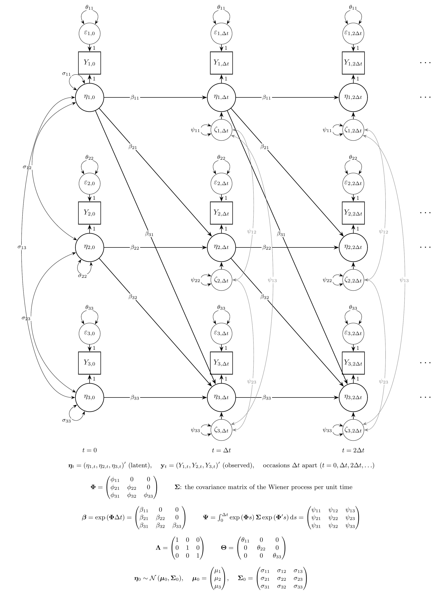
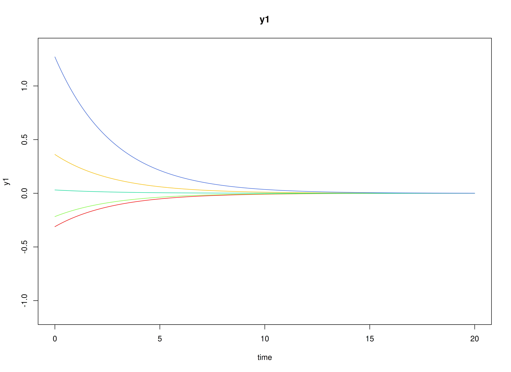
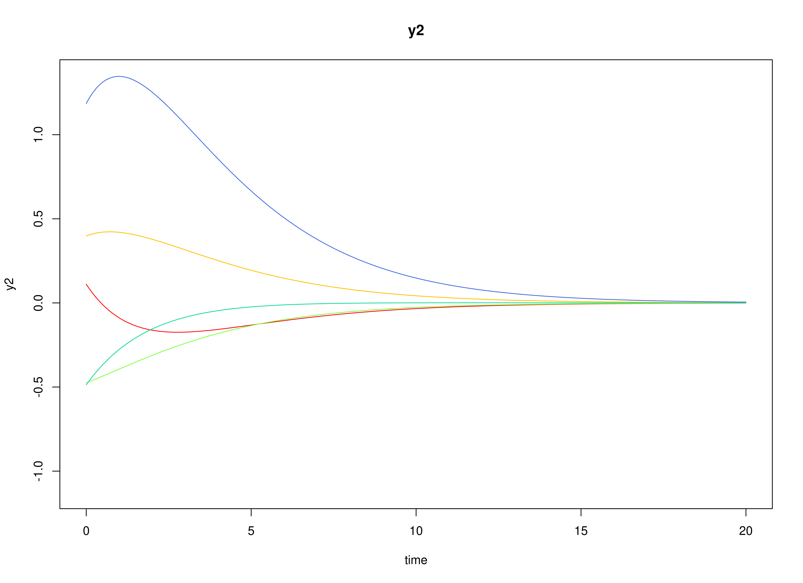
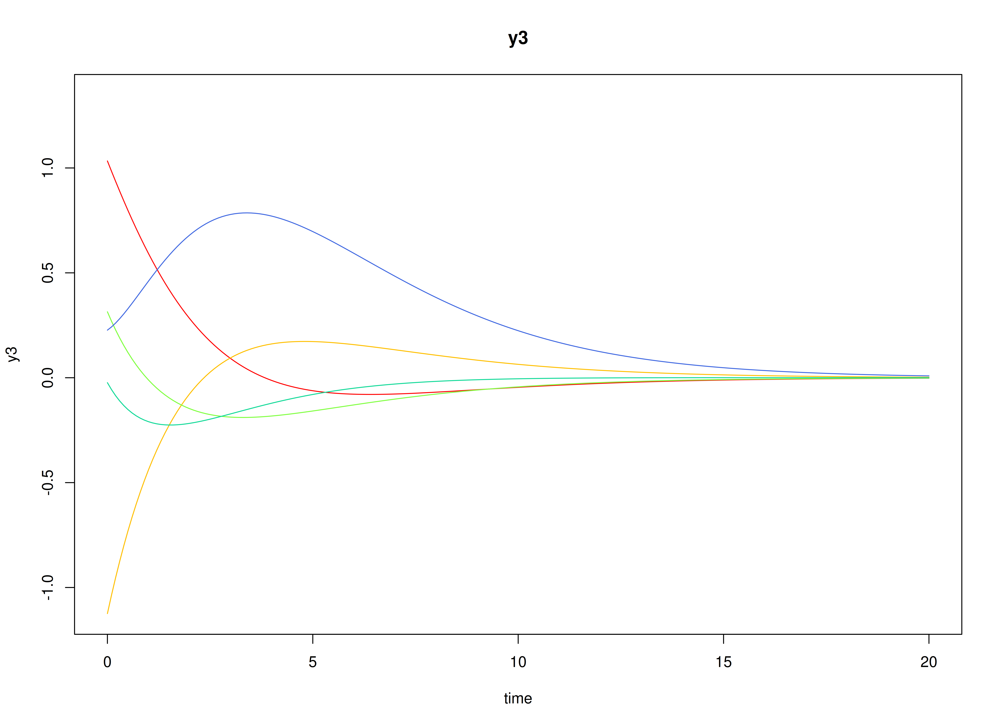
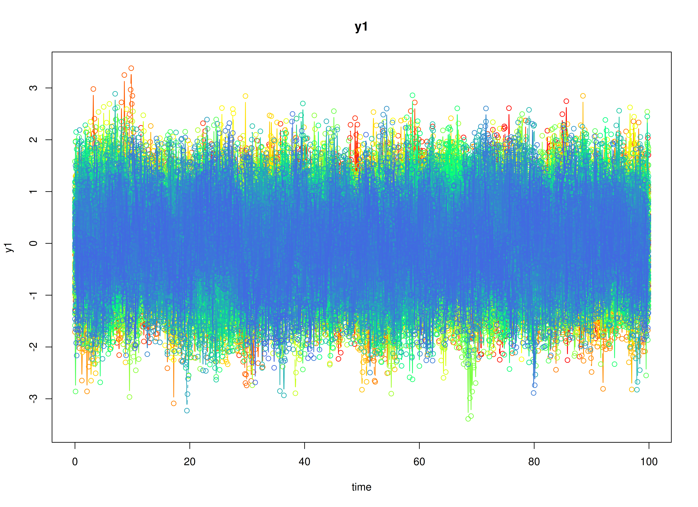
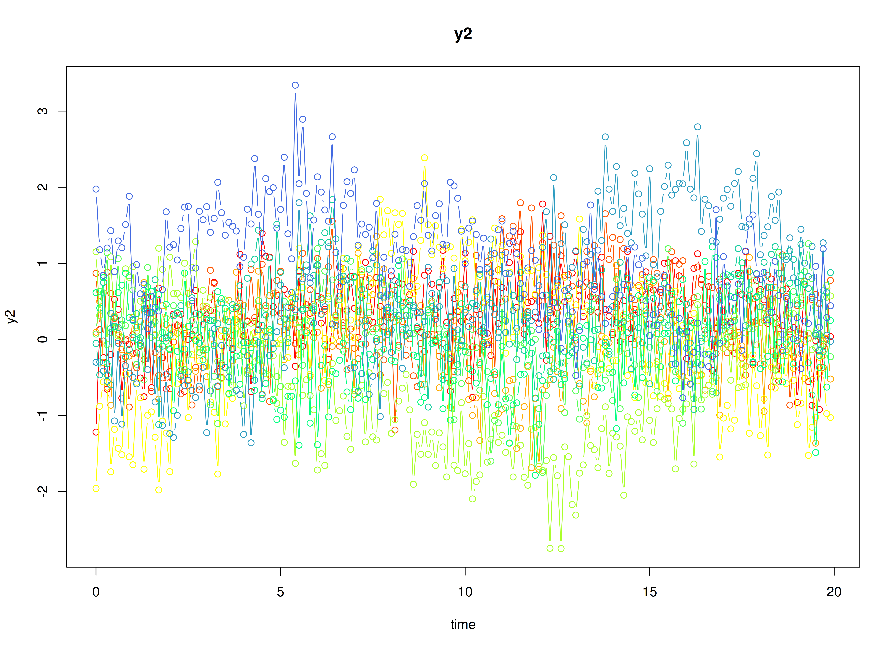
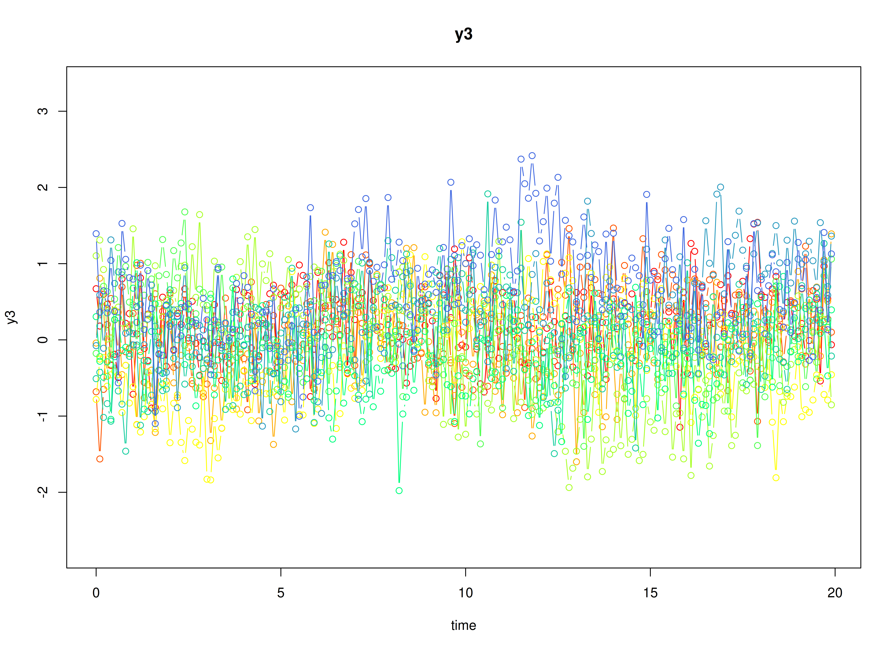
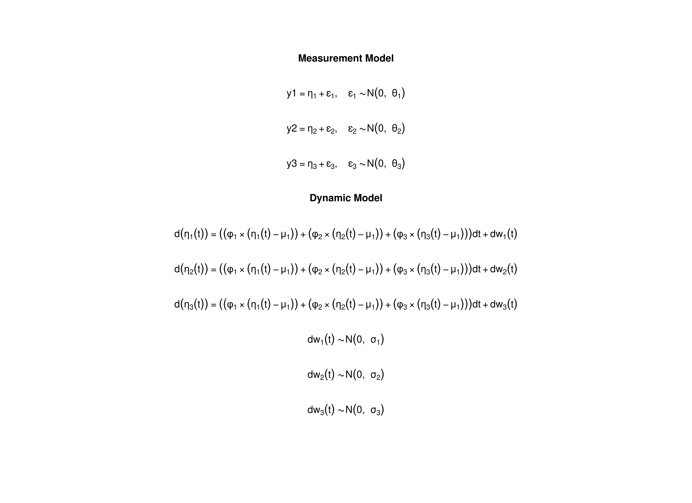

# The Ornstein-Uhlenbeck Model

## Overview

The Ornstein-Uhlenbeck (OU) model is a continuous-time model for
variables that are pulled back toward an equilibrium level after they
are pushed away from it, for example, mood returning to a person’s usual
level after a stressful event. Continuous time means the model describes
change at every moment, not only at the occasions we measure, so the
same parameters apply whether measurements are one hour or one day
apart, and the spacing can differ between occasions.

The model is a state space model with two parts: a measurement model
that links the observed variables to the latent (unobserved) states, and
a dynamic model, here a stochastic differential equation, that describes
how the latent states change over time.

This tutorial does three things:

1.  It writes the multivariate OU model as a state space model.
2.  It simulates data from the model with
    [`SimSSMOUFixed()`](https://github.com/jeksterslab/simStateSpace/reference/SimSSMOUFixed.md),
    with every individual sharing the same parameters.
3.  It fits the model to the simulated data with the `dynr` and `OpenMx`
    packages and compares both sets of estimates with the values used to
    simulate the data.

No prior knowledge of state space models is needed. The vignettes on the
vector autoregressive model and the state space model cover the
discrete-time versions.

## Model

The measurement model is given by \mathbf{y}\_{i, t} =
\boldsymbol{\nu} + \boldsymbol{\Lambda} \boldsymbol{\eta}\_{i, t} +
\boldsymbol{\varepsilon}\_{i, t}, \quad \mathrm{with} \quad
\boldsymbol{\varepsilon}\_{i, t} \sim \mathcal{N} \left( \mathbf{0},
\boldsymbol{\Theta} \right) where \mathbf{y}\_{i, t},
\boldsymbol{\eta}\_{i, t}, and \boldsymbol{\varepsilon}\_{i, t} are
random variables and \boldsymbol{\nu}, \boldsymbol{\Lambda}, and
\boldsymbol{\Theta} are model parameters. \mathbf{y}\_{i, t} represents
a vector of observed random variables, \boldsymbol{\eta}\_{i, t} a
vector of latent random variables, and \boldsymbol{\varepsilon}\_{i, t}
a vector of random measurement errors, at time t and individual i.
\boldsymbol{\nu} denotes a vector of intercepts, \boldsymbol{\Lambda} a
matrix of factor loadings, and \boldsymbol{\Theta} the covariance matrix
of \boldsymbol{\varepsilon}.

In words, each observed variable is an intercept plus a weighted
combination of the latent variables plus measurement error. The latent
variables \boldsymbol{\eta}\_{i, t} are the quantities we care about
(for example, a person’s true stress level), and the observed variables
\mathbf{y}\_{i, t} are noisy measurements of them. Separating
measurement error from true change is the main reason to use a state
space model: measurement error affects only the occasion it occurs on,
while changes in the latent variables carry over in time.

An alternative representation of the measurement error is given by
\boldsymbol{\varepsilon}\_{i, t} = \boldsymbol{\Theta}^{\frac{1}{2}}
\mathbf{z}\_{i, t}, \quad \mathrm{with} \quad \mathbf{z}\_{i, t} \sim
\mathcal{N} \left( \mathbf{0}, \mathbf{I} \right) where \mathbf{z}\_{i,
t} is a vector of independent standard normal random variables and
\left( \boldsymbol{\Theta}^{\frac{1}{2}} \right) \left(
\boldsymbol{\Theta}^{\frac{1}{2}} \right)^{\prime} = \boldsymbol{\Theta}
.

The dynamic structure is given by \mathrm{d} \boldsymbol{\eta}\_{i, t} =
\boldsymbol{\Phi} \left( \boldsymbol{\eta}\_{i, t} - \boldsymbol{\mu}
\right) \mathrm{d}t + \boldsymbol{\Sigma}^{\frac{1}{2}} \mathrm{d}
\mathbf{W}\_{i, t} where \boldsymbol{\mu} is the long-term mean or
equilibrium level, \boldsymbol{\Phi} is the rate of mean reversion,
determining how quickly the variable returns to its mean,
\boldsymbol{\Sigma} is the matrix of volatility or randomness in the
process, and \mathrm{d}\boldsymbol{W} is a Wiener process or Brownian
motion, which represents random fluctuations.

In words, \mathrm{d} \boldsymbol{\eta}\_{i, t} is the change in the
latent variables over a very short time \mathrm{d}t. The change has two
parts: a pull toward the equilibrium \boldsymbol{\mu}, proportional to
the distance \boldsymbol{\eta}\_{i, t} - \boldsymbol{\mu}, and random
fluctuations with covariance \boldsymbol{\Sigma} per unit time.

- With this sign convention, a diagonal element \phi\_{jj} is negative
  for a variable that returns to its equilibrium. The more negative it
  is, the faster the return.
- An off-diagonal element \phi\_{jk} is the effect of the distance of
  variable k from its equilibrium on the rate of change of variable j.
  As in the discrete-time models, the row is the outcome and the column
  is the predictor.

For the process to settle around \boldsymbol{\mu}, all eigenvalues of
\boldsymbol{\Phi} must have negative real parts.

Over a time interval \Delta t, the OU model implies a discrete-time
vector autoregressive model with transition matrix \boldsymbol{\beta} =
\exp \left( \boldsymbol{\Phi} \Delta t \right), the matrix exponential.
[`SimSSMOUFixed()`](https://github.com/jeksterslab/simStateSpace/reference/SimSSMOUFixed.md)
uses this exact discretization to simulate the data, so no approximation
error is introduced.

### Diagram



State space diagram of the OU model.

The model in state space form, at the first three occasions of
measurement, \Delta t apart (t = 0, \Delta t, 2 \Delta t), with every
element of the state drawn. Squares are observed variables and circles
are latent variables. Each latent variable \eta\_{j, t} has one
indicator Y\_{j, t} with a loading of 1, and measurement error
\varepsilon\_{j, t} with variance \theta\_{jj}. The arrows between
occasions are the elements of \boldsymbol{\beta} = \exp \left(
\boldsymbol{\Phi} \Delta t \right). Because \boldsymbol{\Phi} is lower
triangular in this example, so is \boldsymbol{\beta}: \eta\_{1} affects
\eta\_{2} and \eta\_{3}, and \eta\_{2} affects \eta\_{3}. \zeta\_{j, t}
is the process noise from t = \Delta t on. Its covariance matrix
\boldsymbol{\Psi} follows from \boldsymbol{\Phi}, \boldsymbol{\Sigma},
and \Delta t and is full, so the process noise terms covary (the gray
arrows \psi\_{jk}). A loop on a variable is its variance and a curved
two-headed arrow a covariance. At t = 0, the initial condition
\boldsymbol{\eta}\_{0} \sim \mathcal{N} \left( \boldsymbol{\mu}\_{0},
\boldsymbol{\Sigma}\_{0} \right) gives the variances \sigma\_{jj} and
covariances \sigma\_{jk} of the latent variables. The exact
discretization gives \boldsymbol{\beta} and \boldsymbol{\Psi} from
\boldsymbol{\Phi}, \boldsymbol{\Sigma}, and \Delta t;
\boldsymbol{\Lambda} maps the state to the observed variables, and
\boldsymbol{\Theta} is the covariance matrix of the measurement error.
[`SimSSMOUFixed()`](https://github.com/jeksterslab/simStateSpace/reference/SimSSMOUFixed.md)
takes `phi`, `lambda`, `delta_t`, `mu0`, and the Cholesky factors of
\boldsymbol{\Sigma}, \boldsymbol{\Theta}, and \boldsymbol{\Sigma}\_{0}
(`sigma_l`, `theta_l`, and `sigma0_l`), and does the discretization
itself.

## Data Generation

### Notation

Let t = 1000 be the number of time points and n = 100 be the number of
individuals.

Let the measurement model intercept vector \boldsymbol{\nu} be given by

\boldsymbol{\nu} = \left( \begin{array}{c} 0 \\\\ 0 \\\\ 0 \\\\
\end{array} \right) .

Let the factor loadings matrix \boldsymbol{\Lambda} be given by

\boldsymbol{\Lambda} = \left( \begin{array}{ccc} 1 & 0 & 0 \\\\ 0 & 1 &
0 \\\\ 0 & 0 & 1 \\\\ \end{array} \right) .

Let the measurement error covariance matrix \boldsymbol{\Theta} be given
by

\boldsymbol{\Theta} = \left( \begin{array}{ccc} 0.2 & 0 & 0 \\\\ 0 & 0.2
& 0 \\\\ 0 & 0 & 0.2 \\\\ \end{array} \right) .

With \boldsymbol{\nu} = \mathbf{0} and \boldsymbol{\Lambda} =
\mathbf{I}, each observed variable measures one latent variable, and
\boldsymbol{\Theta} adds measurement error with variance 0.2 to each.

Let the initial condition \boldsymbol{\eta}\_{0} be given by

\boldsymbol{\eta}\_{0} \sim \mathcal{N} \left( \boldsymbol{\mu}\_{0},
\boldsymbol{\Sigma}\_{0} \right)

\boldsymbol{\mu}\_{0} = \left( \begin{array}{c} 0 \\\\ 0 \\\\ 0 \\\\
\end{array} \right)

\boldsymbol{\Sigma}\_{0} = \left( \begin{array}{ccc} 0.3425148 &
0.3296023 & 0.0343817 \\\\ 0.3296023 & 0.5664625 & 0.2545955 \\\\
0.0343817 & 0.2545955 & 0.2999909 \\\\ \end{array} \right) .

Let the long-term mean vector \boldsymbol{\mu} be given by

\boldsymbol{\mu} = \left( \begin{array}{c} 0 \\\\ 0 \\\\ 0 \\\\
\end{array} \right) .

Let the rate of mean reversion matrix \boldsymbol{\Phi} be given by

\boldsymbol{\Phi} = \left( \begin{array}{ccc} -0.357 & 0 & 0 \\\\ 0.771
& -0.511 & 0 \\\\ -0.45 & 0.729 & -0.693 \\\\ \end{array} \right) .

Read the columns as predictors and the rows as outcomes. The diagonal
elements are all negative, so each variable returns to its equilibrium.
In addition, \eta\_{1} pushes up the change in \eta\_{2} (0.771),
\eta\_{2} pushes up the change in \eta\_{3} (0.729), and \eta\_{1}
pushes down the change in \eta\_{3} (-0.45). Because \boldsymbol{\Phi}
is lower triangular, its eigenvalues are its diagonal elements, all
negative, so the process is stable.

Let the dynamic process noise covariance matrix \boldsymbol{\Sigma} be
given by

\boldsymbol{\Sigma} = \left( \begin{array}{ccc} 0.2445556 & 0.0220159 &
-0.0500476 \\\\ 0.0220159 & 0.070678 & 0.0153946 \\\\ -0.0500476 &
0.0153946 & 0.0755306 \\\\ \end{array} \right) .

Let \Delta t = 0.1.

The data are measured every 0.1 time units. For example, if the time
unit is one day, the 1000 occasions span 99.9 days.

The initial condition describes where each individual starts. Here, the
mean vector and covariance matrix of \boldsymbol{\eta}\_{0} are the
model-implied mean and covariance of the stable process, computed with
[`LinSDEMeanEta()`](https://github.com/jeksterslab/simStateSpace/reference/LinSDEMeanEta.md)
and
[`LinSDECovEta()`](https://github.com/jeksterslab/simStateSpace/reference/LinSDECovEta.md),
so the data are stationary from the first time point.

### R Function Arguments

The simulation functions take covariance matrices as lower triangular
Cholesky factors (the arguments ending in `_l`).

\
`n`\
`#> [1] 100`\
`time`\
`#> [1] 1000`\
`delta_t`\
`#> [1] 0.1`\
`mu0`\
`#> [1] 0 0 0`\
`sigma0`\
`#>           [,1]      [,2]      [,3]`\
`#> [1,] 0.3425148 0.3296023 0.0343817`\
`#> [2,] 0.3296023 0.5664625 0.2545955`\
`#> [3,] 0.0343817 0.2545955 0.2999909`\
`sigma0_l`` ``# sigma0_l <- t(chol(sigma0))`\
`#>            [,1]      [,2]      [,3]`\
`#> [1,] 0.58524763 0.0000000 0.0000000`\
`#> [2,] 0.56318429 0.4992855 0.0000000`\
`#> [3,] 0.05874726 0.4436540 0.3157701`\
`mu`\
`#> [1] 0 0 0`\
`phi`\
`#>        [,1]   [,2]   [,3]`\
`#> [1,] -0.357  0.000  0.000`\
`#> [2,]  0.771 -0.511  0.000`\
`#> [3,] -0.450  0.729 -0.693`\
`sigma`\
`#>             [,1]       [,2]        [,3]`\
`#> [1,]  0.24455556 0.02201587 -0.05004762`\
`#> [2,]  0.02201587 0.07067800  0.01539456`\
`#> [3,] -0.05004762 0.01539456  0.07553061`\
`sigma_l`` ``# sigma_l <- t(chol(sigma))`\
`#>             [,1]      [,2]     [,3]`\
`#> [1,]  0.49452559 0.0000000 0.000000`\
`#> [2,]  0.04451917 0.2620993 0.000000`\
`#> [3,] -0.10120330 0.0759256 0.243975`\
`nu`\
`#> [1] 0 0 0`\
`lambda`\
`#>      [,1] [,2] [,3]`\
`#> [1,]    1    0    0`\
`#> [2,]    0    1    0`\
`#> [3,]    0    0    1`\
`theta`\
`#>      [,1] [,2] [,3]`\
`#> [1,]  0.2  0.0  0.0`\
`#> [2,]  0.0  0.2  0.0`\
`#> [3,]  0.0  0.0  0.2`\
`theta_l`` ``# theta_l <- t(chol(theta))`\
`#>           [,1]      [,2]      [,3]`\
`#> [1,] 0.4472136 0.0000000 0.0000000`\
`#> [2,] 0.0000000 0.4472136 0.0000000`\
`#> [3,] 0.0000000 0.0000000 0.4472136`

### Visualizing the Dynamics Without Measurement Error and Process Noise (n = 5 with Different Initial Condition)

To see what \boldsymbol{\Phi} alone does, we first simulate five
individuals with the process noise and the measurement error set to
zero. Each individual starts at a different point, and the trajectories
return to the equilibrium at a speed set by \boldsymbol{\Phi}.



### Using the `SimSSMOUFixed` Function from the `simStateSpace` Package to Simulate Data

Now we add the process noise and the measurement error and simulate the
full data set.
[`as.data.frame()`](https://rdrr.io/r/base/as.data.frame.html) returns
the data in long format, one row per individual and time point, with the
columns `id`, `time`, `y1`, `y2`, and `y3`. The `time` column holds the
actual measurement times (0, 0.1, 0.2, and so on), which the
continuous-time model uses.

\
[`library`](https://rdrr.io/r/base/library.html)`(`[`simStateSpace`](https://github.com/jeksterslab/simStateSpace)`)`\
`sim`` ``<-`` `[`SimSSMOUFixed`](https://github.com/jeksterslab/simStateSpace/reference/SimSSMOUFixed.md)`(`\
`  n ``=`` ``n``,`\
`  time ``=`` ``time``,`\
`  delta_t ``=`` ``delta_t``,`\
`  mu0 ``=`` ``mu0``,`\
`  sigma0_l ``=`` ``sigma0_l``,`\
`  mu ``=`` ``mu``,`\
`  phi ``=`` ``phi``,`\
`  sigma_l ``=`` ``sigma_l``,`\
`  nu ``=`` ``nu``,`\
`  lambda ``=`` ``lambda``,`\
`  theta_l ``=`` ``theta_l``,`\
`  type ``=`` ``0`\
`)`\
`data`` ``<-`` `[`as.data.frame`](https://rdrr.io/r/base/as.data.frame.html)`(``sim``)`\
[`head`](https://rdrr.io/r/utils/head.html)`(``data``)`\
`#>   id time          y1         y2         y3`\
`#> 1  1  0.0  0.45047365 -1.2185550  0.6708638`\
`#> 2  1  0.1 -0.84190461  0.1242594  0.1813493`\
`#> 3  1  0.2  0.47289651 -0.2398710  0.5995107`\
`#> 4  1  0.3  0.04089817 -0.6547109  0.4674929`\
`#> 5  1  0.4 -1.37222946 -0.2010512 -0.3341885`\
`#> 6  1  0.5 -0.62410106  0.5262251 -0.1892906`\
[`summary`](https://rdrr.io/r/base/summary.html)`(``data``)`\
`#>        id              time             y1                  y2           `\
`#>  Min.   :  1.00   Min.   : 0.00   Min.   :-3.387237   Min.   :-3.561919  `\
`#>  1st Qu.: 25.75   1st Qu.:24.98   1st Qu.:-0.497505   1st Qu.:-0.593119  `\
`#>  Median : 50.50   Median :49.95   Median : 0.002308   Median : 0.002867  `\
`#>  Mean   : 50.50   Mean   :49.95   Mean   : 0.002420   Mean   : 0.001311  `\
`#>  3rd Qu.: 75.25   3rd Qu.:74.92   3rd Qu.: 0.507538   3rd Qu.: 0.600379  `\
`#>  Max.   :100.00   Max.   :99.90   Max.   : 3.381345   Max.   : 3.415473  `\
`#>        y3            `\
`#>  Min.   :-2.9091510  `\
`#>  1st Qu.:-0.4779403  `\
`#>  Median : 0.0006008  `\
`#>  Mean   : 0.0019631  `\
`#>  3rd Qu.: 0.4815267  `\
`#>  Max.   : 3.0074722`\
[`plot`](https://rdrr.io/r/graphics/plot.default.html)`(``sim``)`



## Model Fitting

The same simulated data are fitted with two programs that estimate state
space models by maximum likelihood with the Kalman filter: `dynr` and
`OpenMx`. The section Population Values and Estimates compares their
estimates with the population values.

### dynr

We fit the model with `dynr`, which estimates state space models by
maximum likelihood. For continuous-time models, `dynr` uses the time
between measurements to get the implied discrete-time model for each
interval, then applies the Kalman filter.

A `dynr` model is built from pieces that match the equations above: the
data, the initial condition, the measurement model, the dynamic model,
and the noise. Each parameter gets a name (for example, `phi_2_1` for
\phi\_{21}\`), and the same name used in two places means one shared
parameter. The starting values are set to the population values for
convenience; with real data, they would be rough guesses.

#### Prepare Data

Tell `dynr` which columns hold the individual, the time, and the
observed variables.

\
`dynr_data`` ``<-`` ``dynr``::`[`dynr.data`](https://rdrr.io/pkg/dynr/man/dynr.data.html)`(`\
`  dataframe ``=`` ``data``,`\
`  id ``=`` ``"id"``,`\
`  time ``=`` ``"time"``,`\
`  observed ``=`` `[`c`](https://rdrr.io/r/base/c.html)`(``"y1"``, ``"y2"``, ``"y3"``)`\
`)`

#### Prepare Initial Condition

The mean \boldsymbol{\mu}\_{0} and covariance \boldsymbol{\Sigma}\_{0}
of the initial state are estimated. The covariance matrix is symmetric,
so `sigma0_2_1` appears both above and below the diagonal.

\
`dynr_initial`` ``<-`` ``dynr``::`[`prep.initial`](https://rdrr.io/pkg/dynr/man/prep.initial.html)`(`\
`  values.inistate ``=`` ``mu0``,`\
`  params.inistate ``=`` `[`c`](https://rdrr.io/r/base/c.html)`(``"mu0_1_1"``, ``"mu0_2_1"``, ``"mu0_3_1"``)``,`\
`  values.inicov ``=`` ``sigma0``,`\
`  params.inicov ``=`` `[`matrix`](https://rdrr.io/r/base/matrix.html)`(`\
`    data ``=`` `[`c`](https://rdrr.io/r/base/c.html)`(`\
`      ``"sigma0_1_1"``, ``"sigma0_2_1"``, ``"sigma0_3_1"``,`\
`      ``"sigma0_2_1"``, ``"sigma0_2_2"``, ``"sigma0_3_2"``,`\
`      ``"sigma0_3_1"``, ``"sigma0_3_2"``, ``"sigma0_3_3"`\
`    ``)``,`\
`    nrow ``=`` ``3`\
`  ``)`\
`)`

#### Prepare Measurement Model

The loadings \boldsymbol{\Lambda} are an identity matrix with no free
parameters (`"fixed"`).

\
`dynr_measurement`` ``<-`` ``dynr``::`[`prep.measurement`](https://rdrr.io/pkg/dynr/man/prep.measurement.html)`(`\
`  values.load ``=`` `[`diag`](https://rdrr.io/r/base/diag.html)`(``3``)``,`\
`  params.load ``=`` `[`matrix`](https://rdrr.io/r/base/matrix.html)`(``data ``=`` ``"fixed"``, nrow ``=`` ``3``, ncol ``=`` ``3``)``,`\
`  state.names ``=`` `[`c`](https://rdrr.io/r/base/c.html)`(``"eta_1"``, ``"eta_2"``, ``"eta_3"``)``,`\
`  obs.names ``=`` `[`c`](https://rdrr.io/r/base/c.html)`(``"y1"``, ``"y2"``, ``"y3"``)`\
`)`

#### Prepare Dynamic Process

Each formula is the rate of change of one latent variable: the effects
\phi\_{jk} of the distances of the three latent variables from their
equilibria \mu\_{k}. `isContinuousTime = TRUE` makes this a
continuous-time model.

\
`dynr_dynamics`` ``<-`` ``dynr``::`[`prep.formulaDynamics`](https://rdrr.io/pkg/dynr/man/prep.formulaDynamics.html)`(`\
`  formula ``=`` `[`list`](https://rdrr.io/r/base/list.html)`(``  `\
`    ``eta_1`` ``~`` ``(``phi_1_1`` ``*`` ``(``eta_1`` ``-`` ``mu_1_1``)``)`` ``+`` ``(``phi_1_2`` ``*`` ``(``eta_2`` ``-`` ``mu_2_1``)``)`` ``+`` ``(``phi_1_3`` ``*`` ``(``eta_3`` ``-`` ``mu_3_1``)``)``,`\
`    ``eta_2`` ``~`` ``(``phi_2_1`` ``*`` ``(``eta_1`` ``-`` ``mu_1_1``)``)`` ``+`` ``(``phi_2_2`` ``*`` ``(``eta_2`` ``-`` ``mu_2_1``)``)`` ``+`` ``(``phi_2_3`` ``*`` ``(``eta_3`` ``-`` ``mu_3_1``)``)``,`\
`    ``eta_3`` ``~`` ``(``phi_3_1`` ``*`` ``(``eta_1`` ``-`` ``mu_1_1``)``)`` ``+`` ``(``phi_3_2`` ``*`` ``(``eta_2`` ``-`` ``mu_2_1``)``)`` ``+`` ``(``phi_3_3`` ``*`` ``(``eta_3`` ``-`` ``mu_3_1``)``)`\
`  ``)``,`\
`  startval ``=`` `[`c`](https://rdrr.io/r/base/c.html)`(`\
`    mu_1_1 ``=`` ``mu``[``1``]``, mu_2_1 ``=`` ``mu``[``2``]``, mu_3_1 ``=`` ``mu``[``3``]``,`\
`    phi_1_1 ``=`` ``phi``[``1``, ``1``]``, phi_1_2 ``=`` ``phi``[``1``, ``2``]``, phi_1_3 ``=`` ``phi``[``1``, ``3``]``,`\
`    phi_2_1 ``=`` ``phi``[``2``, ``1``]``, phi_2_2 ``=`` ``phi``[``2``, ``2``]``, phi_2_3 ``=`` ``phi``[``2``, ``3``]``,`\
`    phi_3_1 ``=`` ``phi``[``3``, ``1``]``, phi_3_2 ``=`` ``phi``[``3``, ``2``]``, phi_3_3 ``=`` ``phi``[``3``, ``3``]`\
`  ``)``,`\
`  isContinuousTime ``=`` ``TRUE`\
`)`

#### Prepare Process Noise

The diffusion covariance \boldsymbol{\Sigma} is estimated in full. The
measurement error covariance \boldsymbol{\Theta} is diagonal: the three
error variances are estimated, and the error covariances are fixed at
zero.

\
`dynr_noise`` ``<-`` ``dynr``::`[`prep.noise`](https://rdrr.io/pkg/dynr/man/prep.noise.html)`(`\
`  values.latent ``=`` ``sigma``,`\
`  params.latent ``=`` `[`matrix`](https://rdrr.io/r/base/matrix.html)`(`\
`    data ``=`` `[`c`](https://rdrr.io/r/base/c.html)`(`\
`      ``"sigma_1_1"``, ``"sigma_2_1"``, ``"sigma_3_1"``,`\
`      ``"sigma_2_1"``, ``"sigma_2_2"``, ``"sigma_3_2"``,`\
`      ``"sigma_3_1"``, ``"sigma_3_2"``, ``"sigma_3_3"`\
`    ``)``,`\
`    nrow ``=`` ``3`\
`  ``)``,`\
`  values.observed ``=`` ``theta``,`\
`  params.observed ``=`` `[`matrix`](https://rdrr.io/r/base/matrix.html)`(`\
`    data ``=`` `[`c`](https://rdrr.io/r/base/c.html)`(`\
`      ``"theta_1_1"``, ``"fixed"``, ``"fixed"``,`\
`      ``"fixed"``, ``"theta_2_2"``, ``"fixed"``,`\
`      ``"fixed"``, ``"fixed"``, ``"theta_3_3"`\
`    ``)``,`\
`    nrow ``=`` ``3`\
`  ``)`\
`)`

#### Prepare the Model

The pieces are put together into one model. `dynr` writes the model as C
code to `outfile` and compiles it.

\
`model`` ``<-`` ``dynr``::`[`dynr.model`](https://rdrr.io/pkg/dynr/man/dynr.model.html)`(`\
`  data ``=`` ``dynr_data``,`\
`  initial ``=`` ``dynr_initial``,`\
`  measurement ``=`` ``dynr_measurement``,`\
`  dynamics ``=`` ``dynr_dynamics``,`\
`  noise ``=`` ``dynr_noise``,`\
`  outfile ``=`` ``"ou.c"`\
`)`

Add lower and upper bounds on the elements of \boldsymbol{\Phi} to keep
the optimizer away from implausible values.

\
`model``$``lb``[`\
`  `[`c`](https://rdrr.io/r/base/c.html)`(`\
`    ``"phi_1_1"``,`\
`    ``"phi_1_2"``,`\
`    ``"phi_1_3"``,`\
`    ``"phi_2_1"``,`\
`    ``"phi_2_2"``,`\
`    ``"phi_2_3"``,`\
`    ``"phi_3_1"``,`\
`    ``"phi_3_2"``,`\
`    ``"phi_3_3"`\
`  ``)`\
`]`` ``<-`` ``-``1.5`\
`model``$``ub``[`\
`  `[`c`](https://rdrr.io/r/base/c.html)`(`\
`    ``"phi_1_1"``,`\
`    ``"phi_1_2"``,`\
`    ``"phi_1_3"``,`\
`    ``"phi_2_1"``,`\
`    ``"phi_2_2"``,`\
`    ``"phi_2_3"``,`\
`    ``"phi_3_1"``,`\
`    ``"phi_3_2"``,`\
`    ``"phi_3_3"`\
`  ``)`\
`]`` ``<-`` ``+``1.5`

The plot below shows the model equations with the parameter names.



#### Fit the Model

\
`results`` ``<-`` ``dynr``::`[`dynr.cook`](https://rdrr.io/pkg/dynr/man/dynr.cook.html)`(`\
`  ``model``,`\
`  debug_flag ``=`` ``TRUE``,`\
`  verbose ``=`` ``FALSE`\
`)`\
`#> [1] "Get ready!!!!"`\
`#> using C compiler: ‘gcc (Ubuntu 15.2.0-16ubuntu1) 15.2.0’`\
`#> Optimization function called.`\
`#> Starting Hessian calculation ...`\
`#> Finished Hessian calculation.`\
`#> Original exit flag:  3 `\
`#> Modified exit flag:  3 `\
`#> Optimization terminated successfully: ftol_rel or ftol_abs was reached. `\
`#> Original fitted parameters:  -0.001501749 -0.003500332 0.001443768 -0.387694 `\
`#> 0.04972841 -0.05067678 0.7575061 -0.5020862 -0.001011028 -0.4483795 0.716618 `\
`#> -0.6816484 -1.397822 0.08916094 -0.2066129 -2.670704 0.2873742 -2.880182 `\
`#> -1.615788 -1.611792 -1.602987 0.01193983 -0.03513501 -0.02020655 -1.023031 `\
`#> 0.9898482 0.1951355 -1.49308 0.8762691 -2.10898 `\
`#> `\
`#> Transformed fitted parameters:  -0.001501749 -0.003500332 0.001443768 -0.387694 `\
`#> 0.04972841 -0.05067678 0.7575061 -0.5020862 -0.001011028 -0.4483795 0.716618 `\
`#> -0.6816484 0.2471347 0.02203476 -0.05106122 0.07116811 0.01533463 0.07238957 `\
`#> 0.1987341 0.1995297 0.2012943 0.01193983 -0.03513501 -0.02020655 0.3595035 `\
`#> 0.3558538 0.07015187 0.5769208 0.2663194 0.3075704 `\
`#> `\
`#> Doing end processing`\
`#> Successful trial`\
`#> Total Time: 37.3343 `\
`#> Backend Time: 37.32591`

#### Summary

The summary lists each estimate with its standard error, t value,
confidence interval, and p value.

\
[`summary`](https://rdrr.io/r/base/summary.html)`(``results``)`\
`#> Coefficients:`\
`#>             Estimate Std. Error t value  ci.lower  ci.upper            Pr(>|t|)`\
`#> mu_1_1     -0.001502   0.014185  -0.106 -0.029303  0.026300              0.4578`\
`#> mu_2_1     -0.003500   0.022729  -0.154 -0.048049  0.041049              0.4388`\
`#> mu_3_1      0.001444   0.014422   0.100 -0.026823  0.029711              0.4601`\
`#> phi_1_1    -0.387694   0.047641  -8.138 -0.481068 -0.294320 <0.0000000000000002`\
`#> phi_1_2     0.049728   0.041464   1.199 -0.031539  0.130996              0.1152`\
`#> phi_1_3    -0.050677   0.030656  -1.653 -0.110761  0.009408              0.0492`\
`#> phi_2_1     0.757506   0.023804  31.823  0.710851  0.804161 <0.0000000000000002`\
`#> phi_2_2    -0.502086   0.021038 -23.865 -0.543321 -0.460852 <0.0000000000000002`\
`#> phi_2_3    -0.001011   0.016016  -0.063 -0.032402  0.030380              0.4748`\
`#> phi_3_1    -0.448379   0.025326 -17.705 -0.498017 -0.398742 <0.0000000000000002`\
`#> phi_3_2     0.716618   0.022333  32.088  0.672847  0.760389 <0.0000000000000002`\
`#> phi_3_3    -0.681648   0.017091 -39.883 -0.715146 -0.648150 <0.0000000000000002`\
`#> sigma_1_1   0.247135   0.008071  30.618  0.231315  0.262954 <0.0000000000000002`\
`#> sigma_2_1   0.022035   0.002742   8.036  0.016660  0.027409 <0.0000000000000002`\
`#> sigma_3_1  -0.051061   0.002865 -17.822 -0.056677 -0.045446 <0.0000000000000002`\
`#> sigma_2_2   0.071168   0.001947  36.546  0.067351  0.074985 <0.0000000000000002`\
`#> sigma_3_2   0.015335   0.001380  11.116  0.012631  0.018038 <0.0000000000000002`\
`#> sigma_3_3   0.072390   0.002097  34.526  0.068280  0.076499 <0.0000000000000002`\
`#> theta_1_1   0.198734   0.001209 164.343  0.196364  0.201104 <0.0000000000000002`\
`#> theta_2_2   0.199530   0.001002 199.200  0.197567  0.201493 <0.0000000000000002`\
`#> theta_3_3   0.201294   0.001017 198.023  0.199302  0.203287 <0.0000000000000002`\
`#> mu0_1_1     0.011940   0.066584   0.179 -0.118562  0.142441              0.4288`\
`#> mu0_2_1    -0.035135   0.081884  -0.429 -0.195625  0.125355              0.3339`\
`#> mu0_3_1    -0.020207   0.060242  -0.335 -0.138279  0.097866              0.3687`\
`#> sigma0_1_1  0.359503   0.060954   5.898  0.240035  0.478972 <0.0000000000000002`\
`#> sigma0_2_1  0.355854   0.064701   5.500  0.229042  0.482665 <0.0000000000000002`\
`#> sigma0_3_1  0.070152   0.040074   1.751 -0.008392  0.148696              0.0400`\
`#> sigma0_2_2  0.576921   0.091953   6.274  0.396697  0.757145 <0.0000000000000002`\
`#> sigma0_3_2  0.266319   0.056148   4.743  0.156272  0.376367 <0.0000000000000002`\
`#> sigma0_3_3  0.307570   0.051144   6.014  0.207330  0.407811 <0.0000000000000002`\
`#>               `\
`#> mu_1_1        `\
`#> mu_2_1        `\
`#> mu_3_1        `\
`#> phi_1_1    ***`\
`#> phi_1_2       `\
`#> phi_1_3    *  `\
`#> phi_2_1    ***`\
`#> phi_2_2    ***`\
`#> phi_2_3       `\
`#> phi_3_1    ***`\
`#> phi_3_2    ***`\
`#> phi_3_3    ***`\
`#> sigma_1_1  ***`\
`#> sigma_2_1  ***`\
`#> sigma_3_1  ***`\
`#> sigma_2_2  ***`\
`#> sigma_3_2  ***`\
`#> sigma_3_3  ***`\
`#> theta_1_1  ***`\
`#> theta_2_2  ***`\
`#> theta_3_3  ***`\
`#> mu0_1_1       `\
`#> mu0_2_1       `\
`#> mu0_3_1       `\
`#> sigma0_1_1 ***`\
`#> sigma0_2_1 ***`\
`#> sigma0_3_1 *  `\
`#> sigma0_2_2 ***`\
`#> sigma0_3_2 ***`\
`#> sigma0_3_3 ***`\
`#> ---`\
`#> Signif. codes:  0 '***' 0.001 '**' 0.01 '*' 0.05 '.' 0.1 ' ' 1`\
`#> `\
`#> -2 log-likelihood value at convergence = 429162.30`\
`#> AIC = 429222.30`\
`#> BIC = 429507.68`

### OpenMx: State Space Model

`OpenMx` (Neale et al., 2016) fits the same state space model with its
own Kalman filter
([`OpenMx::mxExpectationStateSpace()`](https://rdrr.io/pkg/OpenMx/man/mxExpectationStateSpace.html);
Hunter (2018)). Its matrices have the names used in engineering: `A` is
the transition matrix \boldsymbol{\beta}, `B` holds the intercepts of
the dynamic model, `C` is the loading matrix \boldsymbol{\Lambda}, `D`
holds the intercepts of the measurement model, `Q` is the process noise
covariance matrix, and `R` is the measurement error covariance matrix.
The parameter labels are the dynr names; as in dynr, a label used in two
places is one shared parameter, and the starting values are the
population values.

Two details differ from dynr. First, OpenMx reads the data as a single
time series. To start the filter again at the first occasion of every
individual, each individual gets a group, and all groups use the
matrices of one parent model, so every individual has the same
parameters. Second, OpenMx starts the filter one occasion before the
first row, so the first row has the state mean \mathbf{A}
\mathbf{x}\_{0} + \mathbf{B} \mathbf{u} and the state covariance
\mathbf{A} \mathbf{P}\_{0} \mathbf{A}^{\prime} + \mathbf{Q}, with the
constant input \mathbf{u} = 1. Setting \mathbf{x}\_{0} = \mathbf{A}^{-1}
\left( \boldsymbol{\mu}\_{0} - \mathbf{B} \mathbf{u} \right) and
\mathbf{P}\_{0} = \mathbf{A}^{-1} \left( \boldsymbol{\Sigma}\_{0} -
\mathbf{Q} \right) \left( \mathbf{A}^{-1} \right)^{\prime} gives the
first occasion the initial condition of the model, so the likelihood is
the same as in dynr. This needs an invertible \mathbf{A}, which holds
here.

The two helper functions below are the same in every vignette of the
package. `MxMat()` makes an OpenMx matrix from values and dynr-style
labels (`"fixed"` marks a fixed element), and `FitMxSSM()` builds the
groups and fits the model.

\
`MxMat`` ``<-`` ``function``(``values``, ``labels``, ``name``)`` ``{`\
`  ``values`` ``<-`` `[`as.matrix`](https://rdrr.io/r/base/matrix.html)`(``values``)`\
`  ``labels`` ``<-`` `[`matrix`](https://rdrr.io/r/base/matrix.html)`(`\
`    data ``=`` ``labels``,`\
`    nrow ``=`` `[`nrow`](https://rdrr.io/r/base/nrow.html)`(``values``)``,`\
`    ncol ``=`` `[`ncol`](https://rdrr.io/r/base/nrow.html)`(``values``)`\
`  ``)`\
`  ``free`` ``<-`` ``labels`` ``!=`` ``"fixed"`\
`  ``labels``[``!``free``]`` ``<-`` ``NA`\
`  ``OpenMx``::`[`mxMatrix`](https://rdrr.io/pkg/OpenMx/man/mxMatrix.html)`(`\
`    type ``=`` ``"Full"``,`\
`    values ``=`` ``values``,`\
`    free ``=`` ``free``,`\
`    labels ``=`` ``labels``,`\
`    name ``=`` ``name`\
`  ``)`\
`}`\
`FitMxSSM`` ``<-`` ``function``(``data``, ``observed``, ``matrices``, ``name``)`` ``{`\
`  ``# the groups refer to the matrices of the parent model`\
`  ``shared`` ``<-`` ``function``(``x``)`` ``{`\
`    `[`paste0`](https://rdrr.io/r/base/paste.html)`(``name``, ``"."``, ``x``)`\
`  ``}`\
`  ``expectation`` ``<-`` ``OpenMx``::`[`mxExpectationStateSpace`](https://rdrr.io/pkg/OpenMx/man/mxExpectationStateSpace.html)`(`\
`    A ``=`` ``shared``(``"A"``)``,`\
`    B ``=`` ``shared``(``"B"``)``,`\
`    C ``=`` ``shared``(``"C"``)``,`\
`    D ``=`` ``shared``(``"D"``)``,`\
`    Q ``=`` ``shared``(``"Q"``)``,`\
`    R ``=`` ``shared``(``"R"``)``,`\
`    x0 ``=`` ``shared``(``"x0"``)``,`\
`    P0 ``=`` ``shared``(``"P0"``)``,`\
`    u ``=`` ``shared``(``"u"``)`\
`  ``)`\
`  ``# OpenMx needs the names of the observed variables and of the states on C`\
`  ``for`` ``(``i`` ``in`` `[`seq_along`](https://rdrr.io/r/base/seq.html)`(``matrices``)``)`` ``{`\
`    ``if`` ``(``matrices``[[``i``]``]``$``name`` ``==`` ``"C"``)`` ``{`\
`      `[`dimnames`](https://rdrr.io/r/base/dimnames.html)`(``matrices``[[``i``]``]``)`` ``<-`` `[`list`](https://rdrr.io/r/base/list.html)`(`\
`        ``observed``,`\
`        `[`paste0`](https://rdrr.io/r/base/paste.html)`(``"eta_"``, `[`seq_len`](https://rdrr.io/r/base/seq.html)`(`[`ncol`](https://rdrr.io/r/base/nrow.html)`(``matrices``[[``i``]``]``$``values``)``)``)`\
`      ``)`\
`    ``}`\
`  ``}`\
`  ``persons`` ``<-`` `[`split`](https://rdrr.io/r/base/split.html)`(`\
`    x ``=`` ``data``[``, ``observed``, drop ``=`` ``FALSE``]``,`\
`    f ``=`` ``data``[``, ``"id"``]`\
`  ``)`\
`  ``groups`` ``<-`` `[`paste0`](https://rdrr.io/r/base/paste.html)`(``"id_"``, `[`names`](https://rdrr.io/r/base/names.html)`(``persons``)``)`\
`  ``submodels`` ``<-`` `[`lapply`](https://rdrr.io/r/base/lapply.html)`(`\
`    X ``=`` `[`seq_along`](https://rdrr.io/r/base/seq.html)`(``persons``)``,`\
`    FUN ``=`` ``function``(``i``)`` ``{`\
`      ``OpenMx``::`[`mxModel`](https://rdrr.io/pkg/OpenMx/man/mxModel.html)`(`\
`        name ``=`` ``groups``[``i``]``,`\
`        ``expectation``,`\
`        ``OpenMx``::`[`mxFitFunctionML`](https://rdrr.io/pkg/OpenMx/man/mxFitFunctionML.html)`(``)``,`\
`        ``OpenMx``::`[`mxData`](https://rdrr.io/pkg/OpenMx/man/mxData.html)`(`\
`          observed ``=`` ``persons``[[``i``]``]``,`\
`          type ``=`` ``"raw"`\
`        ``)`\
`      ``)`\
`    ``}`\
`  ``)`\
`  ``model`` ``<-`` ``OpenMx``::`[`mxModel`](https://rdrr.io/pkg/OpenMx/man/mxModel.html)`(`\
`    name ``=`` ``name``,`\
`    ``matrices``,`\
`    ``OpenMx``::`[`mxMatrix`](https://rdrr.io/pkg/OpenMx/man/mxMatrix.html)`(`\
`      type ``=`` ``"Unit"``,`\
`      nrow ``=`` ``1``,`\
`      ncol ``=`` ``1``,`\
`      name ``=`` ``"u"`\
`    ``)``,`\
`    ``# the first occasion gets the initial condition of the model`\
`    ``OpenMx``::`[`mxAlgebra`](https://rdrr.io/pkg/OpenMx/man/mxAlgebra.html)`(`\
`      expression ``=`` `[`solve`](https://rdrr.io/r/base/solve.html)`(``A``)`` `[`%*%`](https://rdrr.io/r/base/matmult.html)` ``(``mu0`` ``-`` ``B`` `[`%*%`](https://rdrr.io/r/base/matmult.html)` ``u``)``,`\
`      name ``=`` ``"x0"`\
`    ``)``,`\
`    ``OpenMx``::`[`mxAlgebra`](https://rdrr.io/pkg/OpenMx/man/mxAlgebra.html)`(`\
`      expression ``=`` `[`solve`](https://rdrr.io/r/base/solve.html)`(``A``)`` `[`%*%`](https://rdrr.io/r/base/matmult.html)` ``(``sigma0`` ``-`` ``Q``)`` `[`%*%`](https://rdrr.io/r/base/matmult.html)` `[`t`](https://rdrr.io/r/base/t.html)`(`[`solve`](https://rdrr.io/r/base/solve.html)`(``A``)``)``,`\
`      name ``=`` ``"P0"`\
`    ``)``,`\
`    ``submodels``,`\
`    ``OpenMx``::`[`mxFitFunctionMultigroup`](https://rdrr.io/pkg/OpenMx/man/mxFitFunctionMultigroup.html)`(``groups ``=`` ``groups``)`\
`  ``)`\
`  ``# retries from perturbed starting values only if the first run fails`\
`  ``OpenMx``::`[`mxTryHard`](https://rdrr.io/pkg/OpenMx/man/mxTryHard.html)`(`\
`    model ``=`` ``model``,`\
`    extraTries ``=`` ``5``,`\
`    silent ``=`` ``TRUE`\
`  ``)`\
`}`

The model is in continuous time, so the discrete-time matrices `A`, `B`,
and `Q` are the exact discretization of the drift matrix
\boldsymbol{\Phi}, the equilibrium \boldsymbol{\mu}, and the diffusion
matrix \boldsymbol{\Sigma} over the interval \Delta\_{t}, written as
OpenMx algebras: \mathbf{A} = \exp \left( \boldsymbol{\Phi} \Delta\_{t}
\right), \mathbf{B} = \left( \mathbf{I} - \mathbf{A} \right)
\boldsymbol{\mu}, and \mathbf{Q} from the matrix exponential of a block
matrix (Van Loan, 1978). The free parameters are still
\boldsymbol{\Phi}, \boldsymbol{\mu}, and \boldsymbol{\Sigma}, with the
dynr labels. We use the discrete-time expectation with these algebras
rather than
[`OpenMx::mxExpectationStateSpaceContinuousTime()`](https://rdrr.io/pkg/OpenMx/man/mxExpectationStateSpaceContinuousTime.html):
in our checks with OpenMx 2.22.11, its process noise covariance over an
interval did not match the exact one when \boldsymbol{\Phi} is not
symmetric. The matrix exponential
[`omxExponential()`](https://rdrr.io/pkg/OpenMx/man/expm.html) in the
algebras is also evaluated in R, so OpenMx is attached.

\
[`library`](https://rdrr.io/r/base/library.html)`(`[`OpenMx`](https://openmx.ssri.psu.edu/)`)`\
`#> To take full advantage of multiple cores, use:`\
`#>   mxOption(key='Number of Threads', value=parallel::detectCores()) #now`\
`#>   Sys.setenv(OMP_NUM_THREADS=parallel::detectCores()) #before library(OpenMx)`\
`labels_phi`` ``<-`` `[`matrix`](https://rdrr.io/r/base/matrix.html)`(`\
`  data ``=`` `[`c`](https://rdrr.io/r/base/c.html)`(`\
`    ``"phi_1_1"``, ``"phi_2_1"``, ``"phi_3_1"``,`\
`    ``"phi_1_2"``, ``"phi_2_2"``, ``"phi_3_2"``,`\
`    ``"phi_1_3"``, ``"phi_2_3"``, ``"phi_3_3"`\
`  ``)``,`\
`  nrow ``=`` ``3`\
`)`\
`labels_sigma`` ``<-`` `[`matrix`](https://rdrr.io/r/base/matrix.html)`(`\
`  data ``=`` `[`c`](https://rdrr.io/r/base/c.html)`(`\
`    ``"sigma_1_1"``, ``"sigma_2_1"``, ``"sigma_3_1"``,`\
`    ``"sigma_2_1"``, ``"sigma_2_2"``, ``"sigma_3_2"``,`\
`    ``"sigma_3_1"``, ``"sigma_3_2"``, ``"sigma_3_3"`\
`  ``)``,`\
`  nrow ``=`` ``3`\
`)`\
`labels_theta`` ``<-`` `[`matrix`](https://rdrr.io/r/base/matrix.html)`(`\
`  data ``=`` `[`c`](https://rdrr.io/r/base/c.html)`(`\
`    ``"theta_1_1"``, ``"fixed"``, ``"fixed"``,`\
`    ``"fixed"``, ``"theta_2_2"``, ``"fixed"``,`\
`    ``"fixed"``, ``"fixed"``, ``"theta_3_3"`\
`  ``)``,`\
`  nrow ``=`` ``3`\
`)`\
`labels_sigma0`` ``<-`` `[`matrix`](https://rdrr.io/r/base/matrix.html)`(`\
`  data ``=`` `[`c`](https://rdrr.io/r/base/c.html)`(`\
`    ``"sigma0_1_1"``, ``"sigma0_2_1"``, ``"sigma0_3_1"``,`\
`    ``"sigma0_2_1"``, ``"sigma0_2_2"``, ``"sigma0_3_2"``,`\
`    ``"sigma0_3_1"``, ``"sigma0_3_2"``, ``"sigma0_3_3"`\
`  ``)``,`\
`  nrow ``=`` ``3`\
`)`\
`mx_matrices`` ``<-`` `[`list`](https://rdrr.io/r/base/list.html)`(`\
`  ``MxMat``(``values ``=`` ``phi``, labels ``=`` ``labels_phi``, name ``=`` ``"phi"``)``,`\
`  ``MxMat``(`\
`    values ``=`` ``mu``,`\
`    labels ``=`` `[`c`](https://rdrr.io/r/base/c.html)`(``"mu_1_1"``, ``"mu_2_1"``, ``"mu_3_1"``)``,`\
`    name ``=`` ``"mu"`\
`  ``)``,`\
`  ``MxMat``(``values ``=`` ``sigma``, labels ``=`` ``labels_sigma``, name ``=`` ``"sigma"``)``,`\
`  ``MxMat``(``values ``=`` ``delta_t``, labels ``=`` ``"fixed"``, name ``=`` ``"delta_t"``)``,`\
`  ``MxMat``(``values ``=`` `[`diag`](https://rdrr.io/r/base/diag.html)`(``3``)``, labels ``=`` ``"fixed"``, name ``=`` ``"I"``)``,`\
`  ``MxMat``(`\
`    values ``=`` `[`matrix`](https://rdrr.io/r/base/matrix.html)`(``data ``=`` ``0``, nrow ``=`` ``3``, ncol ``=`` ``3``)``,`\
`    labels ``=`` ``"fixed"``,`\
`    name ``=`` ``"Z"`\
`  ``)``,`\
`  ``# exact discretization over delta_t`\
`  ``OpenMx``::`[`mxAlgebra`](https://rdrr.io/pkg/OpenMx/man/mxAlgebra.html)`(`\
`    expression ``=`` `[`omxExponential`](https://rdrr.io/pkg/OpenMx/man/expm.html)`(``phi`` ``*`` ``delta_t``)``,`\
`    name ``=`` ``"A"`\
`  ``)``,`\
`  ``OpenMx``::`[`mxAlgebra`](https://rdrr.io/pkg/OpenMx/man/mxAlgebra.html)`(`\
`    expression ``=`` ``(``I`` ``-`` ``A``)`` `[`%*%`](https://rdrr.io/r/base/matmult.html)` ``mu``,`\
`    name ``=`` ``"B"`\
`  ``)``,`\
`  ``OpenMx``::`[`mxAlgebra`](https://rdrr.io/pkg/OpenMx/man/mxAlgebra.html)`(`\
`    expression ``=`` `[`omxExponential`](https://rdrr.io/pkg/OpenMx/man/expm.html)`(`\
`      `[`rbind`](https://rdrr.io/r/base/cbind.html)`(`[`cbind`](https://rdrr.io/r/base/cbind.html)`(``-``phi``, ``sigma``)``, `[`cbind`](https://rdrr.io/r/base/cbind.html)`(``Z``, `[`t`](https://rdrr.io/r/base/t.html)`(``phi``)``)``)`` ``*`` ``delta_t`\
`    ``)``,`\
`    name ``=`` ``"vanloan"`\
`  ``)``,`\
`  ``OpenMx``::`[`mxAlgebra`](https://rdrr.io/pkg/OpenMx/man/mxAlgebra.html)`(`\
`    expression ``=`` `[`t`](https://rdrr.io/r/base/t.html)`(``vanloan``[``4``:``6``, ``4``:``6``]``)`` `[`%*%`](https://rdrr.io/r/base/matmult.html)` ``vanloan``[``1``:``3``, ``4``:``6``]``,`\
`    name ``=`` ``"Q"`\
`  ``)``,`\
`  ``MxMat``(``values ``=`` ``lambda``, labels ``=`` ``"fixed"``, name ``=`` ``"C"``)``,`\
`  ``MxMat``(``values ``=`` ``nu``, labels ``=`` ``"fixed"``, name ``=`` ``"D"``)``,`\
`  ``MxMat``(``values ``=`` ``theta``, labels ``=`` ``labels_theta``, name ``=`` ``"R"``)``,`\
`  ``MxMat``(`\
`    values ``=`` ``mu0``,`\
`    labels ``=`` `[`c`](https://rdrr.io/r/base/c.html)`(``"mu0_1_1"``, ``"mu0_2_1"``, ``"mu0_3_1"``)``,`\
`    name ``=`` ``"mu0"`\
`  ``)``,`\
`  ``MxMat``(``values ``=`` ``sigma0``, labels ``=`` ``labels_sigma0``, name ``=`` ``"sigma0"``)`\
`)`

``` r
fit_mx_ssm <- FitMxSSM(
  data = data,
  observed = c("y1", "y2", "y3"),
  matrices = mx_matrices,
  name = "ou"
)
#> 
Beginning initial fit attempt
Fit attempt 0, fit=429162.257745944, new current best! (was 429184.902237525)
                                                                             
#> 
#>  Solution found!  Final fit=429162.26 (started at 429184.9)  (1 attempt(s): 1 valid, 0 errors)
summary(fit_mx_ssm)
#> Summary of ou 
#>  
#> free parameters:
#>          name matrix row col      Estimate   Std.Error A
#> 1     phi_1_1    phi   1   1 -0.3876142685 0.041090784  
#> 2     phi_2_1    phi   2   1  0.7564797795 0.024744397  
#> 3     phi_3_1    phi   3   1 -0.4493657358 0.025727412  
#> 4     phi_1_2    phi   1   2  0.0496573336 0.035923115  
#> 5     phi_2_2    phi   2   2 -0.5011723369 0.021856780  
#> 6     phi_3_2    phi   3   2  0.7174890345 0.022731054  
#> 7     phi_1_3    phi   1   3 -0.0504219199 0.027204763  
#> 8     phi_2_3    phi   2   3 -0.0015903359 0.016533167  
#> 9     phi_3_3    phi   3   3 -0.6823026726 0.017315388  
#> 10     mu_1_1     mu   1   1  0.0008306255 0.014154852  
#> 11     mu_2_1     mu   2   1  0.0002917752 0.022696175  
#> 12     mu_3_1     mu   3   1  0.0036714673 0.014420179  
#> 13  sigma_1_1  sigma   1   1  0.2471544063 0.007307699  
#> 14  sigma_2_1  sigma   2   1  0.0221096642 0.002747339  
#> 15  sigma_3_1  sigma   3   1 -0.0510023578 0.002889058  
#> 16  sigma_2_2  sigma   2   2  0.0711179381 0.001960206  
#> 17  sigma_3_2  sigma   3   2  0.0153221843 0.001390911  
#> 18  sigma_3_3  sigma   3   3  0.0723817345 0.002097979  
#> 19  theta_1_1      R   1   1  0.1987425563 0.001185074  
#> 20  theta_2_2      R   2   2  0.1995466169 0.001002319  
#> 21  theta_3_3      R   3   3  0.2012982670 0.001016362  
#> 22    mu0_1_1    mu0   1   1  0.0116946094 0.064916505  
#> 23    mu0_2_1    mu0   2   1 -0.0329125661 0.078379186  
#> 24    mu0_3_1    mu0   3   1 -0.0176158984 0.059478265  
#> 25 sigma0_1_1 sigma0   1   1  0.3589129909 0.060030605  
#> 26 sigma0_2_1 sigma0   2   1  0.3546565100 0.062562117  
#> 27 sigma0_3_1 sigma0   3   1  0.0705331603 0.039799018  
#> 28 sigma0_2_2 sigma0   2   2  0.5741280922 0.088664241  
#> 29 sigma0_3_2 sigma0   3   2  0.2649873050 0.054409295  
#> 30 sigma0_3_3 sigma0   3   3  0.3071755288 0.050536772  
#> 
#> Model Statistics: 
#>                |  Parameters  |  Degrees of Freedom  |  Fit (-2lnL units)
#>        Model:             30                 299970              429162.3
#>    Saturated:             NA                     NA                    NA
#> Independence:             NA                     NA                    NA
#> Number of observations/statistics: 100000/300000
#> 
#> Information Criteria: 
#>       |  df Penalty  |  Parameters Penalty  |  Sample-Size Adjusted
#> AIC:      -170777.7               429222.3                 429222.3
#> BIC:     -3024370.0               429507.6                 429412.3
#> To get additional fit indices, see help(mxRefModels)
#> timestamp: 2026-11-05 06:31:43 
#> Wall clock time: 593.3018 secs 
#> optimizer:  SLSQP 
#> OpenMx version number: 2.22.11 
#> Need help?  See help(mxSummary)
```

## Population Values and Estimates

Each table below puts the population values used to simulate the data
next to the estimates of one method. Bias is the estimate minus the
population value. Because each model is fitted to a single simulated
data set, this is the error of one estimate, not a Monte Carlo bias,
which would average over many replications. The 95% confidence interval
is the Wald interval, \hat{\theta} \pm 1.96 \times \mathrm{SE}, unless
the caption says otherwise, and `Covers` shows whether it contains the
population value. The parameter names are the dynr names in every table.

\
`EstimatesTable`` ``<-`` ``function``(``population``, ``estimate``, ``se``, ``ll`` ``=`` ``NULL``, ``ul`` ``=`` ``NULL``)`` ``{`\
`  ``z`` ``<-`` ``stats``::`[`qnorm`](https://rdrr.io/r/stats/Normal.html)`(``p ``=`` ``0.975``)`\
`  ``if`` ``(`[`is.null`](https://rdrr.io/r/base/NULL.html)`(``ll``)``)`` ``{`\
`    ``ll`` ``<-`` ``estimate`` ``-`` ``z`` ``*`` ``se`\
`  ``}`\
`  ``if`` ``(`[`is.null`](https://rdrr.io/r/base/NULL.html)`(``ul``)``)`` ``{`\
`    ``ul`` ``<-`` ``estimate`` ``+`` ``z`` ``*`` ``se`\
`  ``}`\
`  `[`data.frame`](https://rdrr.io/r/base/data.frame.html)`(`\
`    Parameter ``=`` `[`names`](https://rdrr.io/r/base/names.html)`(``population``)``,`\
`    Population ``=`` `[`unname`](https://rdrr.io/r/base/unname.html)`(``population``)``,`\
`    Estimate ``=`` `[`unname`](https://rdrr.io/r/base/unname.html)`(``estimate``)``,`\
`    SE ``=`` `[`unname`](https://rdrr.io/r/base/unname.html)`(``se``)``,`\
`    Bias ``=`` `[`unname`](https://rdrr.io/r/base/unname.html)`(``estimate`` ``-`` ``population``)``,`\
``     `2.5%`  ```=`` `[`unname`](https://rdrr.io/r/base/unname.html)`(``ll``)``,`\
``     `97.5%`  ```=`` `[`unname`](https://rdrr.io/r/base/unname.html)`(``ul``)``,`\
`    Covers ``=`` `[`unname`](https://rdrr.io/r/base/unname.html)`(``population`` ``>=`` ``ll`` ``&`` ``population`` ``<=`` ``ul``)``,`\
`    check.names ``=`` ``FALSE`\
`  ``)`\
`}`

\
`# the population value for each dynr parameter name,`\
`# for example, "beta_1_2" is beta[1, 2] and "mu0_2_1" is mu0[2]`\
`population`` ``<-`` `[`vapply`](https://rdrr.io/r/base/lapply.html)`(`\
`  X ``=`` `[`strsplit`](https://rdrr.io/r/base/strsplit.html)`(``x ``=`` `[`names`](https://rdrr.io/r/base/names.html)`(`[`coef`](https://rdrr.io/r/stats/coef.html)`(``results``)``)``, split ``=`` ``"_"``)``,`\
`  FUN ``=`` ``function``(``x``)`` ``{`\
`    `[`as.matrix`](https://rdrr.io/r/base/matrix.html)`(`[`get`](https://rdrr.io/r/base/get.html)`(``x``[``1``]``)``)``[`[`as.integer`](https://rdrr.io/r/base/integer.html)`(``x``[``2``]``)``, `[`as.integer`](https://rdrr.io/r/base/integer.html)`(``x``[``3``]``)``]`\
`  ``}``,`\
`  FUN.VALUE ``=`` `[`numeric`](https://rdrr.io/r/base/numeric.html)`(``1``)`\
`)`\
[`names`](https://rdrr.io/r/base/names.html)`(``population``)`` ``<-`` `[`names`](https://rdrr.io/r/base/names.html)`(`[`coef`](https://rdrr.io/r/stats/coef.html)`(``results``)``)`

### dynr

\
`dynr_est`` ``<-`` `[`coef`](https://rdrr.io/r/stats/coef.html)`(``results``)`\
`dynr_se`` ``<-`` `[`sqrt`](https://rdrr.io/r/base/MathFun.html)`(`[`diag`](https://rdrr.io/r/base/diag.html)`(`[`vcov`](https://rdrr.io/r/stats/vcov.html)`(``results``)``)``)`\
`knitr``::`[`kable`](https://rdrr.io/pkg/knitr/man/kable.html)`(`\
`  x ``=`` ``EstimatesTable``(`\
`    population ``=`` ``population``,`\
`    estimate ``=`` ``dynr_est``[`[`names`](https://rdrr.io/r/base/names.html)`(``population``)``]``,`\
`    se ``=`` ``dynr_se``[`[`names`](https://rdrr.io/r/base/names.html)`(``population``)``]`\
`  ``)``,`\
`  digits ``=`` ``3``,`\
`  caption ``=`` ``"Population values and dynr estimates (one simulated data set)"`\
`)`

| Parameter  | Population | Estimate |    SE |   Bias |   2.5% |  97.5% | Covers |
|:-----------|-----------:|---------:|------:|-------:|-------:|-------:|:-------|
| mu_1_1     |      0.000 |   -0.002 | 0.014 | -0.002 | -0.029 |  0.026 | TRUE   |
| mu_2_1     |      0.000 |   -0.004 | 0.023 | -0.004 | -0.048 |  0.041 | TRUE   |
| mu_3_1     |      0.000 |    0.001 | 0.014 |  0.001 | -0.027 |  0.030 | TRUE   |
| phi_1_1    |     -0.357 |   -0.388 | 0.048 | -0.031 | -0.481 | -0.294 | TRUE   |
| phi_1_2    |      0.000 |    0.050 | 0.041 |  0.050 | -0.032 |  0.131 | TRUE   |
| phi_1_3    |      0.000 |   -0.051 | 0.031 | -0.051 | -0.111 |  0.009 | TRUE   |
| phi_2_1    |      0.771 |    0.758 | 0.024 | -0.013 |  0.711 |  0.804 | TRUE   |
| phi_2_2    |     -0.511 |   -0.502 | 0.021 |  0.009 | -0.543 | -0.461 | TRUE   |
| phi_2_3    |      0.000 |   -0.001 | 0.016 | -0.001 | -0.032 |  0.030 | TRUE   |
| phi_3_1    |     -0.450 |   -0.448 | 0.025 |  0.002 | -0.498 | -0.399 | TRUE   |
| phi_3_2    |      0.729 |    0.717 | 0.022 | -0.012 |  0.673 |  0.760 | TRUE   |
| phi_3_3    |     -0.693 |   -0.682 | 0.017 |  0.011 | -0.715 | -0.648 | TRUE   |
| sigma_1_1  |      0.245 |    0.247 | 0.008 |  0.003 |  0.231 |  0.263 | TRUE   |
| sigma_2_1  |      0.022 |    0.022 | 0.003 |  0.000 |  0.017 |  0.027 | TRUE   |
| sigma_3_1  |     -0.050 |   -0.051 | 0.003 | -0.001 | -0.057 | -0.045 | TRUE   |
| sigma_2_2  |      0.071 |    0.071 | 0.002 |  0.000 |  0.067 |  0.075 | TRUE   |
| sigma_3_2  |      0.015 |    0.015 | 0.001 |  0.000 |  0.013 |  0.018 | TRUE   |
| sigma_3_3  |      0.076 |    0.072 | 0.002 | -0.003 |  0.068 |  0.076 | TRUE   |
| theta_1_1  |      0.200 |    0.199 | 0.001 | -0.001 |  0.196 |  0.201 | TRUE   |
| theta_2_2  |      0.200 |    0.200 | 0.001 |  0.000 |  0.198 |  0.201 | TRUE   |
| theta_3_3  |      0.200 |    0.201 | 0.001 |  0.001 |  0.199 |  0.203 | TRUE   |
| mu0_1_1    |      0.000 |    0.012 | 0.067 |  0.012 | -0.119 |  0.142 | TRUE   |
| mu0_2_1    |      0.000 |   -0.035 | 0.082 | -0.035 | -0.196 |  0.125 | TRUE   |
| mu0_3_1    |      0.000 |   -0.020 | 0.060 | -0.020 | -0.138 |  0.098 | TRUE   |
| sigma0_1_1 |      0.343 |    0.360 | 0.061 |  0.017 |  0.240 |  0.479 | TRUE   |
| sigma0_2_1 |      0.330 |    0.356 | 0.065 |  0.026 |  0.229 |  0.483 | TRUE   |
| sigma0_3_1 |      0.034 |    0.070 | 0.040 |  0.036 | -0.008 |  0.149 | TRUE   |
| sigma0_2_2 |      0.566 |    0.577 | 0.092 |  0.010 |  0.397 |  0.757 | TRUE   |
| sigma0_3_2 |      0.255 |    0.266 | 0.056 |  0.012 |  0.156 |  0.376 | TRUE   |
| sigma0_3_3 |      0.300 |    0.308 | 0.051 |  0.008 |  0.207 |  0.408 | TRUE   |

Population values and dynr estimates (one simulated data set) {.table
style="width:99%;"}

### OpenMx: State Space Model

\
`mx_ssm_est`` ``<-`` ``OpenMx``::`[`omxGetParameters`](https://rdrr.io/pkg/OpenMx/man/omxGetParameters.html)`(``fit_mx_ssm``)`\
`mx_ssm_se`` ``<-`` ``fit_mx_ssm``$``output``$``standardErrors``[``, ``1``]`\
`knitr``::`[`kable`](https://rdrr.io/pkg/knitr/man/kable.html)`(`\
`  x ``=`` ``EstimatesTable``(`\
`    population ``=`` ``population``,`\
`    estimate ``=`` ``mx_ssm_est``[`[`names`](https://rdrr.io/r/base/names.html)`(``population``)``]``,`\
`    se ``=`` ``mx_ssm_se``[`[`names`](https://rdrr.io/r/base/names.html)`(``population``)``]`\
`  ``)``,`\
`  digits ``=`` ``3``,`\
`  caption ``=`` `[`paste`](https://rdrr.io/r/base/paste.html)`(`\
`    ``"Population values and OpenMx state space estimates"``,`\
`    ``"(one simulated data set)"`\
`  ``)`\
`)`

| Parameter  | Population | Estimate |    SE |   Bias |   2.5% |  97.5% | Covers |
|:-----------|-----------:|---------:|------:|-------:|-------:|-------:|:-------|
| mu_1_1     |      0.000 |    0.001 | 0.014 |  0.001 | -0.027 |  0.029 | TRUE   |
| mu_2_1     |      0.000 |    0.000 | 0.023 |  0.000 | -0.044 |  0.045 | TRUE   |
| mu_3_1     |      0.000 |    0.004 | 0.014 |  0.004 | -0.025 |  0.032 | TRUE   |
| phi_1_1    |     -0.357 |   -0.388 | 0.041 | -0.031 | -0.468 | -0.307 | TRUE   |
| phi_1_2    |      0.000 |    0.050 | 0.036 |  0.050 | -0.021 |  0.120 | TRUE   |
| phi_1_3    |      0.000 |   -0.050 | 0.027 | -0.050 | -0.104 |  0.003 | TRUE   |
| phi_2_1    |      0.771 |    0.756 | 0.025 | -0.015 |  0.708 |  0.805 | TRUE   |
| phi_2_2    |     -0.511 |   -0.501 | 0.022 |  0.010 | -0.544 | -0.458 | TRUE   |
| phi_2_3    |      0.000 |   -0.002 | 0.017 | -0.002 | -0.034 |  0.031 | TRUE   |
| phi_3_1    |     -0.450 |   -0.449 | 0.026 |  0.001 | -0.500 | -0.399 | TRUE   |
| phi_3_2    |      0.729 |    0.717 | 0.023 | -0.012 |  0.673 |  0.762 | TRUE   |
| phi_3_3    |     -0.693 |   -0.682 | 0.017 |  0.011 | -0.716 | -0.648 | TRUE   |
| sigma_1_1  |      0.245 |    0.247 | 0.007 |  0.003 |  0.233 |  0.261 | TRUE   |
| sigma_2_1  |      0.022 |    0.022 | 0.003 |  0.000 |  0.017 |  0.027 | TRUE   |
| sigma_3_1  |     -0.050 |   -0.051 | 0.003 | -0.001 | -0.057 | -0.045 | TRUE   |
| sigma_2_2  |      0.071 |    0.071 | 0.002 |  0.000 |  0.067 |  0.075 | TRUE   |
| sigma_3_2  |      0.015 |    0.015 | 0.001 |  0.000 |  0.013 |  0.018 | TRUE   |
| sigma_3_3  |      0.076 |    0.072 | 0.002 | -0.003 |  0.068 |  0.076 | TRUE   |
| theta_1_1  |      0.200 |    0.199 | 0.001 | -0.001 |  0.196 |  0.201 | TRUE   |
| theta_2_2  |      0.200 |    0.200 | 0.001 |  0.000 |  0.198 |  0.202 | TRUE   |
| theta_3_3  |      0.200 |    0.201 | 0.001 |  0.001 |  0.199 |  0.203 | TRUE   |
| mu0_1_1    |      0.000 |    0.012 | 0.065 |  0.012 | -0.116 |  0.139 | TRUE   |
| mu0_2_1    |      0.000 |   -0.033 | 0.078 | -0.033 | -0.187 |  0.121 | TRUE   |
| mu0_3_1    |      0.000 |   -0.018 | 0.059 | -0.018 | -0.134 |  0.099 | TRUE   |
| sigma0_1_1 |      0.343 |    0.359 | 0.060 |  0.016 |  0.241 |  0.477 | TRUE   |
| sigma0_2_1 |      0.330 |    0.355 | 0.063 |  0.025 |  0.232 |  0.477 | TRUE   |
| sigma0_3_1 |      0.034 |    0.071 | 0.040 |  0.036 | -0.007 |  0.149 | TRUE   |
| sigma0_2_2 |      0.566 |    0.574 | 0.089 |  0.008 |  0.400 |  0.748 | TRUE   |
| sigma0_3_2 |      0.255 |    0.265 | 0.054 |  0.010 |  0.158 |  0.372 | TRUE   |
| sigma0_3_3 |      0.300 |    0.307 | 0.051 |  0.007 |  0.208 |  0.406 | TRUE   |

Population values and OpenMx state space estimates (one simulated data
set) {.table style="width:99%;"}

### All Methods

The estimates of every method side by side. The methods maximize the
same likelihood, so their estimates should agree closely.

\
`knitr``::`[`kable`](https://rdrr.io/pkg/knitr/man/kable.html)`(`\
`  x ``=`` `[`data.frame`](https://rdrr.io/r/base/data.frame.html)`(`\
`    Parameter ``=`` `[`names`](https://rdrr.io/r/base/names.html)`(``population``)``,`\
`    Population ``=`` `[`unname`](https://rdrr.io/r/base/unname.html)`(``population``)``,`\
``     `dynr`  ```=`` `[`unname`](https://rdrr.io/r/base/unname.html)`(``dynr_est``[`[`names`](https://rdrr.io/r/base/names.html)`(``population``)``]``)``,`\
``     `OpenMx (SSM)`  ```=`` `[`unname`](https://rdrr.io/r/base/unname.html)`(``mx_ssm_est``[`[`names`](https://rdrr.io/r/base/names.html)`(``population``)``]``)``,`\
`    check.names ``=`` ``FALSE`\
`  ``)``,`\
`  digits ``=`` ``3``,`\
`  caption ``=`` ``"Population values and the estimates of every method"`\
`)`

| Parameter  | Population |   dynr | OpenMx (SSM) |
|:-----------|-----------:|-------:|-------------:|
| mu_1_1     |      0.000 | -0.002 |        0.001 |
| mu_2_1     |      0.000 | -0.004 |        0.000 |
| mu_3_1     |      0.000 |  0.001 |        0.004 |
| phi_1_1    |     -0.357 | -0.388 |       -0.388 |
| phi_1_2    |      0.000 |  0.050 |        0.050 |
| phi_1_3    |      0.000 | -0.051 |       -0.050 |
| phi_2_1    |      0.771 |  0.758 |        0.756 |
| phi_2_2    |     -0.511 | -0.502 |       -0.501 |
| phi_2_3    |      0.000 | -0.001 |       -0.002 |
| phi_3_1    |     -0.450 | -0.448 |       -0.449 |
| phi_3_2    |      0.729 |  0.717 |        0.717 |
| phi_3_3    |     -0.693 | -0.682 |       -0.682 |
| sigma_1_1  |      0.245 |  0.247 |        0.247 |
| sigma_2_1  |      0.022 |  0.022 |        0.022 |
| sigma_3_1  |     -0.050 | -0.051 |       -0.051 |
| sigma_2_2  |      0.071 |  0.071 |        0.071 |
| sigma_3_2  |      0.015 |  0.015 |        0.015 |
| sigma_3_3  |      0.076 |  0.072 |        0.072 |
| theta_1_1  |      0.200 |  0.199 |        0.199 |
| theta_2_2  |      0.200 |  0.200 |        0.200 |
| theta_3_3  |      0.200 |  0.201 |        0.201 |
| mu0_1_1    |      0.000 |  0.012 |        0.012 |
| mu0_2_1    |      0.000 | -0.035 |       -0.033 |
| mu0_3_1    |      0.000 | -0.020 |       -0.018 |
| sigma0_1_1 |      0.343 |  0.360 |        0.359 |
| sigma0_2_1 |      0.330 |  0.356 |        0.355 |
| sigma0_3_1 |      0.034 |  0.070 |        0.071 |
| sigma0_2_2 |      0.566 |  0.577 |        0.574 |
| sigma0_3_2 |      0.255 |  0.266 |        0.265 |
| sigma0_3_3 |      0.300 |  0.308 |        0.307 |

Population values and the estimates of every method {.table}

## References

Chow, S.-M., Ho, M. R., Hamaker, E. L., & Dolan, C. V. (2010).
Equivalence and differences between structural equation modeling and
state-space modeling techniques. *Structural Equation Modeling: A
Multidisciplinary Journal*, *17*(2), 303–332.
<https://doi.org/10.1080/10705511003661553>

Chow, S.-M., Losardo, D., Park, J. J., & Molenaar, P. C. M. (2023).
Continuous-time dynamic models: Connections to structural equation
models and other discrete-time models. In R. H. Hoyle (Ed.), *Handbook
of structural equation modeling* (2nd ed.). The Guilford Press.

Hunter, M. D. (2018). State space modeling in an open source, modular,
structural equation modeling environment. *Structural Equation Modeling:
A Multidisciplinary Journal*, *25*(2), 307–324.
<https://doi.org/10.1080/10705511.2017.1369354>

Neale, M. C., Hunter, M. D., Pritikin, J. N., Zahery, M., Brick, T. R.,
Kirkpatrick, R. M., Estabrook, R., Bates, T. C., Maes, H. H., & Boker,
S. M. (2016). OpenMx 2.0: Extended structural equation and statistical
modeling. *Psychometrika*, *81*(2), 535–549.
<https://doi.org/10.1007/s11336-014-9435-8>

Oravecz, Z., Tuerlinckx, F., & Vandekerckhove, J. (2011). A hierarchical
latent stochastic differential equation model for affective dynamics.
*Psychological Methods*, *16*(4), 468–490.
<https://doi.org/10.1037/a0024375>

Ou, L., Hunter, M. D., & Chow, S.-M. (2019). What’s for dynr: A package
for linear and nonlinear dynamic modeling in R. *The R Journal*,
*11*(1), 91. <https://doi.org/10.32614/rj-2019-012>

R Core Team. (2026). *R: A language and environment for statistical
computing*. R Foundation for Statistical Computing.
<https://www.R-project.org/>

Uhlenbeck, G. E., & Ornstein, L. S. (1930). On the theory of the
brownian motion. *Physical Review*, *36*(5), 823–841.
<https://doi.org/10.1103/physrev.36.823>

Van Loan, C. F. (1978). Computing integrals involving the matrix
exponential. *IEEE Transactions on Automatic Control*, *23*(3), 395–404.
<https://doi.org/10.1109/tac.1978.1101743>
