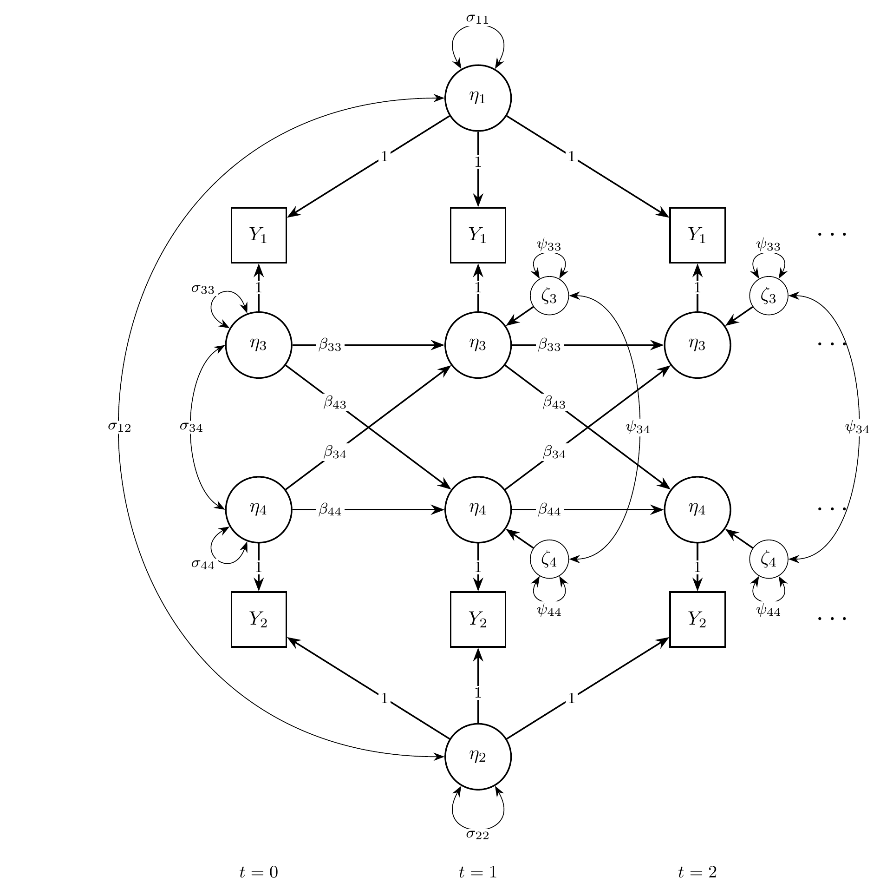
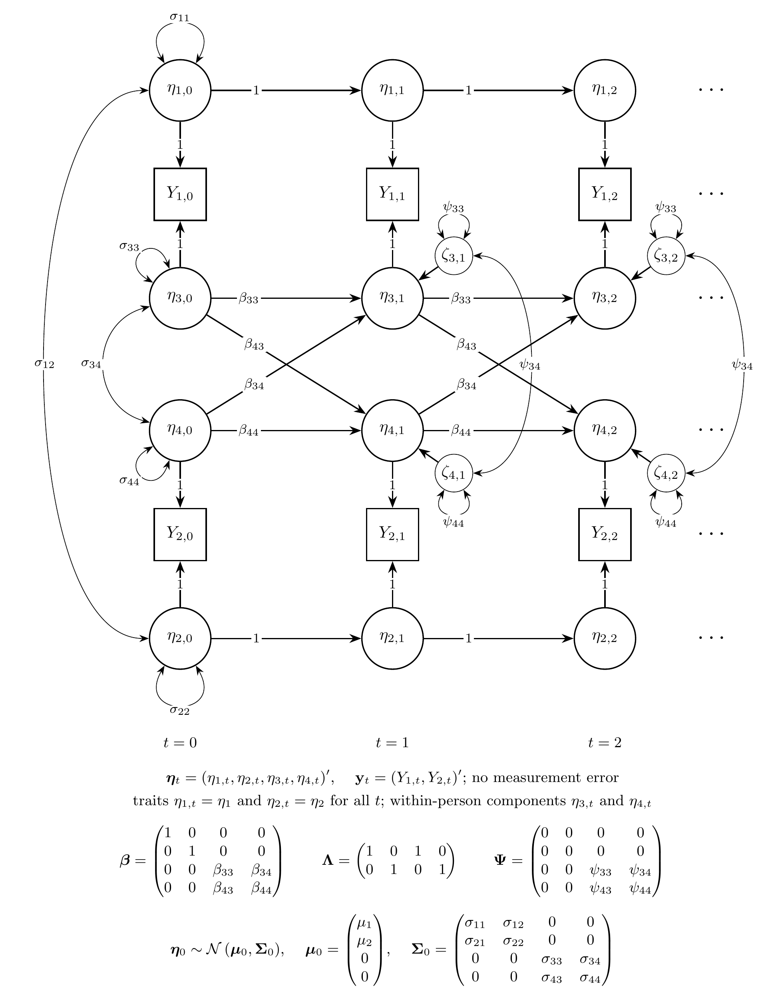
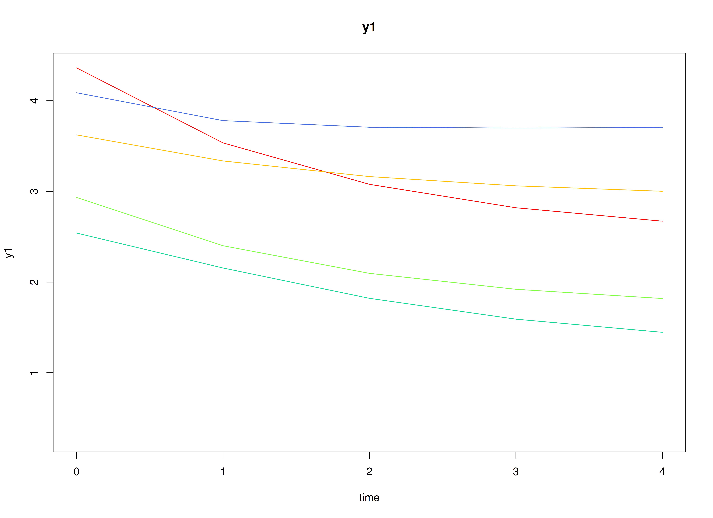
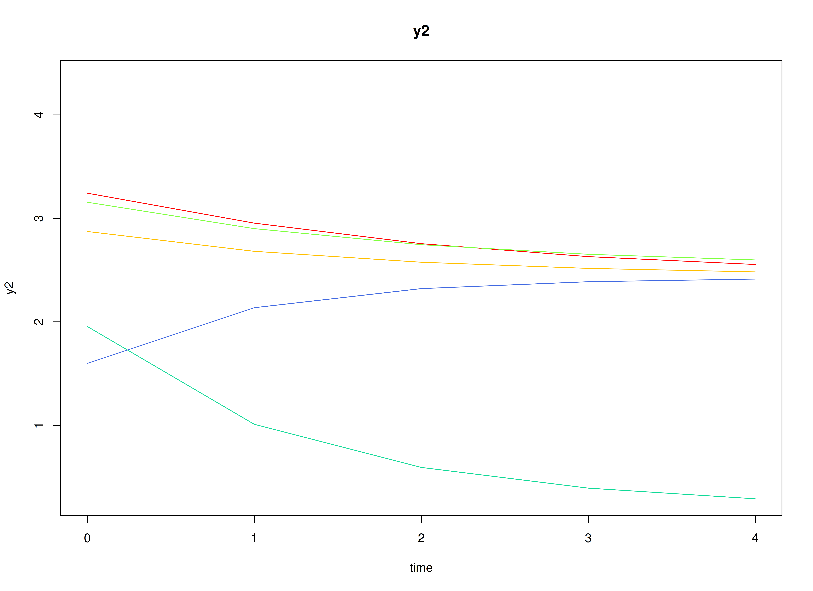
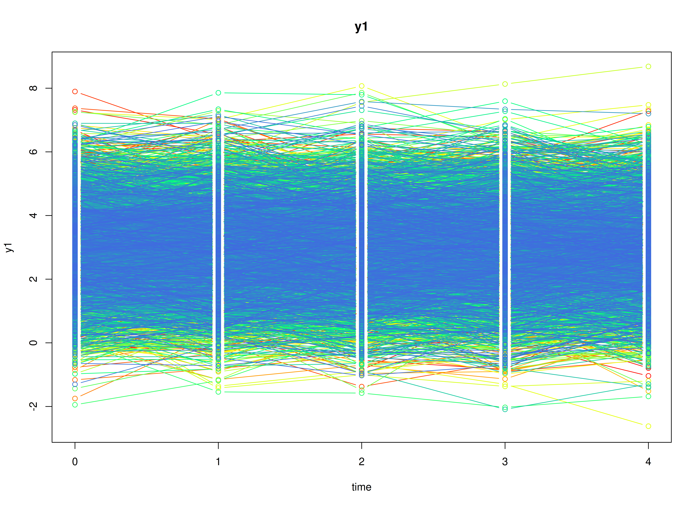
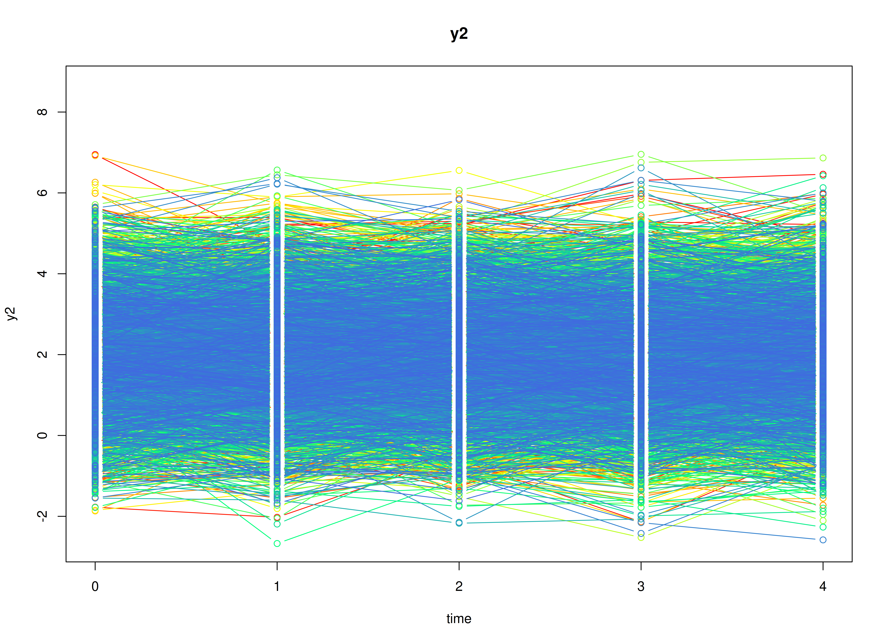
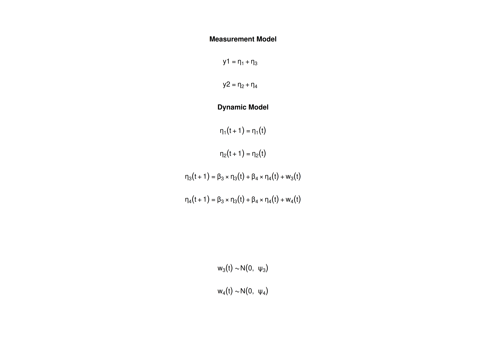

# The Random Intercept Cross-Lagged Panel Model

## Overview

The random intercept cross-lagged panel model (RI-CLPM) studies how two
variables measured on the same individuals over several occasions relate
to each other over time, for example, self-esteem and depression
measured once a year (Hamaker et al., 2015). Each individual has a
stable level on each variable, called a trait, and fluctuates around it
from occasion to occasion. The model separates the two: the traits
describe stable differences between individuals, and the cross-lagged
effects describe how a fluctuation in one variable is followed by a
fluctuation in the other at the next occasion, within the same
individual. The traditional cross-lagged panel model (CLPM) has no
traits, so it mixes the two kinds of differences; it is the VAR model in
the vignette on vector autoregressive models, fitted to panel data.

The RI-CLPM is usually fitted as a structural equation model (SEM)
(Mulder & Hamaker, 2021). It can also be written as a state space model:
the traits are latent states that never change, and the within-person
components are latent states that follow a vector autoregressive
process.

This tutorial does three things:

1.  It writes the RI-CLPM as a state space model.
2.  It simulates data from the model with
    [`SimSSMFixed()`](https://github.com/jeksterslab/simStateSpace/reference/SimSSMFixed.md).
3.  It fits the model to the simulated data as a state space model with
    `dynr` and `OpenMx` and as a structural equation model (SEM) with
    `lavaan` and `OpenMx`, and compares every set of estimates with the
    values used to simulate the data.

No prior knowledge of state space models is needed.

## Model

The measurement model is given by \left( \begin{array}{c} Y\_{1\_{i, t}}
\\\\ Y\_{2\_{i, t}} \\\\ \end{array} \right) = \left(
\begin{array}{cccc} 1 & 0 & 1 & 0 \\\\ 0 & 1 & 0 & 1 \\\\ \end{array}
\right) \left( \begin{array}{c} \eta\_{1\_{i, t}} \\\\ \eta\_{2\_{i, t}}
\\\\ \eta\_{3\_{i, t}} \\\\ \eta\_{4\_{i, t}} \\\\ \end{array} \right)
where Y\_{1\_{i, t}} and Y\_{2\_{i, t}} are the two observed variables
at time t and individual i, \eta\_{1\_{i, t}} and \eta\_{2\_{i, t}} are
the traits of the two variables, and \eta\_{3\_{i, t}} and \eta\_{4\_{i,
t}} are their within-person components.

In words, each observed score is the individual’s trait plus the
individual’s deviation from it on that occasion. As in most applications
of the RI-CLPM, there is no measurement error.

The dynamic structure is given by \left( \begin{array}{c} \eta\_{1\_{i,
t}} \\\\ \eta\_{2\_{i, t}} \\\\ \eta\_{3\_{i, t}} \\\\ \eta\_{4\_{i, t}}
\\\\ \end{array} \right) = \left( \begin{array}{cccc} 1 & 0 & 0 & 0 \\\\
0 & 1 & 0 & 0 \\\\ 0 & 0 & \beta\_{33} & \beta\_{34} \\\\ 0 & 0 &
\beta\_{43} & \beta\_{44} \\\\ \end{array} \right) \left(
\begin{array}{c} \eta\_{1\_{i, t - 1}} \\\\ \eta\_{2\_{i, t - 1}} \\\\
\eta\_{3\_{i, t - 1}} \\\\ \eta\_{4\_{i, t - 1}} \\\\ \end{array}
\right) + \left( \begin{array}{c} 0 \\\\ 0 \\\\ \zeta\_{3\_{i, t}} \\\\
\zeta\_{4\_{i, t}} \\\\ \end{array} \right), \quad \mathrm{with} \quad
\left( \begin{array}{c} \zeta\_{3\_{i, t}} \\\\ \zeta\_{4\_{i, t}} \\\\
\end{array} \right) \sim \mathcal{N} \left( \mathbf{0}, \left(
\begin{array}{cc} \psi\_{33} & \psi\_{34} \\\\ \psi\_{43} & \psi\_{44}
\\\\ \end{array} \right) \right) .

In words, the traits stay the same over time: the first two rows have a
1 on the diagonal and no process noise. The within-person components
follow a vector autoregressive process. \beta\_{33} and \beta\_{44} are
the autoregressive effects: how much of an individual’s deviation from
the trait carries over to the next occasion. \beta\_{34} and \beta\_{43}
are the cross-lagged effects: \beta\_{34} is the effect of a deviation
in the second variable on the deviation in the first variable at the
next occasion, and \beta\_{43} the reverse. \psi\_{33}, \psi\_{44}, and
\psi\_{34} are the variances and covariance of the new, unpredictable
part of the deviations on each occasion.

The initial condition is given by \boldsymbol{\eta}\_{i, 0} \sim
\mathcal{N} \left( \boldsymbol{\mu}\_{0}, \boldsymbol{\Sigma}\_{0}
\right)

\boldsymbol{\mu}\_{0} = \left( \begin{array}{c} \mu\_{1} \\\\ \mu\_{2}
\\\\ 0 \\\\ 0 \\\\ \end{array} \right) \quad \mathrm{and,} \quad
\boldsymbol{\Sigma}\_{0} = \left( \begin{array}{cccc} \sigma\_{11} &
\sigma\_{12} & 0 & 0 \\\\ \sigma\_{21} & \sigma\_{22} & 0 & 0 \\\\ 0 & 0
& \sigma\_{33} & \sigma\_{34} \\\\ 0 & 0 & \sigma\_{43} & \sigma\_{44}
\\\\ \end{array} \right) .

Here, \mu\_{1} and \mu\_{2} are the average traits, \sigma\_{11},
\sigma\_{22}, and \sigma\_{12} are how much individuals differ in their
traits and how the two traits covary, for example, positive if
individuals with higher self-esteem also tend to have higher well-being.
The within-person components have mean zero, because they are deviations
from the traits, and are uncorrelated with the traits. \sigma\_{33},
\sigma\_{44}, and \sigma\_{34} are their variances and covariance at the
first occasion.

### Diagrams



Path diagram of the RI-CLPM.

The RI-CLPM as a path diagram, for the first three occasions (t = 0, 1,
2). Squares are observed variables and circles are latent variables. The
traits \eta\_{1} and \eta\_{2} load on every occasion with a loading of
1, have variances \sigma\_{11} and \sigma\_{22}, and covary
(\sigma\_{12}). The within-person components \eta\_{3} and \eta\_{4}
carry the dynamics: the horizontal arrows are the autoregressive effects
and the diagonal arrows the cross-lagged effects. \zeta\_{3} and
\zeta\_{4} are the new parts of the deviations on each occasion, with
variances \psi\_{33} and \psi\_{44} and covariance \psi\_{34};
\sigma\_{33}, \sigma\_{44}, and \sigma\_{34} are the variances and
covariance of the within-person components at t = 0. A loop on a
variable is its variance and a curved two-headed arrow a covariance.



State space form of the RI-CLPM.

The same model in state space form, for the first three occasions, with
every element of the state drawn. The traits are states with a
transition of 1 and no process noise, so they keep their values over
time: \eta\_{1, t} = \eta\_{1} and \eta\_{2, t} = \eta\_{2} for all t.
Each observed variable Y\_{j, t} is its trait plus its within-person
component, both with a loading of 1. The within-person components
\eta\_{3, t} and \eta\_{4, t} carry the dynamics and receive the process
noise \zeta\_{3, t} and \zeta\_{4, t} from t = 1 on. At t = 0, the
initial condition \boldsymbol{\eta}\_{0} \sim \mathcal{N} \left(
\boldsymbol{\mu}\_{0}, \boldsymbol{\Sigma}\_{0} \right) gives the
variances and covariances at t = 0: the traits and the within-person
components do not covary. Below the diagram, all the latent variables at
one occasion form the state vector \boldsymbol{\eta}\_{t}, and all the
observed variables form \mathbf{y}\_{t}: \boldsymbol{\beta} carries the
state from one occasion to the next, \boldsymbol{\Lambda} maps the state
to the observed variables, and \boldsymbol{\Psi} is the covariance
matrix of the process noise \boldsymbol{\zeta}\_{t}.
[`SimSSMFixed()`](https://github.com/jeksterslab/simStateSpace/reference/SimSSMFixed.md)
takes `beta`, `lambda`, `mu0`, and the Cholesky factors of
\boldsymbol{\Psi} and \boldsymbol{\Sigma}\_{0} (`psi_l` and `sigma0_l`);
`theta_l` is a matrix of zeros.

## Data Generation

### Notation

Let t = 5 be the number of time points and n = 5000 be the number of
individuals.

Let the traits have the means and the covariance matrix

\left( \begin{array}{c} \mu\_{1} \\\\ \mu\_{2} \\\\ \end{array} \right)
= \left( \begin{array}{c} 3 \\\\ 2 \\\\ \end{array} \right) \quad
\mathrm{and,} \quad \left( \begin{array}{cc} \sigma\_{11} & \sigma\_{12}
\\\\ \sigma\_{21} & \sigma\_{22} \\\\ \end{array} \right) = \left(
\begin{array}{cc} 1 & 0.5 \\\\ 0.5 & 1 \\\\ \end{array} \right) .

Let the autoregressive and cross-lagged effects and the process noise
covariance matrix be

\left( \begin{array}{cc} \beta\_{33} & \beta\_{34} \\\\ \beta\_{43} &
\beta\_{44} \\\\ \end{array} \right) = \left( \begin{array}{cc} 0.5 &
0.15 \\\\ 0.1 & 0.4 \\\\ \end{array} \right) \quad \mathrm{and,} \quad
\left( \begin{array}{cc} \psi\_{33} & \psi\_{34} \\\\ \psi\_{43} &
\psi\_{44} \\\\ \end{array} \right) = \left( \begin{array}{cc} 0.5 & 0.1
\\\\ 0.1 & 0.5 \\\\ \end{array} \right) .

The within-person components start from their stationary distribution:
their covariance matrix at the first occasion is the one they keep at
every later occasion, computed with
[`SSMCovEta()`](https://github.com/jeksterslab/simStateSpace/reference/SSMCovEta.md)
from the autoregressive and cross-lagged effects and the process noise
covariance matrix,

\left( \begin{array}{cc} \sigma\_{33} & \sigma\_{34} \\\\ \sigma\_{43} &
\sigma\_{44} \\\\ \end{array} \right) = \left( \begin{array}{cc} 0.73 &
0.222 \\\\ 0.222 & 0.625 \\\\ \end{array} \right) .

### R Function Arguments

The simulation functions take covariance matrices as lower triangular
Cholesky factors (the arguments ending in `_l`). Because the traits have
no process noise and there is no measurement error, `psi` and `theta`
have rows and columns of zeros, and their Cholesky factors are built
block by block.

\
`n`\
`#> [1] 5000`\
`time`\
`#> [1] 5`\
`mu0`\
`#> [1] 3 2 0 0`\
`sigma0`\
`#>      [,1] [,2]      [,3]      [,4]`\
`#> [1,]  1.0  0.5 0.0000000 0.0000000`\
`#> [2,]  0.5  1.0 0.0000000 0.0000000`\
`#> [3,]  0.0  0.0 0.7297462 0.2216425`\
`#> [4,]  0.0  0.0 0.2216425 0.6250344`\
`sigma0_l`` ``# sigma0_l <- t(chol(sigma0))`\
`#>      [,1]      [,2]      [,3]      [,4]`\
`#> [1,]  1.0 0.0000000 0.0000000 0.0000000`\
`#> [2,]  0.5 0.8660254 0.0000000 0.0000000`\
`#> [3,]  0.0 0.0000000 0.8542518 0.0000000`\
`#> [4,]  0.0 0.0000000 0.2594580 0.7468038`\
`alpha`\
`#> [1] 0 0 0 0`\
`beta`\
`#>      [,1] [,2] [,3] [,4]`\
`#> [1,]    1    0  0.0 0.00`\
`#> [2,]    0    1  0.0 0.00`\
`#> [3,]    0    0  0.5 0.15`\
`#> [4,]    0    0  0.1 0.40`\
`psi`\
`#>      [,1] [,2] [,3] [,4]`\
`#> [1,]    0    0  0.0  0.0`\
`#> [2,]    0    0  0.0  0.0`\
`#> [3,]    0    0  0.5  0.1`\
`#> [4,]    0    0  0.1  0.5`\
`psi_l`\
`#>      [,1] [,2]      [,3]      [,4]`\
`#> [1,]    0    0 0.0000000 0.0000000`\
`#> [2,]    0    0 0.0000000 0.0000000`\
`#> [3,]    0    0 0.7071068 0.0000000`\
`#> [4,]    0    0 0.1414214 0.6928203`\
`nu`\
`#> [1] 0 0`\
`lambda`\
`#>      [,1] [,2] [,3] [,4]`\
`#> [1,]    1    0    1    0`\
`#> [2,]    0    1    0    1`\
`theta`\
`#>      [,1] [,2]`\
`#> [1,]    0    0`\
`#> [2,]    0    0`\
`theta_l`\
`#>      [,1] [,2]`\
`#> [1,]    0    0`\
`#> [2,]    0    0`

### Visualizing the Dynamics Without Process Noise (n = 5 with Different Initial Condition)

Without process noise, each individual’s deviations shrink toward zero,
so each trajectory settles at the individual’s trait.



### Using the `SimSSMFixed` Function from the `simStateSpace` Package to Simulate Data

Now we add the process noise and simulate the full data set.
[`as.data.frame()`](https://rdrr.io/r/base/as.data.frame.html) returns
the data in long format, one row per individual and time point, with the
columns `id`, `time`, `y1`, and `y2`.

\
[`library`](https://rdrr.io/r/base/library.html)`(`[`simStateSpace`](https://github.com/jeksterslab/simStateSpace)`)`\
`sim`` ``<-`` `[`SimSSMFixed`](https://github.com/jeksterslab/simStateSpace/reference/SimSSMFixed.md)`(`\
`  n ``=`` ``n``,`\
`  time ``=`` ``time``,`\
`  mu0 ``=`` ``mu0``,`\
`  sigma0_l ``=`` ``sigma0_l``,`\
`  alpha ``=`` ``alpha``,`\
`  beta ``=`` ``beta``,`\
`  psi_l ``=`` ``psi_l``,`\
`  nu ``=`` ``nu``,`\
`  lambda ``=`` ``lambda``,`\
`  theta_l ``=`` ``theta_l``,`\
`  type ``=`` ``0`\
`)`\
`data`` ``<-`` `[`as.data.frame`](https://rdrr.io/r/base/as.data.frame.html)`(``sim``)`\
[`head`](https://rdrr.io/r/utils/head.html)`(``data``)`\
`#>   id time       y1         y2`\
`#> 1  1    0 4.785347  3.5092972`\
`#> 2  1    1 4.758437  3.4784088`\
`#> 3  1    2 4.250888  3.0461680`\
`#> 4  1    3 4.140226  3.8609873`\
`#> 5  1    4 3.736337  4.0710355`\
`#> 6  2    0 3.817745 -0.2774656`\
[`summary`](https://rdrr.io/r/base/summary.html)`(``data``)`\
`#>        id            time         y1               y2        `\
`#>  Min.   :   1   Min.   :0   Min.   :-2.619   Min.   :-2.673  `\
`#>  1st Qu.:1251   1st Qu.:1   1st Qu.: 2.078   1st Qu.: 1.127  `\
`#>  Median :2500   Median :2   Median : 2.977   Median : 1.980  `\
`#>  Mean   :2500   Mean   :2   Mean   : 2.978   Mean   : 1.991  `\
`#>  3rd Qu.:3750   3rd Qu.:3   3rd Qu.: 3.883   3rd Qu.: 2.842  `\
`#>  Max.   :5000   Max.   :4   Max.   : 8.684   Max.   : 6.955`\
[`plot`](https://rdrr.io/r/graphics/plot.default.html)`(``sim``)`



## Model Fitting

The same simulated data are fitted as a state space model with `dynr`
and `OpenMx` and as a structural equation model (SEM) with `lavaan` and
`OpenMx`. All of them estimate the parameters by maximum likelihood. The
section Population Values and Estimates compares their estimates with
the population values.

### dynr

We fit the model with `dynr`, which estimates state space models by
maximum likelihood using the Kalman filter.

A `dynr` model is built from pieces that match the equations above: the
data, the initial condition, the measurement model, the dynamic model,
and the noise. Each parameter gets a name (for example, `beta_3_4` for
\beta\_{34}), and the same name used in two places means one shared
parameter. The starting values are set to the population values for
convenience; with real data, they would be rough guesses.

#### Prepare Data

Tell `dynr` which columns hold the individual, the time, and the
observed variables.

\
`dynr_data`` ``<-`` ``dynr``::`[`dynr.data`](https://rdrr.io/pkg/dynr/man/dynr.data.html)`(`\
`  dataframe ``=`` ``data``,`\
`  id ``=`` ``"id"``,`\
`  time ``=`` ``"time"``,`\
`  observed ``=`` `[`c`](https://rdrr.io/r/base/c.html)`(``"y1"``, ``"y2"``)`\
`)`\
`#> Registered S3 method overwritten by 'car':`\
`#>   method           from`\
`#>   na.action.merMod lme4`

#### Prepare Initial Condition

The means of the traits are estimated; the means of the within-person
components are fixed at zero. The covariance matrix has two free blocks,
the traits and the within-person components at the first occasion; the
covariances between the blocks are fixed at zero.

\
`dynr_initial`` ``<-`` ``dynr``::`[`prep.initial`](https://rdrr.io/pkg/dynr/man/prep.initial.html)`(`\
`  values.inistate ``=`` ``mu0``,`\
`  params.inistate ``=`` `[`c`](https://rdrr.io/r/base/c.html)`(``"mu0_1_1"``, ``"mu0_2_1"``, ``"fixed"``, ``"fixed"``)``,`\
`  values.inicov ``=`` ``sigma0``,`\
`  params.inicov ``=`` `[`matrix`](https://rdrr.io/r/base/matrix.html)`(`\
`    data ``=`` `[`c`](https://rdrr.io/r/base/c.html)`(`\
`      ``"sigma0_1_1"``, ``"sigma0_2_1"``, ``"fixed"``, ``"fixed"``,`\
`      ``"sigma0_2_1"``, ``"sigma0_2_2"``, ``"fixed"``, ``"fixed"``,`\
`      ``"fixed"``, ``"fixed"``, ``"sigma0_3_3"``, ``"sigma0_4_3"``,`\
`      ``"fixed"``, ``"fixed"``, ``"sigma0_4_3"``, ``"sigma0_4_4"`\
`    ``)``,`\
`    nrow ``=`` ``4`\
`  ``)`\
`)`

#### Prepare Measurement Model

The loadings are fixed: each observed variable is its trait plus its
within-person component.

\
`dynr_measurement`` ``<-`` ``dynr``::`[`prep.measurement`](https://rdrr.io/pkg/dynr/man/prep.measurement.html)`(`\
`  values.load ``=`` ``lambda``,`\
`  params.load ``=`` `[`matrix`](https://rdrr.io/r/base/matrix.html)`(``data ``=`` ``"fixed"``, nrow ``=`` ``2``, ncol ``=`` ``4``)``,`\
`  state.names ``=`` `[`c`](https://rdrr.io/r/base/c.html)`(``"eta_1"``, ``"eta_2"``, ``"eta_3"``, ``"eta_4"``)``,`\
`  obs.names ``=`` `[`c`](https://rdrr.io/r/base/c.html)`(``"y1"``, ``"y2"``)`\
`)`

#### Prepare Dynamic Process

Each formula is one row of the dynamic equation. The traits carry over
unchanged; the within-person components have the autoregressive and
cross-lagged effects.

\
`dynr_dynamics`` ``<-`` ``dynr``::`[`prep.formulaDynamics`](https://rdrr.io/pkg/dynr/man/prep.formulaDynamics.html)`(`\
`  formula ``=`` `[`list`](https://rdrr.io/r/base/list.html)`(`\
`    ``eta_1`` ``~`` ``eta_1``,`\
`    ``eta_2`` ``~`` ``eta_2``,`\
`    ``eta_3`` ``~`` ``beta_3_3`` ``*`` ``eta_3`` ``+`` ``beta_3_4`` ``*`` ``eta_4``,`\
`    ``eta_4`` ``~`` ``beta_4_3`` ``*`` ``eta_3`` ``+`` ``beta_4_4`` ``*`` ``eta_4`\
`  ``)``,`\
`  startval ``=`` `[`c`](https://rdrr.io/r/base/c.html)`(`\
`    beta_3_3 ``=`` ``beta``[``3``, ``3``]``, beta_3_4 ``=`` ``beta``[``3``, ``4``]``,`\
`    beta_4_3 ``=`` ``beta``[``4``, ``3``]``, beta_4_4 ``=`` ``beta``[``4``, ``4``]`\
`  ``)``,`\
`  isContinuousTime ``=`` ``FALSE`\
`)`

#### Prepare Process Noise

Only the within-person components have process noise. The measurement
error is fixed at zero.

\
`dynr_noise`` ``<-`` ``dynr``::`[`prep.noise`](https://rdrr.io/pkg/dynr/man/prep.noise.html)`(`\
`  values.latent ``=`` ``psi``,`\
`  params.latent ``=`` `[`matrix`](https://rdrr.io/r/base/matrix.html)`(`\
`    data ``=`` `[`c`](https://rdrr.io/r/base/c.html)`(`\
`      ``"fixed"``, ``"fixed"``, ``"fixed"``, ``"fixed"``,`\
`      ``"fixed"``, ``"fixed"``, ``"fixed"``, ``"fixed"``,`\
`      ``"fixed"``, ``"fixed"``, ``"psi_3_3"``, ``"psi_4_3"``,`\
`      ``"fixed"``, ``"fixed"``, ``"psi_4_3"``, ``"psi_4_4"`\
`    ``)``,`\
`    nrow ``=`` ``4`\
`  ``)``,`\
`  values.observed ``=`` ``theta``,`\
`  params.observed ``=`` `[`matrix`](https://rdrr.io/r/base/matrix.html)`(``data ``=`` ``"fixed"``, nrow ``=`` ``2``, ncol ``=`` ``2``)`\
`)`

#### Prepare the Model

The pieces are put together into one model. `dynr` writes the model as C
code to `outfile` and compiles it.

\
`model`` ``<-`` ``dynr``::`[`dynr.model`](https://rdrr.io/pkg/dynr/man/dynr.model.html)`(`\
`  data ``=`` ``dynr_data``,`\
`  initial ``=`` ``dynr_initial``,`\
`  measurement ``=`` ``dynr_measurement``,`\
`  dynamics ``=`` ``dynr_dynamics``,`\
`  noise ``=`` ``dynr_noise``,`\
`  outfile ``=`` ``"ri-clpm.c"`\
`)`

The plot below shows the model equations with the parameter names.



#### Fit the Model

\
`results`` ``<-`` ``dynr``::`[`dynr.cook`](https://rdrr.io/pkg/dynr/man/dynr.cook.html)`(`\
`  ``model``,`\
`  debug_flag ``=`` ``TRUE``,`\
`  verbose ``=`` ``FALSE`\
`)`\
`#> [1] "Get ready!!!!"`\
`#> using C compiler: ‘gcc (Ubuntu 15.2.0-16ubuntu1) 15.2.0’`\
`#> Optimization function called.`\
`#> Starting Hessian calculation ...`\
`#> Finished Hessian calculation.`\
`#> Original exit flag:  3 `\
`#> Modified exit flag:  3 `\
`#> Optimization terminated successfully: ftol_rel or ftol_abs was reached. `\
`#> Original fitted parameters:  0.5001357 0.1481892 0.08749801 0.389082 -0.6954659 `\
`#> 0.181383 -0.7603375 2.97917 1.992908 0.05821258 0.4976437 -0.2902264 -0.3627058 `\
`#> 0.3202288 -0.5923421 `\
`#> `\
`#> Transformed fitted parameters:  0.5001357 0.1481892 0.08749801 0.389082 `\
`#> 0.498842 0.09048148 0.4839204 2.97917 1.992908 1.05994 0.5274726 1.010588 `\
`#> 0.6957911 0.2228124 0.6243814 `\
`#> `\
`#> Doing end processing`\
`#> Successful trial`\
`#> Total Time: 1.316988 `\
`#> Backend Time: 1.310892`

#### Summary

The summary lists each estimate with its standard error, t value,
confidence interval, and p value.

\
[`summary`](https://rdrr.io/r/base/summary.html)`(``results``)`\
`#> Coefficients:`\
`#>            Estimate Std. Error t value ci.lower ci.upper            Pr(>|t|)`\
`#> beta_3_3   0.500136   0.012599  39.696 0.475442 0.524830 <0.0000000000000002`\
`#> beta_3_4   0.148189   0.010296  14.393 0.128010 0.168368 <0.0000000000000002`\
`#> beta_4_3   0.087498   0.010207   8.572 0.067492 0.107504 <0.0000000000000002`\
`#> beta_4_4   0.389082   0.012230  31.814 0.365112 0.413052 <0.0000000000000002`\
`#> psi_3_3    0.498842   0.006600  75.577 0.485905 0.511779 <0.0000000000000002`\
`#> psi_4_3    0.090481   0.004769  18.973 0.081135 0.099828 <0.0000000000000002`\
`#> psi_4_4    0.483920   0.006509  74.344 0.471163 0.496678 <0.0000000000000002`\
`#> mu0_1_1    2.979170   0.016658 178.840 2.946521 3.011820 <0.0000000000000002`\
`#> mu0_2_1    1.992908   0.015771 126.369 1.961998 2.023817 <0.0000000000000002`\
`#> sigma0_1_1 1.059940   0.030783  34.433 0.999607 1.120274 <0.0000000000000002`\
`#> sigma0_2_1 0.527473   0.022607  23.332 0.483164 0.571781 <0.0000000000000002`\
`#> sigma0_2_2 1.010588   0.026363  38.333 0.958917 1.062259 <0.0000000000000002`\
`#> sigma0_3_3 0.695791   0.022775  30.551 0.651153 0.740429 <0.0000000000000002`\
`#> sigma0_4_3 0.222812   0.015797  14.104 0.191850 0.253775 <0.0000000000000002`\
`#> sigma0_4_4 0.624381   0.018535  33.686 0.588053 0.660710 <0.0000000000000002`\
`#>               `\
`#> beta_3_3   ***`\
`#> beta_3_4   ***`\
`#> beta_4_3   ***`\
`#> beta_4_4   ***`\
`#> psi_3_3    ***`\
`#> psi_4_3    ***`\
`#> psi_4_4    ***`\
`#> mu0_1_1    ***`\
`#> mu0_2_1    ***`\
`#> sigma0_1_1 ***`\
`#> sigma0_2_1 ***`\
`#> sigma0_2_2 ***`\
`#> sigma0_3_3 ***`\
`#> sigma0_4_3 ***`\
`#> sigma0_4_4 ***`\
`#> ---`\
`#> Signif. codes:  0 '***' 0.001 '**' 0.01 '*' 0.05 '.' 0.1 ' ' 1`\
`#> `\
`#> -2 log-likelihood value at convergence = 123375.56`\
`#> AIC = 123405.56`\
`#> BIC = 123527.46`

### OpenMx: State Space Model

`OpenMx` (Neale et al., 2016) fits the same state space model with its
own Kalman filter
([`OpenMx::mxExpectationStateSpace()`](https://rdrr.io/pkg/OpenMx/man/mxExpectationStateSpace.html);
Hunter (2018)). Its matrices have the names used in engineering: `A` is
the transition matrix \boldsymbol{\beta}, `B` holds the intercepts of
the dynamic model, `C` is the loading matrix \boldsymbol{\Lambda}, `D`
holds the intercepts of the measurement model, `Q` is the process noise
covariance matrix, and `R` is the measurement error covariance matrix.
The parameter labels are the dynr names; as in dynr, a label used in two
places is one shared parameter, and the starting values are the
population values.

Two details differ from dynr. First, OpenMx reads the data as a single
time series. To start the filter again at the first occasion of every
individual, each individual gets a group, and all groups use the
matrices of one parent model, so every individual has the same
parameters. Second, OpenMx starts the filter one occasion before the
first row, so the first row has the state mean \mathbf{A}
\mathbf{x}\_{0} + \mathbf{B} \mathbf{u} and the state covariance
\mathbf{A} \mathbf{P}\_{0} \mathbf{A}^{\prime} + \mathbf{Q}, with the
constant input \mathbf{u} = 1. Setting \mathbf{x}\_{0} = \mathbf{A}^{-1}
\left( \boldsymbol{\mu}\_{0} - \mathbf{B} \mathbf{u} \right) and
\mathbf{P}\_{0} = \mathbf{A}^{-1} \left( \boldsymbol{\Sigma}\_{0} -
\mathbf{Q} \right) \left( \mathbf{A}^{-1} \right)^{\prime} gives the
first occasion the initial condition of the model, so the likelihood is
the same as in dynr. This needs an invertible \mathbf{A}, which holds
here.

The two helper functions below are the same in every vignette of the
package. `MxMat()` makes an OpenMx matrix from values and dynr-style
labels (`"fixed"` marks a fixed element), and `FitMxSSM()` builds the
groups and fits the model.

\
`MxMat`` ``<-`` ``function``(``values``, ``labels``, ``name``)`` ``{`\
`  ``values`` ``<-`` `[`as.matrix`](https://rdrr.io/r/base/matrix.html)`(``values``)`\
`  ``labels`` ``<-`` `[`matrix`](https://rdrr.io/r/base/matrix.html)`(`\
`    data ``=`` ``labels``,`\
`    nrow ``=`` `[`nrow`](https://rdrr.io/r/base/nrow.html)`(``values``)``,`\
`    ncol ``=`` `[`ncol`](https://rdrr.io/r/base/nrow.html)`(``values``)`\
`  ``)`\
`  ``free`` ``<-`` ``labels`` ``!=`` ``"fixed"`\
`  ``labels``[``!``free``]`` ``<-`` ``NA`\
`  ``OpenMx``::`[`mxMatrix`](https://rdrr.io/pkg/OpenMx/man/mxMatrix.html)`(`\
`    type ``=`` ``"Full"``,`\
`    values ``=`` ``values``,`\
`    free ``=`` ``free``,`\
`    labels ``=`` ``labels``,`\
`    name ``=`` ``name`\
`  ``)`\
`}`\
`FitMxSSM`` ``<-`` ``function``(``data``, ``observed``, ``matrices``, ``name``)`` ``{`\
`  ``# the groups refer to the matrices of the parent model`\
`  ``shared`` ``<-`` ``function``(``x``)`` ``{`\
`    `[`paste0`](https://rdrr.io/r/base/paste.html)`(``name``, ``"."``, ``x``)`\
`  ``}`\
`  ``expectation`` ``<-`` ``OpenMx``::`[`mxExpectationStateSpace`](https://rdrr.io/pkg/OpenMx/man/mxExpectationStateSpace.html)`(`\
`    A ``=`` ``shared``(``"A"``)``,`\
`    B ``=`` ``shared``(``"B"``)``,`\
`    C ``=`` ``shared``(``"C"``)``,`\
`    D ``=`` ``shared``(``"D"``)``,`\
`    Q ``=`` ``shared``(``"Q"``)``,`\
`    R ``=`` ``shared``(``"R"``)``,`\
`    x0 ``=`` ``shared``(``"x0"``)``,`\
`    P0 ``=`` ``shared``(``"P0"``)``,`\
`    u ``=`` ``shared``(``"u"``)`\
`  ``)`\
`  ``# OpenMx needs the names of the observed variables and of the states on C`\
`  ``for`` ``(``i`` ``in`` `[`seq_along`](https://rdrr.io/r/base/seq.html)`(``matrices``)``)`` ``{`\
`    ``if`` ``(``matrices``[[``i``]``]``$``name`` ``==`` ``"C"``)`` ``{`\
`      `[`dimnames`](https://rdrr.io/r/base/dimnames.html)`(``matrices``[[``i``]``]``)`` ``<-`` `[`list`](https://rdrr.io/r/base/list.html)`(`\
`        ``observed``,`\
`        `[`paste0`](https://rdrr.io/r/base/paste.html)`(``"eta_"``, `[`seq_len`](https://rdrr.io/r/base/seq.html)`(`[`ncol`](https://rdrr.io/r/base/nrow.html)`(``matrices``[[``i``]``]``$``values``)``)``)`\
`      ``)`\
`    ``}`\
`  ``}`\
`  ``persons`` ``<-`` `[`split`](https://rdrr.io/r/base/split.html)`(`\
`    x ``=`` ``data``[``, ``observed``, drop ``=`` ``FALSE``]``,`\
`    f ``=`` ``data``[``, ``"id"``]`\
`  ``)`\
`  ``groups`` ``<-`` `[`paste0`](https://rdrr.io/r/base/paste.html)`(``"id_"``, `[`names`](https://rdrr.io/r/base/names.html)`(``persons``)``)`\
`  ``submodels`` ``<-`` `[`lapply`](https://rdrr.io/r/base/lapply.html)`(`\
`    X ``=`` `[`seq_along`](https://rdrr.io/r/base/seq.html)`(``persons``)``,`\
`    FUN ``=`` ``function``(``i``)`` ``{`\
`      ``OpenMx``::`[`mxModel`](https://rdrr.io/pkg/OpenMx/man/mxModel.html)`(`\
`        name ``=`` ``groups``[``i``]``,`\
`        ``expectation``,`\
`        ``OpenMx``::`[`mxFitFunctionML`](https://rdrr.io/pkg/OpenMx/man/mxFitFunctionML.html)`(``)``,`\
`        ``OpenMx``::`[`mxData`](https://rdrr.io/pkg/OpenMx/man/mxData.html)`(`\
`          observed ``=`` ``persons``[[``i``]``]``,`\
`          type ``=`` ``"raw"`\
`        ``)`\
`      ``)`\
`    ``}`\
`  ``)`\
`  ``model`` ``<-`` ``OpenMx``::`[`mxModel`](https://rdrr.io/pkg/OpenMx/man/mxModel.html)`(`\
`    name ``=`` ``name``,`\
`    ``matrices``,`\
`    ``OpenMx``::`[`mxMatrix`](https://rdrr.io/pkg/OpenMx/man/mxMatrix.html)`(`\
`      type ``=`` ``"Unit"``,`\
`      nrow ``=`` ``1``,`\
`      ncol ``=`` ``1``,`\
`      name ``=`` ``"u"`\
`    ``)``,`\
`    ``# the first occasion gets the initial condition of the model`\
`    ``OpenMx``::`[`mxAlgebra`](https://rdrr.io/pkg/OpenMx/man/mxAlgebra.html)`(`\
`      expression ``=`` `[`solve`](https://rdrr.io/r/base/solve.html)`(``A``)`` `[`%*%`](https://rdrr.io/r/base/matmult.html)` ``(``mu0`` ``-`` ``B`` `[`%*%`](https://rdrr.io/r/base/matmult.html)` ``u``)``,`\
`      name ``=`` ``"x0"`\
`    ``)``,`\
`    ``OpenMx``::`[`mxAlgebra`](https://rdrr.io/pkg/OpenMx/man/mxAlgebra.html)`(`\
`      expression ``=`` `[`solve`](https://rdrr.io/r/base/solve.html)`(``A``)`` `[`%*%`](https://rdrr.io/r/base/matmult.html)` ``(``sigma0`` ``-`` ``Q``)`` `[`%*%`](https://rdrr.io/r/base/matmult.html)` `[`t`](https://rdrr.io/r/base/t.html)`(`[`solve`](https://rdrr.io/r/base/solve.html)`(``A``)``)``,`\
`      name ``=`` ``"P0"`\
`    ``)``,`\
`    ``submodels``,`\
`    ``OpenMx``::`[`mxFitFunctionMultigroup`](https://rdrr.io/pkg/OpenMx/man/mxFitFunctionMultigroup.html)`(``groups ``=`` ``groups``)`\
`  ``)`\
`  ``# retries from perturbed starting values only if the first run fails`\
`  ``OpenMx``::`[`mxTryHard`](https://rdrr.io/pkg/OpenMx/man/mxTryHard.html)`(`\
`    model ``=`` ``model``,`\
`    extraTries ``=`` ``5``,`\
`    silent ``=`` ``TRUE`\
`  ``)`\
`}`

The matrices of the model, with the dynr labels. There is no measurement
error (`R` is zero).

\
`labels_beta`` ``<-`` `[`matrix`](https://rdrr.io/r/base/matrix.html)`(``data ``=`` ``"fixed"``, nrow ``=`` ``4``, ncol ``=`` ``4``)`\
`labels_beta``[``3``:``4``, ``3``:``4``]`` ``<-`` `[`c`](https://rdrr.io/r/base/c.html)`(``"beta_3_3"``, ``"beta_4_3"``, ``"beta_3_4"``, ``"beta_4_4"``)`\
`labels_psi`` ``<-`` `[`matrix`](https://rdrr.io/r/base/matrix.html)`(``data ``=`` ``"fixed"``, nrow ``=`` ``4``, ncol ``=`` ``4``)`\
`labels_psi``[``3``:``4``, ``3``:``4``]`` ``<-`` `[`c`](https://rdrr.io/r/base/c.html)`(``"psi_3_3"``, ``"psi_4_3"``, ``"psi_4_3"``, ``"psi_4_4"``)`\
`labels_sigma0`` ``<-`` `[`matrix`](https://rdrr.io/r/base/matrix.html)`(``data ``=`` ``"fixed"``, nrow ``=`` ``4``, ncol ``=`` ``4``)`\
`labels_sigma0``[``1``:``2``, ``1``:``2``]`` ``<-`` `[`c`](https://rdrr.io/r/base/c.html)`(`\
`  ``"sigma0_1_1"``, ``"sigma0_2_1"``, ``"sigma0_2_1"``, ``"sigma0_2_2"`\
`)`\
`labels_sigma0``[``3``:``4``, ``3``:``4``]`` ``<-`` `[`c`](https://rdrr.io/r/base/c.html)`(`\
`  ``"sigma0_3_3"``, ``"sigma0_4_3"``, ``"sigma0_4_3"``, ``"sigma0_4_4"`\
`)`\
`mx_matrices`` ``<-`` `[`list`](https://rdrr.io/r/base/list.html)`(`\
`  ``MxMat``(``values ``=`` ``beta``, labels ``=`` ``labels_beta``, name ``=`` ``"A"``)``,`\
`  ``MxMat``(``values ``=`` ``alpha``, labels ``=`` ``"fixed"``, name ``=`` ``"B"``)``,`\
`  ``MxMat``(``values ``=`` ``lambda``, labels ``=`` ``"fixed"``, name ``=`` ``"C"``)``,`\
`  ``MxMat``(``values ``=`` ``nu``, labels ``=`` ``"fixed"``, name ``=`` ``"D"``)``,`\
`  ``MxMat``(``values ``=`` ``psi``, labels ``=`` ``labels_psi``, name ``=`` ``"Q"``)``,`\
`  ``MxMat``(``values ``=`` ``theta``, labels ``=`` ``"fixed"``, name ``=`` ``"R"``)``,`\
`  ``MxMat``(`\
`    values ``=`` ``mu0``,`\
`    labels ``=`` `[`c`](https://rdrr.io/r/base/c.html)`(``"mu0_1_1"``, ``"mu0_2_1"``, ``"fixed"``, ``"fixed"``)``,`\
`    name ``=`` ``"mu0"`\
`  ``)``,`\
`  ``MxMat``(``values ``=`` ``sigma0``, labels ``=`` ``labels_sigma0``, name ``=`` ``"sigma0"``)`\
`)`

``` r
fit_mx_ssm <- FitMxSSM(
  data = data,
  observed = c("y1", "y2"),
  matrices = mx_matrices,
  name = "ri_clpm"
)
#> 
Beginning initial fit attempt
Fit attempt 0, fit=123375.561436516, new current best! (was 123393.61516414)
                                                                            
#> 
#>  Solution found!  Final fit=123375.56 (started at 123393.62)  (1 attempt(s): 1 valid, 0 errors)
summary(fit_mx_ssm)
#> Summary of ri_clpm 
#>  
#> free parameters:
#>          name matrix row col   Estimate   Std.Error A
#> 1    beta_3_3      A   3   3 0.50029083 0.012618419  
#> 2    beta_4_3      A   4   3 0.08768250 0.010213720  
#> 3    beta_3_4      A   3   4 0.14835897 0.010300533  
#> 4    beta_4_4      A   4   4 0.38921164 0.012238646  
#> 5     psi_3_3      Q   3   3 0.49892137 0.006605229  
#> 6     psi_4_3      Q   4   3 0.09056997 0.004771368  
#> 7     psi_4_4      Q   4   4 0.48400515 0.006513539  
#> 8     mu0_1_1    mu0   1   1 2.97928062 0.016658625  
#> 9     mu0_2_1    mu0   2   1 1.99301238 0.015775766  
#> 10 sigma0_1_1 sigma0   1   1 1.05970864 0.030935560  
#> 11 sigma0_2_1 sigma0   2   1 0.52731732 0.022643329  
#> 12 sigma0_2_2 sigma0   2   2 1.01051869 0.026375114  
#> 13 sigma0_3_3 sigma0   3   3 0.69592116 0.022937260  
#> 14 sigma0_4_3 sigma0   4   3 0.22291390 0.015840671  
#> 15 sigma0_4_4 sigma0   4   4 0.62446968 0.018590491  
#> 
#> Model Statistics: 
#>                |  Parameters  |  Degrees of Freedom  |  Fit (-2lnL units)
#>        Model:             15                  49985              123375.6
#>    Saturated:             NA                     NA                    NA
#> Independence:             NA                     NA                    NA
#> Number of observations/statistics: 25000/50000
#> 
#> Information Criteria: 
#>       |  df Penalty  |  Parameters Penalty  |  Sample-Size Adjusted
#> AIC:       23405.56               123405.6                 123405.6
#> BIC:     -382804.09               123527.5                 123479.8
#> To get additional fit indices, see help(mxRefModels)
#> timestamp: 2026-11-03 15:59:03 
#> Wall clock time: 119.3972 secs 
#> optimizer:  SLSQP 
#> OpenMx version number: 2.22.11 
#> Need help?  See help(mxSummary)
```

### lavaan: Structural Equation Model

The same model in SEM form, fitted with `lavaan`, should give nearly the
same estimates. In SEM, each variable at each occasion is a separate
observed variable in one row per individual (wide format). Each trait is
a factor with loadings of 1 on all occasions of its variable, and each
within-person component is a factor with a loading of 1 on one observed
variable.

#### Wide Data Set

[`as.data.frame()`](https://rdrr.io/r/base/as.data.frame.html) with
`long = FALSE` returns the data in wide format, with the columns `y1_0`,
`y2_0`, `y1_1`, and so on, for the variable and the occasion.

\
`data_wide`` ``<-`` `[`as.data.frame`](https://rdrr.io/r/base/as.data.frame.html)`(``sim``, long ``=`` ``FALSE``)`\
[`head`](https://rdrr.io/r/utils/head.html)`(``data_wide``)`\
`#>   id     y1_0       y2_0     y1_1       y2_1     y1_2      y2_2     y1_3`\
`#> 1  1 4.785347  3.5092972 4.758437  3.4784088 4.250888 3.0461680 4.140226`\
`#> 2  2 3.817745 -0.2774656 2.862270  0.3853853 1.406240 0.6507028 2.209588`\
`#> 3  3 3.522707  0.9306157 3.149694  0.5750247 2.908617 0.7347837 2.661809`\
`#> 4  4 1.903810 -0.2370393 1.303083 -0.2325082 2.098658 0.8861675 2.326190`\
`#> 5  5 2.870433  3.2662374 2.739691  4.6945798 1.780855 2.6131866 1.442110`\
`#> 6  6 5.227972  1.7285270 5.823289  1.1025812 4.059610 1.8672333 3.877255`\
`#>         y2_3     y1_4       y2_4`\
`#> 1  3.8609873 3.736337  4.0710355`\
`#> 2  0.2949086 2.555893  0.4813110`\
`#> 3  0.4009566 2.359547  0.5418111`\
`#> 4 -0.6644187 2.777429 -0.1732977`\
`#> 5  2.6954513 1.660217  3.7470628`\
`#> 6  1.0967300 3.442963 -0.2470748`

#### Model

The model has the same structure for every occasion, so we write it with
[`paste0()`](https://rdrr.io/r/base/paste.html). The parameter labels
match the dynr names. Giving the lagged effects and the residual
variances the same label on every occasion constrains them to be equal
over time, as in the state space model.

\
`waves`` ``<-`` ``0``:``(``time`` ``-`` ``1``)`\
`now`` ``<-`` ``waves``[``-``1``]`\
`before`` ``<-`` ``waves``[``-``time``]`\
`model`` ``<-`` `[`paste`](https://rdrr.io/r/base/paste.html)`(`\
`  `[`c`](https://rdrr.io/r/base/c.html)`(`\
`    ``"# traits: loadings fixed at 1"``,`\
`    `[`paste0`](https://rdrr.io/r/base/paste.html)`(``"eta_1 =~ "``, `[`paste0`](https://rdrr.io/r/base/paste.html)`(``"1 * y1_"``, ``waves``, collapse ``=`` ``" + "``)``)``,`\
`    `[`paste0`](https://rdrr.io/r/base/paste.html)`(``"eta_2 =~ "``, `[`paste0`](https://rdrr.io/r/base/paste.html)`(``"1 * y2_"``, ``waves``, collapse ``=`` ``" + "``)``)``,`\
`    ``"# within-person components"``,`\
`    `[`paste0`](https://rdrr.io/r/base/paste.html)`(``"w1_"``, ``waves``, ``" =~ 1 * y1_"``, ``waves``)``,`\
`    `[`paste0`](https://rdrr.io/r/base/paste.html)`(``"w2_"``, ``waves``, ``" =~ 1 * y2_"``, ``waves``)``,`\
`    ``"# autoregressive and cross-lagged effects"``,`\
`    `[`paste0`](https://rdrr.io/r/base/paste.html)`(`\
`      ``"w1_"``, ``now``, ``" ~ beta_3_3 * w1_"``, ``before``, ``" + beta_3_4 * w2_"``, ``before`\
`    ``)``,`\
`    `[`paste0`](https://rdrr.io/r/base/paste.html)`(`\
`      ``"w2_"``, ``now``, ``" ~ beta_4_3 * w1_"``, ``before``, ``" + beta_4_4 * w2_"``, ``before`\
`    ``)``,`\
`    ``"# within-person components at the first occasion"``,`\
`    ``"w1_0 ~~ sigma0_3_3 * w1_0"``,`\
`    ``"w2_0 ~~ sigma0_4_4 * w2_0"``,`\
`    ``"w1_0 ~~ sigma0_4_3 * w2_0"``,`\
`    ``"# process noise at later occasions"``,`\
`    `[`paste0`](https://rdrr.io/r/base/paste.html)`(``"w1_"``, ``now``, ``" ~~ psi_3_3 * w1_"``, ``now``)``,`\
`    `[`paste0`](https://rdrr.io/r/base/paste.html)`(``"w2_"``, ``now``, ``" ~~ psi_4_4 * w2_"``, ``now``)``,`\
`    `[`paste0`](https://rdrr.io/r/base/paste.html)`(``"w1_"``, ``now``, ``" ~~ psi_4_3 * w2_"``, ``now``)``,`\
`    ``"# traits: means, variances, and covariance"``,`\
`    ``"eta_1 ~ mu0_1_1 * 1"``,`\
`    ``"eta_2 ~ mu0_2_1 * 1"``,`\
`    ``"eta_1 ~~ sigma0_1_1 * eta_1"``,`\
`    ``"eta_2 ~~ sigma0_2_2 * eta_2"``,`\
`    ``"eta_1 ~~ sigma0_2_1 * eta_2"``,`\
`    ``"# traits are uncorrelated with the first within-person components"``,`\
`    ``"eta_1 ~~ 0 * w1_0 + 0 * w2_0"``,`\
`    ``"eta_2 ~~ 0 * w1_0 + 0 * w2_0"``,`\
`    ``"# no measurement error and no observed intercepts"``,`\
`    `[`paste0`](https://rdrr.io/r/base/paste.html)`(``"y1_"``, ``waves``, ``" ~~ 0 * y1_"``, ``waves``)``,`\
`    `[`paste0`](https://rdrr.io/r/base/paste.html)`(``"y2_"``, ``waves``, ``" ~~ 0 * y2_"``, ``waves``)``,`\
`    `[`paste0`](https://rdrr.io/r/base/paste.html)`(``"y1_"``, ``waves``, ``" ~ 0 * 1"``)``,`\
`    `[`paste0`](https://rdrr.io/r/base/paste.html)`(``"y2_"``, ``waves``, ``" ~ 0 * 1"``)`\
`  ``)``,`\
`  collapse ``=`` ``"\n"`\
`)`\
[`cat`](https://rdrr.io/r/base/cat.html)`(``model``)`\
`#> # traits: loadings fixed at 1`\
`#> eta_1 =~ 1 * y1_0 + 1 * y1_1 + 1 * y1_2 + 1 * y1_3 + 1 * y1_4`\
`#> eta_2 =~ 1 * y2_0 + 1 * y2_1 + 1 * y2_2 + 1 * y2_3 + 1 * y2_4`\
`#> # within-person components`\
`#> w1_0 =~ 1 * y1_0`\
`#> w1_1 =~ 1 * y1_1`\
`#> w1_2 =~ 1 * y1_2`\
`#> w1_3 =~ 1 * y1_3`\
`#> w1_4 =~ 1 * y1_4`\
`#> w2_0 =~ 1 * y2_0`\
`#> w2_1 =~ 1 * y2_1`\
`#> w2_2 =~ 1 * y2_2`\
`#> w2_3 =~ 1 * y2_3`\
`#> w2_4 =~ 1 * y2_4`\
`#> # autoregressive and cross-lagged effects`\
`#> w1_1 ~ beta_3_3 * w1_0 + beta_3_4 * w2_0`\
`#> w1_2 ~ beta_3_3 * w1_1 + beta_3_4 * w2_1`\
`#> w1_3 ~ beta_3_3 * w1_2 + beta_3_4 * w2_2`\
`#> w1_4 ~ beta_3_3 * w1_3 + beta_3_4 * w2_3`\
`#> w2_1 ~ beta_4_3 * w1_0 + beta_4_4 * w2_0`\
`#> w2_2 ~ beta_4_3 * w1_1 + beta_4_4 * w2_1`\
`#> w2_3 ~ beta_4_3 * w1_2 + beta_4_4 * w2_2`\
`#> w2_4 ~ beta_4_3 * w1_3 + beta_4_4 * w2_3`\
`#> # within-person components at the first occasion`\
`#> w1_0 ~~ sigma0_3_3 * w1_0`\
`#> w2_0 ~~ sigma0_4_4 * w2_0`\
`#> w1_0 ~~ sigma0_4_3 * w2_0`\
`#> # process noise at later occasions`\
`#> w1_1 ~~ psi_3_3 * w1_1`\
`#> w1_2 ~~ psi_3_3 * w1_2`\
`#> w1_3 ~~ psi_3_3 * w1_3`\
`#> w1_4 ~~ psi_3_3 * w1_4`\
`#> w2_1 ~~ psi_4_4 * w2_1`\
`#> w2_2 ~~ psi_4_4 * w2_2`\
`#> w2_3 ~~ psi_4_4 * w2_3`\
`#> w2_4 ~~ psi_4_4 * w2_4`\
`#> w1_1 ~~ psi_4_3 * w2_1`\
`#> w1_2 ~~ psi_4_3 * w2_2`\
`#> w1_3 ~~ psi_4_3 * w2_3`\
`#> w1_4 ~~ psi_4_3 * w2_4`\
`#> # traits: means, variances, and covariance`\
`#> eta_1 ~ mu0_1_1 * 1`\
`#> eta_2 ~ mu0_2_1 * 1`\
`#> eta_1 ~~ sigma0_1_1 * eta_1`\
`#> eta_2 ~~ sigma0_2_2 * eta_2`\
`#> eta_1 ~~ sigma0_2_1 * eta_2`\
`#> # traits are uncorrelated with the first within-person components`\
`#> eta_1 ~~ 0 * w1_0 + 0 * w2_0`\
`#> eta_2 ~~ 0 * w1_0 + 0 * w2_0`\
`#> # no measurement error and no observed intercepts`\
`#> y1_0 ~~ 0 * y1_0`\
`#> y1_1 ~~ 0 * y1_1`\
`#> y1_2 ~~ 0 * y1_2`\
`#> y1_3 ~~ 0 * y1_3`\
`#> y1_4 ~~ 0 * y1_4`\
`#> y2_0 ~~ 0 * y2_0`\
`#> y2_1 ~~ 0 * y2_1`\
`#> y2_2 ~~ 0 * y2_2`\
`#> y2_3 ~~ 0 * y2_3`\
`#> y2_4 ~~ 0 * y2_4`\
`#> y1_0 ~ 0 * 1`\
`#> y1_1 ~ 0 * 1`\
`#> y1_2 ~ 0 * 1`\
`#> y1_3 ~ 0 * 1`\
`#> y1_4 ~ 0 * 1`\
`#> y2_0 ~ 0 * 1`\
`#> y2_1 ~ 0 * 1`\
`#> y2_2 ~ 0 * 1`\
`#> y2_3 ~ 0 * 1`\
`#> y2_4 ~ 0 * 1`

[`lavaan::lavaan()`](https://rdrr.io/pkg/lavaan/man/lavaan.html) adds
nothing to the model by itself, so every parameter above is exactly the
one written.

\
`fit_lavaan`` ``<-`` ``lavaan``::`[`lavaan`](https://rdrr.io/pkg/lavaan/man/lavaan.html)`(`\
`  model ``=`` ``model``,`\
`  data ``=`` ``data_wide`\
`)`\
`lavaan``::``summary``(``fit_lavaan``)`\
`#> lavaan 0.7-3 ended normally after 59 iterations`\
`#> `\
`#>   Estimator                                         ML`\
`#>   Optimization method                           NLMINB`\
`#>   Number of model parameters                        36`\
`#>   Number of equality constraints                    21`\
`#> `\
`#>   Number of observations                          5000`\
`#> `\
`#> Model Test User Model:`\
`#>                                                       `\
`#>   Test statistic                                59.880`\
`#>   Degrees of freedom                                50`\
`#>   P-value (Chi-square)                           0.160`\
`#>                                                       `\
`#>   Browne's residual (NT model-based) test             `\
`#>   Test statistic                                59.753`\
`#>   Degrees of freedom                                50`\
`#>   P-value (Chi-square)                           0.163`\
`#> `\
`#> Parameter Estimates:`\
`#> `\
`#>   Standard errors                             Standard`\
`#>   Information                                 Expected`\
`#>   Information saturated (h1) model          Structured`\
`#> `\
`#> Latent Variables:`\
`#>                    Estimate  Std.Err  z-value  P(>|z|)`\
`#>   eta_1 =~                                            `\
`#>     y1_0              1.000                           `\
`#>     y1_1              1.000                           `\
`#>     y1_2              1.000                           `\
`#>     y1_3              1.000                           `\
`#>     y1_4              1.000                           `\
`#>   eta_2 =~                                            `\
`#>     y2_0              1.000                           `\
`#>     y2_1              1.000                           `\
`#>     y2_2              1.000                           `\
`#>     y2_3              1.000                           `\
`#>     y2_4              1.000                           `\
`#>   w1_0 =~                                             `\
`#>     y1_0              1.000                           `\
`#>   w1_1 =~                                             `\
`#>     y1_1              1.000                           `\
`#>   w1_2 =~                                             `\
`#>     y1_2              1.000                           `\
`#>   w1_3 =~                                             `\
`#>     y1_3              1.000                           `\
`#>   w1_4 =~                                             `\
`#>     y1_4              1.000                           `\
`#>   w2_0 =~                                             `\
`#>     y2_0              1.000                           `\
`#>   w2_1 =~                                             `\
`#>     y2_1              1.000                           `\
`#>   w2_2 =~                                             `\
`#>     y2_2              1.000                           `\
`#>   w2_3 =~                                             `\
`#>     y2_3              1.000                           `\
`#>   w2_4 =~                                             `\
`#>     y2_4              1.000                           `\
`#> `\
`#> Regressions:`\
`#>                    Estimate  Std.Err  z-value  P(>|z|)`\
`#>   w1_1 ~                                              `\
`#>     w1_0   (b_3_3)    0.500    0.013   39.797    0.000`\
`#>     w2_0   (b_3_4)    0.148    0.010   14.430    0.000`\
`#>   w1_2 ~                                              `\
`#>     w1_1   (b_3_3)    0.500    0.013   39.797    0.000`\
`#>     w2_1   (b_3_4)    0.148    0.010   14.430    0.000`\
`#>   w1_3 ~                                              `\
`#>     w1_2   (b_3_3)    0.500    0.013   39.797    0.000`\
`#>     w2_2   (b_3_4)    0.148    0.010   14.430    0.000`\
`#>   w1_4 ~                                              `\
`#>     w1_3   (b_3_3)    0.500    0.013   39.797    0.000`\
`#>     w2_3   (b_3_4)    0.148    0.010   14.430    0.000`\
`#>   w2_1 ~                                              `\
`#>     w1_0   (b_4_3)    0.088    0.010    8.636    0.000`\
`#>     w2_0   (b_4_4)    0.389    0.012   31.973    0.000`\
`#>   w2_2 ~                                              `\
`#>     w1_1   (b_4_3)    0.088    0.010    8.636    0.000`\
`#>     w2_1   (b_4_4)    0.389    0.012   31.973    0.000`\
`#>   w2_3 ~                                              `\
`#>     w1_2   (b_4_3)    0.088    0.010    8.636    0.000`\
`#>     w2_2   (b_4_4)    0.389    0.012   31.973    0.000`\
`#>   w2_4 ~                                              `\
`#>     w1_3   (b_4_3)    0.088    0.010    8.636    0.000`\
`#>     w2_3   (b_4_4)    0.389    0.012   31.973    0.000`\
`#> `\
`#> Covariances:`\
`#>                    Estimate  Std.Err  z-value  P(>|z|)`\
`#>   w1_0 ~~                                             `\
`#>     w2_0    (s0_4)    0.223    0.016   14.028    0.000`\
`#>  .w1_1 ~~                                             `\
`#>    .w2_1    (p_4_)    0.091    0.005   19.090    0.000`\
`#>  .w1_2 ~~                                             `\
`#>    .w2_2    (p_4_)    0.091    0.005   19.090    0.000`\
`#>  .w1_3 ~~                                             `\
`#>    .w2_3    (p_4_)    0.091    0.005   19.090    0.000`\
`#>  .w1_4 ~~                                             `\
`#>    .w2_4    (p_4_)    0.091    0.005   19.090    0.000`\
`#>   eta_1 ~~                                            `\
`#>     eta_2   (s0_2)    0.527    0.023   23.246    0.000`\
`#>     w1_0              0.000                           `\
`#>     w2_0              0.000                           `\
`#>   eta_2 ~~                                            `\
`#>     w1_0              0.000                           `\
`#>     w2_0              0.000                           `\
`#> `\
`#> Intercepts:`\
`#>                    Estimate  Std.Err  z-value  P(>|z|)`\
`#>     eta_1   (m0_1)    2.979    0.017  178.863    0.000`\
`#>     eta_2   (m0_2)    1.993    0.016  126.347    0.000`\
`#>    .y1_0              0.000                           `\
`#>    .y1_1              0.000                           `\
`#>    .y1_2              0.000                           `\
`#>    .y1_3              0.000                           `\
`#>    .y1_4              0.000                           `\
`#>    .y2_0              0.000                           `\
`#>    .y2_1              0.000                           `\
`#>    .y2_2              0.000                           `\
`#>    .y2_3              0.000                           `\
`#>    .y2_4              0.000                           `\
`#> `\
`#> Variances:`\
`#>                    Estimate  Std.Err  z-value  P(>|z|)`\
`#>     w1_0    (s0_3)    0.696    0.023   30.261    0.000`\
`#>     w2_0    (s0_4)    0.624    0.019   33.475    0.000`\
`#>    .w1_1    (p_3_)    0.499    0.007   75.763    0.000`\
`#>    .w1_2    (p_3_)    0.499    0.007   75.763    0.000`\
`#>    .w1_3    (p_3_)    0.499    0.007   75.763    0.000`\
`#>    .w1_4    (p_3_)    0.499    0.007   75.763    0.000`\
`#>    .w2_1    (p_4_)    0.484    0.006   74.869    0.000`\
`#>    .w2_2    (p_4_)    0.484    0.006   74.869    0.000`\
`#>    .w2_3    (p_4_)    0.484    0.006   74.869    0.000`\
`#>    .w2_4    (p_4_)    0.484    0.006   74.869    0.000`\
`#>     eta_1   (s0_1)    1.060    0.031   34.205    0.000`\
`#>     eta_2   (s0_2)    1.011    0.026   38.250    0.000`\
`#>    .y1_0              0.000                           `\
`#>    .y1_1              0.000                           `\
`#>    .y1_2              0.000                           `\
`#>    .y1_3              0.000                           `\
`#>    .y1_4              0.000                           `\
`#>    .y2_0              0.000                           `\
`#>    .y2_1              0.000                           `\
`#>    .y2_2              0.000                           `\
`#>    .y2_3              0.000                           `\
`#>    .y2_4              0.000`

### OpenMx: Structural Equation Model

The same SEM in `OpenMx`, written with
[`OpenMx::mxPath()`](https://rdrr.io/pkg/OpenMx/man/mxPath.html) on the
wide data. One-headed arrows are loadings and regressions, two-headed
arrows are variances and covariances, and arrows from `"one"` are means.
A path that is not written is fixed at zero, so the zero residual
variances, covariances, and intercepts of the lavaan model need no lines
here. The labels are the dynr names, and the starting values are the
population values.

\
`waves`` ``<-`` ``0``:``(``time`` ``-`` ``1``)`\
`y1`` ``<-`` `[`paste0`](https://rdrr.io/r/base/paste.html)`(``"y1_"``, ``waves``)`\
`y2`` ``<-`` `[`paste0`](https://rdrr.io/r/base/paste.html)`(``"y2_"``, ``waves``)`\
`w1`` ``<-`` `[`paste0`](https://rdrr.io/r/base/paste.html)`(``"w1_"``, ``waves``)`\
`w2`` ``<-`` `[`paste0`](https://rdrr.io/r/base/paste.html)`(``"w2_"``, ``waves``)`\
`mx_sem`` ``<-`` ``OpenMx``::`[`mxModel`](https://rdrr.io/pkg/OpenMx/man/mxModel.html)`(`\
`  name ``=`` ``"ri_clpm_sem"``,`\
`  type ``=`` ``"RAM"``,`\
`  manifestVars ``=`` `[`c`](https://rdrr.io/r/base/c.html)`(``y1``, ``y2``)``,`\
`  latentVars ``=`` `[`c`](https://rdrr.io/r/base/c.html)`(``"eta_1"``, ``"eta_2"``, ``w1``, ``w2``)``,`\
`  ``OpenMx``::`[`mxData`](https://rdrr.io/pkg/OpenMx/man/mxData.html)`(``observed ``=`` ``data_wide``[``, `[`c`](https://rdrr.io/r/base/c.html)`(``y1``, ``y2``)``]``, type ``=`` ``"raw"``)``,`\
`  ``# traits: loadings fixed at 1`\
`  ``OpenMx``::`[`mxPath`](https://rdrr.io/pkg/OpenMx/man/mxPath.html)`(``from ``=`` ``"eta_1"``, to ``=`` ``y1``, free ``=`` ``FALSE``, values ``=`` ``1``)``,`\
`  ``OpenMx``::`[`mxPath`](https://rdrr.io/pkg/OpenMx/man/mxPath.html)`(``from ``=`` ``"eta_2"``, to ``=`` ``y2``, free ``=`` ``FALSE``, values ``=`` ``1``)``,`\
`  ``# within-person components`\
`  ``OpenMx``::`[`mxPath`](https://rdrr.io/pkg/OpenMx/man/mxPath.html)`(``from ``=`` ``w1``, to ``=`` ``y1``, free ``=`` ``FALSE``, values ``=`` ``1``)``,`\
`  ``OpenMx``::`[`mxPath`](https://rdrr.io/pkg/OpenMx/man/mxPath.html)`(``from ``=`` ``w2``, to ``=`` ``y2``, free ``=`` ``FALSE``, values ``=`` ``1``)``,`\
`  ``# autoregressive and cross-lagged effects`\
`  ``OpenMx``::`[`mxPath`](https://rdrr.io/pkg/OpenMx/man/mxPath.html)`(`\
`    from ``=`` ``w1``[``-``time``]``, to ``=`` ``w1``[``-``1``]``, labels ``=`` ``"beta_3_3"``, values ``=`` ``beta``[``3``, ``3``]`\
`  ``)``,`\
`  ``OpenMx``::`[`mxPath`](https://rdrr.io/pkg/OpenMx/man/mxPath.html)`(`\
`    from ``=`` ``w2``[``-``time``]``, to ``=`` ``w1``[``-``1``]``, labels ``=`` ``"beta_3_4"``, values ``=`` ``beta``[``3``, ``4``]`\
`  ``)``,`\
`  ``OpenMx``::`[`mxPath`](https://rdrr.io/pkg/OpenMx/man/mxPath.html)`(`\
`    from ``=`` ``w1``[``-``time``]``, to ``=`` ``w2``[``-``1``]``, labels ``=`` ``"beta_4_3"``, values ``=`` ``beta``[``4``, ``3``]`\
`  ``)``,`\
`  ``OpenMx``::`[`mxPath`](https://rdrr.io/pkg/OpenMx/man/mxPath.html)`(`\
`    from ``=`` ``w2``[``-``time``]``, to ``=`` ``w2``[``-``1``]``, labels ``=`` ``"beta_4_4"``, values ``=`` ``beta``[``4``, ``4``]`\
`  ``)``,`\
`  ``# within-person components at the first occasion`\
`  ``OpenMx``::`[`mxPath`](https://rdrr.io/pkg/OpenMx/man/mxPath.html)`(`\
`    from ``=`` `[`c`](https://rdrr.io/r/base/c.html)`(``"w1_0"``, ``"w2_0"``, ``"w1_0"``)``,`\
`    to ``=`` `[`c`](https://rdrr.io/r/base/c.html)`(``"w1_0"``, ``"w2_0"``, ``"w2_0"``)``,`\
`    arrows ``=`` ``2``,`\
`    labels ``=`` `[`c`](https://rdrr.io/r/base/c.html)`(``"sigma0_3_3"``, ``"sigma0_4_4"``, ``"sigma0_4_3"``)``,`\
`    values ``=`` `[`c`](https://rdrr.io/r/base/c.html)`(``sigma0``[``3``, ``3``]``, ``sigma0``[``4``, ``4``]``, ``sigma0``[``4``, ``3``]``)`\
`  ``)``,`\
`  ``# process noise at later occasions`\
`  ``OpenMx``::`[`mxPath`](https://rdrr.io/pkg/OpenMx/man/mxPath.html)`(`\
`    from ``=`` ``w1``[``-``1``]``, arrows ``=`` ``2``, labels ``=`` ``"psi_3_3"``, values ``=`` ``psi``[``3``, ``3``]`\
`  ``)``,`\
`  ``OpenMx``::`[`mxPath`](https://rdrr.io/pkg/OpenMx/man/mxPath.html)`(`\
`    from ``=`` ``w2``[``-``1``]``, arrows ``=`` ``2``, labels ``=`` ``"psi_4_4"``, values ``=`` ``psi``[``4``, ``4``]`\
`  ``)``,`\
`  ``OpenMx``::`[`mxPath`](https://rdrr.io/pkg/OpenMx/man/mxPath.html)`(`\
`    from ``=`` ``w1``[``-``1``]``,`\
`    to ``=`` ``w2``[``-``1``]``,`\
`    arrows ``=`` ``2``,`\
`    labels ``=`` ``"psi_4_3"``,`\
`    values ``=`` ``psi``[``4``, ``3``]`\
`  ``)``,`\
`  ``# traits: means, variances, and covariance`\
`  ``OpenMx``::`[`mxPath`](https://rdrr.io/pkg/OpenMx/man/mxPath.html)`(`\
`    from ``=`` ``"one"``,`\
`    to ``=`` `[`c`](https://rdrr.io/r/base/c.html)`(``"eta_1"``, ``"eta_2"``)``,`\
`    labels ``=`` `[`c`](https://rdrr.io/r/base/c.html)`(``"mu0_1_1"``, ``"mu0_2_1"``)``,`\
`    values ``=`` ``mu0``[``1``:``2``]`\
`  ``)``,`\
`  ``OpenMx``::`[`mxPath`](https://rdrr.io/pkg/OpenMx/man/mxPath.html)`(`\
`    from ``=`` `[`c`](https://rdrr.io/r/base/c.html)`(``"eta_1"``, ``"eta_2"``, ``"eta_1"``)``,`\
`    to ``=`` `[`c`](https://rdrr.io/r/base/c.html)`(``"eta_1"``, ``"eta_2"``, ``"eta_2"``)``,`\
`    arrows ``=`` ``2``,`\
`    labels ``=`` `[`c`](https://rdrr.io/r/base/c.html)`(``"sigma0_1_1"``, ``"sigma0_2_2"``, ``"sigma0_2_1"``)``,`\
`    values ``=`` `[`c`](https://rdrr.io/r/base/c.html)`(``sigma0``[``1``, ``1``]``, ``sigma0``[``2``, ``2``]``, ``sigma0``[``2``, ``1``]``)`\
`  ``)`\
`)`

\
`fit_mx_sem`` ``<-`` ``OpenMx``::`[`mxRun`](https://rdrr.io/pkg/OpenMx/man/mxRun.html)`(`\
`  model ``=`` ``mx_sem``,`\
`  silent ``=`` ``TRUE`\
`)`\
[`summary`](https://rdrr.io/r/base/summary.html)`(``fit_mx_sem``)`\
`#> Summary of ri_clpm_sem `\
`#>  `\
`#> free parameters:`\
`#>          name matrix   row   col   Estimate   Std.Error A`\
`#> 1    beta_3_3      A  w1_1  w1_0 0.50029083 0.012627686  `\
`#> 2    beta_4_3      A  w2_1  w1_0 0.08768250 0.010219128  `\
`#> 3    beta_3_4      A  w1_1  w2_0 0.14835897 0.010304854  `\
`#> 4    beta_4_4      A  w2_1  w2_0 0.38921164 0.012246956  `\
`#> 5  sigma0_1_1      S eta_1 eta_1 1.05970864 0.031011125  `\
`#> 6  sigma0_2_1      S eta_1 eta_2 0.52731732 0.022707009  `\
`#> 7  sigma0_2_2      S eta_2 eta_2 1.01051868 0.026437307  `\
`#> 8  sigma0_3_3      S  w1_0  w1_0 0.69592117 0.022957749  `\
`#> 9     psi_3_3      S  w1_1  w1_1 0.49892137 0.006607971  `\
`#> 10 sigma0_4_3      S  w1_0  w2_0 0.22291390 0.015844244  `\
`#> 11 sigma0_4_4      S  w2_0  w2_0 0.62446968 0.018599704  `\
`#> 12    psi_4_3      S  w1_1  w2_1 0.09056997 0.004772756  `\
`#> 13    psi_4_4      S  w2_1  w2_1 0.48400515 0.006516305  `\
`#> 14    mu0_1_1      M     1 eta_1 2.97928062 0.016659177  `\
`#> 15    mu0_2_1      M     1 eta_2 1.99301238 0.015776835  `\
`#> `\
`#> Model Statistics: `\
`#>                |  Parameters  |  Degrees of Freedom  |  Fit (-2lnL units)`\
`#>        Model:             15                  49985              123375.6`\
`#>    Saturated:             65                  49935                    NA`\
`#> Independence:             20                  49980                    NA`\
`#> Number of observations/statistics: 5000/50000`\
`#> `\
`#> Information Criteria: `\
`#>       |  df Penalty  |  Parameters Penalty  |  Sample-Size Adjusted`\
`#> AIC:       23405.56               123405.6                 123405.7`\
`#> BIC:     -302356.34               123503.3                 123455.7`\
`#> To get additional fit indices, see help(mxRefModels)`\
`#> timestamp: 2026-11-03 16:02:32 `\
`#> Wall clock time: 0.05221152 secs `\
`#> optimizer:  SLSQP `\
`#> OpenMx version number: 2.22.11 `\
`#> Need help?  See help(mxSummary)`

## Population Values and Estimates

Each table below puts the population values used to simulate the data
next to the estimates of one method. Bias is the estimate minus the
population value. Because each model is fitted to a single simulated
data set, this is the error of one estimate, not a Monte Carlo bias,
which would average over many replications. The 95% confidence interval
is the Wald interval, \hat{\theta} \pm 1.96 \times \mathrm{SE}, unless
the caption says otherwise, and `Covers` shows whether it contains the
population value. The parameter names are the dynr names in every table.

\
`EstimatesTable`` ``<-`` ``function``(``population``, ``estimate``, ``se``, ``ll`` ``=`` ``NULL``, ``ul`` ``=`` ``NULL``)`` ``{`\
`  ``z`` ``<-`` ``stats``::`[`qnorm`](https://rdrr.io/r/stats/Normal.html)`(``p ``=`` ``0.975``)`\
`  ``if`` ``(`[`is.null`](https://rdrr.io/r/base/NULL.html)`(``ll``)``)`` ``{`\
`    ``ll`` ``<-`` ``estimate`` ``-`` ``z`` ``*`` ``se`\
`  ``}`\
`  ``if`` ``(`[`is.null`](https://rdrr.io/r/base/NULL.html)`(``ul``)``)`` ``{`\
`    ``ul`` ``<-`` ``estimate`` ``+`` ``z`` ``*`` ``se`\
`  ``}`\
`  `[`data.frame`](https://rdrr.io/r/base/data.frame.html)`(`\
`    Parameter ``=`` `[`names`](https://rdrr.io/r/base/names.html)`(``population``)``,`\
`    Population ``=`` `[`unname`](https://rdrr.io/r/base/unname.html)`(``population``)``,`\
`    Estimate ``=`` `[`unname`](https://rdrr.io/r/base/unname.html)`(``estimate``)``,`\
`    SE ``=`` `[`unname`](https://rdrr.io/r/base/unname.html)`(``se``)``,`\
`    Bias ``=`` `[`unname`](https://rdrr.io/r/base/unname.html)`(``estimate`` ``-`` ``population``)``,`\
``     `2.5%`  ```=`` `[`unname`](https://rdrr.io/r/base/unname.html)`(``ll``)``,`\
``     `97.5%`  ```=`` `[`unname`](https://rdrr.io/r/base/unname.html)`(``ul``)``,`\
`    Covers ``=`` `[`unname`](https://rdrr.io/r/base/unname.html)`(``population`` ``>=`` ``ll`` ``&`` ``population`` ``<=`` ``ul``)``,`\
`    check.names ``=`` ``FALSE`\
`  ``)`\
`}`

\
`population`` ``<-`` `[`c`](https://rdrr.io/r/base/c.html)`(`\
`  mu0_1_1 ``=`` ``mu0``[``1``]``,`\
`  mu0_2_1 ``=`` ``mu0``[``2``]``,`\
`  sigma0_1_1 ``=`` ``sigma0``[``1``, ``1``]``,`\
`  sigma0_2_1 ``=`` ``sigma0``[``2``, ``1``]``,`\
`  sigma0_2_2 ``=`` ``sigma0``[``2``, ``2``]``,`\
`  sigma0_3_3 ``=`` ``sigma0``[``3``, ``3``]``,`\
`  sigma0_4_3 ``=`` ``sigma0``[``4``, ``3``]``,`\
`  sigma0_4_4 ``=`` ``sigma0``[``4``, ``4``]``,`\
`  beta_3_3 ``=`` ``beta``[``3``, ``3``]``,`\
`  beta_3_4 ``=`` ``beta``[``3``, ``4``]``,`\
`  beta_4_3 ``=`` ``beta``[``4``, ``3``]``,`\
`  beta_4_4 ``=`` ``beta``[``4``, ``4``]``,`\
`  psi_3_3 ``=`` ``psi``[``3``, ``3``]``,`\
`  psi_4_3 ``=`` ``psi``[``4``, ``3``]``,`\
`  psi_4_4 ``=`` ``psi``[``4``, ``4``]`\
`)`

### dynr

\
`dynr_est`` ``<-`` `[`coef`](https://rdrr.io/r/stats/coef.html)`(``results``)`\
`dynr_se`` ``<-`` `[`sqrt`](https://rdrr.io/r/base/MathFun.html)`(`[`diag`](https://rdrr.io/r/base/diag.html)`(`[`vcov`](https://rdrr.io/r/stats/vcov.html)`(``results``)``)``)`\
`knitr``::`[`kable`](https://rdrr.io/pkg/knitr/man/kable.html)`(`\
`  x ``=`` ``EstimatesTable``(`\
`    population ``=`` ``population``,`\
`    estimate ``=`` ``dynr_est``[`[`names`](https://rdrr.io/r/base/names.html)`(``population``)``]``,`\
`    se ``=`` ``dynr_se``[`[`names`](https://rdrr.io/r/base/names.html)`(``population``)``]`\
`  ``)``,`\
`  digits ``=`` ``3``,`\
`  caption ``=`` ``"Population values and dynr estimates (one simulated data set)"`\
`)`

| Parameter  | Population | Estimate |    SE |   Bias |  2.5% | 97.5% | Covers |
|:-----------|-----------:|---------:|------:|-------:|------:|------:|:-------|
| mu0_1_1    |      3.000 |    2.979 | 0.017 | -0.021 | 2.947 | 3.012 | TRUE   |
| mu0_2_1    |      2.000 |    1.993 | 0.016 | -0.007 | 1.962 | 2.024 | TRUE   |
| sigma0_1_1 |      1.000 |    1.060 | 0.031 |  0.060 | 1.000 | 1.120 | TRUE   |
| sigma0_2_1 |      0.500 |    0.527 | 0.023 |  0.027 | 0.483 | 0.572 | TRUE   |
| sigma0_2_2 |      1.000 |    1.011 | 0.026 |  0.011 | 0.959 | 1.062 | TRUE   |
| sigma0_3_3 |      0.730 |    0.696 | 0.023 | -0.034 | 0.651 | 0.740 | TRUE   |
| sigma0_4_3 |      0.222 |    0.223 | 0.016 |  0.001 | 0.192 | 0.254 | TRUE   |
| sigma0_4_4 |      0.625 |    0.624 | 0.019 | -0.001 | 0.588 | 0.661 | TRUE   |
| beta_3_3   |      0.500 |    0.500 | 0.013 |  0.000 | 0.475 | 0.525 | TRUE   |
| beta_3_4   |      0.150 |    0.148 | 0.010 | -0.002 | 0.128 | 0.168 | TRUE   |
| beta_4_3   |      0.100 |    0.087 | 0.010 | -0.013 | 0.067 | 0.108 | TRUE   |
| beta_4_4   |      0.400 |    0.389 | 0.012 | -0.011 | 0.365 | 0.413 | TRUE   |
| psi_3_3    |      0.500 |    0.499 | 0.007 | -0.001 | 0.486 | 0.512 | TRUE   |
| psi_4_3    |      0.100 |    0.090 | 0.005 | -0.010 | 0.081 | 0.100 | FALSE  |
| psi_4_4    |      0.500 |    0.484 | 0.007 | -0.016 | 0.471 | 0.497 | FALSE  |

Population values and dynr estimates (one simulated data set) {.table}

### OpenMx: State Space Model

\
`mx_ssm_est`` ``<-`` ``OpenMx``::`[`omxGetParameters`](https://rdrr.io/pkg/OpenMx/man/omxGetParameters.html)`(``fit_mx_ssm``)`\
`mx_ssm_se`` ``<-`` ``fit_mx_ssm``$``output``$``standardErrors``[``, ``1``]`\
`knitr``::`[`kable`](https://rdrr.io/pkg/knitr/man/kable.html)`(`\
`  x ``=`` ``EstimatesTable``(`\
`    population ``=`` ``population``,`\
`    estimate ``=`` ``mx_ssm_est``[`[`names`](https://rdrr.io/r/base/names.html)`(``population``)``]``,`\
`    se ``=`` ``mx_ssm_se``[`[`names`](https://rdrr.io/r/base/names.html)`(``population``)``]`\
`  ``)``,`\
`  digits ``=`` ``3``,`\
`  caption ``=`` `[`paste`](https://rdrr.io/r/base/paste.html)`(`\
`    ``"Population values and OpenMx state space estimates"``,`\
`    ``"(one simulated data set)"`\
`  ``)`\
`)`

| Parameter  | Population | Estimate |    SE |   Bias |  2.5% | 97.5% | Covers |
|:-----------|-----------:|---------:|------:|-------:|------:|------:|:-------|
| mu0_1_1    |      3.000 |    2.979 | 0.017 | -0.021 | 2.947 | 3.012 | TRUE   |
| mu0_2_1    |      2.000 |    1.993 | 0.016 | -0.007 | 1.962 | 2.024 | TRUE   |
| sigma0_1_1 |      1.000 |    1.060 | 0.031 |  0.060 | 0.999 | 1.120 | TRUE   |
| sigma0_2_1 |      0.500 |    0.527 | 0.023 |  0.027 | 0.483 | 0.572 | TRUE   |
| sigma0_2_2 |      1.000 |    1.011 | 0.026 |  0.011 | 0.959 | 1.062 | TRUE   |
| sigma0_3_3 |      0.730 |    0.696 | 0.023 | -0.034 | 0.651 | 0.741 | TRUE   |
| sigma0_4_3 |      0.222 |    0.223 | 0.016 |  0.001 | 0.192 | 0.254 | TRUE   |
| sigma0_4_4 |      0.625 |    0.624 | 0.019 | -0.001 | 0.588 | 0.661 | TRUE   |
| beta_3_3   |      0.500 |    0.500 | 0.013 |  0.000 | 0.476 | 0.525 | TRUE   |
| beta_3_4   |      0.150 |    0.148 | 0.010 | -0.002 | 0.128 | 0.169 | TRUE   |
| beta_4_3   |      0.100 |    0.088 | 0.010 | -0.012 | 0.068 | 0.108 | TRUE   |
| beta_4_4   |      0.400 |    0.389 | 0.012 | -0.011 | 0.365 | 0.413 | TRUE   |
| psi_3_3    |      0.500 |    0.499 | 0.007 | -0.001 | 0.486 | 0.512 | TRUE   |
| psi_4_3    |      0.100 |    0.091 | 0.005 | -0.009 | 0.081 | 0.100 | FALSE  |
| psi_4_4    |      0.500 |    0.484 | 0.007 | -0.016 | 0.471 | 0.497 | FALSE  |

Population values and OpenMx state space estimates (one simulated data
set) {.table}

### lavaan: Structural Equation Model

\
`pe`` ``<-`` ``lavaan``::`[`parameterEstimates`](https://rdrr.io/pkg/lavaan/man/parameterEstimates.html)`(``fit_lavaan``)`\
`# a label shared by several paths is one parameter`\
`pe`` ``<-`` ``pe``[``pe``$``label`` ``!=`` ``""`` ``&`` ``!`[`duplicated`](https://rdrr.io/r/base/duplicated.html)`(``pe``$``label``)``, ``]`\
`lavaan_est`` ``<-`` ``stats``::`[`setNames`](https://rdrr.io/r/stats/setNames.html)`(``object ``=`` ``pe``$``est``, nm ``=`` ``pe``$``label``)`\
`lavaan_se`` ``<-`` ``stats``::`[`setNames`](https://rdrr.io/r/stats/setNames.html)`(``object ``=`` ``pe``$``se``, nm ``=`` ``pe``$``label``)`\
`knitr``::`[`kable`](https://rdrr.io/pkg/knitr/man/kable.html)`(`\
`  x ``=`` ``EstimatesTable``(`\
`    population ``=`` ``population``,`\
`    estimate ``=`` ``lavaan_est``[`[`names`](https://rdrr.io/r/base/names.html)`(``population``)``]``,`\
`    se ``=`` ``lavaan_se``[`[`names`](https://rdrr.io/r/base/names.html)`(``population``)``]`\
`  ``)``,`\
`  digits ``=`` ``3``,`\
`  caption ``=`` ``"Population values and lavaan estimates (one simulated data set)"`\
`)`

| Parameter  | Population | Estimate |    SE |   Bias |  2.5% | 97.5% | Covers |
|:-----------|-----------:|---------:|------:|-------:|------:|------:|:-------|
| mu0_1_1    |      3.000 |    2.979 | 0.017 | -0.021 | 2.947 | 3.012 | TRUE   |
| mu0_2_1    |      2.000 |    1.993 | 0.016 | -0.007 | 1.962 | 2.024 | TRUE   |
| sigma0_1_1 |      1.000 |    1.060 | 0.031 |  0.060 | 0.999 | 1.120 | TRUE   |
| sigma0_2_1 |      0.500 |    0.527 | 0.023 |  0.027 | 0.483 | 0.572 | TRUE   |
| sigma0_2_2 |      1.000 |    1.011 | 0.026 |  0.011 | 0.959 | 1.062 | TRUE   |
| sigma0_3_3 |      0.730 |    0.696 | 0.023 | -0.034 | 0.651 | 0.741 | TRUE   |
| sigma0_4_3 |      0.222 |    0.223 | 0.016 |  0.001 | 0.192 | 0.254 | TRUE   |
| sigma0_4_4 |      0.625 |    0.624 | 0.019 | -0.001 | 0.588 | 0.661 | TRUE   |
| beta_3_3   |      0.500 |    0.500 | 0.013 |  0.000 | 0.476 | 0.525 | TRUE   |
| beta_3_4   |      0.150 |    0.148 | 0.010 | -0.002 | 0.128 | 0.169 | TRUE   |
| beta_4_3   |      0.100 |    0.088 | 0.010 | -0.012 | 0.068 | 0.108 | TRUE   |
| beta_4_4   |      0.400 |    0.389 | 0.012 | -0.011 | 0.365 | 0.413 | TRUE   |
| psi_3_3    |      0.500 |    0.499 | 0.007 | -0.001 | 0.486 | 0.512 | TRUE   |
| psi_4_3    |      0.100 |    0.091 | 0.005 | -0.009 | 0.081 | 0.100 | FALSE  |
| psi_4_4    |      0.500 |    0.484 | 0.006 | -0.016 | 0.471 | 0.497 | FALSE  |

Population values and lavaan estimates (one simulated data set) {.table}

### OpenMx: Structural Equation Model

\
`mx_sem_est`` ``<-`` ``OpenMx``::`[`omxGetParameters`](https://rdrr.io/pkg/OpenMx/man/omxGetParameters.html)`(``fit_mx_sem``)`\
`mx_sem_se`` ``<-`` ``fit_mx_sem``$``output``$``standardErrors``[``, ``1``]`\
`knitr``::`[`kable`](https://rdrr.io/pkg/knitr/man/kable.html)`(`\
`  x ``=`` ``EstimatesTable``(`\
`    population ``=`` ``population``,`\
`    estimate ``=`` ``mx_sem_est``[`[`names`](https://rdrr.io/r/base/names.html)`(``population``)``]``,`\
`    se ``=`` ``mx_sem_se``[`[`names`](https://rdrr.io/r/base/names.html)`(``population``)``]`\
`  ``)``,`\
`  digits ``=`` ``3``,`\
`  caption ``=`` ``"Population values and OpenMx SEM estimates (one simulated data set)"`\
`)`

| Parameter  | Population | Estimate |    SE |   Bias |  2.5% | 97.5% | Covers |
|:-----------|-----------:|---------:|------:|-------:|------:|------:|:-------|
| mu0_1_1    |      3.000 |    2.979 | 0.017 | -0.021 | 2.947 | 3.012 | TRUE   |
| mu0_2_1    |      2.000 |    1.993 | 0.016 | -0.007 | 1.962 | 2.024 | TRUE   |
| sigma0_1_1 |      1.000 |    1.060 | 0.031 |  0.060 | 0.999 | 1.120 | TRUE   |
| sigma0_2_1 |      0.500 |    0.527 | 0.023 |  0.027 | 0.483 | 0.572 | TRUE   |
| sigma0_2_2 |      1.000 |    1.011 | 0.026 |  0.011 | 0.959 | 1.062 | TRUE   |
| sigma0_3_3 |      0.730 |    0.696 | 0.023 | -0.034 | 0.651 | 0.741 | TRUE   |
| sigma0_4_3 |      0.222 |    0.223 | 0.016 |  0.001 | 0.192 | 0.254 | TRUE   |
| sigma0_4_4 |      0.625 |    0.624 | 0.019 | -0.001 | 0.588 | 0.661 | TRUE   |
| beta_3_3   |      0.500 |    0.500 | 0.013 |  0.000 | 0.476 | 0.525 | TRUE   |
| beta_3_4   |      0.150 |    0.148 | 0.010 | -0.002 | 0.128 | 0.169 | TRUE   |
| beta_4_3   |      0.100 |    0.088 | 0.010 | -0.012 | 0.068 | 0.108 | TRUE   |
| beta_4_4   |      0.400 |    0.389 | 0.012 | -0.011 | 0.365 | 0.413 | TRUE   |
| psi_3_3    |      0.500 |    0.499 | 0.007 | -0.001 | 0.486 | 0.512 | TRUE   |
| psi_4_3    |      0.100 |    0.091 | 0.005 | -0.009 | 0.081 | 0.100 | FALSE  |
| psi_4_4    |      0.500 |    0.484 | 0.007 | -0.016 | 0.471 | 0.497 | FALSE  |

Population values and OpenMx SEM estimates (one simulated data set)
{.table}

### All Methods

The estimates of every method side by side. The methods maximize the
same likelihood, so their estimates should agree closely.

\
`knitr``::`[`kable`](https://rdrr.io/pkg/knitr/man/kable.html)`(`\
`  x ``=`` `[`data.frame`](https://rdrr.io/r/base/data.frame.html)`(`\
`    Parameter ``=`` `[`names`](https://rdrr.io/r/base/names.html)`(``population``)``,`\
`    Population ``=`` `[`unname`](https://rdrr.io/r/base/unname.html)`(``population``)``,`\
``     `dynr`  ```=`` `[`unname`](https://rdrr.io/r/base/unname.html)`(``dynr_est``[`[`names`](https://rdrr.io/r/base/names.html)`(``population``)``]``)``,`\
``     `OpenMx (SSM)`  ```=`` `[`unname`](https://rdrr.io/r/base/unname.html)`(``mx_ssm_est``[`[`names`](https://rdrr.io/r/base/names.html)`(``population``)``]``)``,`\
``     `lavaan`  ```=`` `[`unname`](https://rdrr.io/r/base/unname.html)`(``lavaan_est``[`[`names`](https://rdrr.io/r/base/names.html)`(``population``)``]``)``,`\
``     `OpenMx (SEM)`  ```=`` `[`unname`](https://rdrr.io/r/base/unname.html)`(``mx_sem_est``[`[`names`](https://rdrr.io/r/base/names.html)`(``population``)``]``)``,`\
`    check.names ``=`` ``FALSE`\
`  ``)``,`\
`  digits ``=`` ``3``,`\
`  caption ``=`` ``"Population values and the estimates of every method"`\
`)`

| Parameter  | Population |  dynr | OpenMx (SSM) | lavaan | OpenMx (SEM) |
|:-----------|-----------:|------:|-------------:|-------:|-------------:|
| mu0_1_1    |      3.000 | 2.979 |        2.979 |  2.979 |        2.979 |
| mu0_2_1    |      2.000 | 1.993 |        1.993 |  1.993 |        1.993 |
| sigma0_1_1 |      1.000 | 1.060 |        1.060 |  1.060 |        1.060 |
| sigma0_2_1 |      0.500 | 0.527 |        0.527 |  0.527 |        0.527 |
| sigma0_2_2 |      1.000 | 1.011 |        1.011 |  1.011 |        1.011 |
| sigma0_3_3 |      0.730 | 0.696 |        0.696 |  0.696 |        0.696 |
| sigma0_4_3 |      0.222 | 0.223 |        0.223 |  0.223 |        0.223 |
| sigma0_4_4 |      0.625 | 0.624 |        0.624 |  0.624 |        0.624 |
| beta_3_3   |      0.500 | 0.500 |        0.500 |  0.500 |        0.500 |
| beta_3_4   |      0.150 | 0.148 |        0.148 |  0.148 |        0.148 |
| beta_4_3   |      0.100 | 0.087 |        0.088 |  0.088 |        0.088 |
| beta_4_4   |      0.400 | 0.389 |        0.389 |  0.389 |        0.389 |
| psi_3_3    |      0.500 | 0.499 |        0.499 |  0.499 |        0.499 |
| psi_4_3    |      0.100 | 0.090 |        0.091 |  0.091 |        0.091 |
| psi_4_4    |      0.500 | 0.484 |        0.484 |  0.484 |        0.484 |

Population values and the estimates of every method {.table}

## References

Chow, S.-M., Ho, M. R., Hamaker, E. L., & Dolan, C. V. (2010).
Equivalence and differences between structural equation modeling and
state-space modeling techniques. *Structural Equation Modeling: A
Multidisciplinary Journal*, *17*(2), 303–332.
<https://doi.org/10.1080/10705511003661553>

Hamaker, E. L., Kuiper, R. M., & Grasman, R. P. P. P. (2015). A critique
of the cross-lagged panel model. *Psychological Methods*, *20*(1),
102–116. <https://doi.org/10.1037/a0038889>

Hunter, M. D. (2018). State space modeling in an open source, modular,
structural equation modeling environment. *Structural Equation Modeling:
A Multidisciplinary Journal*, *25*(2), 307–324.
<https://doi.org/10.1080/10705511.2017.1369354>

Mulder, J. D., & Hamaker, E. L. (2021). Three extensions of the random
intercept cross-lagged panel model. *Structural Equation Modeling: A
Multidisciplinary Journal*, *28*(4), 638–648.
<https://doi.org/10.1080/10705511.2020.1784738>

Neale, M. C., Hunter, M. D., Pritikin, J. N., Zahery, M., Brick, T. R.,
Kirkpatrick, R. M., Estabrook, R., Bates, T. C., Maes, H. H., & Boker,
S. M. (2016). OpenMx 2.0: Extended structural equation and statistical
modeling. *Psychometrika*, *81*(2), 535–549.
<https://doi.org/10.1007/s11336-014-9435-8>

Ou, L., Hunter, M. D., & Chow, S.-M. (2019). What’s for dynr: A package
for linear and nonlinear dynamic modeling in R. *The R Journal*,
*11*(1), 91. <https://doi.org/10.32614/rj-2019-012>

R Core Team. (2026). *R: A language and environment for statistical
computing*. R Foundation for Statistical Computing.
<https://www.R-project.org/>

Rosseel, Y. (2012). lavaan: An R package for structural equation
modeling. *Journal of Statistical Software*, *48*(2).
<https://doi.org/10.18637/jss.v048.i02>
