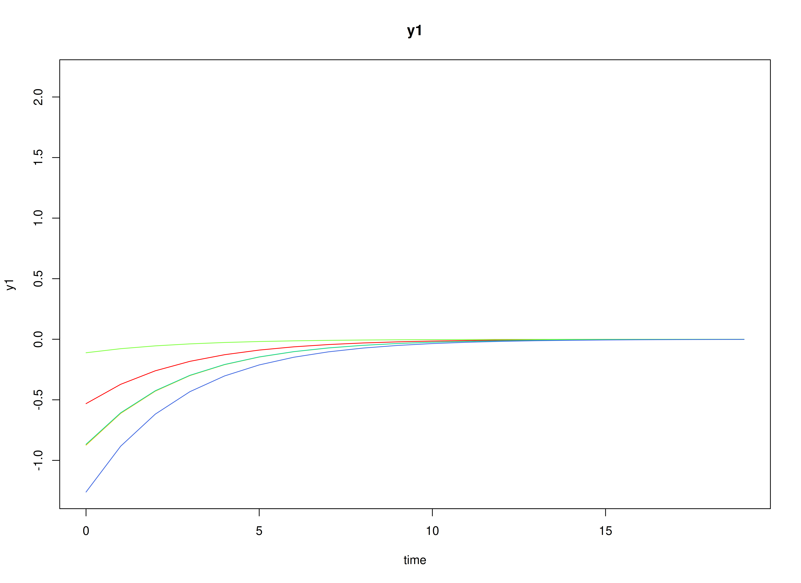
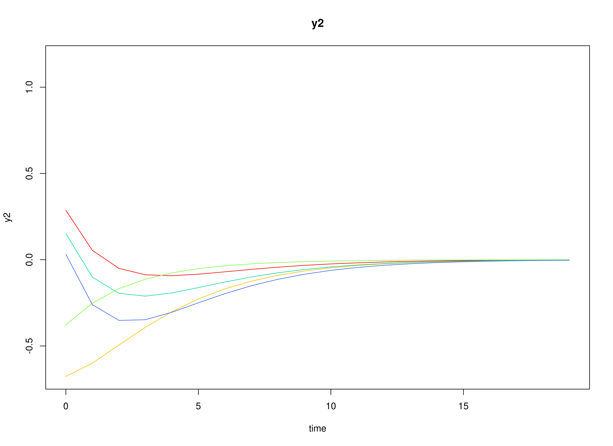
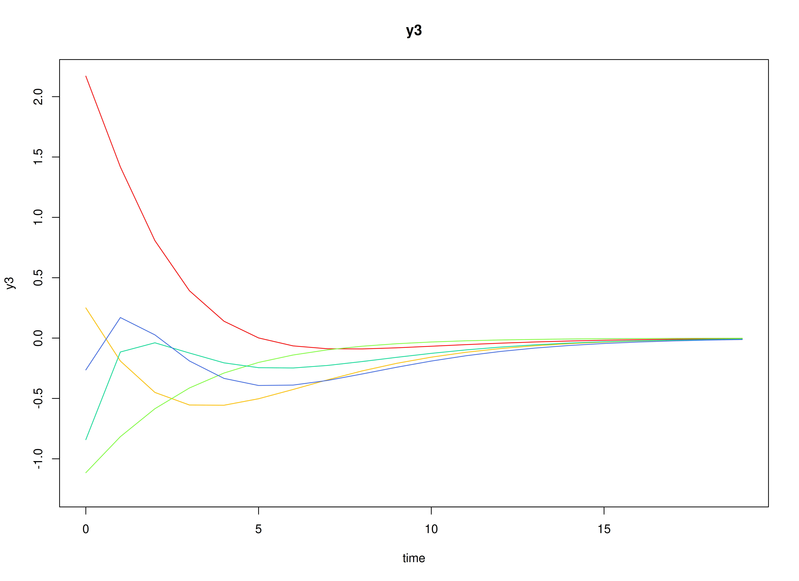
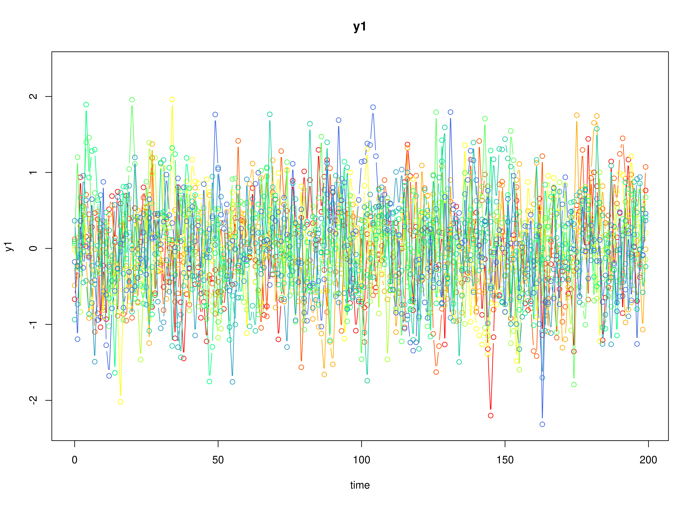
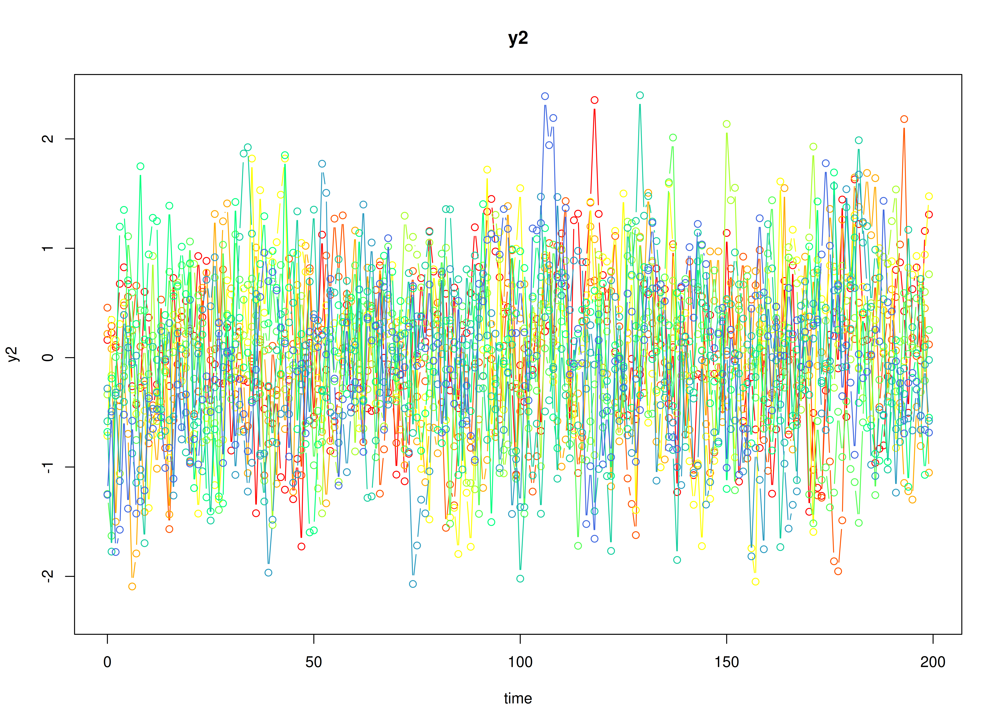
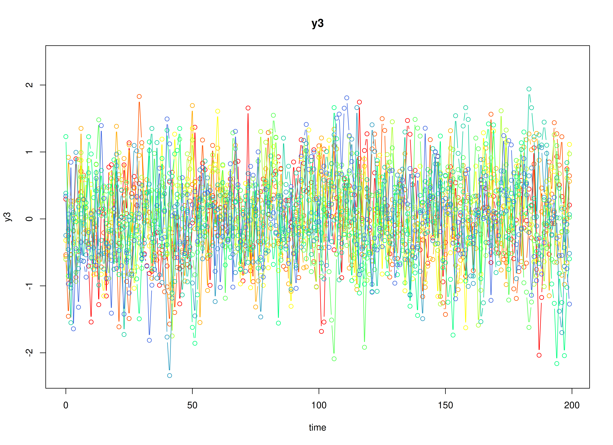
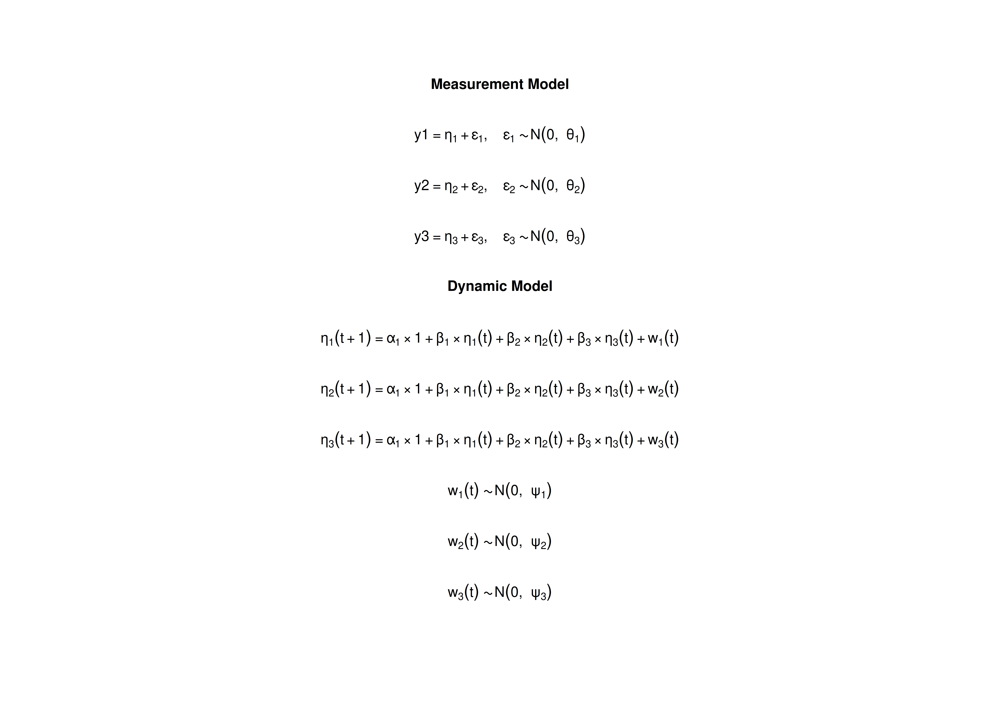

# The State Space Model

## Model

The measurement model is given by
``` math
\begin{equation}
  \mathbf{y}_{i, t}
  =
  \boldsymbol{\nu}
  +
  \boldsymbol{\Lambda}
  \boldsymbol{\eta}_{i, t}
  +
  \boldsymbol{\varepsilon}_{i, t},
  \quad
  \mathrm{with}
  \quad
  \boldsymbol{\varepsilon}_{i, t}
  \sim
  \mathcal{N}
  \left(
  \mathbf{0},
  \boldsymbol{\Theta}
  \right)
\end{equation}
```
where $`\mathbf{y}_{i, t}`$, $`\boldsymbol{\eta}_{i, t}`$, and
$`\boldsymbol{\varepsilon}_{i, t}`$ are random variables and
$`\boldsymbol{\nu}`$, $`\boldsymbol{\Lambda}`$, and
$`\boldsymbol{\Theta}`$ are model parameters. $`\mathbf{y}_{i, t}`$
represents a vector of observed random variables,
$`\boldsymbol{\eta}_{i, t}`$ a vector of latent random variables, and
$`\boldsymbol{\varepsilon}_{i, t}`$ a vector of random measurement
errors, at time $`t`$ and individual $`i`$. $`\boldsymbol{\nu}`$ denotes
a vector of intercepts, $`\boldsymbol{\Lambda}`$ a matrix of factor
loadings, and $`\boldsymbol{\Theta}`$ the covariance matrix of
$`\boldsymbol{\varepsilon}`$.

An alternative representation of the measurement error is given by
``` math
\begin{equation}
  \boldsymbol{\varepsilon}_{i, t}
  =
  \boldsymbol{\Theta}^{\frac{1}{2}}
  \mathbf{z}_{i, t},
  \quad
  \mathrm{with}
  \quad
  \mathbf{z}_{i, t}
  \sim
  \mathcal{N}
  \left(
  \mathbf{0},
  \mathbf{I}
  \right)
\end{equation}
```
where $`\mathbf{z}_{i, t}`$ is a vector of independent standard normal
random variables and
$`\left( \boldsymbol{\Theta}^{\frac{1}{2}} \right) \left( \boldsymbol{\Theta}^{\frac{1}{2}} \right)^{\prime} = \boldsymbol{\Theta}`$
.

The dynamic structure is given by
``` math
\begin{equation}
  \boldsymbol{\eta}_{i, t}
  =
  \boldsymbol{\alpha}
  +
  \boldsymbol{\beta}
  \boldsymbol{\eta}_{i, t - 1}
  +
  \boldsymbol{\zeta}_{i, t},
  \quad
  \mathrm{with}
  \quad
  \boldsymbol{\zeta}_{i, t}
  \sim
  \mathcal{N}
  \left(
  \mathbf{0},
  \boldsymbol{\Psi}
  \right)
\end{equation}
```
where $`\boldsymbol{\eta}_{i, t}`$, $`\boldsymbol{\eta}_{i, t - 1}`$,
and $`\boldsymbol{\zeta}_{i, t}`$ are random variables, and
$`\boldsymbol{\alpha}`$, $`\boldsymbol{\beta}`$, and
$`\boldsymbol{\Psi}`$ are model parameters. Here,
$`\boldsymbol{\eta}_{i, t}`$ is a vector of latent variables at time
$`t`$ and individual $`i`$, $`\boldsymbol{\eta}_{i, t - 1}`$ represents
a vector of latent variables at time $`t - 1`$ and individual $`i`$, and
$`\boldsymbol{\zeta}_{i, t}`$ represents a vector of dynamic noise at
time $`t`$ and individual $`i`$. $`\boldsymbol{\alpha}`$ denotes a
vector of intercepts, $`\boldsymbol{\beta}`$ a matrix of autoregression
and cross regression coefficients, and $`\boldsymbol{\Psi}`$ the
covariance matrix of $`\boldsymbol{\zeta}_{i, t}`$.

An alternative representation of the dynamic noise is given by
``` math
\begin{equation}
  \boldsymbol{\zeta}_{i, t}
  =
  \boldsymbol{\Psi}^{\frac{1}{2}}
  \mathbf{z}_{i, t},
  \quad
  \mathrm{with}
  \quad
  \mathbf{z}_{i, t}
  \sim
  \mathcal{N}
  \left(
  \mathbf{0},
  \mathbf{I}
  \right)
\end{equation}
```
where
$`\left( \boldsymbol{\Psi}^{\frac{1}{2}} \right) \left( \boldsymbol{\Psi}^{\frac{1}{2}} \right)^{\prime} = \boldsymbol{\Psi}`$
.

## Data Generation

### Notation

Let $`t = 200`$ be the number of time points and $`n = 10`$ be the
number of individuals.

Let the measurement model intecept vector $`\boldsymbol{\nu}`$ be given
by

``` math
\begin{equation}
\boldsymbol{\nu}
=
\left(
\begin{array}{c}
  0 \\
  0 \\
  0 \\
\end{array}
\right) .
\end{equation}
```

Let the factor loadings matrix $`\boldsymbol{\Lambda}`$ be given by

``` math
\begin{equation}
\boldsymbol{\Lambda}
=
\left(
\begin{array}{ccc}
  1 & 0 & 0 \\
  0 & 1 & 0 \\
  0 & 0 & 1 \\
\end{array}
\right) .
\end{equation}
```

Let the measurement error covariance matrix $`\boldsymbol{\Theta}`$ be
given by

``` math
\begin{equation}
\boldsymbol{\Theta}
=
\left(
\begin{array}{ccc}
  0.2 & 0 & 0 \\
  0 & 0.2 & 0 \\
  0 & 0 & 0.2 \\
\end{array}
\right) .
\end{equation}
```

Let the initial condition $`\boldsymbol{\eta}_{0}`$ be given by

``` math
\begin{equation}
\boldsymbol{\eta}_{0} \sim \mathcal{N} \left( \boldsymbol{\mu}_{\boldsymbol{\eta} \mid 0}, \boldsymbol{\Sigma}_{\boldsymbol{\eta} \mid 0} \right)
\end{equation}
```

``` math
\begin{equation}
\boldsymbol{\mu}_{\boldsymbol{\eta} \mid 0}
=
\left(
\begin{array}{c}
  0 \\
  0 \\
  0 \\
\end{array}
\right)
\end{equation}
```

``` math
\begin{equation}
\boldsymbol{\Sigma}_{\boldsymbol{\eta} \mid 0}
=
\left(
\begin{array}{ccc}
  0.1960784 & 0.1183232 & 0.0298539 \\
  0.1183232 & 0.3437711 & 0.1381855 \\
  0.0298539 & 0.1381855 & 0.2663828 \\
\end{array}
\right) .
\end{equation}
```

Let the constant vector $`\boldsymbol{\alpha}`$ be given by

``` math
\begin{equation}
\boldsymbol{\alpha}
=
\left(
\begin{array}{c}
  0 \\
  0 \\
  0 \\
\end{array}
\right) .
\end{equation}
```

Let the transition matrix $`\boldsymbol{\beta}`$ be given by

``` math
\begin{equation}
\boldsymbol{\beta}
=
\left(
\begin{array}{ccc}
  0.7 & 0 & 0 \\
  0.5 & 0.6 & 0 \\
  -0.1 & 0.4 & 0.5 \\
\end{array}
\right) .
\end{equation}
```

Let the dynamic process noise $`\boldsymbol{\Psi}`$ be given by

``` math
\begin{equation}
\boldsymbol{\Psi}
=
\left(
\begin{array}{ccc}
  0.1 & 0 & 0 \\
  0 & 0.1 & 0 \\
  0 & 0 & 0.1 \\
\end{array}
\right) .
\end{equation}
```

### R Function Arguments

\
`n`\
`#> [1] 10`\
`time`\
`#> [1] 200`\
`mu0`\
`#> [1] 0 0 0`\
`sigma0`\
`#>            [,1]      [,2]       [,3]`\
`#> [1,] 0.19607843 0.1183232 0.02985385`\
`#> [2,] 0.11832319 0.3437711 0.13818551`\
`#> [3,] 0.02985385 0.1381855 0.26638284`\
`sigma0_l`` ``# sigma0_l <- t(chol(sigma0))`\
`#>            [,1]      [,2]     [,3]`\
`#> [1,] 0.44280744 0.0000000 0.000000`\
`#> [2,] 0.26721139 0.5218900 0.000000`\
`#> [3,] 0.06741949 0.2302597 0.456966`\
`alpha`\
`#> [1] 0 0 0`\
`beta`\
`#>      [,1] [,2] [,3]`\
`#> [1,]  0.7  0.0  0.0`\
`#> [2,]  0.5  0.6  0.0`\
`#> [3,] -0.1  0.4  0.5`\
`psi`\
`#>      [,1] [,2] [,3]`\
`#> [1,]  0.1  0.0  0.0`\
`#> [2,]  0.0  0.1  0.0`\
`#> [3,]  0.0  0.0  0.1`\
`psi_l`` ``# psi_l <- t(chol(psi))`\
`#>           [,1]      [,2]      [,3]`\
`#> [1,] 0.3162278 0.0000000 0.0000000`\
`#> [2,] 0.0000000 0.3162278 0.0000000`\
`#> [3,] 0.0000000 0.0000000 0.3162278`\
`nu`\
`#> [1] 0 0 0`\
`lambda`\
`#>      [,1] [,2] [,3]`\
`#> [1,]    1    0    0`\
`#> [2,]    0    1    0`\
`#> [3,]    0    0    1`\
`theta`\
`#>      [,1] [,2] [,3]`\
`#> [1,]  0.2  0.0  0.0`\
`#> [2,]  0.0  0.2  0.0`\
`#> [3,]  0.0  0.0  0.2`\
`theta_l`` ``# theta_l <- t(chol(theta))`\
`#>           [,1]      [,2]      [,3]`\
`#> [1,] 0.4472136 0.0000000 0.0000000`\
`#> [2,] 0.0000000 0.4472136 0.0000000`\
`#> [3,] 0.0000000 0.0000000 0.4472136`

### Visualizing the Dynamics Without Process Noise (n = 5 with Different Initial Condition)



### Using the `SimSSMFixed` Function from the `simStateSpace` Package to Simulate Data

\
[`library`](https://rdrr.io/r/base/library.html)`(`[`simStateSpace`](https://github.com/jeksterslab/simStateSpace)`)`\
`sim`` ``<-`` `[`SimSSMFixed`](https://github.com/jeksterslab/simStateSpace/reference/SimSSMFixed.md)`(`\
`  n ``=`` ``n``,`\
`  time ``=`` ``time``,`\
`  mu0 ``=`` ``mu0``,`\
`  sigma0_l ``=`` ``sigma0_l``,`\
`  alpha ``=`` ``alpha``,`\
`  beta ``=`` ``beta``,`\
`  psi_l ``=`` ``psi_l``,`\
`  nu ``=`` ``nu``,`\
`  lambda ``=`` ``lambda``,`\
`  theta_l ``=`` ``theta_l``,`\
`  type ``=`` ``0`\
`)`\
`data`` ``<-`` `[`as.data.frame`](https://rdrr.io/r/base/as.data.frame.html)`(``sim``)`\
[`head`](https://rdrr.io/r/utils/head.html)`(``data``)`\
`#>   id time          y1         y2         y3`\
`#> 1  1    0 -0.66908807 0.16178434  0.2955693`\
`#> 2  1    1 -0.23021811 0.22873073 -0.2540210`\
`#> 3  1    2  0.93689389 0.09496693 -0.9267506`\
`#> 4  1    3  0.04445794 0.67521289 -0.1792168`\
`#> 5  1    4  0.15413707 0.82591676  0.8976536`\
`#> 6  1    5 -0.09943698 0.67154173  0.2853507`\
[`summary`](https://rdrr.io/r/base/summary.html)`(``data``)`\
`#>        id            time              y1                  y2           `\
`#>  Min.   : 1.0   Min.   :  0.00   Min.   :-2.315283   Min.   :-2.092224  `\
`#>  1st Qu.: 3.0   1st Qu.: 49.75   1st Qu.:-0.419229   1st Qu.:-0.486763  `\
`#>  Median : 5.5   Median : 99.50   Median : 0.004236   Median : 0.034591  `\
`#>  Mean   : 5.5   Mean   : 99.50   Mean   :-0.002387   Mean   : 0.008276  `\
`#>  3rd Qu.: 8.0   3rd Qu.:149.25   3rd Qu.: 0.414362   3rd Qu.: 0.499517  `\
`#>  Max.   :10.0   Max.   :199.00   Max.   : 1.961879   Max.   : 2.398964  `\
`#>        y3          `\
`#>  Min.   :-2.34002  `\
`#>  1st Qu.:-0.41118  `\
`#>  Median : 0.02153  `\
`#>  Mean   : 0.02317  `\
`#>  3rd Qu.: 0.45024  `\
`#>  Max.   : 1.94049`\
[`plot`](https://rdrr.io/r/graphics/plot.default.html)`(``sim``)`



## Model Fitting

### Prepare Data

\
`dynr_data`` ``<-`` ``dynr``::`[`dynr.data`](https://rdrr.io/pkg/dynr/man/dynr.data.html)`(`\
`  data ``=`` ``data``,`\
`  id ``=`` ``"id"``,`\
`  time ``=`` ``"time"``,`\
`  observed ``=`` `[`c`](https://rdrr.io/r/base/c.html)`(``"y1"``, ``"y2"``, ``"y3"``)`\
`)`

### Prepare Initial Condition

\
`dynr_initial`` ``<-`` ``dynr``::`[`prep.initial`](https://rdrr.io/pkg/dynr/man/prep.initial.html)`(`\
`  values.inistate ``=`` ``mu0``,`\
`  params.inistate ``=`` `[`c`](https://rdrr.io/r/base/c.html)`(``"mu0_1_1"``, ``"mu0_2_1"``, ``"mu0_3_1"``)``,`\
`  values.inicov ``=`` ``sigma0``,`\
`  params.inicov ``=`` `[`matrix`](https://rdrr.io/r/base/matrix.html)`(`\
`    data ``=`` `[`c`](https://rdrr.io/r/base/c.html)`(`\
`      ``"sigma0_1_1"``, ``"sigma0_2_1"``, ``"sigma0_3_1"``,`\
`      ``"sigma0_2_1"``, ``"sigma0_2_2"``, ``"sigma0_3_2"``,`\
`      ``"sigma0_3_1"``, ``"sigma0_3_2"``, ``"sigma0_3_3"`\
`    ``)``,`\
`    nrow ``=`` ``3`\
`  ``)`\
`)`

### Prepare Measurement Model

\
`dynr_measurement`` ``<-`` ``dynr``::`[`prep.measurement`](https://rdrr.io/pkg/dynr/man/prep.measurement.html)`(`\
`  values.load ``=`` `[`diag`](https://rdrr.io/r/base/diag.html)`(``3``)``,`\
`  params.load ``=`` `[`matrix`](https://rdrr.io/r/base/matrix.html)`(``data ``=`` ``"fixed"``, nrow ``=`` ``3``, ncol ``=`` ``3``)``,`\
`  state.names ``=`` `[`c`](https://rdrr.io/r/base/c.html)`(``"eta_1"``, ``"eta_2"``, ``"eta_3"``)``,`\
`  obs.names ``=`` `[`c`](https://rdrr.io/r/base/c.html)`(``"y1"``, ``"y2"``, ``"y3"``)`\
`)`

### Prepare Dynamic Process

\
`dynr_dynamics`` ``<-`` ``dynr``::`[`prep.formulaDynamics`](https://rdrr.io/pkg/dynr/man/prep.formulaDynamics.html)`(`\
`  formula ``=`` `[`list`](https://rdrr.io/r/base/list.html)`(`\
`    ``eta_1`` ``~`` ``alpha_1_1`` ``*`` ``1`` ``+`` ``beta_1_1`` ``*`` ``eta_1`` ``+`` ``beta_1_2`` ``*`` ``eta_2`` ``+`` ``beta_1_3`` ``*`` ``eta_3``,`\
`    ``eta_2`` ``~`` ``alpha_2_1`` ``*`` ``1`` ``+`` ``beta_2_1`` ``*`` ``eta_1`` ``+`` ``beta_2_2`` ``*`` ``eta_2`` ``+`` ``beta_2_3`` ``*`` ``eta_3``,`\
`    ``eta_3`` ``~`` ``alpha_3_1`` ``*`` ``1`` ``+`` ``beta_3_1`` ``*`` ``eta_1`` ``+`` ``beta_3_2`` ``*`` ``eta_2`` ``+`` ``beta_3_3`` ``*`` ``eta_3`\
`  ``)``,`\
`  startval ``=`` `[`c`](https://rdrr.io/r/base/c.html)`(`\
`    alpha_1_1 ``=`` ``alpha``[``1``]``, alpha_2_1 ``=`` ``alpha``[``2``]``, alpha_3_1 ``=`` ``alpha``[``3``]``,`\
`    beta_1_1 ``=`` ``beta``[``1``, ``1``]``, beta_1_2 ``=`` ``beta``[``1``, ``2``]``, beta_1_3 ``=`` ``beta``[``1``, ``3``]``,`\
`    beta_2_1 ``=`` ``beta``[``2``, ``1``]``, beta_2_2 ``=`` ``beta``[``2``, ``2``]``, beta_2_3 ``=`` ``beta``[``2``, ``3``]``,`\
`    beta_3_1 ``=`` ``beta``[``3``, ``1``]``, beta_3_2 ``=`` ``beta``[``3``, ``2``]``, beta_3_3 ``=`` ``beta``[``3``, ``3``]`\
`  ``)``,`\
`  isContinuousTime ``=`` ``FALSE`\
`)`

### Prepare Process Noise

\
`dynr_noise`` ``<-`` ``dynr``::`[`prep.noise`](https://rdrr.io/pkg/dynr/man/prep.noise.html)`(`\
`  values.latent ``=`` ``psi``,`\
`  params.latent ``=`` `[`matrix`](https://rdrr.io/r/base/matrix.html)`(`\
`    data ``=`` `[`c`](https://rdrr.io/r/base/c.html)`(`\
`      ``"psi_1_1"``, ``"psi_2_1"``, ``"psi_3_1"``,`\
`      ``"psi_2_1"``, ``"psi_2_2"``, ``"psi_3_2"``,`\
`      ``"psi_3_1"``, ``"psi_3_2"``, ``"psi_3_3"`\
`    ``)``,`\
`    nrow ``=`` ``3`\
`  ``)``,`\
`  values.observed ``=`` ``theta``,`\
`  params.observed ``=`` `[`matrix`](https://rdrr.io/r/base/matrix.html)`(`\
`    data ``=`` `[`c`](https://rdrr.io/r/base/c.html)`(`\
`      ``"theta_1_1"``, ``"fixed"``, ``"fixed"``,`\
`      ``"fixed"``, ``"theta_2_2"``, ``"fixed"``,`\
`      ``"fixed"``, ``"fixed"``, ``"theta_3_3"`\
`    ``)``,`\
`    nrow ``=`` ``3`\
`  ``)`\
`)`

### Prepare the Model

\
`model`` ``<-`` ``dynr``::`[`dynr.model`](https://rdrr.io/pkg/dynr/man/dynr.model.html)`(`\
`  data ``=`` ``dynr_data``,`\
`  initial ``=`` ``dynr_initial``,`\
`  measurement ``=`` ``dynr_measurement``,`\
`  dynamics ``=`` ``dynr_dynamics``,`\
`  noise ``=`` ``dynr_noise``,`\
`  outfile ``=`` ``"ssm.c"`\
`)`



### Fit the Model

\
`results`` ``<-`` ``dynr``::`[`dynr.cook`](https://rdrr.io/pkg/dynr/man/dynr.cook.html)`(`\
`  ``model``,`\
`  debug_flag ``=`` ``TRUE``,`\
`  verbose ``=`` ``FALSE`\
`)`\
`#> [1] "Get ready!!!!"`\
`#> using C compiler: ‘gcc (Ubuntu 13.3.0-6ubuntu2~24.04.1) 13.3.0’`\
`#> Optimization function called.`\
`#> Starting Hessian calculation ...`\
`#> Finished Hessian calculation.`\
`#> Original exit flag:  3 `\
`#> Modified exit flag:  3 `\
`#> Optimization terminated successfully: ftol_rel or ftol_abs was reached. `\
`#> Original fitted parameters:  0.0005368551 0.008235204 0.01013316 0.6868813 `\
`#> 0.001730164 0.002913755 0.4675764 0.5965132 -0.02147487 -0.05326514 0.392605 `\
`#> 0.4365367 -2.256573 0.02711671 -0.1489293 -2.151777 0.006419125 -2.127149 `\
`#> -1.660823 -1.662211 -1.8253 -0.1725023 -0.5161966 -0.02439533 -3.778195 `\
`#> 0.2891856 -0.07200593 -1.639686 -0.8167291 -4.247308 `\
`#> `\
`#> Transformed fitted parameters:  0.0005368551 0.008235204 0.01013316 0.6868813 `\
`#> 0.001730164 0.002913755 0.4675764 0.5965132 -0.02147487 -0.05326514 0.392605 `\
`#> 0.4365367 0.1047087 0.002839356 -0.0155942 0.1163543 0.0003235351 0.1215038 `\
`#> 0.1899826 0.1897191 0.1611693 -0.1725023 -0.5161966 -0.02439533 0.02286392 `\
`#> 0.006611915 -0.001646338 0.195953 -0.158955 0.1438555 `\
`#> `\
`#> Doing end processing`\
`#> Successful trial`\
`#> Total Time: 1.129163 `\
`#> Backend Time: 1.116476`

## Summary

\
[`summary`](https://rdrr.io/r/base/summary.html)`(``results``)`\
`#> Coefficients:`\
`#>              Estimate Std. Error t value   ci.lower   ci.upper Pr(>|t|)    `\
`#> alpha_1_1   0.0005369  0.0079153   0.068 -0.0149769  0.0160506   0.4730    `\
`#> alpha_2_1   0.0082352  0.0097797   0.842 -0.0109327  0.0274031   0.1999    `\
`#> alpha_3_1   0.0101332  0.0101396   0.999 -0.0097401  0.0300064   0.1589    `\
`#> beta_1_1    0.6868813  0.0707792   9.705  0.5481566  0.8256059   <2e-16 ***`\
`#> beta_1_2    0.0017302  0.0442688   0.039 -0.0850350  0.0884954   0.4844    `\
`#> beta_1_3    0.0029138  0.0324456   0.090 -0.0606784  0.0665059   0.4642    `\
`#> beta_2_1    0.4675764  0.0659382   7.091  0.3383398  0.5968130   <2e-16 ***`\
`#> beta_2_2    0.5965132  0.0513398  11.619  0.4958890  0.6971373   <2e-16 ***`\
`#> beta_2_3   -0.0214749  0.0371144  -0.579 -0.0942178  0.0512681   0.2815    `\
`#> beta_3_1   -0.0532651  0.0545359  -0.977 -0.1601536  0.0536233   0.1644    `\
`#> beta_3_2    0.3926050  0.0578475   6.787  0.2792261  0.5059839   <2e-16 ***`\
`#> beta_3_3    0.4365367  0.0601856   7.253  0.3185752  0.5544983   <2e-16 ***`\
`#> psi_1_1     0.1047087  0.0229502   4.562  0.0597272  0.1496902   <2e-16 ***`\
`#> psi_2_1     0.0028394  0.0077629   0.366 -0.0123756  0.0180543   0.3573    `\
`#> psi_3_1    -0.0155942  0.0073753  -2.114 -0.0300495 -0.0011389   0.0173 *  `\
`#> psi_2_2     0.1163543  0.0202244   5.753  0.0767152  0.1559934   <2e-16 ***`\
`#> psi_3_2     0.0003235  0.0074576   0.043 -0.0142931  0.0149401   0.4827    `\
`#> psi_3_3     0.1215038  0.0285189   4.260  0.0656079  0.1773998   <2e-16 ***`\
`#> theta_1_1   0.1899826  0.0189303  10.036  0.1528799  0.2270852   <2e-16 ***`\
`#> theta_2_2   0.1897191  0.0191982   9.882  0.1520913  0.2273468   <2e-16 ***`\
`#> theta_3_3   0.1611693  0.0276434   5.830  0.1069893  0.2153493   <2e-16 ***`\
`#> mu0_1_1    -0.1725023  0.1211585  -1.424 -0.4099686  0.0649639   0.0773 .  `\
`#> mu0_2_1    -0.5161966  0.1840950  -2.804 -0.8770163 -0.1553770   0.0025 ** `\
`#> mu0_3_1    -0.0243953  0.1716182  -0.142 -0.3607608  0.3119701   0.4435    `\
`#> sigma0_1_1  0.0228639  0.0667235   0.343 -0.1079117  0.1536396   0.3659    `\
`#> sigma0_2_1  0.0066119  0.0774783   0.085 -0.1452427  0.1584665   0.4660    `\
`#> sigma0_3_1 -0.0016463  0.0708905  -0.023 -0.1405892  0.1372966   0.4907    `\
`#> sigma0_2_2  0.1959530  0.1521411   1.288 -0.1022380  0.4941440   0.0990 .  `\
`#> sigma0_3_2 -0.1589550  0.1134158  -1.402 -0.3812458  0.0633359   0.0806 .  `\
`#> sigma0_3_3  0.1438555  0.1326337   1.085 -0.1161018  0.4038129   0.1391    `\
`#> ---`\
`#> Signif. codes:  0 '***' 0.001 '**' 0.01 '*' 0.05 '.' 0.1 ' ' 1`\
`#> `\
`#> -2 log-likelihood value at convergence = 10423.49`\
`#> AIC = 10483.49`\
`#> BIC = 10651.52`

### Parameter Estimates

\
`alpha_hat`\
`#> [1] 0.0005368551 0.0082352036 0.0101331642`\
`beta_hat`\
`#>             [,1]        [,2]         [,3]`\
`#> [1,]  0.68688127 0.001730164  0.002913755`\
`#> [2,]  0.46757640 0.596513193 -0.021474870`\
`#> [3,] -0.05326514 0.392605010  0.436536740`\
`psi_hat`\
`#>              [,1]         [,2]          [,3]`\
`#> [1,]  0.104708721 0.0028393563 -0.0155942013`\
`#> [2,]  0.002839356 0.1163542997  0.0003235351`\
`#> [3,] -0.015594201 0.0003235351  0.1215038272`\
`theta_hat`\
`#>           [,1]      [,2]      [,3]`\
`#> [1,] 0.1899826 0.0000000 0.0000000`\
`#> [2,] 0.0000000 0.1897191 0.0000000`\
`#> [3,] 0.0000000 0.0000000 0.1611693`\
`mu0_hat`\
`#> [1] -0.17250235 -0.51619664 -0.02439533`\
`sigma0_hat`\
`#>              [,1]         [,2]         [,3]`\
`#> [1,]  0.022863919  0.006611915 -0.001646338`\
`#> [2,]  0.006611915  0.195953002 -0.158954973`\
`#> [3,] -0.001646338 -0.158954973  0.143855534`

## References

Chow, S.-M., Ho, M. R., Hamaker, E. L., & Dolan, C. V. (2010).
Equivalence and differences between structural equation modeling and
state-space modeling techniques. *Structural Equation Modeling: A
Multidisciplinary Journal*, *17*(2), 303–332.
<https://doi.org/10.1080/10705511003661553>

Ou, L., Hunter, M. D., & Chow, S.-M. (2019). What’s for dynr: A package
for linear and nonlinear dynamic modeling in R. *The R Journal*,
*11*(1), 91. <https://doi.org/10.32614/rj-2019-012>

Pesigan, I. J. A., Russell, M. A., & Chow, S.-M. (2025). Inferences and
effect sizes for direct, indirect, and total effects in continuous-time
mediation models. *Psychological Methods*.
<https://doi.org/10.1037/met0000779>

R Core Team. (2026). *R: A language and environment for statistical
computing*. R Foundation for Statistical Computing.
<https://www.R-project.org/>
