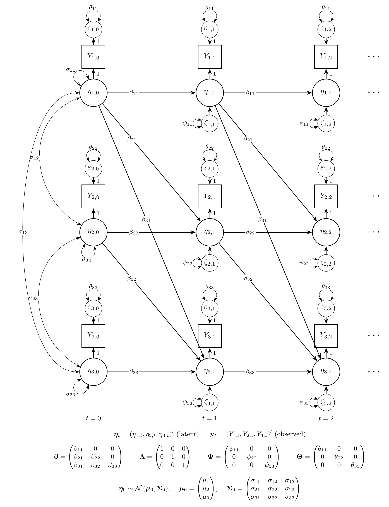
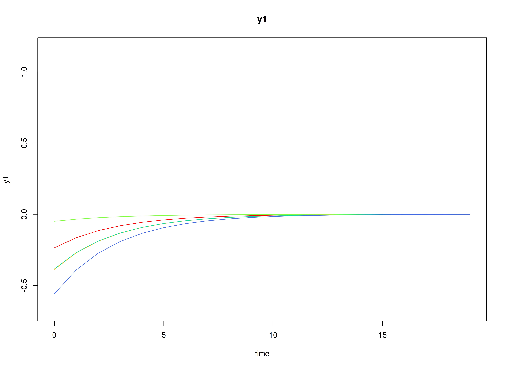
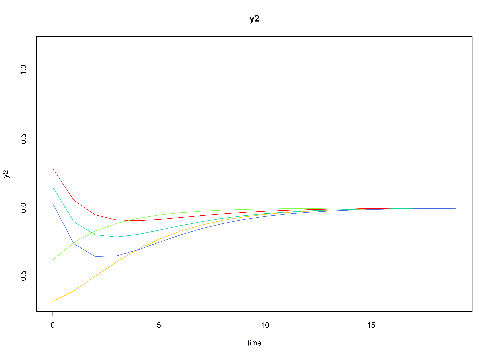
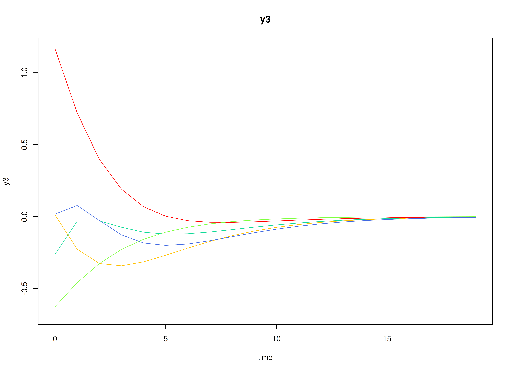
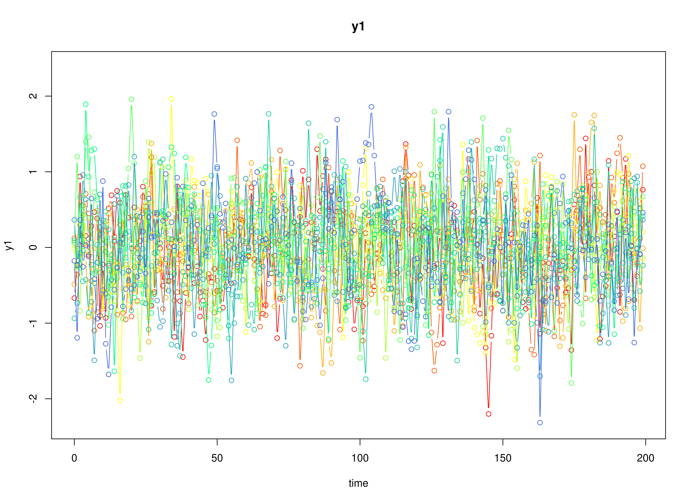
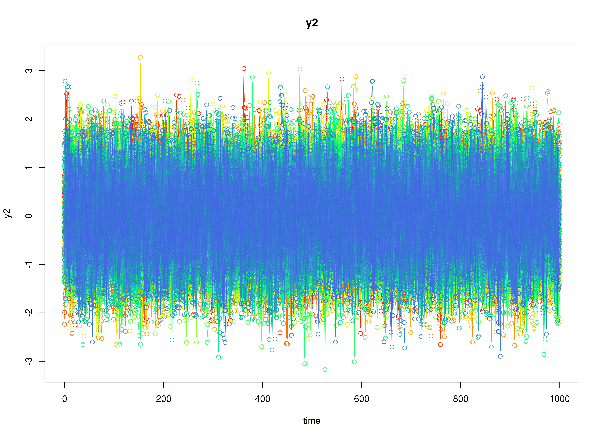
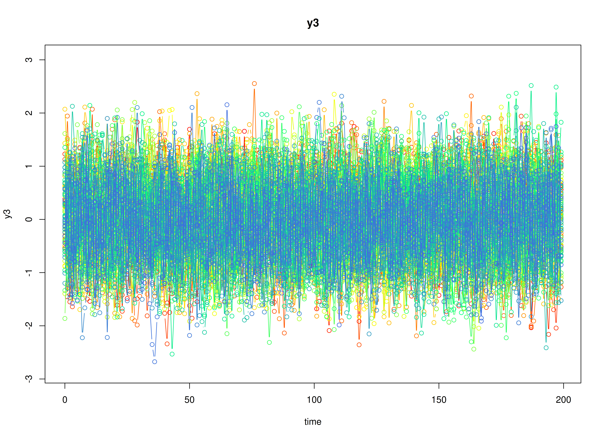
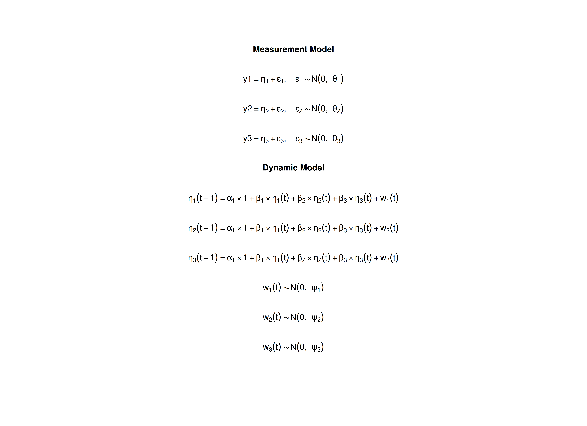

# The State Space Model

## Overview

A state space model describes variables that we cannot observe directly
(latent states) and how they change over time, using repeated,
error-prone measurements of them. It has two parts: a measurement model
that links the observed variables to the latent states, and a dynamic
model that describes how the latent states carry over and influence each
other from one occasion to the next.

This tutorial does three things:

1.  It writes a state space model with a first-order vector
    autoregressive dynamic model.
2.  It simulates data from the model with
    [`SimSSMFixed()`](https://github.com/jeksterslab/simStateSpace/reference/SimSSMFixed.md),
    with every individual sharing the same parameters.
3.  It fits the model to the simulated data with the `dynr` package and
    compares the estimates with the values used to simulate the data.

No prior knowledge of state space models is needed. If the model without
measurement error is enough for you, see the vignette on the vector
autoregressive model.

## Model

The measurement model is given by \\\[\begin{equation} \mathbf{y}\_{i,
t} = \boldsymbol{\nu} + \boldsymbol{\Lambda} \boldsymbol{\eta}\_{i, t} +
\boldsymbol{\varepsilon}\_{i, t}, \quad \mathrm{with} \quad
\boldsymbol{\varepsilon}\_{i, t} \sim \mathcal{N} \left( \mathbf{0},
\boldsymbol{\Theta} \right) \end{equation}\\\] where \\(\mathbf{y}\_{i,
t}\\), \\(\boldsymbol{\eta}\_{i, t}\\), and
\\(\boldsymbol{\varepsilon}\_{i, t}\\) are random variables and
\\(\boldsymbol{\nu}\\), \\(\boldsymbol{\Lambda}\\), and
\\(\boldsymbol{\Theta}\\) are model parameters. \\(\mathbf{y}\_{i, t}\\)
represents a vector of observed random variables,
\\(\boldsymbol{\eta}\_{i, t}\\) a vector of latent random variables, and
\\(\boldsymbol{\varepsilon}\_{i, t}\\) a vector of random measurement
errors, at time \\(t\\) and individual \\(i\\). \\(\boldsymbol{\nu}\\)
denotes a vector of intercepts, \\(\boldsymbol{\Lambda}\\) a matrix of
factor loadings, and \\(\boldsymbol{\Theta}\\) the covariance matrix of
\\(\boldsymbol{\varepsilon}\\).

In words, each observed variable is an intercept plus a weighted
combination of the latent variables plus measurement error. The latent
variables \\(\boldsymbol{\eta}\_{i, t}\\) are the quantities we care
about (for example, a person’s true stress level), and the observed
variables \\(\mathbf{y}\_{i, t}\\) are noisy measurements of them.
Separating measurement error from true change is the main reason to use
a state space model: measurement error affects only the occasion it
occurs on, while changes in the latent variables carry over in time.

An alternative representation of the measurement error is given by
\\\[\begin{equation} \boldsymbol{\varepsilon}\_{i, t} =
\boldsymbol{\Theta}^{\frac{1}{2}} \mathbf{z}\_{i, t}, \quad
\mathrm{with} \quad \mathbf{z}\_{i, t} \sim \mathcal{N} \left(
\mathbf{0}, \mathbf{I} \right) \end{equation}\\\] where
\\(\mathbf{z}\_{i, t}\\) is a vector of independent standard normal
random variables and \\(\left( \boldsymbol{\Theta}^{\frac{1}{2}} \right)
\left( \boldsymbol{\Theta}^{\frac{1}{2}} \right)^{\prime} =
\boldsymbol{\Theta}\\) .

The dynamic structure is given by \\\[\begin{equation}
\boldsymbol{\eta}\_{i, t} = \boldsymbol{\alpha} + \boldsymbol{\beta}
\boldsymbol{\eta}\_{i, t - 1} + \boldsymbol{\zeta}\_{i, t}, \quad
\mathrm{with} \quad \boldsymbol{\zeta}\_{i, t} \sim \mathcal{N} \left(
\mathbf{0}, \boldsymbol{\Psi} \right) \end{equation}\\\] where
\\(\boldsymbol{\eta}\_{i, t}\\), \\(\boldsymbol{\eta}\_{i, t - 1}\\),
and \\(\boldsymbol{\zeta}\_{i, t}\\) are random variables, and
\\(\boldsymbol{\alpha}\\), \\(\boldsymbol{\beta}\\), and
\\(\boldsymbol{\Psi}\\) are model parameters. Here,
\\(\boldsymbol{\eta}\_{i, t}\\) is a vector of latent variables at time
\\(t\\) and individual \\(i\\), \\(\boldsymbol{\eta}\_{i, t - 1}\\)
represents a vector of latent variables at time \\(t - 1\\) and
individual \\(i\\), and \\(\boldsymbol{\zeta}\_{i, t}\\) represents a
vector of dynamic noise at time \\(t\\) and individual \\(i\\).
\\(\boldsymbol{\alpha}\\) denotes a vector of intercepts,
\\(\boldsymbol{\beta}\\) a matrix of autoregression and cross regression
coefficients, and \\(\boldsymbol{\Psi}\\) the covariance matrix of
\\(\boldsymbol{\zeta}\_{i, t}\\).

In words, each latent variable at time \\(t\\) is a weighted sum of all
the latent variables at time \\(t - 1\\), plus an intercept and a random
shock. The weights are the elements of \\(\boldsymbol{\beta}\\):

- A diagonal element \\(\beta\_{jj}\\) is the autoregressive effect, how
  much of variable \\(j\\) carries over to the next occasion. Values
  closer to 1 mean the variable changes slowly (high inertia).
- An off-diagonal element \\(\beta\_{jk}\\) is the cross-lagged effect
  of variable \\(k\\) at time \\(t - 1\\) on variable \\(j\\) at time
  \\(t\\). Note the order: the row is the outcome, the column is the
  predictor.

The shocks \\(\boldsymbol{\zeta}\_{i, t}\\) stand for everything that
moves the latent variables that the model does not explain. Unlike
measurement error, a shock carries over to later occasions through
\\(\boldsymbol{\beta}\\). For the process to settle around a stable
mean, all eigenvalues of \\(\boldsymbol{\beta}\\) must have modulus less
than 1.

An alternative representation of the dynamic noise is given by
\\\[\begin{equation} \boldsymbol{\zeta}\_{i, t} =
\boldsymbol{\Psi}^{\frac{1}{2}} \mathbf{z}\_{i, t}, \quad \mathrm{with}
\quad \mathbf{z}\_{i, t} \sim \mathcal{N} \left( \mathbf{0}, \mathbf{I}
\right) \end{equation}\\\] where \\(\left(
\boldsymbol{\Psi}^{\frac{1}{2}} \right) \left(
\boldsymbol{\Psi}^{\frac{1}{2}} \right)^{\prime} = \boldsymbol{\Psi}\\)
. This is how both kinds of noise are simulated: independent standard
normal draws are multiplied by a square root of the covariance matrix.
The functions in `simStateSpace` take this square root, the lower
triangular Cholesky factor, as the arguments `psi_l` (for
\\(\boldsymbol{\Psi}\\)) and `theta_l` (for \\(\boldsymbol{\Theta}\\)).

### Diagrams


Path diagram of the state space model.

The model as a path diagram, for the first three occasions. Squares are
observed variables and circles are latent variables. Each latent
variable \\(\eta\_{j}\\) has one indicator \\(y\_{j}\\) with a loading
of 1 and measurement error \\(\varepsilon\_{j}\\) with variance
\\(\theta\_{jj}\\). The horizontal arrows are the autoregressive effects
and the diagonal arrows the cross-lagged effects; only the nonzero
elements of \\(\boldsymbol{\beta}\\) in this example are drawn
(\\(\eta\_{1}\\) affects \\(\eta\_{2}\\) and \\(\eta\_{3}\\), and
\\(\eta\_{2}\\) affects \\(\eta\_{3}\\)). \\(\zeta\_{j}\\) is the
process noise, with variance \\(\psi\_{jj}\\), and the curved arrows on
the left are the covariances of the latent variables at the first
occasion.



State space form of the state space model.

The same model in state space form. All the latent variables at one
occasion form the state vector \\(\boldsymbol{\eta}\_{t}\\), and all the
observed variables form \\(\mathbf{y}\_{t}\\). \\(\boldsymbol{\beta}\\)
carries the state from one occasion to the next,
\\(\boldsymbol{\Lambda}\\) maps the state to the observed variables,
\\(\boldsymbol{\Psi}\\) is the covariance matrix of the process noise
\\(\boldsymbol{\zeta}\_{t}\\), and \\(\boldsymbol{\Theta}\\) the
covariance matrix of the measurement error
\\(\boldsymbol{\varepsilon}\_{t}\\).
[`SimSSMFixed()`](https://github.com/jeksterslab/simStateSpace/reference/SimSSMFixed.md)
takes `beta`, `lambda`, and the Cholesky factors of
\\(\boldsymbol{\Psi}\\) and \\(\boldsymbol{\Theta}\\) (`psi_l` and
`theta_l`).

## Data Generation

### Notation

Let \\(t = 200\\) be the number of time points and \\(n = 10\\) be the
number of individuals.

Let the measurement model intercept vector \\(\boldsymbol{\nu}\\) be
given by

\\\[\begin{equation} \boldsymbol{\nu} = \left( \begin{array}{c} 0 \\\\ 0
\\\\ 0 \\\\ \end{array} \right) . \end{equation}\\\]

Let the factor loadings matrix \\(\boldsymbol{\Lambda}\\) be given by

\\\[\begin{equation} \boldsymbol{\Lambda} = \left( \begin{array}{ccc} 1
& 0 & 0 \\\\ 0 & 1 & 0 \\\\ 0 & 0 & 1 \\\\ \end{array} \right) .
\end{equation}\\\]

Let the measurement error covariance matrix \\(\boldsymbol{\Theta}\\) be
given by

\\\[\begin{equation} \boldsymbol{\Theta} = \left( \begin{array}{ccc} 0.2
& 0 & 0 \\\\ 0 & 0.2 & 0 \\\\ 0 & 0 & 0.2 \\\\ \end{array} \right) .
\end{equation}\\\]

With \\(\boldsymbol{\nu} = \mathbf{0}\\) and \\(\boldsymbol{\Lambda} =
\mathbf{I}\\), each observed variable measures one latent variable, and
\\(\boldsymbol{\Theta}\\) adds measurement error with variance 0.2 to
each.

Let the initial condition \\(\boldsymbol{\eta}\_{0}\\) be given by

\\\[\begin{equation} \boldsymbol{\eta}\_{0} \sim \mathcal{N} \left(
\boldsymbol{\mu}\_{\boldsymbol{\eta} \mid 0},
\boldsymbol{\Sigma}\_{\boldsymbol{\eta} \mid 0} \right)
\end{equation}\\\]

\\\[\begin{equation} \boldsymbol{\mu}\_{\boldsymbol{\eta} \mid 0} =
\left( \begin{array}{c} 0 \\\\ 0 \\\\ 0 \\\\ \end{array} \right)
\end{equation}\\\]

\\\[\begin{equation} \boldsymbol{\Sigma}\_{\boldsymbol{\eta} \mid 0} =
\left( \begin{array}{ccc} 0.1960784 & 0.1183232 & 0.0298539 \\\\
0.1183232 & 0.3437711 & 0.1381855 \\\\ 0.0298539 & 0.1381855 & 0.2663828
\\\\ \end{array} \right) . \end{equation}\\\]

Let the constant vector \\(\boldsymbol{\alpha}\\) be given by

\\\[\begin{equation} \boldsymbol{\alpha} = \left( \begin{array}{c} 0
\\\\ 0 \\\\ 0 \\\\ \end{array} \right) . \end{equation}\\\]

Let the transition matrix \\(\boldsymbol{\beta}\\) be given by

\\\[\begin{equation} \boldsymbol{\beta} = \left( \begin{array}{ccc} 0.7
& 0 & 0 \\\\ 0.5 & 0.6 & 0 \\\\ -0.1 & 0.4 & 0.5 \\\\ \end{array}
\right) . \end{equation}\\\]

Read the columns as predictors and the rows as outcomes. Each variable
carries over to the next occasion (autoregressive effects 0.7, 0.6, and
0.5). In addition, \\(\eta\_{1}\\) predicts later \\(\eta\_{2}\\) (0.5),
\\(\eta\_{2}\\) predicts later \\(\eta\_{3}\\) (0.4), and
\\(\eta\_{1}\\) has a small negative effect on later \\(\eta\_{3}\\)
(-0.1). Because \\(\boldsymbol{\beta}\\) is lower triangular, its
eigenvalues are its diagonal elements, all less than 1, so the process
is stable.

Let the dynamic process noise \\(\boldsymbol{\Psi}\\) be given by

\\\[\begin{equation} \boldsymbol{\Psi} = \left( \begin{array}{ccc} 0.1 &
0 & 0 \\\\ 0 & 0.1 & 0 \\\\ 0 & 0 & 0.1 \\\\ \end{array} \right) .
\end{equation}\\\]

The initial condition describes where each individual starts. Here, the
mean vector and covariance matrix of \\(\boldsymbol{\eta}\_{0}\\) are
the model-implied mean and covariance of the stable process, computed
with
[`SSMMeanEta()`](https://github.com/jeksterslab/simStateSpace/reference/SSMMeanEta.md)
and
[`SSMCovEta()`](https://github.com/jeksterslab/simStateSpace/reference/SSMCovEta.md),
so the data are stationary from the first time point.

### R Function Arguments

The simulation functions take covariance matrices as lower triangular
Cholesky factors (the arguments ending in `_l`).

\
`n`\
`#> [1] 10`\
`time`\
`#> [1] 200`\
`mu0`\
`#> [1] 0 0 0`\
`sigma0`\
`#>            [,1]      [,2]       [,3]`\
`#> [1,] 0.19607843 0.1183232 0.02985385`\
`#> [2,] 0.11832319 0.3437711 0.13818551`\
`#> [3,] 0.02985385 0.1381855 0.26638284`\
`sigma0_l`` ``# sigma0_l <- t(chol(sigma0))`\
`#>            [,1]      [,2]     [,3]`\
`#> [1,] 0.44280744 0.0000000 0.000000`\
`#> [2,] 0.26721139 0.5218900 0.000000`\
`#> [3,] 0.06741949 0.2302597 0.456966`\
`alpha`\
`#> [1] 0 0 0`\
`beta`\
`#>      [,1] [,2] [,3]`\
`#> [1,]  0.7  0.0  0.0`\
`#> [2,]  0.5  0.6  0.0`\
`#> [3,] -0.1  0.4  0.5`\
`psi`\
`#>      [,1] [,2] [,3]`\
`#> [1,]  0.1  0.0  0.0`\
`#> [2,]  0.0  0.1  0.0`\
`#> [3,]  0.0  0.0  0.1`\
`psi_l`` ``# psi_l <- t(chol(psi))`\
`#>           [,1]      [,2]      [,3]`\
`#> [1,] 0.3162278 0.0000000 0.0000000`\
`#> [2,] 0.0000000 0.3162278 0.0000000`\
`#> [3,] 0.0000000 0.0000000 0.3162278`\
`nu`\
`#> [1] 0 0 0`\
`lambda`\
`#>      [,1] [,2] [,3]`\
`#> [1,]    1    0    0`\
`#> [2,]    0    1    0`\
`#> [3,]    0    0    1`\
`theta`\
`#>      [,1] [,2] [,3]`\
`#> [1,]  0.2  0.0  0.0`\
`#> [2,]  0.0  0.2  0.0`\
`#> [3,]  0.0  0.0  0.2`\
`theta_l`` ``# theta_l <- t(chol(theta))`\
`#>           [,1]      [,2]      [,3]`\
`#> [1,] 0.4472136 0.0000000 0.0000000`\
`#> [2,] 0.0000000 0.4472136 0.0000000`\
`#> [3,] 0.0000000 0.0000000 0.4472136`

### Visualizing the Dynamics Without Process Noise (n = 5 with Different Initial Condition)

To see what \\(\boldsymbol{\beta}\\) alone does, we first simulate five
individuals with the process noise and the measurement error set to
zero. Each individual starts at a different point, and the trajectories
return to the mean at a speed set by \\(\boldsymbol{\beta}\\).



### Using the `SimSSMFixed` Function from the `simStateSpace` Package to Simulate Data

Now we add the process noise and the measurement error and simulate the
full data set.
[`as.data.frame()`](https://rdrr.io/r/base/as.data.frame.html) returns
the data in long format, one row per individual and time point, with the
columns `id`, `time`, `y1`, `y2`, and `y3`.

\
[`library`](https://rdrr.io/r/base/library.html)`(`[`simStateSpace`](https://github.com/jeksterslab/simStateSpace)`)`\
`sim`` ``<-`` `[`SimSSMFixed`](https://github.com/jeksterslab/simStateSpace/reference/SimSSMFixed.md)`(`\
`  n ``=`` ``n``,`\
`  time ``=`` ``time``,`\
`  mu0 ``=`` ``mu0``,`\
`  sigma0_l ``=`` ``sigma0_l``,`\
`  alpha ``=`` ``alpha``,`\
`  beta ``=`` ``beta``,`\
`  psi_l ``=`` ``psi_l``,`\
`  nu ``=`` ``nu``,`\
`  lambda ``=`` ``lambda``,`\
`  theta_l ``=`` ``theta_l``,`\
`  type ``=`` ``0`\
`)`\
`data`` ``<-`` `[`as.data.frame`](https://rdrr.io/r/base/as.data.frame.html)`(``sim``)`\
[`head`](https://rdrr.io/r/utils/head.html)`(``data``)`\
`#>   id time          y1         y2         y3`\
`#> 1  1    0 -0.66908807 0.16178434  0.2955693`\
`#> 2  1    1 -0.23021811 0.22873073 -0.2540210`\
`#> 3  1    2  0.93689389 0.09496693 -0.9267506`\
`#> 4  1    3  0.04445794 0.67521289 -0.1792168`\
`#> 5  1    4  0.15413707 0.82591676  0.8976536`\
`#> 6  1    5 -0.09943698 0.67154173  0.2853507`\
[`summary`](https://rdrr.io/r/base/summary.html)`(``data``)`\
`#>        id            time              y1                  y2           `\
`#>  Min.   : 1.0   Min.   :  0.00   Min.   :-2.315283   Min.   :-2.092224  `\
`#>  1st Qu.: 3.0   1st Qu.: 49.75   1st Qu.:-0.419229   1st Qu.:-0.486763  `\
`#>  Median : 5.5   Median : 99.50   Median : 0.004236   Median : 0.034591  `\
`#>  Mean   : 5.5   Mean   : 99.50   Mean   :-0.002387   Mean   : 0.008276  `\
`#>  3rd Qu.: 8.0   3rd Qu.:149.25   3rd Qu.: 0.414362   3rd Qu.: 0.499517  `\
`#>  Max.   :10.0   Max.   :199.00   Max.   : 1.961879   Max.   : 2.398964  `\
`#>        y3          `\
`#>  Min.   :-2.34002  `\
`#>  1st Qu.:-0.41118  `\
`#>  Median : 0.02153  `\
`#>  Mean   : 0.02317  `\
`#>  3rd Qu.: 0.45024  `\
`#>  Max.   : 1.94049`\
[`plot`](https://rdrr.io/r/graphics/plot.default.html)`(``sim``)`



## Model Fitting

We fit the model with `dynr`, which estimates state space models by
maximum likelihood using the Kalman filter. The Kalman filter estimates
the latent states occasion by occasion, weighing the model’s prediction
against the new measurement.

A `dynr` model is built from pieces that match the equations above: the
data, the initial condition, the measurement model, the dynamic model,
and the noise. Each parameter gets a name (for example, `beta_2_1` for
\\(\beta\_{21}\\)\`), and the same name used in two places means one
shared parameter. The starting values are set to the population values
for convenience; with real data, they would be rough guesses.

### Prepare Data

Tell `dynr` which columns hold the individual, the time, and the
observed variables.

\
`dynr_data`` ``<-`` ``dynr``::`[`dynr.data`](https://rdrr.io/pkg/dynr/man/dynr.data.html)`(`\
`  data ``=`` ``data``,`\
`  id ``=`` ``"id"``,`\
`  time ``=`` ``"time"``,`\
`  observed ``=`` `[`c`](https://rdrr.io/r/base/c.html)`(``"y1"``, ``"y2"``, ``"y3"``)`\
`)`

### Prepare Initial Condition

The mean \\(\boldsymbol{\mu}\_{\boldsymbol{\eta} \mid 0}\\) and
covariance \\(\boldsymbol{\Sigma}\_{\boldsymbol{\eta} \mid 0}\\) of the
initial state are estimated. The covariance matrix is symmetric, so
`sigma0_2_1` appears both above and below the diagonal.

\
`dynr_initial`` ``<-`` ``dynr``::`[`prep.initial`](https://rdrr.io/pkg/dynr/man/prep.initial.html)`(`\
`  values.inistate ``=`` ``mu0``,`\
`  params.inistate ``=`` `[`c`](https://rdrr.io/r/base/c.html)`(``"mu0_1_1"``, ``"mu0_2_1"``, ``"mu0_3_1"``)``,`\
`  values.inicov ``=`` ``sigma0``,`\
`  params.inicov ``=`` `[`matrix`](https://rdrr.io/r/base/matrix.html)`(`\
`    data ``=`` `[`c`](https://rdrr.io/r/base/c.html)`(`\
`      ``"sigma0_1_1"``, ``"sigma0_2_1"``, ``"sigma0_3_1"``,`\
`      ``"sigma0_2_1"``, ``"sigma0_2_2"``, ``"sigma0_3_2"``,`\
`      ``"sigma0_3_1"``, ``"sigma0_3_2"``, ``"sigma0_3_3"`\
`    ``)``,`\
`    nrow ``=`` ``3`\
`  ``)`\
`)`

### Prepare Measurement Model

The loadings \\(\boldsymbol{\Lambda}\\) are an identity matrix with no
free parameters (`"fixed"`).

\
`dynr_measurement`` ``<-`` ``dynr``::`[`prep.measurement`](https://rdrr.io/pkg/dynr/man/prep.measurement.html)`(`\
`  values.load ``=`` `[`diag`](https://rdrr.io/r/base/diag.html)`(``3``)``,`\
`  params.load ``=`` `[`matrix`](https://rdrr.io/r/base/matrix.html)`(``data ``=`` ``"fixed"``, nrow ``=`` ``3``, ncol ``=`` ``3``)``,`\
`  state.names ``=`` `[`c`](https://rdrr.io/r/base/c.html)`(``"eta_1"``, ``"eta_2"``, ``"eta_3"``)``,`\
`  obs.names ``=`` `[`c`](https://rdrr.io/r/base/c.html)`(``"y1"``, ``"y2"``, ``"y3"``)`\
`)`

### Prepare Dynamic Process

Each formula is one row of the dynamic equation: the intercept
\\(\alpha\_{j}\\) plus the effects \\(\beta\_{jk}\\) of the three latent
variables at the previous occasion. `isContinuousTime = FALSE` makes
this a discrete-time model.

\
`dynr_dynamics`` ``<-`` ``dynr``::`[`prep.formulaDynamics`](https://rdrr.io/pkg/dynr/man/prep.formulaDynamics.html)`(`\
`  formula ``=`` `[`list`](https://rdrr.io/r/base/list.html)`(`\
`    ``eta_1`` ``~`` ``alpha_1_1`` ``*`` ``1`` ``+`` ``beta_1_1`` ``*`` ``eta_1`` ``+`` ``beta_1_2`` ``*`` ``eta_2`` ``+`` ``beta_1_3`` ``*`` ``eta_3``,`\
`    ``eta_2`` ``~`` ``alpha_2_1`` ``*`` ``1`` ``+`` ``beta_2_1`` ``*`` ``eta_1`` ``+`` ``beta_2_2`` ``*`` ``eta_2`` ``+`` ``beta_2_3`` ``*`` ``eta_3``,`\
`    ``eta_3`` ``~`` ``alpha_3_1`` ``*`` ``1`` ``+`` ``beta_3_1`` ``*`` ``eta_1`` ``+`` ``beta_3_2`` ``*`` ``eta_2`` ``+`` ``beta_3_3`` ``*`` ``eta_3`\
`  ``)``,`\
`  startval ``=`` `[`c`](https://rdrr.io/r/base/c.html)`(`\
`    alpha_1_1 ``=`` ``alpha``[``1``]``, alpha_2_1 ``=`` ``alpha``[``2``]``, alpha_3_1 ``=`` ``alpha``[``3``]``,`\
`    beta_1_1 ``=`` ``beta``[``1``, ``1``]``, beta_1_2 ``=`` ``beta``[``1``, ``2``]``, beta_1_3 ``=`` ``beta``[``1``, ``3``]``,`\
`    beta_2_1 ``=`` ``beta``[``2``, ``1``]``, beta_2_2 ``=`` ``beta``[``2``, ``2``]``, beta_2_3 ``=`` ``beta``[``2``, ``3``]``,`\
`    beta_3_1 ``=`` ``beta``[``3``, ``1``]``, beta_3_2 ``=`` ``beta``[``3``, ``2``]``, beta_3_3 ``=`` ``beta``[``3``, ``3``]`\
`  ``)``,`\
`  isContinuousTime ``=`` ``FALSE`\
`)`

### Prepare Process Noise

The process noise covariance \\(\boldsymbol{\Psi}\\) is estimated in
full. The measurement error covariance \\(\boldsymbol{\Theta}\\) is
diagonal: the three error variances are estimated, and the error
covariances are fixed at zero.

\
`dynr_noise`` ``<-`` ``dynr``::`[`prep.noise`](https://rdrr.io/pkg/dynr/man/prep.noise.html)`(`\
`  values.latent ``=`` ``psi``,`\
`  params.latent ``=`` `[`matrix`](https://rdrr.io/r/base/matrix.html)`(`\
`    data ``=`` `[`c`](https://rdrr.io/r/base/c.html)`(`\
`      ``"psi_1_1"``, ``"psi_2_1"``, ``"psi_3_1"``,`\
`      ``"psi_2_1"``, ``"psi_2_2"``, ``"psi_3_2"``,`\
`      ``"psi_3_1"``, ``"psi_3_2"``, ``"psi_3_3"`\
`    ``)``,`\
`    nrow ``=`` ``3`\
`  ``)``,`\
`  values.observed ``=`` ``theta``,`\
`  params.observed ``=`` `[`matrix`](https://rdrr.io/r/base/matrix.html)`(`\
`    data ``=`` `[`c`](https://rdrr.io/r/base/c.html)`(`\
`      ``"theta_1_1"``, ``"fixed"``, ``"fixed"``,`\
`      ``"fixed"``, ``"theta_2_2"``, ``"fixed"``,`\
`      ``"fixed"``, ``"fixed"``, ``"theta_3_3"`\
`    ``)``,`\
`    nrow ``=`` ``3`\
`  ``)`\
`)`

### Prepare the Model

The pieces are put together into one model. `dynr` writes the model as C
code to `outfile` and compiles it.

\
`model`` ``<-`` ``dynr``::`[`dynr.model`](https://rdrr.io/pkg/dynr/man/dynr.model.html)`(`\
`  data ``=`` ``dynr_data``,`\
`  initial ``=`` ``dynr_initial``,`\
`  measurement ``=`` ``dynr_measurement``,`\
`  dynamics ``=`` ``dynr_dynamics``,`\
`  noise ``=`` ``dynr_noise``,`\
`  outfile ``=`` ``"ssm.c"`\
`)`

The plot below shows the model equations with the parameter names.



### Fit the Model

\
`results`` ``<-`` ``dynr``::`[`dynr.cook`](https://rdrr.io/pkg/dynr/man/dynr.cook.html)`(`\
`  ``model``,`\
`  debug_flag ``=`` ``TRUE``,`\
`  verbose ``=`` ``FALSE`\
`)`\
`#> [1] "Get ready!!!!"`\
`#> using C compiler: ‘gcc (Ubuntu 15.2.0-16ubuntu1) 15.2.0’`\
`#> Optimization function called.`\
`#> Starting Hessian calculation ...`\
`#> Finished Hessian calculation.`\
`#> Original exit flag:  3 `\
`#> Modified exit flag:  3 `\
`#> Optimization terminated successfully: ftol_rel or ftol_abs was reached. `\
`#> Original fitted parameters:  0.0005368551 0.008235204 0.01013316 0.6868813 `\
`#> 0.001730167 0.002913753 0.4675764 0.5965132 -0.02147487 -0.05326514 0.392605 `\
`#> 0.4365367 -2.256573 0.02711671 -0.1489293 -2.151777 0.006419125 -2.127149 `\
`#> -1.660823 -1.662211 -1.8253 -0.1725023 -0.5161966 -0.02439533 -3.778195 `\
`#> 0.2891854 -0.07200612 -1.639686 -0.8167291 -4.247308 `\
`#> `\
`#> Transformed fitted parameters:  0.0005368551 0.008235204 0.01013316 0.6868813 `\
`#> 0.001730167 0.002913753 0.4675764 0.5965132 -0.02147487 -0.05326514 0.392605 `\
`#> 0.4365367 0.1047087 0.002839356 -0.0155942 0.1163543 0.0003235351 0.1215038 `\
`#> 0.1899826 0.1897191 0.1611693 -0.1725023 -0.5161966 -0.02439533 0.02286392 `\
`#> 0.006611912 -0.001646342 0.195953 -0.158955 0.1438555 `\
`#> `\
`#> Doing end processing`\
`#> Warning in sqrt(diag(iHess)): NaNs produced`\
`#> Warning in sqrt(diag(x$inv.hessian)): NaNs produced`\
`#> Warning: These parameters may have untrustworthy standard errors: sigma0_2_1,`\
`#> sigma0_3_1.`\
`#> Total Time: 27.24204 `\
`#> Backend Time: 26.87385`

## Summary

The summary lists each estimate with its standard error, \\(t\\) value,
confidence interval, and \\(p\\) value.

\
[`summary`](https://rdrr.io/r/base/summary.html)`(``results``)`\
`#> Coefficients:`\
`#>              Estimate Std. Error t value   ci.lower   ci.upper`\
`#> alpha_1_1   0.0005369  0.0079154   0.068 -0.0149770  0.0160508`\
`#> alpha_2_1   0.0082352  0.0097799   0.842 -0.0109331  0.0274035`\
`#> alpha_3_1   0.0101332  0.0101409   0.999 -0.0097426  0.0300090`\
`#> beta_1_1    0.6868813  0.0721791   9.516  0.5454127  0.8283498`\
`#> beta_1_2    0.0017302  0.0446783   0.039 -0.0858378  0.0892981`\
`#> beta_1_3    0.0029138  0.0324108   0.090 -0.0606103  0.0664378`\
`#> beta_2_1    0.4675764  0.0668180   6.998  0.3366156  0.5985372`\
`#> beta_2_2    0.5965132  0.0516820  11.542  0.4952182  0.6978081`\
`#> beta_2_3   -0.0214749  0.0370979  -0.579 -0.0941854  0.0512356`\
`#> beta_3_1   -0.0532651  0.0548683  -0.971 -0.1608050  0.0542747`\
`#> beta_3_2    0.3926050  0.0585108   6.710  0.2779260  0.5072840`\
`#> beta_3_3    0.4365367  0.0611277   7.141  0.3167286  0.5563448`\
`#> psi_1_1     0.1047087  0.0234714   4.461  0.0587057  0.1507118`\
`#> psi_2_1     0.0028394  0.0077805   0.365 -0.0124102  0.0180889`\
`#> psi_3_1    -0.0155942  0.0073864  -2.111 -0.0300713 -0.0011171`\
`#> psi_2_2     0.1163543  0.0203383   5.721  0.0764920  0.1562166`\
`#> psi_3_2     0.0003235  0.0074875   0.043 -0.0143517  0.0149988`\
`#> psi_3_3     0.1215038  0.0290534   4.182  0.0645602  0.1784475`\
`#> theta_1_1   0.1899826  0.0193318   9.827  0.1520929  0.2278722`\
`#> theta_2_2   0.1897191  0.0193088   9.826  0.1518746  0.2275636`\
`#> theta_3_3   0.1611693  0.0282204   5.711  0.1058583  0.2164803`\
`#> mu0_1_1    -0.1725023  0.1212377  -1.423 -0.4101238  0.0651191`\
`#> mu0_2_1    -0.5161966  0.1843022  -2.801 -0.8774223 -0.1549710`\
`#> mu0_3_1    -0.0243953  0.1718595  -0.142 -0.3612338  0.3124431`\
`#> sigma0_1_1  0.0228639  0.0598445   0.382 -0.0944292  0.1401571`\
`#> sigma0_2_1  0.0066119        NaN      NA        NaN        NaN`\
`#> sigma0_3_1 -0.0016463        NaN      NA        NaN        NaN`\
`#> sigma0_2_2  0.1959530  0.1518049   1.291 -0.1015792  0.4934852`\
`#> sigma0_3_2 -0.1589550  0.1135795  -1.400 -0.3815667  0.0636568`\
`#> sigma0_3_3  0.1438555  0.1382930   1.040 -0.1271937  0.4149048`\
`#>                       Pr(>|t|)    `\
`#> alpha_1_1               0.4730    `\
`#> alpha_2_1               0.1999    `\
`#> alpha_3_1               0.1589    `\
`#> beta_1_1   <0.0000000000000002 ***`\
`#> beta_1_2                0.4846    `\
`#> beta_1_3                0.4642    `\
`#> beta_2_1   <0.0000000000000002 ***`\
`#> beta_2_2   <0.0000000000000002 ***`\
`#> beta_2_3                0.2814    `\
`#> beta_3_1                0.1659    `\
`#> beta_3_2   <0.0000000000000002 ***`\
`#> beta_3_3   <0.0000000000000002 ***`\
`#> psi_1_1    <0.0000000000000002 ***`\
`#> psi_2_1                 0.3576    `\
`#> psi_3_1                 0.0174 *  `\
`#> psi_2_2    <0.0000000000000002 ***`\
`#> psi_3_2                 0.4828    `\
`#> psi_3_3    <0.0000000000000002 ***`\
`#> theta_1_1  <0.0000000000000002 ***`\
`#> theta_2_2  <0.0000000000000002 ***`\
`#> theta_3_3  <0.0000000000000002 ***`\
`#> mu0_1_1                 0.0775 .  `\
`#> mu0_2_1                 0.0026 ** `\
`#> mu0_3_1                 0.4436    `\
`#> sigma0_1_1              0.3512    `\
`#> sigma0_2_1                  NA    `\
`#> sigma0_3_1                  NA    `\
`#> sigma0_2_2              0.0985 .  `\
`#> sigma0_3_2              0.0809 .  `\
`#> sigma0_3_3              0.1492    `\
`#> ---`\
`#> Signif. codes:  0 '***' 0.001 '**' 0.01 '*' 0.05 '.' 0.1 ' ' 1`\
`#> `\
`#> -2 log-likelihood value at convergence = 10423.49`\
`#> AIC = 10483.49`\
`#> BIC = 10651.52`

### Parameter Estimates

The estimates arranged as the matrices in the model, to compare with the
population values in the Data Generation section.

\
`alpha_hat`\
`#> [1] 0.0005368551 0.0082352037 0.0101331642`\
`beta_hat`\
`#>             [,1]        [,2]         [,3]`\
`#> [1,]  0.68688127 0.001730167  0.002913753`\
`#> [2,]  0.46757639 0.596513193 -0.021474870`\
`#> [3,] -0.05326514 0.392605011  0.436536738`\
`psi_hat`\
`#>              [,1]         [,2]          [,3]`\
`#> [1,]  0.104708722 0.0028393563 -0.0155942012`\
`#> [2,]  0.002839356 0.1163543003  0.0003235351`\
`#> [3,] -0.015594201 0.0003235351  0.1215038284`\
`theta_hat`\
`#>           [,1]      [,2]      [,3]`\
`#> [1,] 0.1899826 0.0000000 0.0000000`\
`#> [2,] 0.0000000 0.1897191 0.0000000`\
`#> [3,] 0.0000000 0.0000000 0.1611693`\
`mu0_hat`\
`#> [1] -0.17250235 -0.51619664 -0.02439533`\
`sigma0_hat`\
`#>              [,1]         [,2]         [,3]`\
`#> [1,]  0.022863918  0.006611912 -0.001646342`\
`#> [2,]  0.006611912  0.195953006 -0.158954972`\
`#> [3,] -0.001646342 -0.158954972  0.143855539`

## Table of Parameters and Estimates

The table below puts each population value used to simulate the data
next to its estimate. Bias is the estimate minus the population value.
Because the model is fitted to a single simulated data set, this is the
error of one estimate, not a Monte Carlo bias, which would average over
many replications. The 95% confidence interval is the Wald interval,
\\(\hat{\theta} \pm 1.96 \times \mathrm{SE}\\), and `Covers` shows
whether it contains the population value.

\
`EstimatesTable`` ``<-`` ``function``(``population``, ``estimate``, ``se``)`` ``{`\
`  ``z`` ``<-`` ``stats``::`[`qnorm`](https://rdrr.io/r/stats/Normal.html)`(``p ``=`` ``0.975``)`\
`  ``ll`` ``<-`` ``estimate`` ``-`` ``z`` ``*`` ``se`\
`  ``ul`` ``<-`` ``estimate`` ``+`` ``z`` ``*`` ``se`\
`  `[`data.frame`](https://rdrr.io/r/base/data.frame.html)`(`\
`    Parameter ``=`` `[`names`](https://rdrr.io/r/base/names.html)`(``population``)``,`\
`    Population ``=`` `[`unname`](https://rdrr.io/r/base/unname.html)`(``population``)``,`\
`    Estimate ``=`` `[`unname`](https://rdrr.io/r/base/unname.html)`(``estimate``)``,`\
`    SE ``=`` `[`unname`](https://rdrr.io/r/base/unname.html)`(``se``)``,`\
`    Bias ``=`` `[`unname`](https://rdrr.io/r/base/unname.html)`(``estimate`` ``-`` ``population``)``,`\
``     `2.5%`  ```=`` `[`unname`](https://rdrr.io/r/base/unname.html)`(``ll``)``,`\
``     `97.5%`  ```=`` `[`unname`](https://rdrr.io/r/base/unname.html)`(``ul``)``,`\
`    Covers ``=`` `[`unname`](https://rdrr.io/r/base/unname.html)`(``population`` ``>=`` ``ll`` ``&`` ``population`` ``<=`` ``ul``)``,`\
`    check.names ``=`` ``FALSE`\
`  ``)`\
`}`

\
`estimates`` ``<-`` `[`coef`](https://rdrr.io/r/stats/coef.html)`(``results``)`\
`se`` ``<-`` `[`sqrt`](https://rdrr.io/r/base/MathFun.html)`(`[`diag`](https://rdrr.io/r/base/diag.html)`(`[`vcov`](https://rdrr.io/r/stats/vcov.html)`(``results``)``)``)`\
`#> Warning in sqrt(diag(vcov(results))): NaNs produced`\
`# the population value for each dynr parameter name,`\
`# for example, "beta_1_2" is beta[1, 2] and "mu0_2_1" is mu0[2]`\
`population`` ``<-`` `[`vapply`](https://rdrr.io/r/base/lapply.html)`(`\
`  X ``=`` `[`strsplit`](https://rdrr.io/r/base/strsplit.html)`(``x ``=`` `[`names`](https://rdrr.io/r/base/names.html)`(``estimates``)``, split ``=`` ``"_"``)``,`\
`  FUN ``=`` ``function``(``x``)`` ``{`\
`    `[`as.matrix`](https://rdrr.io/r/base/matrix.html)`(`[`get`](https://rdrr.io/r/base/get.html)`(``x``[``1``]``)``)``[`[`as.integer`](https://rdrr.io/r/base/integer.html)`(``x``[``2``]``)``, `[`as.integer`](https://rdrr.io/r/base/integer.html)`(``x``[``3``]``)``]`\
`  ``}``,`\
`  FUN.VALUE ``=`` `[`numeric`](https://rdrr.io/r/base/numeric.html)`(``1``)`\
`)`\
[`names`](https://rdrr.io/r/base/names.html)`(``population``)`` ``<-`` `[`names`](https://rdrr.io/r/base/names.html)`(``estimates``)`\
`knitr``::`[`kable`](https://rdrr.io/pkg/knitr/man/kable.html)`(`\
`  x ``=`` ``EstimatesTable``(`\
`    population ``=`` ``population``,`\
`    estimate ``=`` ``estimates``,`\
`    se ``=`` ``se`\
`  ``)``,`\
`  digits ``=`` ``3``,`\
`  caption ``=`` ``"Population values and dynr estimates (one simulated data set)"`\
`)`

| Parameter  | Population | Estimate |    SE |   Bias |   2.5% |  97.5% | Covers |
|:-----------|-----------:|---------:|------:|-------:|-------:|-------:|:-------|
| alpha_1_1  |      0.000 |    0.001 | 0.008 |  0.001 | -0.015 |  0.016 | TRUE   |
| alpha_2_1  |      0.000 |    0.008 | 0.010 |  0.008 | -0.011 |  0.027 | TRUE   |
| alpha_3_1  |      0.000 |    0.010 | 0.010 |  0.010 | -0.010 |  0.030 | TRUE   |
| beta_1_1   |      0.700 |    0.687 | 0.072 | -0.013 |  0.545 |  0.828 | TRUE   |
| beta_1_2   |      0.000 |    0.002 | 0.045 |  0.002 | -0.086 |  0.089 | TRUE   |
| beta_1_3   |      0.000 |    0.003 | 0.032 |  0.003 | -0.061 |  0.066 | TRUE   |
| beta_2_1   |      0.500 |    0.468 | 0.067 | -0.032 |  0.337 |  0.599 | TRUE   |
| beta_2_2   |      0.600 |    0.597 | 0.052 | -0.003 |  0.495 |  0.698 | TRUE   |
| beta_2_3   |      0.000 |   -0.021 | 0.037 | -0.021 | -0.094 |  0.051 | TRUE   |
| beta_3_1   |     -0.100 |   -0.053 | 0.055 |  0.047 | -0.161 |  0.054 | TRUE   |
| beta_3_2   |      0.400 |    0.393 | 0.059 | -0.007 |  0.278 |  0.507 | TRUE   |
| beta_3_3   |      0.500 |    0.437 | 0.061 | -0.063 |  0.317 |  0.556 | TRUE   |
| psi_1_1    |      0.100 |    0.105 | 0.023 |  0.005 |  0.059 |  0.151 | TRUE   |
| psi_2_1    |      0.000 |    0.003 | 0.008 |  0.003 | -0.012 |  0.018 | TRUE   |
| psi_3_1    |      0.000 |   -0.016 | 0.007 | -0.016 | -0.030 | -0.001 | FALSE  |
| psi_2_2    |      0.100 |    0.116 | 0.020 |  0.016 |  0.076 |  0.156 | TRUE   |
| psi_3_2    |      0.000 |    0.000 | 0.007 |  0.000 | -0.014 |  0.015 | TRUE   |
| psi_3_3    |      0.100 |    0.122 | 0.029 |  0.022 |  0.065 |  0.178 | TRUE   |
| theta_1_1  |      0.200 |    0.190 | 0.019 | -0.010 |  0.152 |  0.228 | TRUE   |
| theta_2_2  |      0.200 |    0.190 | 0.019 | -0.010 |  0.152 |  0.228 | TRUE   |
| theta_3_3  |      0.200 |    0.161 | 0.028 | -0.039 |  0.106 |  0.216 | TRUE   |
| mu0_1_1    |      0.000 |   -0.173 | 0.121 | -0.173 | -0.410 |  0.065 | TRUE   |
| mu0_2_1    |      0.000 |   -0.516 | 0.184 | -0.516 | -0.877 | -0.155 | FALSE  |
| mu0_3_1    |      0.000 |   -0.024 | 0.172 | -0.024 | -0.361 |  0.312 | TRUE   |
| sigma0_1_1 |      0.196 |    0.023 | 0.060 | -0.173 | -0.094 |  0.140 | FALSE  |
| sigma0_2_1 |      0.118 |    0.007 |   NaN | -0.112 |    NaN |    NaN | NA     |
| sigma0_3_1 |      0.030 |   -0.002 |   NaN | -0.032 |    NaN |    NaN | NA     |
| sigma0_2_2 |      0.344 |    0.196 | 0.152 | -0.148 | -0.102 |  0.493 | TRUE   |
| sigma0_3_2 |      0.138 |   -0.159 | 0.114 | -0.297 | -0.382 |  0.064 | FALSE  |
| sigma0_3_3 |      0.266 |    0.144 | 0.138 | -0.123 | -0.127 |  0.415 | TRUE   |

Population values and dynr estimates (one simulated data set) {.table
style="width:99%;"}

## References

Chow, S.-M., Ho, M. R., Hamaker, E. L., & Dolan, C. V. (2010).
Equivalence and differences between structural equation modeling and
state-space modeling techniques. *Structural Equation Modeling: A
Multidisciplinary Journal*, *17*(2), 303–332.
<https://doi.org/10.1080/10705511003661553>

Ou, L., Hunter, M. D., & Chow, S.-M. (2019). What’s for dynr: A package
for linear and nonlinear dynamic modeling in R. *The R Journal*,
*11*(1), 91. <https://doi.org/10.32614/rj-2019-012>

R Core Team. (2026). *R: A language and environment for statistical
computing*. R Foundation for Statistical Computing.
<https://www.R-project.org/>
