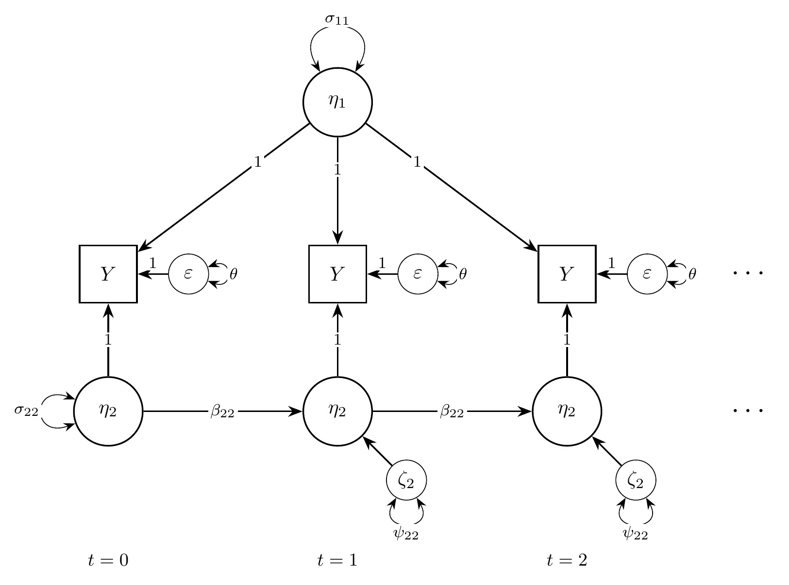
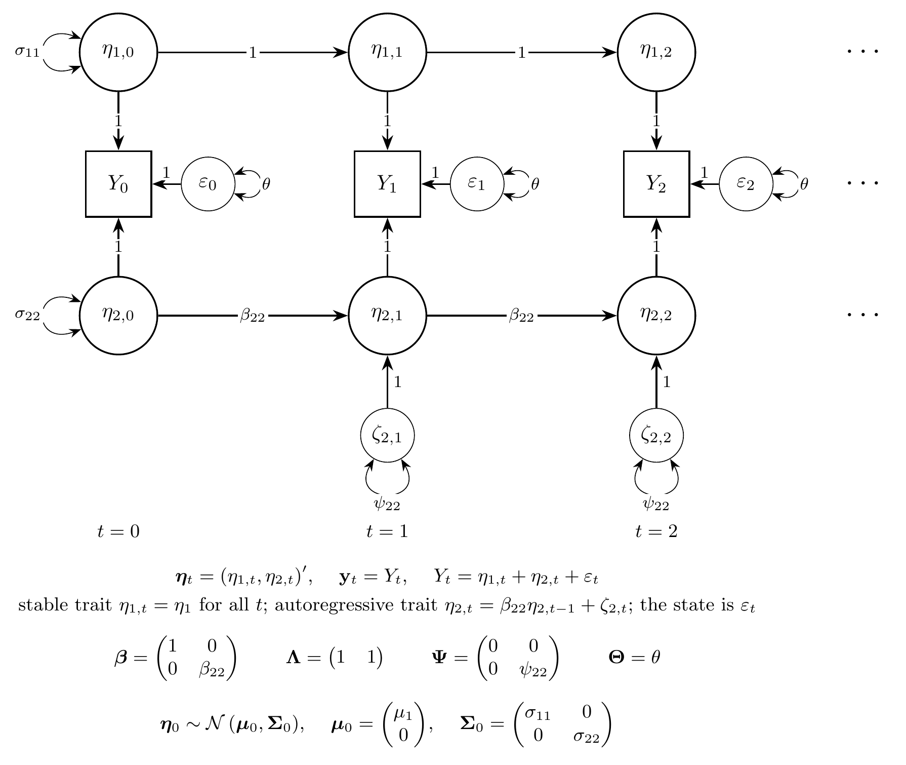
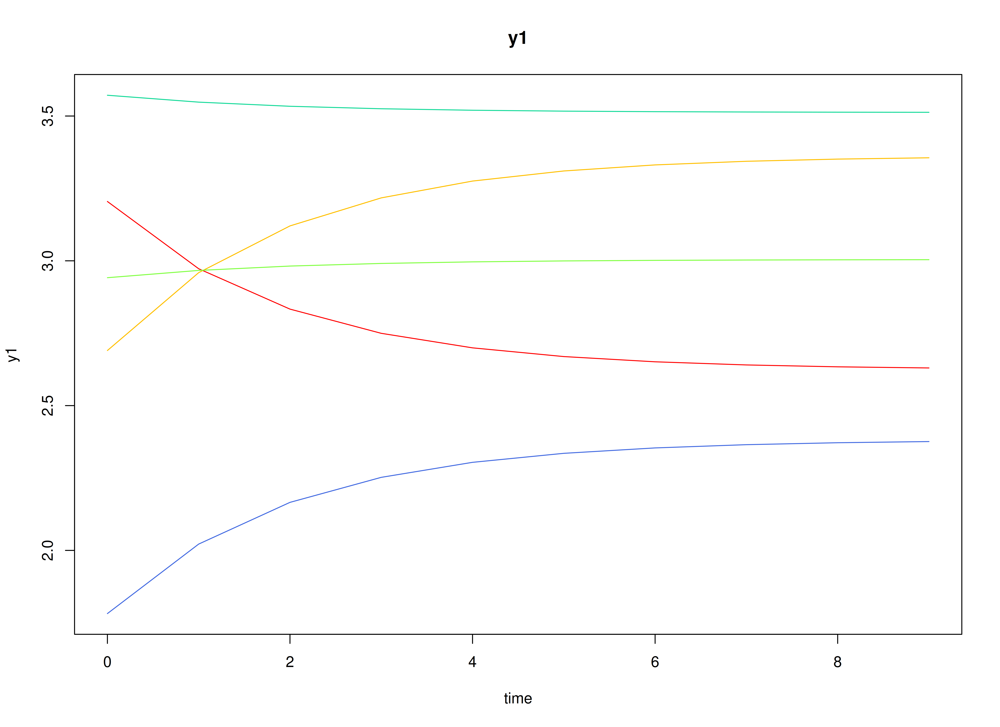
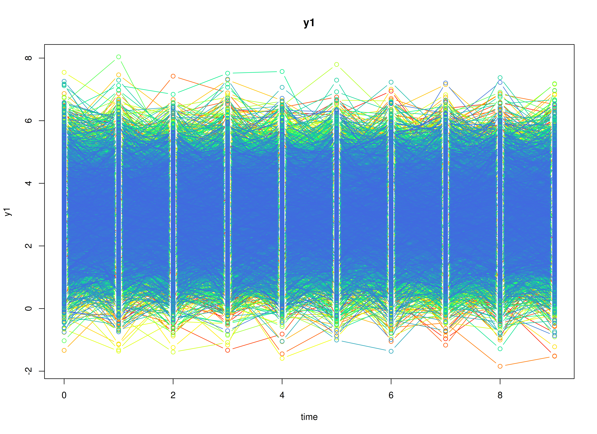
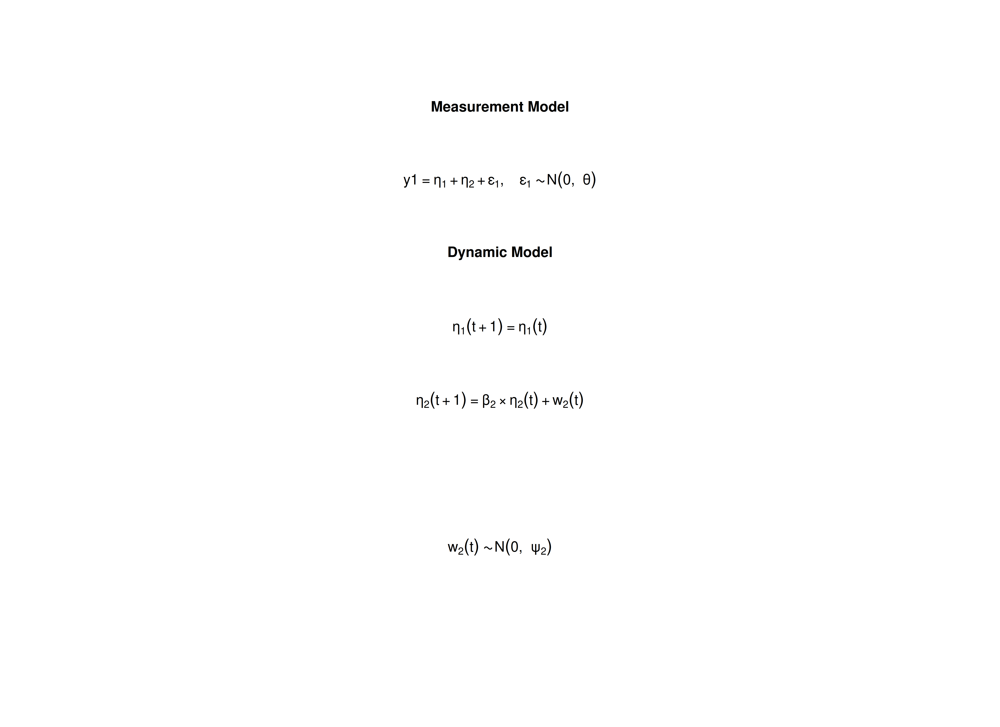

# The Stable Trait, Autoregressive Trait, and State Model

## Overview

The stable trait, autoregressive trait, and state (STARTS) model divides
a variable measured repeatedly on the same individuals into three parts
(Kenny & Zautra, 1995, 2001). Take life satisfaction measured once a
year. Part of it is a stable trait that does not change over the study.
Part of it is an autoregressive trait that changes slowly: a good year
tends to be followed by a fairly good year. The rest is a state that
belongs to one occasion only, such as the mood on the day of the survey
or measurement error. The model estimates how much of the variance
belongs to each part and how strongly the autoregressive part carries
over.

The STARTS model is usually fitted as a structural equation model (SEM).
It can also be written as a state space model: the stable trait is a
latent state that never changes, the autoregressive trait is a latent
state with first-order dynamics, and the state part is the measurement
error.

This tutorial does three things:

1.  It writes the STARTS model as a state space model.
2.  It simulates data from the model with
    [`SimSSMFixed()`](https://github.com/jeksterslab/simStateSpace/reference/SimSSMFixed.md).
3.  It fits the model to the simulated data with `dynr` (state space)
    and with `lavaan` (SEM), and compares both sets of estimates with
    the values used to simulate the data.

No prior knowledge of state space models is needed.

## Model

The measurement model is given by \\\[\begin{equation} Y\_{i, t} =
\left( \begin{array}{cc} 1 & 1 \\\\ \end{array} \right) \left(
\begin{array}{c} \eta\_{1\_{i, t}} \\\\ \eta\_{2\_{i, t}} \\\\
\end{array} \right) + \varepsilon\_{i, t}, \quad \mathrm{with} \quad
\varepsilon\_{i, t} \sim \mathcal{N} \left( 0, \theta \right)
\end{equation}\\\] where \\(Y\_{i, t}\\) is the observed variable at
time \\(t\\) and individual \\(i\\), \\(\eta\_{1\_{i, t}}\\) is the
stable trait, \\(\eta\_{2\_{i, t}}\\) is the autoregressive trait, and
\\(\varepsilon\_{i, t}\\) is the state. \\(\theta\\) is the variance of
the state.

In words, the observed score is the sum of the three parts. The state
\\(\varepsilon\_{i, t}\\) is new on every occasion and does not carry
over, so it plays the role of measurement error in a state space model.

The dynamic structure is given by \\\[\begin{equation} \left(
\begin{array}{c} \eta\_{1\_{i, t}} \\\\ \eta\_{2\_{i, t}} \\\\
\end{array} \right) = \left( \begin{array}{cc} 1 & 0 \\\\ 0 &
\beta\_{22} \\\\ \end{array} \right) \left( \begin{array}{c}
\eta\_{1\_{i, t - 1}} \\\\ \eta\_{2\_{i, t - 1}} \\\\ \end{array}
\right) + \left( \begin{array}{c} 0 \\\\ \zeta\_{2\_{i, t}} \\\\
\end{array} \right), \quad \mathrm{with} \quad \zeta\_{2\_{i, t}} \sim
\mathcal{N} \left( 0, \psi\_{22} \right) . \end{equation}\\\]

In words, the stable trait stays the same over time. The autoregressive
trait keeps a proportion \\(\beta\_{22}\\) of its previous value and
adds a new part with variance \\(\psi\_{22}\\). The closer
\\(\beta\_{22}\\) is to 1, the more slowly the autoregressive trait
changes.

The initial condition is given by \\\[\begin{equation}
\boldsymbol{\eta}\_{i, 0} \sim \mathcal{N} \left( \left(
\begin{array}{c} \mu\_{1} \\\\ 0 \\\\ \end{array} \right), \left(
\begin{array}{cc} \sigma\_{11} & 0 \\\\ 0 & \sigma\_{22} \\\\
\end{array} \right) \right) . \end{equation}\\\]

Here, \\(\mu\_{1}\\) is the average stable trait and \\(\sigma\_{11}\\)
is how much individuals differ in it. The autoregressive trait has mean
zero, because the stable trait carries the mean, and \\(\sigma\_{22}\\)
is its variance at the first occasion. The two traits are uncorrelated.

### Diagrams



Path diagram of the STARTS model.

The STARTS model as a path diagram, for the first three occasions. The
stable trait \\(\eta\_{1}\\) loads on every occasion with a loading
of 1. The autoregressive trait \\(\eta\_{2}\\) carries over from one
occasion to the next with the autoregressive effect \\(\beta\_{22}\\)
and gets a new part \\(\zeta\_{2}\\), with variance \\(\psi\_{22}\\), on
each occasion. The state \\(\varepsilon\\), with variance \\(\theta\\),
is new on every occasion.



State space form of the STARTS model.

The same model in state space form. All the latent variables at one
occasion form the state vector \\(\boldsymbol{\eta}\_{t}\\), and all the
observed variables form \\(\mathbf{y}\_{t}\\). \\(\boldsymbol{\beta}\\)
carries the state from one occasion to the next,
\\(\boldsymbol{\Lambda}\\) maps the state to the observed variables,
\\(\boldsymbol{\Psi}\\) is the covariance matrix of the process noise
\\(\boldsymbol{\zeta}\_{t}\\), and \\(\boldsymbol{\Theta}\\) is the
variance of the state.
[`SimSSMFixed()`](https://github.com/jeksterslab/simStateSpace/reference/SimSSMFixed.md)
takes `beta`, `lambda`, and the Cholesky factors of
\\(\boldsymbol{\Psi}\\) and \\(\boldsymbol{\Theta}\\) (`psi_l` and
`theta_l`).

## Data Generation

### Notation

Let \\(t = 10\\) be the number of time points and \\(n = 10000\\) be the
number of individuals. The STARTS model needs many occasions to tell the
three parts apart, so this example has more occasions than the other
vignettes.

Let the stable trait have mean \\(\mu\_{1} = 3\\) and variance
\\(\sigma\_{11} = 0.5\\). Let the autoregressive effect be
\\(\beta\_{22} = 0.6\\), the process noise variance \\(\psi\_{22} =
0.32\\), and the state variance \\(\theta = 0.3\\).

The autoregressive trait starts from its stationary distribution, so its
variance at the first occasion is the variance it keeps at every later
occasion,

\\\[\begin{equation} \sigma\_{22} = \frac{\psi\_{22}}{1 -
\beta\_{22}^{2}} = 0.5 . \end{equation}\\\]

With these values, the stable trait, the autoregressive trait, and the
state contribute 0.5, 0.5, and 0.3 to the variance of the observed score
on every occasion.

### R Function Arguments

The simulation functions take covariance matrices as lower triangular
Cholesky factors (the arguments ending in `_l`). Because the stable
trait has no process noise, `psi` has a row and a column of zeros, and
its Cholesky factor is written directly.

\
`n`\
`#> [1] 10000`\
`time`\
`#> [1] 10`\
`mu0`\
`#> [1] 3 0`\
`sigma0`\
`#>      [,1] [,2]`\
`#> [1,]  0.5  0.0`\
`#> [2,]  0.0  0.5`\
`sigma0_l`` ``# sigma0_l <- t(chol(sigma0))`\
`#>           [,1]      [,2]`\
`#> [1,] 0.7071068 0.0000000`\
`#> [2,] 0.0000000 0.7071068`\
`alpha`\
`#> [1] 0 0`\
`beta`\
`#>      [,1] [,2]`\
`#> [1,]    1  0.0`\
`#> [2,]    0  0.6`\
`psi`\
`#>      [,1] [,2]`\
`#> [1,]    0 0.00`\
`#> [2,]    0 0.32`\
`psi_l`\
`#>      [,1]      [,2]`\
`#> [1,]    0 0.0000000`\
`#> [2,]    0 0.5656854`\
`nu`\
`#> [1] 0`\
`lambda`\
`#>      [,1] [,2]`\
`#> [1,]    1    1`\
`theta`\
`#>      [,1]`\
`#> [1,]  0.3`\
`theta_l`` ``# theta_l <- t(chol(theta))`\
`#>           [,1]`\
`#> [1,] 0.5477226`

### Visualizing the Dynamics Without Process Noise and Measurement Error (n = 5 with Different Initial Condition)

Without process noise and the state, each individual’s autoregressive
trait decays toward zero, so each trajectory settles at the individual’s
stable trait.



### Using the `SimSSMFixed` Function from the `simStateSpace` Package to Simulate Data

Now we add the process noise and the state and simulate the full data
set. [`as.data.frame()`](https://rdrr.io/r/base/as.data.frame.html)
returns the data in long format, one row per individual and time point,
with the columns `id`, `time`, and `y1`.

\
[`library`](https://rdrr.io/r/base/library.html)`(`[`simStateSpace`](https://github.com/jeksterslab/simStateSpace)`)`\
`sim`` ``<-`` `[`SimSSMFixed`](https://github.com/jeksterslab/simStateSpace/reference/SimSSMFixed.md)`(`\
`  n ``=`` ``n``,`\
`  time ``=`` ``time``,`\
`  mu0 ``=`` ``mu0``,`\
`  sigma0_l ``=`` ``sigma0_l``,`\
`  alpha ``=`` ``alpha``,`\
`  beta ``=`` ``beta``,`\
`  psi_l ``=`` ``psi_l``,`\
`  nu ``=`` ``nu``,`\
`  lambda ``=`` ``lambda``,`\
`  theta_l ``=`` ``theta_l``,`\
`  type ``=`` ``0`\
`)`\
`data`` ``<-`` `[`as.data.frame`](https://rdrr.io/r/base/as.data.frame.html)`(``sim``)`\
[`head`](https://rdrr.io/r/utils/head.html)`(``data``)`\
`#>   id time       y1`\
`#> 1  1    0 2.724102`\
`#> 2  1    1 2.554146`\
`#> 3  1    2 2.834498`\
`#> 4  1    3 1.952812`\
`#> 5  1    4 1.715812`\
`#> 6  1    5 1.798422`\
[`summary`](https://rdrr.io/r/base/summary.html)`(``data``)`\
`#>        id             time           y1        `\
`#>  Min.   :    1   Min.   :0.0   Min.   :-1.844  `\
`#>  1st Qu.: 2501   1st Qu.:2.0   1st Qu.: 2.230  `\
`#>  Median : 5000   Median :4.5   Median : 3.006  `\
`#>  Mean   : 5000   Mean   :4.5   Mean   : 3.007  `\
`#>  3rd Qu.: 7500   3rd Qu.:7.0   3rd Qu.: 3.778  `\
`#>  Max.   :10000   Max.   :9.0   Max.   : 8.039`\
[`plot`](https://rdrr.io/r/graphics/plot.default.html)`(``sim``)`



## Model Fitting

We first fit the model with `dynr`, which estimates state space models
by maximum likelihood using the Kalman filter.

A `dynr` model is built from pieces that match the equations above: the
data, the initial condition, the measurement model, the dynamic model,
and the noise. Each parameter gets a name (for example, `beta_2_2` for
\\(\beta\_{22}\\)), and the same name used in two places means one
shared parameter. The starting values are set to the population values
for convenience; with real data, they would be rough guesses.

### Prepare Data

Tell `dynr` which columns hold the individual, the time, and the
observed variables.

\
`dynr_data`` ``<-`` ``dynr``::`[`dynr.data`](https://rdrr.io/pkg/dynr/man/dynr.data.html)`(`\
`  dataframe ``=`` ``data``,`\
`  id ``=`` ``"id"``,`\
`  time ``=`` ``"time"``,`\
`  observed ``=`` ``"y1"`\
`)`

### Prepare Initial Condition

The mean of the stable trait and the variances of both traits at the
first occasion are estimated. The mean of the autoregressive trait and
the covariance of the two traits are fixed at zero.

\
`dynr_initial`` ``<-`` ``dynr``::`[`prep.initial`](https://rdrr.io/pkg/dynr/man/prep.initial.html)`(`\
`  values.inistate ``=`` ``mu0``,`\
`  params.inistate ``=`` `[`c`](https://rdrr.io/r/base/c.html)`(``"mu0_1_1"``, ``"fixed"``)``,`\
`  values.inicov ``=`` ``sigma0``,`\
`  params.inicov ``=`` `[`matrix`](https://rdrr.io/r/base/matrix.html)`(`\
`    data ``=`` `[`c`](https://rdrr.io/r/base/c.html)`(`\
`      ``"sigma0_1_1"``, ``"fixed"``,`\
`      ``"fixed"``, ``"sigma0_2_2"`\
`    ``)``,`\
`    nrow ``=`` ``2`\
`  ``)`\
`)`

### Prepare Measurement Model

The loadings \\(\left( 1, 1 \right)\\) are fixed.

\
`dynr_measurement`` ``<-`` ``dynr``::`[`prep.measurement`](https://rdrr.io/pkg/dynr/man/prep.measurement.html)`(`\
`  values.load ``=`` ``lambda``,`\
`  params.load ``=`` `[`matrix`](https://rdrr.io/r/base/matrix.html)`(``data ``=`` ``"fixed"``, nrow ``=`` ``1``, ncol ``=`` ``2``)``,`\
`  state.names ``=`` `[`c`](https://rdrr.io/r/base/c.html)`(``"eta_1"``, ``"eta_2"``)``,`\
`  obs.names ``=`` ``"y1"`\
`)`

### Prepare Dynamic Process

The stable trait carries over unchanged; the autoregressive trait has
the autoregressive effect \\(\beta\_{22}\\).

\
`dynr_dynamics`` ``<-`` ``dynr``::`[`prep.formulaDynamics`](https://rdrr.io/pkg/dynr/man/prep.formulaDynamics.html)`(`\
`  formula ``=`` `[`list`](https://rdrr.io/r/base/list.html)`(`\
`    ``eta_1`` ``~`` ``eta_1``,`\
`    ``eta_2`` ``~`` ``beta_2_2`` ``*`` ``eta_2`\
`  ``)``,`\
`  startval ``=`` `[`c`](https://rdrr.io/r/base/c.html)`(``beta_2_2 ``=`` ``beta``[``2``, ``2``]``)``,`\
`  isContinuousTime ``=`` ``FALSE`\
`)`

### Prepare Process Noise

Only the autoregressive trait has process noise. The state variance
\\(\theta\\) is estimated.

\
`dynr_noise`` ``<-`` ``dynr``::`[`prep.noise`](https://rdrr.io/pkg/dynr/man/prep.noise.html)`(`\
`  values.latent ``=`` ``psi``,`\
`  params.latent ``=`` `[`matrix`](https://rdrr.io/r/base/matrix.html)`(`\
`    data ``=`` `[`c`](https://rdrr.io/r/base/c.html)`(`\
`      ``"fixed"``, ``"fixed"``,`\
`      ``"fixed"``, ``"psi_2_2"`\
`    ``)``,`\
`    nrow ``=`` ``2`\
`  ``)``,`\
`  values.observed ``=`` ``theta``,`\
`  params.observed ``=`` ``"theta"`\
`)`

### Prepare the Model

The pieces are put together into one model. `dynr` writes the model as C
code to `outfile` and compiles it.

\
`model`` ``<-`` ``dynr``::`[`dynr.model`](https://rdrr.io/pkg/dynr/man/dynr.model.html)`(`\
`  data ``=`` ``dynr_data``,`\
`  initial ``=`` ``dynr_initial``,`\
`  measurement ``=`` ``dynr_measurement``,`\
`  dynamics ``=`` ``dynr_dynamics``,`\
`  noise ``=`` ``dynr_noise``,`\
`  outfile ``=`` ``"starts.c"`\
`)`

The plot below shows the model equations with the parameter names.



### Fit the Model

\
`results`` ``<-`` ``dynr``::`[`dynr.cook`](https://rdrr.io/pkg/dynr/man/dynr.cook.html)`(`\
`  ``model``,`\
`  debug_flag ``=`` ``TRUE``,`\
`  verbose ``=`` ``FALSE`\
`)`\
`#> [1] "Get ready!!!!"`\
`#> using C compiler: ‘gcc (Ubuntu 15.2.0-16ubuntu1) 15.2.0’`\
`#> Optimization function called.`\
`#> Starting Hessian calculation ...`\
`#> Finished Hessian calculation.`\
`#> Original exit flag:  3 `\
`#> Modified exit flag:  3 `\
`#> Optimization terminated successfully: ftol_rel or ftol_abs was reached. `\
`#> Original fitted parameters:  0.6069395 -1.138077 -1.195125 3.006529 -0.7009229 `\
`#> -0.7188562 `\
`#> `\
`#> Transformed fitted parameters:  0.6069395 0.3204346 0.3026661 3.006529 `\
`#> 0.4961272 0.4873093 `\
`#> `\
`#> Doing end processing`\
`#> Successful trial`\
`#> Total Time: 46.7627 `\
`#> Backend Time: 46.39977`

## Summary

The summary lists each estimate with its standard error, \\(t\\) value,
confidence interval, and \\(p\\) value.

\
[`summary`](https://rdrr.io/r/base/summary.html)`(``results``)`\
`#> Coefficients:`\
`#>            Estimate Std. Error t value ci.lower ci.upper            Pr(>|t|)`\
`#> beta_2_2   0.606940   0.012620   48.09 0.582205 0.631674 <0.0000000000000002`\
`#> psi_2_2    0.320435   0.009594   33.40 0.301631 0.339238 <0.0000000000000002`\
`#> theta      0.302666   0.008010   37.79 0.286967 0.318366 <0.0000000000000002`\
`#> mu0_1_1    3.006529   0.008286  362.83 2.990288 3.022770 <0.0000000000000002`\
`#> sigma0_1_1 0.496127   0.010921   45.43 0.474722 0.517532 <0.0000000000000002`\
`#> sigma0_2_2 0.487309   0.015438   31.57 0.457051 0.517567 <0.0000000000000002`\
`#>               `\
`#> beta_2_2   ***`\
`#> psi_2_2    ***`\
`#> theta      ***`\
`#> mu0_1_1    ***`\
`#> sigma0_1_1 ***`\
`#> sigma0_2_2 ***`\
`#> ---`\
`#> Signif. codes:  0 '***' 0.001 '**' 0.01 '*' 0.05 '.' 0.1 ' ' 1`\
`#> `\
`#> -2 log-likelihood value at convergence = 260347.42`\
`#> AIC = 260359.42`\
`#> BIC = 260416.49`

## The STARTS Model in Structural Equation Modeling

The same model in SEM form, fitted with `lavaan`, should give nearly the
same estimates. In SEM, each occasion is a separate observed variable in
one row per individual (wide format). The stable trait is a factor with
loadings of 1 on all occasions, and the autoregressive trait is a factor
on each occasion with a loading of 1 on that occasion.

### Wide Data Set

[`as.data.frame()`](https://rdrr.io/r/base/as.data.frame.html) with
`long = FALSE` returns the data in wide format.

\
`data`` ``<-`` `[`as.data.frame`](https://rdrr.io/r/base/as.data.frame.html)`(``sim``, long ``=`` ``FALSE``)`\
[`head`](https://rdrr.io/r/utils/head.html)`(``data``)`\
`#>   id     y1_0      y1_1     y1_2     y1_3     y1_4         y1_5      y1_6`\
`#> 1  1 2.724102 2.5541457 2.834498 1.952812 1.715812  1.798422003 2.6524161`\
`#> 2  2 1.398728 1.5898005 2.078358 3.136913 3.420155  1.656597551 1.7696126`\
`#> 3  3 5.130244 3.5302297 3.728487 3.017891 5.113005  4.727711315 3.2796103`\
`#> 4  4 1.891987 1.9632526 3.094126 1.995233 2.613028  2.185718347 3.3743940`\
`#> 5  5 1.725919 0.5120299 0.753101 2.145500 2.795792  2.154440779 1.9059497`\
`#> 6  6 2.957243 1.4160208 1.596537 1.762764 1.159233 -0.005812339 0.8095458`\
`#>        y1_7      y1_8      y1_9`\
`#> 1 2.0029863 2.4650079 2.7663724`\
`#> 2 0.6304025 1.7566680 0.4364570`\
`#> 3 2.7692017 3.2305090 3.4921984`\
`#> 4 2.7263657 0.8028354 1.1643963`\
`#> 5 1.7443716 1.6288711 0.7896516`\
`#> 6 1.5117643 1.3294805 2.4095639`

### Model

The model has the same structure for every occasion, so we write it with
[`paste0()`](https://rdrr.io/r/base/paste.html). The parameter labels
match the dynr names. Giving the autoregressive effect, the process
noise variance, and the state variance the same label on every occasion
constrains them to be equal over time, as in the state space model.

\
`waves`` ``<-`` ``0``:``(``time`` ``-`` ``1``)`\
`now`` ``<-`` ``waves``[``-``1``]`\
`before`` ``<-`` ``waves``[``-``time``]`\
`model`` ``<-`` `[`paste`](https://rdrr.io/r/base/paste.html)`(`\
`  `[`c`](https://rdrr.io/r/base/c.html)`(`\
`    ``"# stable trait: loadings fixed at 1"``,`\
`    `[`paste0`](https://rdrr.io/r/base/paste.html)`(``"eta_1 =~ "``, `[`paste0`](https://rdrr.io/r/base/paste.html)`(``"1 * y1_"``, ``waves``, collapse ``=`` ``" + "``)``)``,`\
`    ``"# autoregressive trait on each occasion"``,`\
`    `[`paste0`](https://rdrr.io/r/base/paste.html)`(``"ar_"``, ``waves``, ``" =~ 1 * y1_"``, ``waves``)``,`\
`    ``"# autoregressive effect"``,`\
`    `[`paste0`](https://rdrr.io/r/base/paste.html)`(``"ar_"``, ``now``, ``" ~ beta_2_2 * ar_"``, ``before``)``,`\
`    ``"# autoregressive trait at the first occasion"``,`\
`    ``"ar_0 ~~ sigma0_2_2 * ar_0"``,`\
`    ``"# process noise at later occasions"``,`\
`    `[`paste0`](https://rdrr.io/r/base/paste.html)`(``"ar_"``, ``now``, ``" ~~ psi_2_2 * ar_"``, ``now``)``,`\
`    ``"# stable trait: mean and variance"``,`\
`    ``"eta_1 ~ mu0_1_1 * 1"``,`\
`    ``"eta_1 ~~ sigma0_1_1 * eta_1"``,`\
`    ``"# the two traits are uncorrelated"``,`\
`    ``"eta_1 ~~ 0 * ar_0"``,`\
`    ``"# state variance, equal over time; no observed intercepts"``,`\
`    `[`paste0`](https://rdrr.io/r/base/paste.html)`(``"y1_"``, ``waves``, ``" ~~ theta * y1_"``, ``waves``)``,`\
`    `[`paste0`](https://rdrr.io/r/base/paste.html)`(``"y1_"``, ``waves``, ``" ~ 0 * 1"``)`\
`  ``)``,`\
`  collapse ``=`` ``"\n"`\
`)`\
[`cat`](https://rdrr.io/r/base/cat.html)`(``model``)`\
`#> # stable trait: loadings fixed at 1`\
`#> eta_1 =~ 1 * y1_0 + 1 * y1_1 + 1 * y1_2 + 1 * y1_3 + 1 * y1_4 + 1 * y1_5 + 1 * y1_6 + 1 * y1_7 + 1 * y1_8 + 1 * y1_9`\
`#> # autoregressive trait on each occasion`\
`#> ar_0 =~ 1 * y1_0`\
`#> ar_1 =~ 1 * y1_1`\
`#> ar_2 =~ 1 * y1_2`\
`#> ar_3 =~ 1 * y1_3`\
`#> ar_4 =~ 1 * y1_4`\
`#> ar_5 =~ 1 * y1_5`\
`#> ar_6 =~ 1 * y1_6`\
`#> ar_7 =~ 1 * y1_7`\
`#> ar_8 =~ 1 * y1_8`\
`#> ar_9 =~ 1 * y1_9`\
`#> # autoregressive effect`\
`#> ar_1 ~ beta_2_2 * ar_0`\
`#> ar_2 ~ beta_2_2 * ar_1`\
`#> ar_3 ~ beta_2_2 * ar_2`\
`#> ar_4 ~ beta_2_2 * ar_3`\
`#> ar_5 ~ beta_2_2 * ar_4`\
`#> ar_6 ~ beta_2_2 * ar_5`\
`#> ar_7 ~ beta_2_2 * ar_6`\
`#> ar_8 ~ beta_2_2 * ar_7`\
`#> ar_9 ~ beta_2_2 * ar_8`\
`#> # autoregressive trait at the first occasion`\
`#> ar_0 ~~ sigma0_2_2 * ar_0`\
`#> # process noise at later occasions`\
`#> ar_1 ~~ psi_2_2 * ar_1`\
`#> ar_2 ~~ psi_2_2 * ar_2`\
`#> ar_3 ~~ psi_2_2 * ar_3`\
`#> ar_4 ~~ psi_2_2 * ar_4`\
`#> ar_5 ~~ psi_2_2 * ar_5`\
`#> ar_6 ~~ psi_2_2 * ar_6`\
`#> ar_7 ~~ psi_2_2 * ar_7`\
`#> ar_8 ~~ psi_2_2 * ar_8`\
`#> ar_9 ~~ psi_2_2 * ar_9`\
`#> # stable trait: mean and variance`\
`#> eta_1 ~ mu0_1_1 * 1`\
`#> eta_1 ~~ sigma0_1_1 * eta_1`\
`#> # the two traits are uncorrelated`\
`#> eta_1 ~~ 0 * ar_0`\
`#> # state variance, equal over time; no observed intercepts`\
`#> y1_0 ~~ theta * y1_0`\
`#> y1_1 ~~ theta * y1_1`\
`#> y1_2 ~~ theta * y1_2`\
`#> y1_3 ~~ theta * y1_3`\
`#> y1_4 ~~ theta * y1_4`\
`#> y1_5 ~~ theta * y1_5`\
`#> y1_6 ~~ theta * y1_6`\
`#> y1_7 ~~ theta * y1_7`\
`#> y1_8 ~~ theta * y1_8`\
`#> y1_9 ~~ theta * y1_9`\
`#> y1_0 ~ 0 * 1`\
`#> y1_1 ~ 0 * 1`\
`#> y1_2 ~ 0 * 1`\
`#> y1_3 ~ 0 * 1`\
`#> y1_4 ~ 0 * 1`\
`#> y1_5 ~ 0 * 1`\
`#> y1_6 ~ 0 * 1`\
`#> y1_7 ~ 0 * 1`\
`#> y1_8 ~ 0 * 1`\
`#> y1_9 ~ 0 * 1`

[`lavaan::lavaan()`](https://rdrr.io/pkg/lavaan/man/lavaan.html) adds
nothing to the model by itself, so every parameter above is exactly the
one written.

\
`fit`` ``<-`` ``lavaan``::`[`lavaan`](https://rdrr.io/pkg/lavaan/man/lavaan.html)`(`\
`  model ``=`` ``model``,`\
`  data ``=`` ``data`\
`)`\
`lavaan``::``summary``(``fit``)`\
`#> lavaan 0.7-3 ended normally after 35 iterations`\
`#> `\
`#>   Estimator                                         ML`\
`#>   Optimization method                           NLMINB`\
`#>   Number of model parameters                        31`\
`#>   Number of equality constraints                    25`\
`#> `\
`#>   Number of observations                         10000`\
`#> `\
`#> Model Test User Model:`\
`#>                                                       `\
`#>   Test statistic                                51.382`\
`#>   Degrees of freedom                                59`\
`#>   P-value (Chi-square)                           0.749`\
`#>                                                       `\
`#>   Browne's residual (NT model-based) test             `\
`#>   Test statistic                                51.471`\
`#>   Degrees of freedom                                59`\
`#>   P-value (Chi-square)                           0.746`\
`#> `\
`#> Parameter Estimates:`\
`#> `\
`#>   Standard errors                             Standard`\
`#>   Information                                 Expected`\
`#>   Information saturated (h1) model          Structured`\
`#> `\
`#> Latent Variables:`\
`#>                    Estimate  Std.Err  z-value  P(>|z|)`\
`#>   eta_1 =~                                            `\
`#>     y1_0              1.000                           `\
`#>     y1_1              1.000                           `\
`#>     y1_2              1.000                           `\
`#>     y1_3              1.000                           `\
`#>     y1_4              1.000                           `\
`#>     y1_5              1.000                           `\
`#>     y1_6              1.000                           `\
`#>     y1_7              1.000                           `\
`#>     y1_8              1.000                           `\
`#>     y1_9              1.000                           `\
`#>   ar_0 =~                                             `\
`#>     y1_0              1.000                           `\
`#>   ar_1 =~                                             `\
`#>     y1_1              1.000                           `\
`#>   ar_2 =~                                             `\
`#>     y1_2              1.000                           `\
`#>   ar_3 =~                                             `\
`#>     y1_3              1.000                           `\
`#>   ar_4 =~                                             `\
`#>     y1_4              1.000                           `\
`#>   ar_5 =~                                             `\
`#>     y1_5              1.000                           `\
`#>   ar_6 =~                                             `\
`#>     y1_6              1.000                           `\
`#>   ar_7 =~                                             `\
`#>     y1_7              1.000                           `\
`#>   ar_8 =~                                             `\
`#>     y1_8              1.000                           `\
`#>   ar_9 =~                                             `\
`#>     y1_9              1.000                           `\
`#> `\
`#> Regressions:`\
`#>                    Estimate  Std.Err  z-value  P(>|z|)`\
`#>   ar_1 ~                                              `\
`#>     ar_0    (b_2_)    0.607    0.013   48.421    0.000`\
`#>   ar_2 ~                                              `\
`#>     ar_1    (b_2_)    0.607    0.013   48.421    0.000`\
`#>   ar_3 ~                                              `\
`#>     ar_2    (b_2_)    0.607    0.013   48.421    0.000`\
`#>   ar_4 ~                                              `\
`#>     ar_3    (b_2_)    0.607    0.013   48.421    0.000`\
`#>   ar_5 ~                                              `\
`#>     ar_4    (b_2_)    0.607    0.013   48.421    0.000`\
`#>   ar_6 ~                                              `\
`#>     ar_5    (b_2_)    0.607    0.013   48.421    0.000`\
`#>   ar_7 ~                                              `\
`#>     ar_6    (b_2_)    0.607    0.013   48.421    0.000`\
`#>   ar_8 ~                                              `\
`#>     ar_7    (b_2_)    0.607    0.013   48.421    0.000`\
`#>   ar_9 ~                                              `\
`#>     ar_8    (b_2_)    0.607    0.013   48.421    0.000`\
`#> `\
`#> Covariances:`\
`#>                    Estimate  Std.Err  z-value  P(>|z|)`\
`#>   eta_1 ~~                                            `\
`#>     ar_0              0.000                           `\
`#> `\
`#> Intercepts:`\
`#>                    Estimate  Std.Err  z-value  P(>|z|)`\
`#>     eta_1   (m0_1)    3.007    0.008  362.790    0.000`\
`#>    .y1_0              0.000                           `\
`#>    .y1_1              0.000                           `\
`#>    .y1_2              0.000                           `\
`#>    .y1_3              0.000                           `\
`#>    .y1_4              0.000                           `\
`#>    .y1_5              0.000                           `\
`#>    .y1_6              0.000                           `\
`#>    .y1_7              0.000                           `\
`#>    .y1_8              0.000                           `\
`#>    .y1_9              0.000                           `\
`#> `\
`#> Variances:`\
`#>                    Estimate  Std.Err  z-value  P(>|z|)`\
`#>     ar_0    (s0_2)    0.487    0.015   31.858    0.000`\
`#>    .ar_1    (p_2_)    0.320    0.010   33.268    0.000`\
`#>    .ar_2    (p_2_)    0.320    0.010   33.268    0.000`\
`#>    .ar_3    (p_2_)    0.320    0.010   33.268    0.000`\
`#>    .ar_4    (p_2_)    0.320    0.010   33.268    0.000`\
`#>    .ar_5    (p_2_)    0.320    0.010   33.268    0.000`\
`#>    .ar_6    (p_2_)    0.320    0.010   33.268    0.000`\
`#>    .ar_7    (p_2_)    0.320    0.010   33.268    0.000`\
`#>    .ar_8    (p_2_)    0.320    0.010   33.268    0.000`\
`#>    .ar_9    (p_2_)    0.320    0.010   33.268    0.000`\
`#>     eta_1   (s0_1)    0.496    0.011   45.215    0.000`\
`#>    .y1_0    (thet)    0.303    0.008   37.787    0.000`\
`#>    .y1_1    (thet)    0.303    0.008   37.787    0.000`\
`#>    .y1_2    (thet)    0.303    0.008   37.787    0.000`\
`#>    .y1_3    (thet)    0.303    0.008   37.787    0.000`\
`#>    .y1_4    (thet)    0.303    0.008   37.787    0.000`\
`#>    .y1_5    (thet)    0.303    0.008   37.787    0.000`\
`#>    .y1_6    (thet)    0.303    0.008   37.787    0.000`\
`#>    .y1_7    (thet)    0.303    0.008   37.787    0.000`\
`#>    .y1_8    (thet)    0.303    0.008   37.787    0.000`\
`#>    .y1_9    (thet)    0.303    0.008   37.787    0.000`

## Table of Parameters and Estimates

The table below puts each population value used to simulate the data
next to its estimate. Bias is the estimate minus the population value.
Because the model is fitted to a single simulated data set, this is the
error of one estimate, not a Monte Carlo bias, which would average over
many replications. The 95% confidence interval is the Wald interval,
\\(\hat{\theta} \pm 1.96 \times \mathrm{SE}\\), and `Covers` shows
whether it contains the population value.

\
`EstimatesTable`` ``<-`` ``function``(``population``, ``estimate``, ``se``)`` ``{`\
`  ``z`` ``<-`` ``stats``::`[`qnorm`](https://rdrr.io/r/stats/Normal.html)`(``p ``=`` ``0.975``)`\
`  ``ll`` ``<-`` ``estimate`` ``-`` ``z`` ``*`` ``se`\
`  ``ul`` ``<-`` ``estimate`` ``+`` ``z`` ``*`` ``se`\
`  `[`data.frame`](https://rdrr.io/r/base/data.frame.html)`(`\
`    Parameter ``=`` `[`names`](https://rdrr.io/r/base/names.html)`(``population``)``,`\
`    Population ``=`` `[`unname`](https://rdrr.io/r/base/unname.html)`(``population``)``,`\
`    Estimate ``=`` `[`unname`](https://rdrr.io/r/base/unname.html)`(``estimate``)``,`\
`    SE ``=`` `[`unname`](https://rdrr.io/r/base/unname.html)`(``se``)``,`\
`    Bias ``=`` `[`unname`](https://rdrr.io/r/base/unname.html)`(``estimate`` ``-`` ``population``)``,`\
``     `2.5%`  ```=`` `[`unname`](https://rdrr.io/r/base/unname.html)`(``ll``)``,`\
``     `97.5%`  ```=`` `[`unname`](https://rdrr.io/r/base/unname.html)`(``ul``)``,`\
`    Covers ``=`` `[`unname`](https://rdrr.io/r/base/unname.html)`(``population`` ``>=`` ``ll`` ``&`` ``population`` ``<=`` ``ul``)``,`\
`    check.names ``=`` ``FALSE`\
`  ``)`\
`}`

\
`population`` ``<-`` `[`c`](https://rdrr.io/r/base/c.html)`(`\
`  mu0_1_1 ``=`` ``mu0``[``1``]``,`\
`  sigma0_1_1 ``=`` ``sigma0``[``1``, ``1``]``,`\
`  sigma0_2_2 ``=`` ``sigma0``[``2``, ``2``]``,`\
`  beta_2_2 ``=`` ``beta``[``2``, ``2``]``,`\
`  psi_2_2 ``=`` ``psi``[``2``, ``2``]``,`\
`  theta ``=`` ``theta``[``1``, ``1``]`\
`)`

### dynr

\
`estimates`` ``<-`` `[`coef`](https://rdrr.io/r/stats/coef.html)`(``results``)``[`[`names`](https://rdrr.io/r/base/names.html)`(``population``)``]`\
`se`` ``<-`` `[`sqrt`](https://rdrr.io/r/base/MathFun.html)`(`[`diag`](https://rdrr.io/r/base/diag.html)`(`[`vcov`](https://rdrr.io/r/stats/vcov.html)`(``results``)``)``)`\
[`names`](https://rdrr.io/r/base/names.html)`(``se``)`` ``<-`` `[`names`](https://rdrr.io/r/base/names.html)`(`[`coef`](https://rdrr.io/r/stats/coef.html)`(``results``)``)`\
`knitr``::`[`kable`](https://rdrr.io/pkg/knitr/man/kable.html)`(`\
`  x ``=`` ``EstimatesTable``(`\
`    population ``=`` ``population``,`\
`    estimate ``=`` ``estimates``,`\
`    se ``=`` ``se``[`[`names`](https://rdrr.io/r/base/names.html)`(``population``)``]`\
`  ``)``,`\
`  digits ``=`` ``3``,`\
`  caption ``=`` ``"Population values and dynr estimates (one simulated data set)"`\
`)`

| Parameter  | Population | Estimate |    SE |   Bias |  2.5% | 97.5% | Covers |
|:-----------|-----------:|---------:|------:|-------:|------:|------:|:-------|
| mu0_1_1    |       3.00 |    3.007 | 0.008 |  0.007 | 2.990 | 3.023 | TRUE   |
| sigma0_1_1 |       0.50 |    0.496 | 0.011 | -0.004 | 0.475 | 0.518 | TRUE   |
| sigma0_2_2 |       0.50 |    0.487 | 0.015 | -0.013 | 0.457 | 0.518 | TRUE   |
| beta_2_2   |       0.60 |    0.607 | 0.013 |  0.007 | 0.582 | 0.632 | TRUE   |
| psi_2_2    |       0.32 |    0.320 | 0.010 |  0.000 | 0.302 | 0.339 | TRUE   |
| theta      |       0.30 |    0.303 | 0.008 |  0.003 | 0.287 | 0.318 | TRUE   |

Population values and dynr estimates (one simulated data set) {.table}

### lavaan

\
`pe`` ``<-`` ``lavaan``::`[`parameterEstimates`](https://rdrr.io/pkg/lavaan/man/parameterEstimates.html)`(``fit``)`\
`# a label shared by several occasions is one parameter`\
`pe`` ``<-`` ``pe``[``pe``$``label`` ``!=`` ``""`` ``&`` ``!`[`duplicated`](https://rdrr.io/r/base/duplicated.html)`(``pe``$``label``)``, ``]`\
[`rownames`](https://rdrr.io/r/base/colnames.html)`(``pe``)`` ``<-`` ``pe``$``label`\
`knitr``::`[`kable`](https://rdrr.io/pkg/knitr/man/kable.html)`(`\
`  x ``=`` ``EstimatesTable``(`\
`    population ``=`` ``population``,`\
`    estimate ``=`` ``pe``[`[`names`](https://rdrr.io/r/base/names.html)`(``population``)``, ``"est"``]``,`\
`    se ``=`` ``pe``[`[`names`](https://rdrr.io/r/base/names.html)`(``population``)``, ``"se"``]`\
`  ``)``,`\
`  digits ``=`` ``3``,`\
`  caption ``=`` ``"Population values and lavaan estimates (one simulated data set)"`\
`)`

| Parameter  | Population | Estimate |    SE |   Bias |  2.5% | 97.5% | Covers |
|:-----------|-----------:|---------:|------:|-------:|------:|------:|:-------|
| mu0_1_1    |       3.00 |    3.007 | 0.008 |  0.007 | 2.990 | 3.023 | TRUE   |
| sigma0_1_1 |       0.50 |    0.496 | 0.011 | -0.004 | 0.475 | 0.518 | TRUE   |
| sigma0_2_2 |       0.50 |    0.487 | 0.015 | -0.013 | 0.457 | 0.517 | TRUE   |
| beta_2_2   |       0.60 |    0.607 | 0.013 |  0.007 | 0.583 | 0.632 | TRUE   |
| psi_2_2    |       0.32 |    0.320 | 0.010 |  0.000 | 0.301 | 0.339 | TRUE   |
| theta      |       0.30 |    0.303 | 0.008 |  0.003 | 0.287 | 0.319 | TRUE   |

Population values and lavaan estimates (one simulated data set) {.table}

## References

Chow, S.-M., Ho, M. R., Hamaker, E. L., & Dolan, C. V. (2010).
Equivalence and differences between structural equation modeling and
state-space modeling techniques. *Structural Equation Modeling: A
Multidisciplinary Journal*, *17*(2), 303–332.
<https://doi.org/10.1080/10705511003661553>

Kenny, D. A., & Zautra, A. (1995). The trait-state-error model for
multiwave data. *Journal of Consulting and Clinical Psychology*,
*63*(1), 52–59. <https://doi.org/10.1037/0022-006x.63.1.52>

Kenny, D. A., & Zautra, A. (2001). Trait-state models for longitudinal
data. In L. M. Collins & A. G. Sayer (Eds.), *New methods for the
analysis of change* (pp. 243–263). American Psychological Association.
<https://doi.org/10.1037/10409-008>

Ou, L., Hunter, M. D., & Chow, S.-M. (2019). What’s for dynr: A package
for linear and nonlinear dynamic modeling in R. *The R Journal*,
*11*(1), 91. <https://doi.org/10.32614/rj-2019-012>

R Core Team. (2026). *R: A language and environment for statistical
computing*. R Foundation for Statistical Computing.
<https://www.R-project.org/>

Rosseel, Y. (2012). lavaan: An R package for structural equation
modeling. *Journal of Statistical Software*, *48*(2).
<https://doi.org/10.18637/jss.v048.i02>
