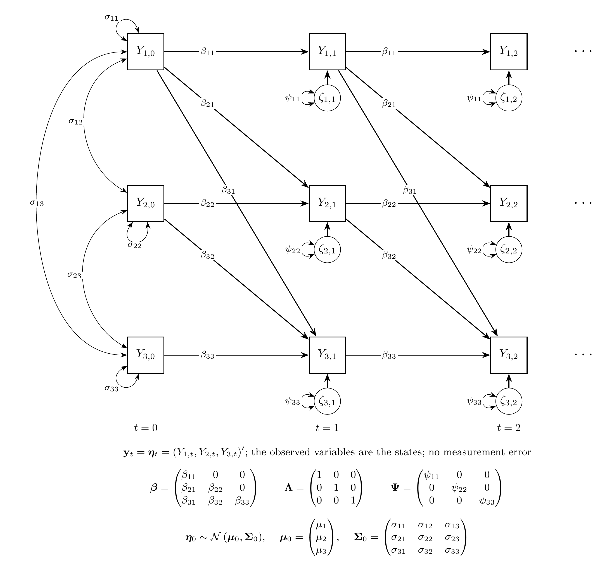
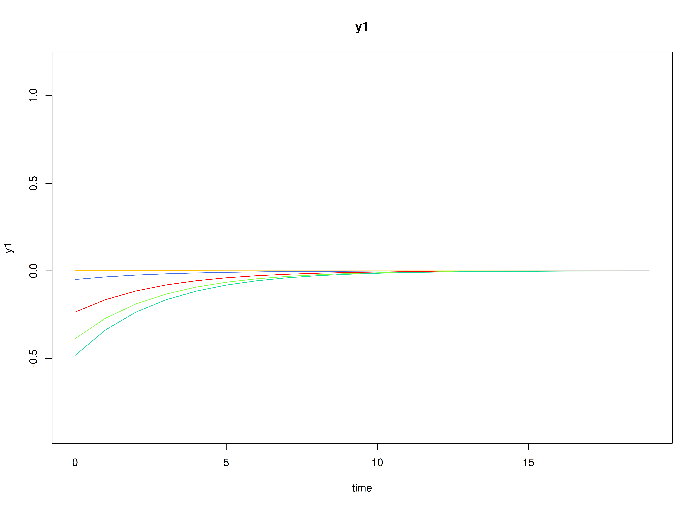
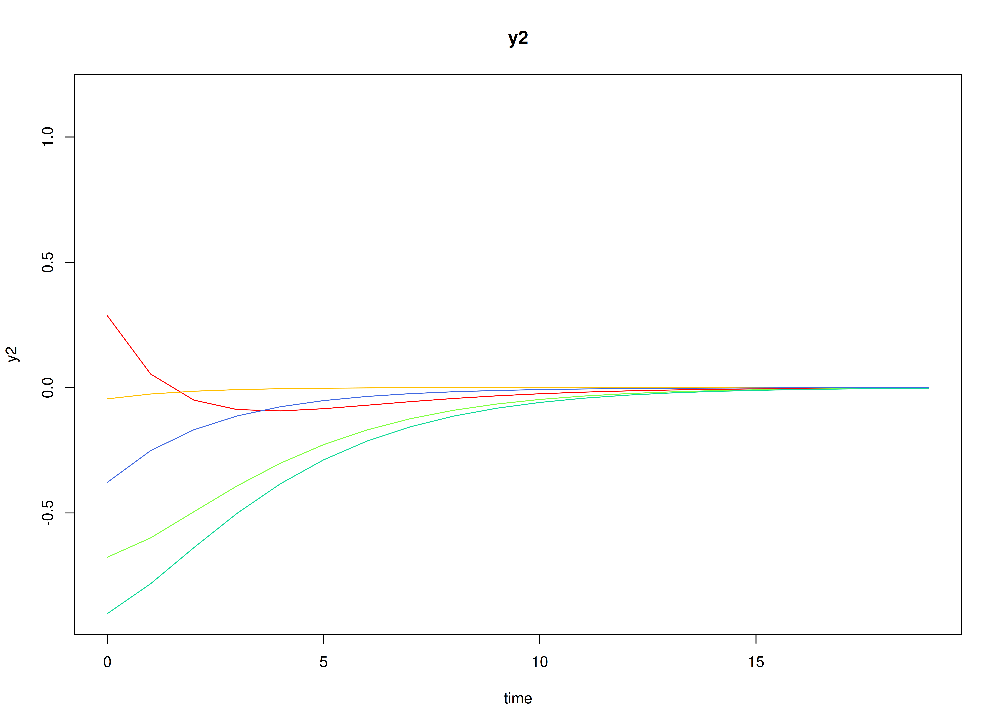
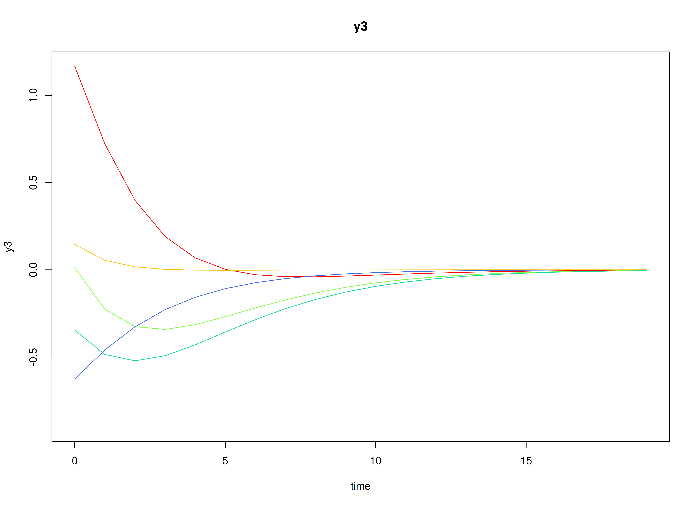
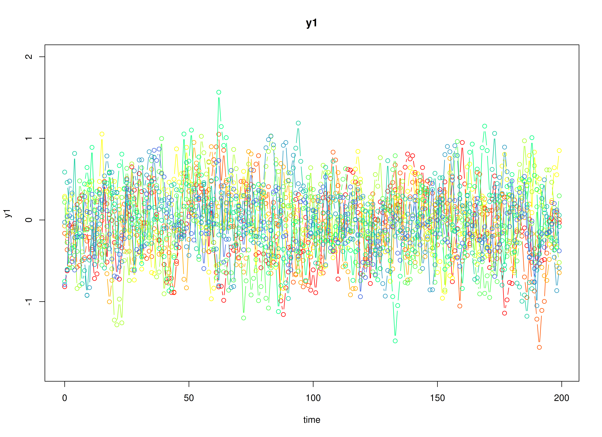
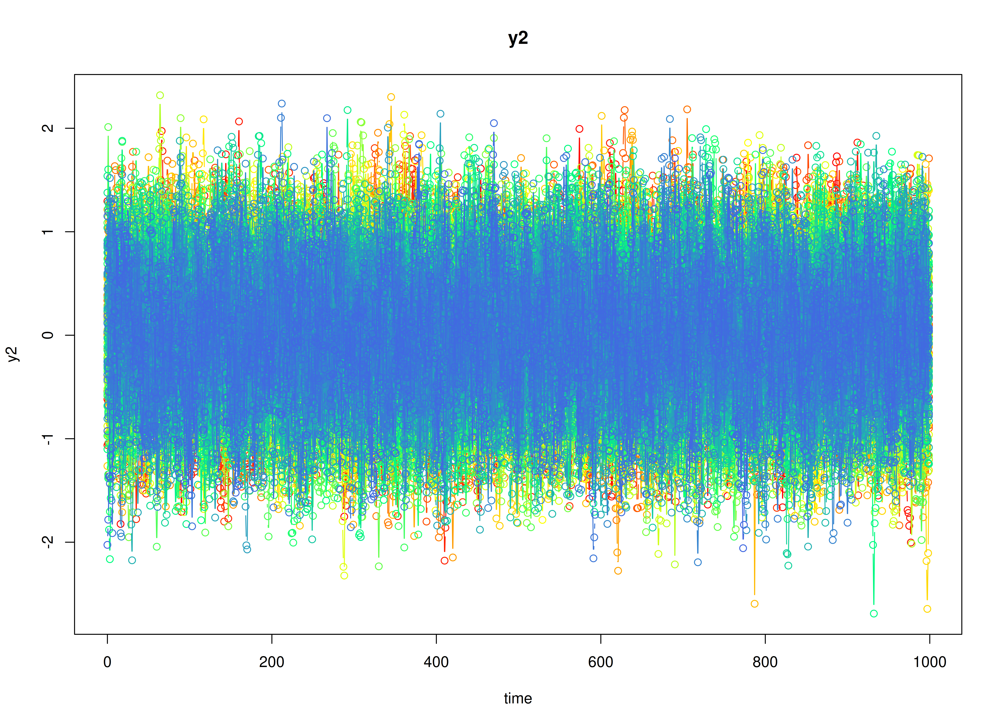
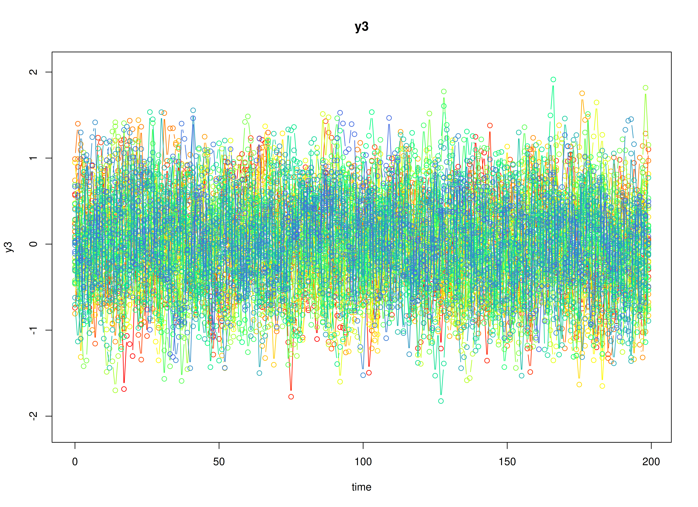
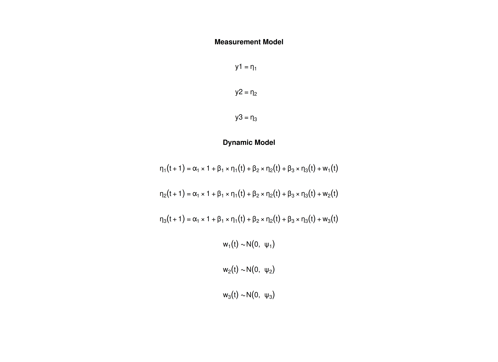

# The Vector Autoregressive Model

## Overview

The vector autoregressive (VAR) model describes how a set of variables
measured repeatedly on the same person carry over and influence each
other from one occasion to the next. For example, today’s stress may
predict tomorrow’s stress (carry-over), and today’s stress may also
predict tomorrow’s negative affect (cross-lagged effect).

This tutorial does three things:

1.  It writes the first-order VAR model as a state space model.
2.  It simulates data from the model with
    [`SimSSMVARFixed()`](https://github.com/jeksterslab/simStateSpace/reference/SimSSMVARFixed.md),
    with every individual sharing the same parameters.
3.  It fits the model to the simulated data with the `dynr` package and
    compares the estimates with the values used to simulate the data.

No prior knowledge of state space models is needed. A state space model
has two parts: a measurement model that links what we observe to
underlying (latent) states, and a dynamic model that describes how those
states change over time. In the VAR model, the variables are assumed to
be measured without error, so the measurement part is simple, and all
the interest is in the dynamics.

## Model

The measurement model is given by \\\[\begin{equation} \mathbf{y}\_{i,
t} = \boldsymbol{\eta}\_{i, t} \end{equation}\\\] where
\\(\mathbf{y}\_{i, t}\\) represents a vector of observed variables and
\\(\boldsymbol{\eta}\_{i, t}\\) a vector of latent variables for
individual \\(i\\) and time \\(t\\). Since the observed and latent
variables are equal, we only generate data from the dynamic structure.

The dynamic structure is given by \\\[\begin{equation}
\boldsymbol{\eta}\_{i, t} = \boldsymbol{\alpha} + \boldsymbol{\beta}
\boldsymbol{\eta}\_{i, t - 1} + \boldsymbol{\zeta}\_{i, t}, \quad
\mathrm{with} \quad \boldsymbol{\zeta}\_{i, t} \sim \mathcal{N} \left(
\mathbf{0}, \boldsymbol{\Psi} \right) \end{equation}\\\] where
\\(\boldsymbol{\eta}\_{i, t}\\), \\(\boldsymbol{\eta}\_{i, t - 1}\\),
and \\(\boldsymbol{\zeta}\_{i, t}\\) are random variables, and
\\(\boldsymbol{\alpha}\\), \\(\boldsymbol{\beta}\\), and
\\(\boldsymbol{\Psi}\\) are model parameters. Here,
\\(\boldsymbol{\eta}\_{i, t}\\) is a vector of latent variables at time
\\(t\\) and individual \\(i\\), \\(\boldsymbol{\eta}\_{i, t - 1}\\)
represents a vector of latent variables at time \\(t - 1\\) and
individual \\(i\\), and \\(\boldsymbol{\zeta}\_{i, t}\\) represents a
vector of dynamic noise at time \\(t\\) and individual \\(i\\).
\\(\boldsymbol{\alpha}\\) denotes a vector of intercepts,
\\(\boldsymbol{\beta}\\) a matrix of autoregression and cross regression
coefficients, and \\(\boldsymbol{\Psi}\\) the covariance matrix of
\\(\boldsymbol{\zeta}\_{i, t}\\).

In words, each variable at time \\(t\\) is a weighted sum of all the
variables at time \\(t - 1\\), plus an intercept and a random shock. The
weights are the elements of \\(\boldsymbol{\beta}\\):

- A diagonal element \\(\beta\_{jj}\\) is the autoregressive effect, how
  much of variable \\(j\\) carries over to the next occasion. Values
  closer to 1 mean the variable changes slowly (high inertia).
- An off-diagonal element \\(\beta\_{jk}\\) is the cross-lagged effect
  of variable \\(k\\) at time \\(t - 1\\) on variable \\(j\\) at time
  \\(t\\). Note the order: the row is the outcome, the column is the
  predictor.

The shocks \\(\boldsymbol{\zeta}\_{i, t}\\) stand for everything that
moves the variables that the model does not explain, for example, events
that happen between occasions. For the process to settle around a stable
mean, all eigenvalues of \\(\boldsymbol{\beta}\\) must have modulus less
than 1.

An alternative representation of the dynamic noise is given by
\\\[\begin{equation} \boldsymbol{\zeta}\_{i, t} =
\boldsymbol{\Psi}^{\frac{1}{2}} \mathbf{z}\_{i, t}, \quad \mathrm{with}
\quad \mathbf{z}\_{i, t} \sim \mathcal{N} \left( \mathbf{0}, \mathbf{I}
\right) \end{equation}\\\] where \\(\left(
\boldsymbol{\Psi}^{\frac{1}{2}} \right) \left(
\boldsymbol{\Psi}^{\frac{1}{2}} \right)^{\prime} = \boldsymbol{\Psi}\\)
. This is how the noise is simulated: independent standard normal draws
\\(\mathbf{z}\_{i, t}\\) are multiplied by a square root of
\\(\boldsymbol{\Psi}\\). The functions in `simStateSpace` take this
square root, the lower triangular Cholesky factor of
\\(\boldsymbol{\Psi}\\), as the argument `psi_l`.

### Diagrams


Path diagram of the VAR model.

The model as a path diagram, for the first three occasions. The
variables are observed (squares) and have no measurement error. The
horizontal arrows are the autoregressive effects and the diagonal arrows
the cross-lagged effects; only the nonzero elements of
\\(\boldsymbol{\beta}\\) in this example are drawn. \\(\zeta\_{j}\\) is
the process noise, with variance \\(\psi\_{jj}\\), and the curved arrows
on the left are the covariances of the variables at the first occasion.



State space form of the VAR model.

The same model in state space form. The observed variables are the
state, \\(\mathbf{y}\_{t} = \boldsymbol{\eta}\_{t}\\), so
\\(\boldsymbol{\Lambda}\\) is the identity matrix and there is no
measurement error. \\(\boldsymbol{\beta}\\) carries the state from one
occasion to the next, and \\(\boldsymbol{\Psi}\\) is the covariance
matrix of the process noise \\(\boldsymbol{\zeta}\_{t}\\).
[`SimSSMVARFixed()`](https://github.com/jeksterslab/simStateSpace/reference/SimSSMVARFixed.md)
takes `beta` and the Cholesky factor of \\(\boldsymbol{\Psi}\\)
(`psi_l`).

## Data Generation

### Notation

Let \\(t = 200\\) be the number of time points and \\(n = 10\\) be the
number of individuals.

Let the initial condition \\(\boldsymbol{\eta}\_{0}\\) be given by

\\\[\begin{equation} \boldsymbol{\eta}\_{0} \sim \mathcal{N} \left(
\boldsymbol{\mu}\_{\boldsymbol{\eta} \mid 0},
\boldsymbol{\Sigma}\_{\boldsymbol{\eta} \mid 0} \right)
\end{equation}\\\]

\\\[\begin{equation} \boldsymbol{\mu}\_{\boldsymbol{\eta} \mid 0} =
\left( \begin{array}{c} 0 \\\\ 0 \\\\ 0 \\\\ \end{array} \right)
\end{equation}\\\]

\\\[\begin{equation} \boldsymbol{\Sigma}\_{\boldsymbol{\eta} \mid 0} =
\left( \begin{array}{ccc} 0.1960784 & 0.1183232 & 0.0298539 \\\\
0.1183232 & 0.3437711 & 0.1381855 \\\\ 0.0298539 & 0.1381855 & 0.2663828
\\\\ \end{array} \right) . \end{equation}\\\]

Let the constant vector \\(\boldsymbol{\alpha}\\) be given by

\\\[\begin{equation} \boldsymbol{\alpha} = \left( \begin{array}{c} 0
\\\\ 0 \\\\ 0 \\\\ \end{array} \right) . \end{equation}\\\]

Let the transition matrix \\(\boldsymbol{\beta}\\) be given by

\\\[\begin{equation} \boldsymbol{\beta} = \left( \begin{array}{ccc} 0.7
& 0 & 0 \\\\ 0.5 & 0.6 & 0 \\\\ -0.1 & 0.4 & 0.5 \\\\ \end{array}
\right) . \end{equation}\\\]

Read the columns as predictors and the rows as outcomes. Each variable
carries over to the next occasion (autoregressive effects 0.7, 0.6, and
0.5). In addition, \\(\eta\_{1}\\) predicts later \\(\eta\_{2}\\) (0.5),
\\(\eta\_{2}\\) predicts later \\(\eta\_{3}\\) (0.4), and
\\(\eta\_{1}\\) has a small negative effect on later \\(\eta\_{3}\\)
(-0.1). Because \\(\boldsymbol{\beta}\\) is lower triangular, its
eigenvalues are its diagonal elements, all less than 1, so the process
is stable.

Let the dynamic process noise \\(\boldsymbol{\Psi}\\) be given by

\\\[\begin{equation} \boldsymbol{\Psi} = \left( \begin{array}{ccc} 0.1 &
0 & 0 \\\\ 0 & 0.1 & 0 \\\\ 0 & 0 & 0.1 \\\\ \end{array} \right) .
\end{equation}\\\]

The initial condition describes where each individual starts. Here, the
mean vector and covariance matrix of \\(\boldsymbol{\eta}\_{0}\\) are
the model-implied mean and covariance of the stable process, computed
with
[`SSMMeanEta()`](https://github.com/jeksterslab/simStateSpace/reference/SSMMeanEta.md)
and
[`SSMCovEta()`](https://github.com/jeksterslab/simStateSpace/reference/SSMCovEta.md),
so the data are stationary from the first time point.

### R Function Arguments

The simulation functions take covariance matrices as lower triangular
Cholesky factors (the arguments ending in `_l`).

\
`n`\
`#> [1] 10`\
`time`\
`#> [1] 200`\
`mu0`\
`#> [1] 0 0 0`\
`sigma0`\
`#>            [,1]      [,2]       [,3]`\
`#> [1,] 0.19607843 0.1183232 0.02985385`\
`#> [2,] 0.11832319 0.3437711 0.13818551`\
`#> [3,] 0.02985385 0.1381855 0.26638284`\
`sigma0_l`` ``# sigma0_l <- t(chol(sigma0))`\
`#>            [,1]      [,2]     [,3]`\
`#> [1,] 0.44280744 0.0000000 0.000000`\
`#> [2,] 0.26721139 0.5218900 0.000000`\
`#> [3,] 0.06741949 0.2302597 0.456966`\
`alpha`\
`#> [1] 0 0 0`\
`beta`\
`#>      [,1] [,2] [,3]`\
`#> [1,]  0.7  0.0  0.0`\
`#> [2,]  0.5  0.6  0.0`\
`#> [3,] -0.1  0.4  0.5`\
`psi`\
`#>      [,1] [,2] [,3]`\
`#> [1,]  0.1  0.0  0.0`\
`#> [2,]  0.0  0.1  0.0`\
`#> [3,]  0.0  0.0  0.1`\
`psi_l`` ``# psi_l <- t(chol(psi))`\
`#>           [,1]      [,2]      [,3]`\
`#> [1,] 0.3162278 0.0000000 0.0000000`\
`#> [2,] 0.0000000 0.3162278 0.0000000`\
`#> [3,] 0.0000000 0.0000000 0.3162278`

### Visualizing the Dynamics Without Process Noise (n = 5 with Different Initial Condition)

To see what \\(\boldsymbol{\beta}\\) alone does, we first simulate five
individuals with the process noise set to zero. Each individual starts
at a different point, and the trajectories return to the mean at a speed
set by \\(\boldsymbol{\beta}\\).



### Using the `SimSSMVARFixed` Function from the `simStateSpace` Package to Simulate Data

Now we add the process noise and simulate the full data set.
[`as.data.frame()`](https://rdrr.io/r/base/as.data.frame.html) returns
the data in long format, one row per individual and time point, with the
columns `id`, `time`, `y1`, `y2`, and `y3`.

\
[`library`](https://rdrr.io/r/base/library.html)`(`[`simStateSpace`](https://github.com/jeksterslab/simStateSpace)`)`\
`sim`` ``<-`` `[`SimSSMVARFixed`](https://github.com/jeksterslab/simStateSpace/reference/SimSSMVARFixed.md)`(`\
`  n ``=`` ``n``,`\
`  time ``=`` ``time``,`\
`  mu0 ``=`` ``mu0``,`\
`  sigma0_l ``=`` ``sigma0_l``,`\
`  alpha ``=`` ``alpha``,`\
`  beta ``=`` ``beta``,`\
`  psi_l ``=`` ``psi_l`\
`)`\
`data`` ``<-`` `[`as.data.frame`](https://rdrr.io/r/base/as.data.frame.html)`(``sim``)`\
[`head`](https://rdrr.io/r/utils/head.html)`(``data``)`\
`#>   id time          y1          y2          y3`\
`#> 1  1    0 -0.81728749  0.01319023  0.57975035`\
`#> 2  1    1 -0.62264147 -0.94877859  0.54422379`\
`#> 3  1    2 -0.06731464 -0.69530903 -0.09626706`\
`#> 4  1    3 -0.09174342 -0.44804477 -0.27983813`\
`#> 5  1    4 -0.04104160 -0.72769549 -0.19238403`\
`#> 6  1    5  0.18907246 -0.81602072 -0.73831208`\
[`summary`](https://rdrr.io/r/base/summary.html)`(``data``)`\
`#>        id            time              y1                 y2          `\
`#>  Min.   : 1.0   Min.   :  0.00   Min.   :-1.56057   Min.   :-1.82387  `\
`#>  1st Qu.: 3.0   1st Qu.: 49.75   1st Qu.:-0.32629   1st Qu.:-0.41733  `\
`#>  Median : 5.5   Median : 99.50   Median :-0.03242   Median :-0.03901  `\
`#>  Mean   : 5.5   Mean   : 99.50   Mean   :-0.03181   Mean   :-0.02456  `\
`#>  3rd Qu.: 8.0   3rd Qu.:149.25   3rd Qu.: 0.26432   3rd Qu.: 0.35497  `\
`#>  Max.   :10.0   Max.   :199.00   Max.   : 1.56537   Max.   : 1.99368  `\
`#>        y3           `\
`#>  Min.   :-1.774215  `\
`#>  1st Qu.:-0.354106  `\
`#>  Median : 0.015030  `\
`#>  Mean   : 0.009726  `\
`#>  3rd Qu.: 0.364646  `\
`#>  Max.   : 1.522946`\
[`plot`](https://rdrr.io/r/graphics/plot.default.html)`(``sim``)`



## Model Fitting

We fit the model with `dynr`, which estimates state space models by
maximum likelihood using the Kalman filter. A `dynr` model is built from
pieces that match the equations above: the data, the initial condition,
the measurement model, the dynamic model, and the noise. Each parameter
gets a name (for example, `beta_2_1` for \\(\beta\_{21}\\)), and the
same name used in two places means one shared parameter. The starting
values are set to the population values for convenience; with real data,
they would be rough guesses.

### Prepare Data

Tell `dynr` which columns hold the individual, the time, and the
observed variables.

\
`dynr_data`` ``<-`` ``dynr``::`[`dynr.data`](https://rdrr.io/pkg/dynr/man/dynr.data.html)`(`\
`  data ``=`` ``data``,`\
`  id ``=`` ``"id"``,`\
`  time ``=`` ``"time"``,`\
`  observed ``=`` `[`c`](https://rdrr.io/r/base/c.html)`(``"y1"``, ``"y2"``, ``"y3"``)`\
`)`

### Prepare Initial Condition

The mean \\(\boldsymbol{\mu}\_{\boldsymbol{\eta} \mid 0}\\) and
covariance \\(\boldsymbol{\Sigma}\_{\boldsymbol{\eta} \mid 0}\\) of the
initial state are estimated. The covariance matrix is symmetric, so
`sigma0_2_1` appears both above and below the diagonal.

\
`dynr_initial`` ``<-`` ``dynr``::`[`prep.initial`](https://rdrr.io/pkg/dynr/man/prep.initial.html)`(`\
`  values.inistate ``=`` ``mu0``,`\
`  params.inistate ``=`` `[`c`](https://rdrr.io/r/base/c.html)`(``"mu0_1_1"``, ``"mu0_2_1"``, ``"mu0_3_1"``)``,`\
`  values.inicov ``=`` ``sigma0``,`\
`  params.inicov ``=`` `[`matrix`](https://rdrr.io/r/base/matrix.html)`(`\
`    data ``=`` `[`c`](https://rdrr.io/r/base/c.html)`(`\
`      ``"sigma0_1_1"``, ``"sigma0_2_1"``, ``"sigma0_3_1"``,`\
`      ``"sigma0_2_1"``, ``"sigma0_2_2"``, ``"sigma0_3_2"``,`\
`      ``"sigma0_3_1"``, ``"sigma0_3_2"``, ``"sigma0_3_3"`\
`    ``)``,`\
`    nrow ``=`` ``3`\
`  ``)`\
`)`

### Prepare Measurement Model

The measurement model \\(\mathbf{y}\_{i, t} = \boldsymbol{\eta}\_{i,
t}\\) is an identity matrix of loadings, with no free parameters
(`"fixed"`).

\
`dynr_measurement`` ``<-`` ``dynr``::`[`prep.measurement`](https://rdrr.io/pkg/dynr/man/prep.measurement.html)`(`\
`  values.load ``=`` `[`diag`](https://rdrr.io/r/base/diag.html)`(``3``)``,`\
`  params.load ``=`` `[`matrix`](https://rdrr.io/r/base/matrix.html)`(``data ``=`` ``"fixed"``, nrow ``=`` ``3``, ncol ``=`` ``3``)``,`\
`  state.names ``=`` `[`c`](https://rdrr.io/r/base/c.html)`(``"eta_1"``, ``"eta_2"``, ``"eta_3"``)``,`\
`  obs.names ``=`` `[`c`](https://rdrr.io/r/base/c.html)`(``"y1"``, ``"y2"``, ``"y3"``)`\
`)`

### Prepare Dynamic Process

Each formula is one row of the dynamic equation: the intercept
\\(\alpha\_{j}\\) plus the effects \\(\beta\_{jk}\\) of the three
variables at the previous occasion. `isContinuousTime = FALSE` makes
this a discrete-time model.

\
`dynr_dynamics`` ``<-`` ``dynr``::`[`prep.formulaDynamics`](https://rdrr.io/pkg/dynr/man/prep.formulaDynamics.html)`(`\
`  formula ``=`` `[`list`](https://rdrr.io/r/base/list.html)`(`\
`    ``eta_1`` ``~`` ``alpha_1_1`` ``*`` ``1`` ``+`` ``beta_1_1`` ``*`` ``eta_1`` ``+`` ``beta_1_2`` ``*`` ``eta_2`` ``+`` ``beta_1_3`` ``*`` ``eta_3``,`\
`    ``eta_2`` ``~`` ``alpha_2_1`` ``*`` ``1`` ``+`` ``beta_2_1`` ``*`` ``eta_1`` ``+`` ``beta_2_2`` ``*`` ``eta_2`` ``+`` ``beta_2_3`` ``*`` ``eta_3``,`\
`    ``eta_3`` ``~`` ``alpha_3_1`` ``*`` ``1`` ``+`` ``beta_3_1`` ``*`` ``eta_1`` ``+`` ``beta_3_2`` ``*`` ``eta_2`` ``+`` ``beta_3_3`` ``*`` ``eta_3`\
`  ``)``,`\
`  startval ``=`` `[`c`](https://rdrr.io/r/base/c.html)`(`\
`    alpha_1_1 ``=`` ``alpha``[``1``]``, alpha_2_1 ``=`` ``alpha``[``2``]``, alpha_3_1 ``=`` ``alpha``[``3``]``,`\
`    beta_1_1 ``=`` ``beta``[``1``, ``1``]``, beta_1_2 ``=`` ``beta``[``1``, ``2``]``, beta_1_3 ``=`` ``beta``[``1``, ``3``]``,`\
`    beta_2_1 ``=`` ``beta``[``2``, ``1``]``, beta_2_2 ``=`` ``beta``[``2``, ``2``]``, beta_2_3 ``=`` ``beta``[``2``, ``3``]``,`\
`    beta_3_1 ``=`` ``beta``[``3``, ``1``]``, beta_3_2 ``=`` ``beta``[``3``, ``2``]``, beta_3_3 ``=`` ``beta``[``3``, ``3``]`\
`  ``)``,`\
`  isContinuousTime ``=`` ``FALSE`\
`)`

### Prepare Process Noise

The latent noise covariance \\(\boldsymbol{\Psi}\\) is estimated. The
measurement error covariance is fixed at zero, because the variables are
measured without error in this model.

\
`dynr_noise`` ``<-`` ``dynr``::`[`prep.noise`](https://rdrr.io/pkg/dynr/man/prep.noise.html)`(`\
`  values.latent ``=`` ``psi``,`\
`  params.latent ``=`` `[`matrix`](https://rdrr.io/r/base/matrix.html)`(`\
`    data ``=`` `[`c`](https://rdrr.io/r/base/c.html)`(`\
`      ``"psi_1_1"``, ``"psi_2_1"``, ``"psi_3_1"``,`\
`      ``"psi_2_1"``, ``"psi_2_2"``, ``"psi_3_2"``,`\
`      ``"psi_3_1"``, ``"psi_3_2"``, ``"psi_3_3"`\
`    ``)``,`\
`    nrow ``=`` ``3`\
`  ``)``,`\
`  values.observed ``=`` `[`matrix`](https://rdrr.io/r/base/matrix.html)`(``data ``=`` ``0``, nrow ``=`` ``3``, ncol ``=`` ``3``)``,`\
`  params.observed ``=`` `[`matrix`](https://rdrr.io/r/base/matrix.html)`(``data ``=`` ``"fixed"``, nrow ``=`` ``3``, ncol ``=`` ``3``)`\
`)`

### Prepare the Model

The pieces are put together into one model. `dynr` writes the model as C
code to `outfile` and compiles it. The plot below shows the model
equations with the parameter names.

\
`model`` ``<-`` ``dynr``::`[`dynr.model`](https://rdrr.io/pkg/dynr/man/dynr.model.html)`(`\
`  data ``=`` ``dynr_data``,`\
`  initial ``=`` ``dynr_initial``,`\
`  measurement ``=`` ``dynr_measurement``,`\
`  dynamics ``=`` ``dynr_dynamics``,`\
`  noise ``=`` ``dynr_noise``,`\
`  outfile ``=`` ``"var.c"`\
`)`



### Fit the Model

\
`results`` ``<-`` ``dynr``::`[`dynr.cook`](https://rdrr.io/pkg/dynr/man/dynr.cook.html)`(`\
`  ``model``,`\
`  debug_flag ``=`` ``TRUE``,`\
`  verbose ``=`` ``FALSE`\
`)`\
`#> [1] "Get ready!!!!"`\
`#> using C compiler: ‘gcc (Ubuntu 15.2.0-16ubuntu1) 15.2.0’`\
`#> Optimization function called.`\
`#> Starting Hessian calculation ...`\
`#> Finished Hessian calculation.`\
`#> Original exit flag:  3 `\
`#> Modified exit flag:  3 `\
`#> Optimization terminated successfully: ftol_rel or ftol_abs was reached. `\
`#> Original fitted parameters:  -0.009659021 0.006326407 0.01105055 0.6699005 `\
`#> 0.02336719 -0.008557283 0.4980157 0.610462 -0.01641327 -0.1277804 0.4459828 `\
`#> 0.4777827 -2.325915 -0.05106317 -0.02204618 -2.285971 -0.02170302 -2.31359 `\
`#> -0.1263982 -0.03301659 0.2370182 -1.476343 0.545595 0.1225164 -1.285094 `\
`#> 0.3734002 -1.972366 `\
`#> `\
`#> Transformed fitted parameters:  -0.009659021 0.006326407 0.01105055 0.6699005 `\
`#> 0.02336719 -0.008557283 0.4980157 0.610462 -0.01641327 -0.1277804 0.4459828 `\
`#> 0.4777827 0.09769403 -0.004988567 -0.00215378 0.10193 -0.002096681 0.09900091 `\
`#> -0.1263982 -0.03301659 0.2370182 0.2284717 0.124653 0.02799153 0.3446345 `\
`#> 0.1185637 0.1811258 `\
`#> `\
`#> Doing end processing`\
`#> Successful trial`\
`#> Total Time: 23.53514 `\
`#> Backend Time: 23.17039`

## Summary

The summary lists each estimate with its standard error, \\(t\\) value,
confidence interval, and \\(p\\) value.

\
[`summary`](https://rdrr.io/r/base/summary.html)`(``results``)`\
`#> Coefficients:`\
`#>              Estimate Std. Error t value   ci.lower   ci.upper`\
`#> alpha_1_1  -0.0096590  0.0070306  -1.374 -0.0234387  0.0041206`\
`#> alpha_2_1   0.0063264  0.0071814   0.881 -0.0077488  0.0204017`\
`#> alpha_3_1   0.0110505  0.0070774   1.561 -0.0028210  0.0249221`\
`#> beta_1_1    0.6699005  0.0181372  36.935  0.6343522  0.7054488`\
`#> beta_1_2    0.0233672  0.0149701   1.561 -0.0059737  0.0527080`\
`#> beta_1_3   -0.0085573  0.0150746  -0.568 -0.0381029  0.0209883`\
`#> beta_2_1    0.4980157  0.0185263  26.882  0.4617049  0.5343266`\
`#> beta_2_2    0.6104620  0.0152913  39.922  0.5804916  0.6404324`\
`#> beta_2_3   -0.0164133  0.0153979  -1.066 -0.0465925  0.0137660`\
`#> beta_3_1   -0.1277804  0.0182578  -6.999 -0.1635651 -0.0919957`\
`#> beta_3_2    0.4459828  0.0150698  29.595  0.4164466  0.4755190`\
`#> beta_3_3    0.4777827  0.0151749  31.485  0.4480403  0.5075250`\
`#> psi_1_1     0.0976940  0.0030971  31.544  0.0916239  0.1037642`\
`#> psi_2_1    -0.0049886  0.0022397  -2.227 -0.0093784 -0.0005988`\
`#> psi_3_1    -0.0021538  0.0022051  -0.977 -0.0064756  0.0021681`\
`#> psi_2_2     0.1019300  0.0032314  31.544  0.0955966  0.1082634`\
`#> psi_3_2    -0.0020967  0.0022523  -0.931 -0.0065112  0.0023178`\
`#> psi_3_3     0.0990009  0.0031385  31.544  0.0928495  0.1051523`\
`#> mu0_1_1    -0.1263982  0.1511529  -0.836 -0.4226525  0.1698561`\
`#> mu0_2_1    -0.0330166  0.1856236  -0.178 -0.3968322  0.3307990`\
`#> mu0_3_1     0.2370182  0.1345815   1.761 -0.0267567  0.5007932`\
`#> sigma0_1_1  0.2284717  0.1021394   2.237  0.0282821  0.4286613`\
`#> sigma0_2_1  0.1246530  0.0971009   1.284 -0.0656613  0.3149673`\
`#> sigma0_3_1  0.0279915  0.0649172   0.431 -0.0992439  0.1552270`\
`#> sigma0_2_2  0.3446345  0.1541142   2.236  0.0425762  0.6466928`\
`#> sigma0_3_2  0.1185637  0.0874441   1.356 -0.0528235  0.2899509`\
`#> sigma0_3_3  0.1811258  0.0809860   2.237  0.0223961  0.3398554`\
`#>                       Pr(>|t|)    `\
`#> alpha_1_1               0.0848 .  `\
`#> alpha_2_1               0.1892    `\
`#> alpha_3_1               0.0593 .  `\
`#> beta_1_1   <0.0000000000000002 ***`\
`#> beta_1_2                0.0594 .  `\
`#> beta_1_3                0.2852    `\
`#> beta_2_1   <0.0000000000000002 ***`\
`#> beta_2_2   <0.0000000000000002 ***`\
`#> beta_2_3                0.1433    `\
`#> beta_3_1   <0.0000000000000002 ***`\
`#> beta_3_2   <0.0000000000000002 ***`\
`#> beta_3_3   <0.0000000000000002 ***`\
`#> psi_1_1    <0.0000000000000002 ***`\
`#> psi_2_1                 0.0130 *  `\
`#> psi_3_1                 0.1644    `\
`#> psi_2_2    <0.0000000000000002 ***`\
`#> psi_3_2                 0.1760    `\
`#> psi_3_3    <0.0000000000000002 ***`\
`#> mu0_1_1                 0.2016    `\
`#> mu0_2_1                 0.4294    `\
`#> mu0_3_1                 0.0392 *  `\
`#> sigma0_1_1              0.0127 *  `\
`#> sigma0_2_1              0.0997 .  `\
`#> sigma0_3_1              0.3332    `\
`#> sigma0_2_2              0.0127 *  `\
`#> sigma0_3_2              0.0876 .  `\
`#> sigma0_3_3              0.0127 *  `\
`#> ---`\
`#> Signif. codes:  0 '***' 0.001 '**' 0.01 '*' 0.05 '.' 0.1 ' ' 1`\
`#> `\
`#> -2 log-likelihood value at convergence = 3198.61`\
`#> AIC = 3252.61`\
`#> BIC = 3403.83`

### Parameter Estimates

The estimates arranged as the matrices in the model, to compare with the
population values in the Data Generation section.

\
`alpha_hat`\
`#> [1] -0.009659021  0.006326407  0.011050550`\
`beta_hat`\
`#>            [,1]       [,2]         [,3]`\
`#> [1,]  0.6699005 0.02336719 -0.008557283`\
`#> [2,]  0.4980157 0.61046200 -0.016413272`\
`#> [3,] -0.1277804 0.44598281  0.477782683`\
`psi_hat`\
`#>              [,1]         [,2]         [,3]`\
`#> [1,]  0.097694029 -0.004988567 -0.002153780`\
`#> [2,] -0.004988567  0.101930001 -0.002096681`\
`#> [3,] -0.002153780 -0.002096681  0.099000914`\
`mu0_hat`\
`#> [1] -0.12639820 -0.03301659  0.23701823`\
`sigma0_hat`\
`#>            [,1]      [,2]       [,3]`\
`#> [1,] 0.22847167 0.1246530 0.02799153`\
`#> [2,] 0.12465301 0.3446345 0.11856369`\
`#> [3,] 0.02799153 0.1185637 0.18112578`

## Table of Parameters and Estimates

The table below puts each population value used to simulate the data
next to its estimate. Bias is the estimate minus the population value.
Because the model is fitted to a single simulated data set, this is the
error of one estimate, not a Monte Carlo bias, which would average over
many replications. The 95% confidence interval is the Wald interval,
\\(\hat{\theta} \pm 1.96 \times \mathrm{SE}\\), and `Covers` shows
whether it contains the population value.

\
`EstimatesTable`` ``<-`` ``function``(``population``, ``estimate``, ``se``)`` ``{`\
`  ``z`` ``<-`` ``stats``::`[`qnorm`](https://rdrr.io/r/stats/Normal.html)`(``p ``=`` ``0.975``)`\
`  ``ll`` ``<-`` ``estimate`` ``-`` ``z`` ``*`` ``se`\
`  ``ul`` ``<-`` ``estimate`` ``+`` ``z`` ``*`` ``se`\
`  `[`data.frame`](https://rdrr.io/r/base/data.frame.html)`(`\
`    Parameter ``=`` `[`names`](https://rdrr.io/r/base/names.html)`(``population``)``,`\
`    Population ``=`` `[`unname`](https://rdrr.io/r/base/unname.html)`(``population``)``,`\
`    Estimate ``=`` `[`unname`](https://rdrr.io/r/base/unname.html)`(``estimate``)``,`\
`    SE ``=`` `[`unname`](https://rdrr.io/r/base/unname.html)`(``se``)``,`\
`    Bias ``=`` `[`unname`](https://rdrr.io/r/base/unname.html)`(``estimate`` ``-`` ``population``)``,`\
``     `2.5%`  ```=`` `[`unname`](https://rdrr.io/r/base/unname.html)`(``ll``)``,`\
``     `97.5%`  ```=`` `[`unname`](https://rdrr.io/r/base/unname.html)`(``ul``)``,`\
`    Covers ``=`` `[`unname`](https://rdrr.io/r/base/unname.html)`(``population`` ``>=`` ``ll`` ``&`` ``population`` ``<=`` ``ul``)``,`\
`    check.names ``=`` ``FALSE`\
`  ``)`\
`}`

\
`estimates`` ``<-`` `[`coef`](https://rdrr.io/r/stats/coef.html)`(``results``)`\
`se`` ``<-`` `[`sqrt`](https://rdrr.io/r/base/MathFun.html)`(`[`diag`](https://rdrr.io/r/base/diag.html)`(`[`vcov`](https://rdrr.io/r/stats/vcov.html)`(``results``)``)``)`\
`# the population value for each dynr parameter name,`\
`# for example, "beta_1_2" is beta[1, 2] and "mu0_2_1" is mu0[2]`\
`population`` ``<-`` `[`vapply`](https://rdrr.io/r/base/lapply.html)`(`\
`  X ``=`` `[`strsplit`](https://rdrr.io/r/base/strsplit.html)`(``x ``=`` `[`names`](https://rdrr.io/r/base/names.html)`(``estimates``)``, split ``=`` ``"_"``)``,`\
`  FUN ``=`` ``function``(``x``)`` ``{`\
`    `[`as.matrix`](https://rdrr.io/r/base/matrix.html)`(`[`get`](https://rdrr.io/r/base/get.html)`(``x``[``1``]``)``)``[`[`as.integer`](https://rdrr.io/r/base/integer.html)`(``x``[``2``]``)``, `[`as.integer`](https://rdrr.io/r/base/integer.html)`(``x``[``3``]``)``]`\
`  ``}``,`\
`  FUN.VALUE ``=`` `[`numeric`](https://rdrr.io/r/base/numeric.html)`(``1``)`\
`)`\
[`names`](https://rdrr.io/r/base/names.html)`(``population``)`` ``<-`` `[`names`](https://rdrr.io/r/base/names.html)`(``estimates``)`\
`knitr``::`[`kable`](https://rdrr.io/pkg/knitr/man/kable.html)`(`\
`  x ``=`` ``EstimatesTable``(`\
`    population ``=`` ``population``,`\
`    estimate ``=`` ``estimates``,`\
`    se ``=`` ``se`\
`  ``)``,`\
`  digits ``=`` ``3``,`\
`  caption ``=`` ``"Population values and dynr estimates (one simulated data set)"`\
`)`

| Parameter  | Population | Estimate |    SE |   Bias |   2.5% |  97.5% | Covers |
|:-----------|-----------:|---------:|------:|-------:|-------:|-------:|:-------|
| alpha_1_1  |      0.000 |   -0.010 | 0.007 | -0.010 | -0.023 |  0.004 | TRUE   |
| alpha_2_1  |      0.000 |    0.006 | 0.007 |  0.006 | -0.008 |  0.020 | TRUE   |
| alpha_3_1  |      0.000 |    0.011 | 0.007 |  0.011 | -0.003 |  0.025 | TRUE   |
| beta_1_1   |      0.700 |    0.670 | 0.018 | -0.030 |  0.634 |  0.705 | TRUE   |
| beta_1_2   |      0.000 |    0.023 | 0.015 |  0.023 | -0.006 |  0.053 | TRUE   |
| beta_1_3   |      0.000 |   -0.009 | 0.015 | -0.009 | -0.038 |  0.021 | TRUE   |
| beta_2_1   |      0.500 |    0.498 | 0.019 | -0.002 |  0.462 |  0.534 | TRUE   |
| beta_2_2   |      0.600 |    0.610 | 0.015 |  0.010 |  0.580 |  0.640 | TRUE   |
| beta_2_3   |      0.000 |   -0.016 | 0.015 | -0.016 | -0.047 |  0.014 | TRUE   |
| beta_3_1   |     -0.100 |   -0.128 | 0.018 | -0.028 | -0.164 | -0.092 | TRUE   |
| beta_3_2   |      0.400 |    0.446 | 0.015 |  0.046 |  0.416 |  0.476 | FALSE  |
| beta_3_3   |      0.500 |    0.478 | 0.015 | -0.022 |  0.448 |  0.508 | TRUE   |
| psi_1_1    |      0.100 |    0.098 | 0.003 | -0.002 |  0.092 |  0.104 | TRUE   |
| psi_2_1    |      0.000 |   -0.005 | 0.002 | -0.005 | -0.009 | -0.001 | FALSE  |
| psi_3_1    |      0.000 |   -0.002 | 0.002 | -0.002 | -0.006 |  0.002 | TRUE   |
| psi_2_2    |      0.100 |    0.102 | 0.003 |  0.002 |  0.096 |  0.108 | TRUE   |
| psi_3_2    |      0.000 |   -0.002 | 0.002 | -0.002 | -0.007 |  0.002 | TRUE   |
| psi_3_3    |      0.100 |    0.099 | 0.003 | -0.001 |  0.093 |  0.105 | TRUE   |
| mu0_1_1    |      0.000 |   -0.126 | 0.151 | -0.126 | -0.423 |  0.170 | TRUE   |
| mu0_2_1    |      0.000 |   -0.033 | 0.186 | -0.033 | -0.397 |  0.331 | TRUE   |
| mu0_3_1    |      0.000 |    0.237 | 0.135 |  0.237 | -0.027 |  0.501 | TRUE   |
| sigma0_1_1 |      0.196 |    0.228 | 0.102 |  0.032 |  0.028 |  0.429 | TRUE   |
| sigma0_2_1 |      0.118 |    0.125 | 0.097 |  0.006 | -0.066 |  0.315 | TRUE   |
| sigma0_3_1 |      0.030 |    0.028 | 0.065 | -0.002 | -0.099 |  0.155 | TRUE   |
| sigma0_2_2 |      0.344 |    0.345 | 0.154 |  0.001 |  0.043 |  0.647 | TRUE   |
| sigma0_3_2 |      0.138 |    0.119 | 0.087 | -0.020 | -0.053 |  0.290 | TRUE   |
| sigma0_3_3 |      0.266 |    0.181 | 0.081 | -0.085 |  0.022 |  0.340 | TRUE   |

Population values and dynr estimates (one simulated data set) {.table
style="width:99%;"}

## References

Chow, S.-M., Ho, M. R., Hamaker, E. L., & Dolan, C. V. (2010).
Equivalence and differences between structural equation modeling and
state-space modeling techniques. *Structural Equation Modeling: A
Multidisciplinary Journal*, *17*(2), 303–332.
<https://doi.org/10.1080/10705511003661553>

Ou, L., Hunter, M. D., & Chow, S.-M. (2019). What’s for dynr: A package
for linear and nonlinear dynamic modeling in R. *The R Journal*,
*11*(1), 91. <https://doi.org/10.32614/rj-2019-012>

R Core Team. (2026). *R: A language and environment for statistical
computing*. R Foundation for Statistical Computing.
<https://www.R-project.org/>
