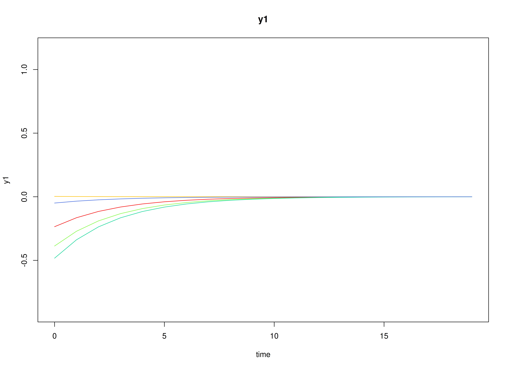
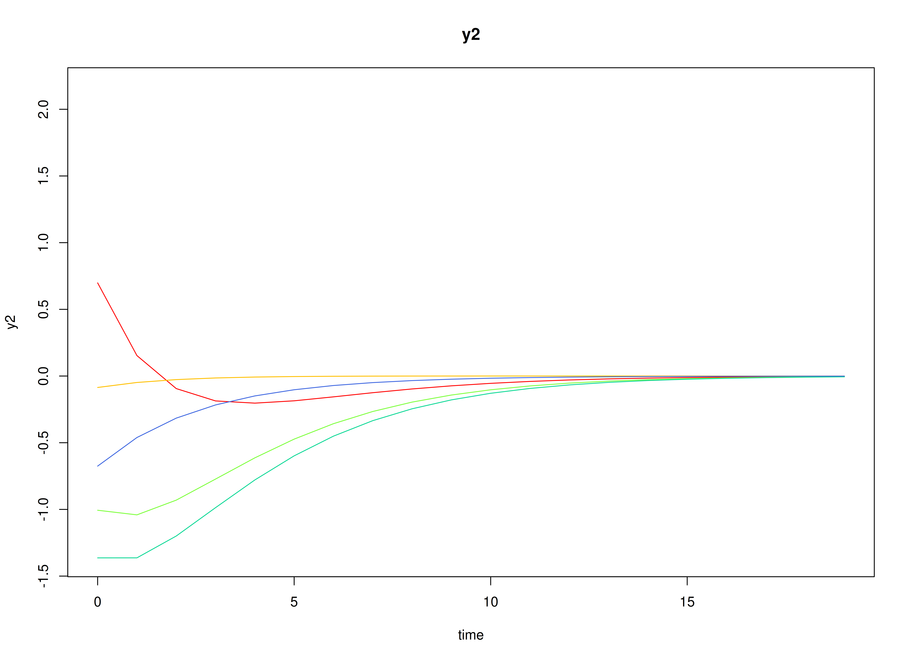
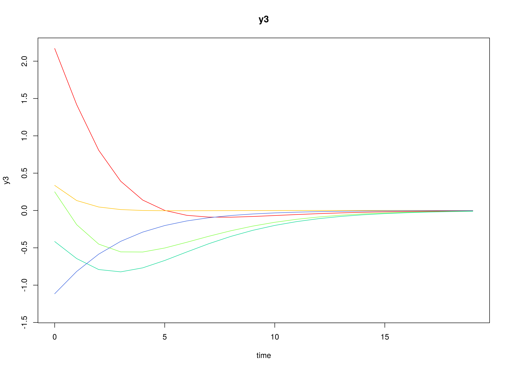
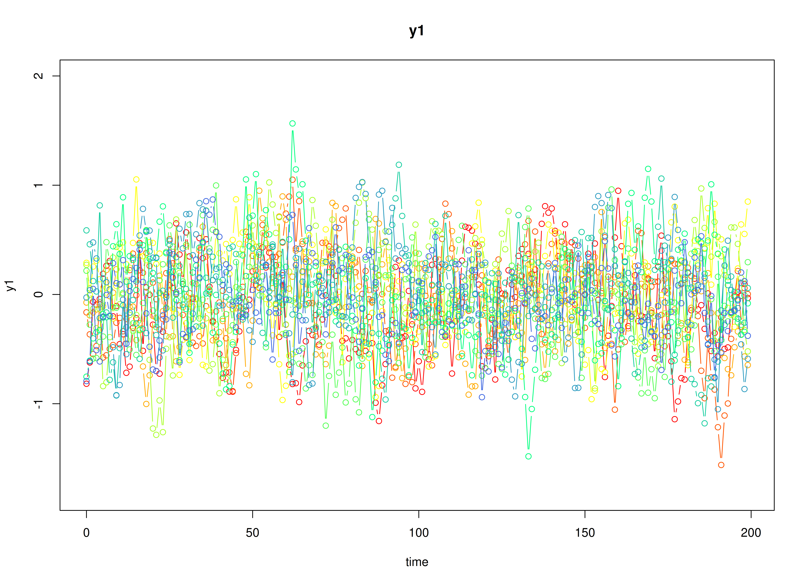
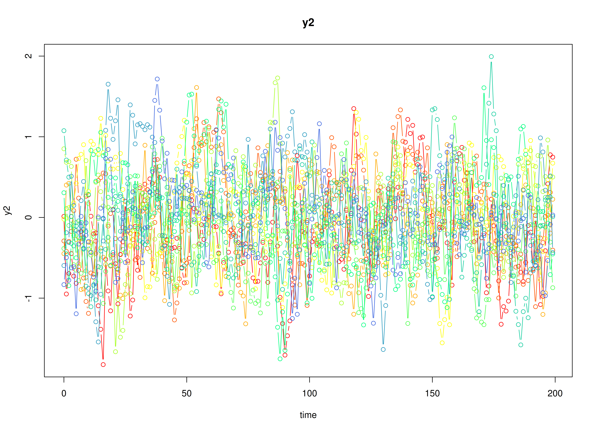
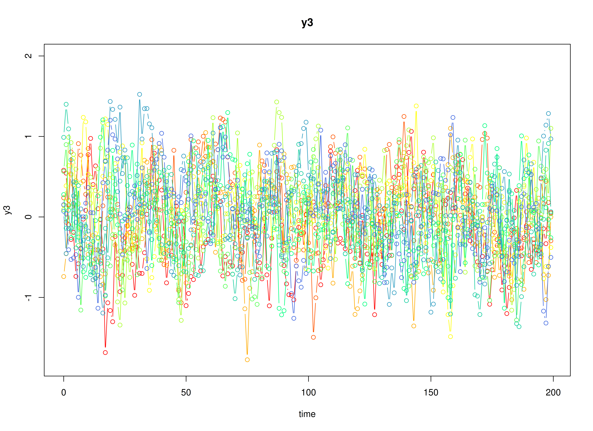
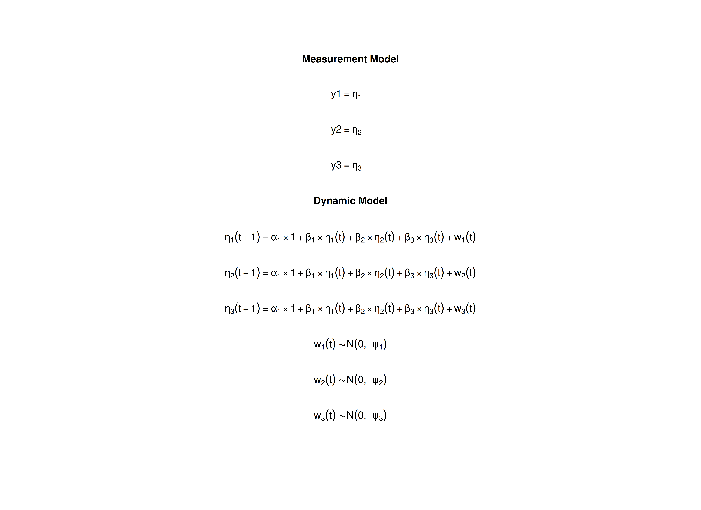

# The Vector Autoregressive Model

## Model

The measurement model is given by
``` math
\begin{equation}
  \mathbf{y}_{i, t}
  =
  \boldsymbol{\eta}_{i, t}
\end{equation}
```
where $`\mathbf{y}_{i, t}`$ represents a vector of observed variables
and $`\boldsymbol{\eta}_{i, t}`$ a vector of latent variables for
individual $`i`$ and time $`t`$. Since the observed and latent variables
are equal, we only generate data from the dynamic structure.

The dynamic structure is given by
``` math
\begin{equation}
  \boldsymbol{\eta}_{i, t}
  =
  \boldsymbol{\alpha}
  +
  \boldsymbol{\beta}
  \boldsymbol{\eta}_{i, t - 1}
  +
  \boldsymbol{\zeta}_{i, t},
  \quad
  \mathrm{with}
  \quad
  \boldsymbol{\zeta}_{i, t}
  \sim
  \mathcal{N}
  \left(
  \mathbf{0},
  \boldsymbol{\Psi}
  \right)
\end{equation}
```
where $`\boldsymbol{\eta}_{i, t}`$, $`\boldsymbol{\eta}_{i, t - 1}`$,
and $`\boldsymbol{\zeta}_{i, t}`$ are random variables, and
$`\boldsymbol{\alpha}`$, $`\boldsymbol{\beta}`$, and
$`\boldsymbol{\Psi}`$ are model parameters. Here,
$`\boldsymbol{\eta}_{i, t}`$ is a vector of latent variables at time
$`t`$ and individual $`i`$, $`\boldsymbol{\eta}_{i, t - 1}`$ represents
a vector of latent variables at time $`t - 1`$ and individual $`i`$, and
$`\boldsymbol{\zeta}_{i, t}`$ represents a vector of dynamic noise at
time $`t`$ and individual $`i`$. $`\boldsymbol{\alpha}`$ denotes a
vector of intercepts, $`\boldsymbol{\beta}`$ a matrix of autoregression
and cross regression coefficients, and $`\boldsymbol{\Psi}`$ the
covariance matrix of $`\boldsymbol{\zeta}_{i, t}`$.

An alternative representation of the dynamic noise is given by
``` math
\begin{equation}
  \boldsymbol{\zeta}_{i, t}
  =
  \boldsymbol{\Psi}^{\frac{1}{2}}
  \mathbf{z}_{i, t},
  \quad
  \mathrm{with}
  \quad
  \mathbf{z}_{i, t}
  \sim
  \mathcal{N}
  \left(
  \mathbf{0},
  \mathbf{I}
  \right)
\end{equation}
```
where
$`\left( \boldsymbol{\Psi}^{\frac{1}{2}} \right) \left( \boldsymbol{\Psi}^{\frac{1}{2}} \right)^{\prime} = \boldsymbol{\Psi}`$
.

## Data Generation

### Notation

Let $`t = 200`$ be the number of time points and $`n = 10`$ be the
number of individuals.

Let the initial condition $`\boldsymbol{\eta}_{0}`$ be given by

``` math
\begin{equation}
\boldsymbol{\eta}_{0} \sim \mathcal{N} \left( \boldsymbol{\mu}_{\boldsymbol{\eta} \mid 0}, \boldsymbol{\Sigma}_{\boldsymbol{\eta} \mid 0} \right)
\end{equation}
```

``` math
\begin{equation}
\boldsymbol{\mu}_{\boldsymbol{\eta} \mid 0}
=
\left(
\begin{array}{c}
  0 \\
  0 \\
  0 \\
\end{array}
\right)
\end{equation}
```

``` math
\begin{equation}
\boldsymbol{\Sigma}_{\boldsymbol{\eta} \mid 0}
=
\left(
\begin{array}{ccc}
  0.1960784 & 0.1183232 & 0.0298539 \\
  0.1183232 & 0.3437711 & 0.1381855 \\
  0.0298539 & 0.1381855 & 0.2663828 \\
\end{array}
\right) .
\end{equation}
```

Let the constant vector $`\boldsymbol{\alpha}`$ be given by

``` math
\begin{equation}
\boldsymbol{\alpha}
=
\left(
\begin{array}{c}
  0 \\
  0 \\
  0 \\
\end{array}
\right) .
\end{equation}
```

Let the transition matrix $`\boldsymbol{\beta}`$ be given by

``` math
\begin{equation}
\boldsymbol{\beta}
=
\left(
\begin{array}{ccc}
  0.7 & 0 & 0 \\
  0.5 & 0.6 & 0 \\
  -0.1 & 0.4 & 0.5 \\
\end{array}
\right) .
\end{equation}
```

Let the dynamic process noise $`\boldsymbol{\Psi}`$ be given by

``` math
\begin{equation}
\boldsymbol{\Psi}
=
\left(
\begin{array}{ccc}
  0.1 & 0 & 0 \\
  0 & 0.1 & 0 \\
  0 & 0 & 0.1 \\
\end{array}
\right) .
\end{equation}
```

### R Function Arguments

\
`n`\
`#> [1] 10`\
`time`\
`#> [1] 200`\
`mu0`\
`#> [1] 0 0 0`\
`sigma0`\
`#>            [,1]      [,2]       [,3]`\
`#> [1,] 0.19607843 0.1183232 0.02985385`\
`#> [2,] 0.11832319 0.3437711 0.13818551`\
`#> [3,] 0.02985385 0.1381855 0.26638284`\
`sigma0_l`` ``# sigma0_l <- t(chol(sigma0))`\
`#>            [,1]      [,2]     [,3]`\
`#> [1,] 0.44280744 0.0000000 0.000000`\
`#> [2,] 0.26721139 0.5218900 0.000000`\
`#> [3,] 0.06741949 0.2302597 0.456966`\
`alpha`\
`#> [1] 0 0 0`\
`beta`\
`#>      [,1] [,2] [,3]`\
`#> [1,]  0.7  0.0  0.0`\
`#> [2,]  0.5  0.6  0.0`\
`#> [3,] -0.1  0.4  0.5`\
`psi`\
`#>      [,1] [,2] [,3]`\
`#> [1,]  0.1  0.0  0.0`\
`#> [2,]  0.0  0.1  0.0`\
`#> [3,]  0.0  0.0  0.1`\
`psi_l`` ``# psi_l <- t(chol(psi))`\
`#>           [,1]      [,2]      [,3]`\
`#> [1,] 0.3162278 0.0000000 0.0000000`\
`#> [2,] 0.0000000 0.3162278 0.0000000`\
`#> [3,] 0.0000000 0.0000000 0.3162278`

### Visualizing the Dynamics Without Process Noise (n = 5 with Different Initial Condition)



### Using the `SimSSMVARFixed` Function from the `simStateSpace` Package to Simulate Data

\
[`library`](https://rdrr.io/r/base/library.html)`(`[`simStateSpace`](https://github.com/jeksterslab/simStateSpace)`)`\
`sim`` ``<-`` `[`SimSSMVARFixed`](https://github.com/jeksterslab/simStateSpace/reference/SimSSMVARFixed.md)`(`\
`  n ``=`` ``n``,`\
`  time ``=`` ``time``,`\
`  mu0 ``=`` ``mu0``,`\
`  sigma0_l ``=`` ``sigma0_l``,`\
`  alpha ``=`` ``alpha``,`\
`  beta ``=`` ``beta``,`\
`  psi_l ``=`` ``psi_l`\
`)`\
`data`` ``<-`` `[`as.data.frame`](https://rdrr.io/r/base/as.data.frame.html)`(``sim``)`\
[`head`](https://rdrr.io/r/utils/head.html)`(``data``)`\
`#>   id time          y1          y2          y3`\
`#> 1  1    0 -0.81728749  0.01319023  0.57975035`\
`#> 2  1    1 -0.62264147 -0.94877859  0.54422379`\
`#> 3  1    2 -0.06731464 -0.69530903 -0.09626706`\
`#> 4  1    3 -0.09174342 -0.44804477 -0.27983813`\
`#> 5  1    4 -0.04104160 -0.72769549 -0.19238403`\
`#> 6  1    5  0.18907246 -0.81602072 -0.73831208`\
[`summary`](https://rdrr.io/r/base/summary.html)`(``data``)`\
`#>        id            time              y1                 y2          `\
`#>  Min.   : 1.0   Min.   :  0.00   Min.   :-1.56057   Min.   :-1.82387  `\
`#>  1st Qu.: 3.0   1st Qu.: 49.75   1st Qu.:-0.32629   1st Qu.:-0.41733  `\
`#>  Median : 5.5   Median : 99.50   Median :-0.03242   Median :-0.03901  `\
`#>  Mean   : 5.5   Mean   : 99.50   Mean   :-0.03181   Mean   :-0.02456  `\
`#>  3rd Qu.: 8.0   3rd Qu.:149.25   3rd Qu.: 0.26432   3rd Qu.: 0.35497  `\
`#>  Max.   :10.0   Max.   :199.00   Max.   : 1.56537   Max.   : 1.99368  `\
`#>        y3           `\
`#>  Min.   :-1.774215  `\
`#>  1st Qu.:-0.354106  `\
`#>  Median : 0.015030  `\
`#>  Mean   : 0.009726  `\
`#>  3rd Qu.: 0.364646  `\
`#>  Max.   : 1.522946`\
[`plot`](https://rdrr.io/r/graphics/plot.default.html)`(``sim``)`



## Model Fitting

### Prepare Data

\
`dynr_data`` ``<-`` ``dynr``::`[`dynr.data`](https://rdrr.io/pkg/dynr/man/dynr.data.html)`(`\
`  data ``=`` ``data``,`\
`  id ``=`` ``"id"``,`\
`  time ``=`` ``"time"``,`\
`  observed ``=`` `[`c`](https://rdrr.io/r/base/c.html)`(``"y1"``, ``"y2"``, ``"y3"``)`\
`)`

### Prepare Initial Condition

\
`dynr_initial`` ``<-`` ``dynr``::`[`prep.initial`](https://rdrr.io/pkg/dynr/man/prep.initial.html)`(`\
`  values.inistate ``=`` ``mu0``,`\
`  params.inistate ``=`` `[`c`](https://rdrr.io/r/base/c.html)`(``"mu0_1_1"``, ``"mu0_2_1"``, ``"mu0_3_1"``)``,`\
`  values.inicov ``=`` ``sigma0``,`\
`  params.inicov ``=`` `[`matrix`](https://rdrr.io/r/base/matrix.html)`(`\
`    data ``=`` `[`c`](https://rdrr.io/r/base/c.html)`(`\
`      ``"sigma0_1_1"``, ``"sigma0_2_1"``, ``"sigma0_3_1"``,`\
`      ``"sigma0_2_1"``, ``"sigma0_2_2"``, ``"sigma0_3_2"``,`\
`      ``"sigma0_3_1"``, ``"sigma0_3_2"``, ``"sigma0_3_3"`\
`    ``)``,`\
`    nrow ``=`` ``3`\
`  ``)`\
`)`

### Prepare Measurement Model

\
`dynr_measurement`` ``<-`` ``dynr``::`[`prep.measurement`](https://rdrr.io/pkg/dynr/man/prep.measurement.html)`(`\
`  values.load ``=`` `[`diag`](https://rdrr.io/r/base/diag.html)`(``3``)``,`\
`  params.load ``=`` `[`matrix`](https://rdrr.io/r/base/matrix.html)`(``data ``=`` ``"fixed"``, nrow ``=`` ``3``, ncol ``=`` ``3``)``,`\
`  state.names ``=`` `[`c`](https://rdrr.io/r/base/c.html)`(``"eta_1"``, ``"eta_2"``, ``"eta_3"``)``,`\
`  obs.names ``=`` `[`c`](https://rdrr.io/r/base/c.html)`(``"y1"``, ``"y2"``, ``"y3"``)`\
`)`

### Prepare Dynamic Process

\
`dynr_dynamics`` ``<-`` ``dynr``::`[`prep.formulaDynamics`](https://rdrr.io/pkg/dynr/man/prep.formulaDynamics.html)`(`\
`  formula ``=`` `[`list`](https://rdrr.io/r/base/list.html)`(`\
`    ``eta_1`` ``~`` ``alpha_1_1`` ``*`` ``1`` ``+`` ``beta_1_1`` ``*`` ``eta_1`` ``+`` ``beta_1_2`` ``*`` ``eta_2`` ``+`` ``beta_1_3`` ``*`` ``eta_3``,`\
`    ``eta_2`` ``~`` ``alpha_2_1`` ``*`` ``1`` ``+`` ``beta_2_1`` ``*`` ``eta_1`` ``+`` ``beta_2_2`` ``*`` ``eta_2`` ``+`` ``beta_2_3`` ``*`` ``eta_3``,`\
`    ``eta_3`` ``~`` ``alpha_3_1`` ``*`` ``1`` ``+`` ``beta_3_1`` ``*`` ``eta_1`` ``+`` ``beta_3_2`` ``*`` ``eta_2`` ``+`` ``beta_3_3`` ``*`` ``eta_3`\
`  ``)``,`\
`  startval ``=`` `[`c`](https://rdrr.io/r/base/c.html)`(`\
`    alpha_1_1 ``=`` ``alpha``[``1``]``, alpha_2_1 ``=`` ``alpha``[``2``]``, alpha_3_1 ``=`` ``alpha``[``3``]``,`\
`    beta_1_1 ``=`` ``beta``[``1``, ``1``]``, beta_1_2 ``=`` ``beta``[``1``, ``2``]``, beta_1_3 ``=`` ``beta``[``1``, ``3``]``,`\
`    beta_2_1 ``=`` ``beta``[``2``, ``1``]``, beta_2_2 ``=`` ``beta``[``2``, ``2``]``, beta_2_3 ``=`` ``beta``[``2``, ``3``]``,`\
`    beta_3_1 ``=`` ``beta``[``3``, ``1``]``, beta_3_2 ``=`` ``beta``[``3``, ``2``]``, beta_3_3 ``=`` ``beta``[``3``, ``3``]`\
`  ``)``,`\
`  isContinuousTime ``=`` ``FALSE`\
`)`

### Prepare Process Noise

\
`dynr_noise`` ``<-`` ``dynr``::`[`prep.noise`](https://rdrr.io/pkg/dynr/man/prep.noise.html)`(`\
`  values.latent ``=`` ``psi``,`\
`  params.latent ``=`` `[`matrix`](https://rdrr.io/r/base/matrix.html)`(`\
`    data ``=`` `[`c`](https://rdrr.io/r/base/c.html)`(`\
`      ``"psi_1_1"``, ``"psi_2_1"``, ``"psi_3_1"``,`\
`      ``"psi_2_1"``, ``"psi_2_2"``, ``"psi_3_2"``,`\
`      ``"psi_3_1"``, ``"psi_3_2"``, ``"psi_3_3"`\
`    ``)``,`\
`    nrow ``=`` ``3`\
`  ``)``,`\
`  values.observed ``=`` `[`matrix`](https://rdrr.io/r/base/matrix.html)`(``data ``=`` ``0``, nrow ``=`` ``3``, ncol ``=`` ``3``)``,`\
`  params.observed ``=`` `[`matrix`](https://rdrr.io/r/base/matrix.html)`(``data ``=`` ``"fixed"``, nrow ``=`` ``3``, ncol ``=`` ``3``)`\
`)`

### Prepare the Model

\
`model`` ``<-`` ``dynr``::`[`dynr.model`](https://rdrr.io/pkg/dynr/man/dynr.model.html)`(`\
`  data ``=`` ``dynr_data``,`\
`  initial ``=`` ``dynr_initial``,`\
`  measurement ``=`` ``dynr_measurement``,`\
`  dynamics ``=`` ``dynr_dynamics``,`\
`  noise ``=`` ``dynr_noise``,`\
`  outfile ``=`` ``"var.c"`\
`)`



### Fit the Model

\
`results`` ``<-`` ``dynr``::`[`dynr.cook`](https://rdrr.io/pkg/dynr/man/dynr.cook.html)`(`\
`  ``model``,`\
`  debug_flag ``=`` ``TRUE``,`\
`  verbose ``=`` ``FALSE`\
`)`\
`#> [1] "Get ready!!!!"`\
`#> using C compiler: ‘gcc (Ubuntu 13.3.0-6ubuntu2~24.04.1) 13.3.0’`\
`#> Optimization function called.`\
`#> Starting Hessian calculation ...`\
`#> Finished Hessian calculation.`\
`#> Original exit flag:  3 `\
`#> Modified exit flag:  3 `\
`#> Optimization terminated successfully: ftol_rel or ftol_abs was reached. `\
`#> Original fitted parameters:  -0.009659021 0.006326407 0.01105055 0.6699005 `\
`#> 0.02336719 -0.008557283 0.4980157 0.610462 -0.01641327 -0.1277804 0.4459828 `\
`#> 0.4777827 -2.325915 -0.05106317 -0.02204618 -2.285971 -0.02170302 -2.31359 `\
`#> -0.1263982 -0.0330166 0.2370182 -1.476343 0.545595 0.1225164 -1.285094 `\
`#> 0.3734002 -1.972366 `\
`#> `\
`#> Transformed fitted parameters:  -0.009659021 0.006326407 0.01105055 0.6699005 `\
`#> 0.02336719 -0.008557283 0.4980157 0.610462 -0.01641327 -0.1277804 0.4459828 `\
`#> 0.4777827 0.09769403 -0.004988567 -0.00215378 0.10193 -0.002096681 0.09900091 `\
`#> -0.1263982 -0.0330166 0.2370182 0.2284717 0.124653 0.02799153 0.3446345 `\
`#> 0.1185637 0.1811258 `\
`#> `\
`#> Doing end processing`\
`#> Successful trial`\
`#> Total Time: 58.46323 `\
`#> Backend Time: 57.74241`

## Summary

\
[`summary`](https://rdrr.io/r/base/summary.html)`(``results``)`\
`#> Coefficients:`\
`#>              Estimate Std. Error t value   ci.lower   ci.upper Pr(>|t|)    `\
`#> alpha_1_1  -0.0096590  0.0070306  -1.374 -0.0234387  0.0041206   0.0848 .  `\
`#> alpha_2_1   0.0063264  0.0071814   0.881 -0.0077488  0.0204017   0.1892    `\
`#> alpha_3_1   0.0110505  0.0070774   1.561 -0.0028210  0.0249221   0.0593 .  `\
`#> beta_1_1    0.6699005  0.0181368  36.936  0.6343530  0.7054480   <2e-16 ***`\
`#> beta_1_2    0.0233672  0.0149701   1.561 -0.0059736  0.0527080   0.0594 .  `\
`#> beta_1_3   -0.0085573  0.0150745  -0.568 -0.0381027  0.0209881   0.2852    `\
`#> beta_2_1    0.4980157  0.0185257  26.882  0.4617061  0.5343254   <2e-16 ***`\
`#> beta_2_2    0.6104620  0.0152910  39.923  0.5804922  0.6404318   <2e-16 ***`\
`#> beta_2_3   -0.0164133  0.0153978  -1.066 -0.0465923  0.0137658   0.1433    `\
`#> beta_3_1   -0.1277804  0.0182577  -6.999 -0.1635648 -0.0919960   <2e-16 ***`\
`#> beta_3_2    0.4459828  0.0150698  29.594  0.4164465  0.4755191   <2e-16 ***`\
`#> beta_3_3    0.4777827  0.0151750  31.485  0.4480402  0.5075251   <2e-16 ***`\
`#> psi_1_1     0.0976940  0.0030970  31.544  0.0916240  0.1037641   <2e-16 ***`\
`#> psi_2_1    -0.0049886  0.0022397  -2.227 -0.0093783 -0.0005988   0.0130 *  `\
`#> psi_3_1    -0.0021538  0.0022051  -0.977 -0.0064756  0.0021680   0.1644    `\
`#> psi_2_2     0.1019300  0.0032314  31.544  0.0955966  0.1082634   <2e-16 ***`\
`#> psi_3_2    -0.0020967  0.0022523  -0.931 -0.0065111  0.0023177   0.1760    `\
`#> psi_3_3     0.0990009  0.0031385  31.544  0.0928496  0.1051523   <2e-16 ***`\
`#> mu0_1_1    -0.1263982  0.1511580  -0.836 -0.4226625  0.1698661   0.2016    `\
`#> mu0_2_1    -0.0330166  0.1856481  -0.178 -0.3968802  0.3308470   0.4294    `\
`#> mu0_3_1     0.2370182  0.1345854   1.761 -0.0267643  0.5008008   0.0392 *  `\
`#> sigma0_1_1  0.2284717  0.1022045   2.235  0.0281546  0.4287887   0.0128 *  `\
`#> sigma0_2_1  0.1246530  0.0970758   1.284 -0.0656120  0.3149180   0.0996 .  `\
`#> sigma0_3_1  0.0279915  0.0649250   0.431 -0.0992592  0.1552422   0.3332    `\
`#> sigma0_2_2  0.3446345  0.1540975   2.236  0.0426091  0.6466600   0.0127 *  `\
`#> sigma0_3_2  0.1185637  0.0874131   1.356 -0.0527629  0.2898903   0.0876 .  `\
`#> sigma0_3_3  0.1811258  0.0809848   2.237  0.0223985  0.3398530   0.0127 *  `\
`#> ---`\
`#> Signif. codes:  0 '***' 0.001 '**' 0.01 '*' 0.05 '.' 0.1 ' ' 1`\
`#> `\
`#> -2 log-likelihood value at convergence = 3198.61`\
`#> AIC = 3252.61`\
`#> BIC = 3403.83`

### Parameter Estimates

\
`alpha_hat`\
`#> [1] -0.009659021  0.006326407  0.011050550`\
`beta_hat`\
`#>            [,1]       [,2]         [,3]`\
`#> [1,]  0.6699005 0.02336719 -0.008557283`\
`#> [2,]  0.4980157 0.61046200 -0.016413272`\
`#> [3,] -0.1277804 0.44598281  0.477782683`\
`psi_hat`\
`#>              [,1]         [,2]         [,3]`\
`#> [1,]  0.097694029 -0.004988567 -0.002153780`\
`#> [2,] -0.004988567  0.101930001 -0.002096681`\
`#> [3,] -0.002153780 -0.002096681  0.099000914`\
`mu0_hat`\
`#> [1] -0.1263982 -0.0330166  0.2370182`\
`sigma0_hat`\
`#>            [,1]      [,2]       [,3]`\
`#> [1,] 0.22847167 0.1246530 0.02799153`\
`#> [2,] 0.12465301 0.3446345 0.11856369`\
`#> [3,] 0.02799153 0.1185637 0.18112578`

## References

Chow, S.-M., Ho, M. R., Hamaker, E. L., & Dolan, C. V. (2010).
Equivalence and differences between structural equation modeling and
state-space modeling techniques. *Structural Equation Modeling: A
Multidisciplinary Journal*, *17*(2), 303–332.
<https://doi.org/10.1080/10705511003661553>

Ou, L., Hunter, M. D., & Chow, S.-M. (2019). What’s for dynr: A package
for linear and nonlinear dynamic modeling in R. *The R Journal*,
*11*(1), 91. <https://doi.org/10.32614/rj-2019-012>

Pesigan, I. J. A., Russell, M. A., & Chow, S.-M. (2025). Inferences and
effect sizes for direct, indirect, and total effects in continuous-time
mediation models. *Psychological Methods*.
<https://doi.org/10.1037/met0000779>

R Core Team. (2026). *R: A language and environment for statistical
computing*. R Foundation for Statistical Computing.
<https://www.R-project.org/>
