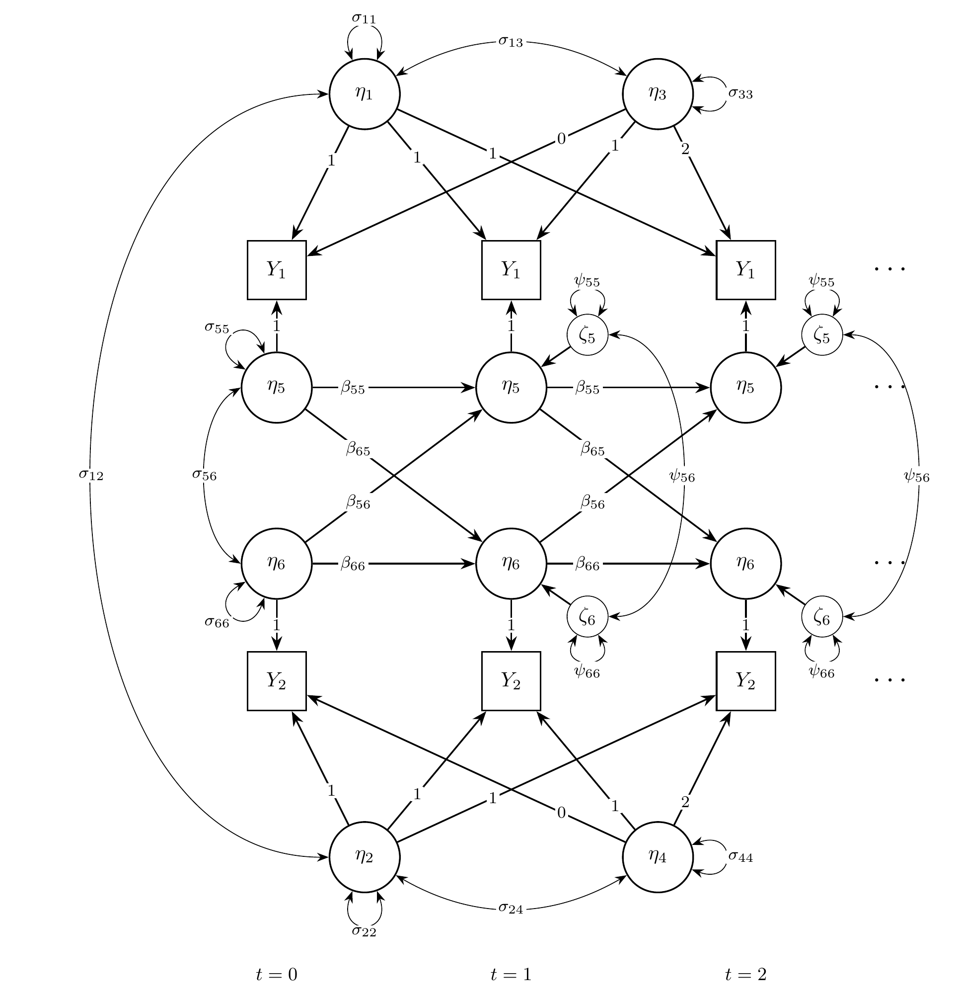
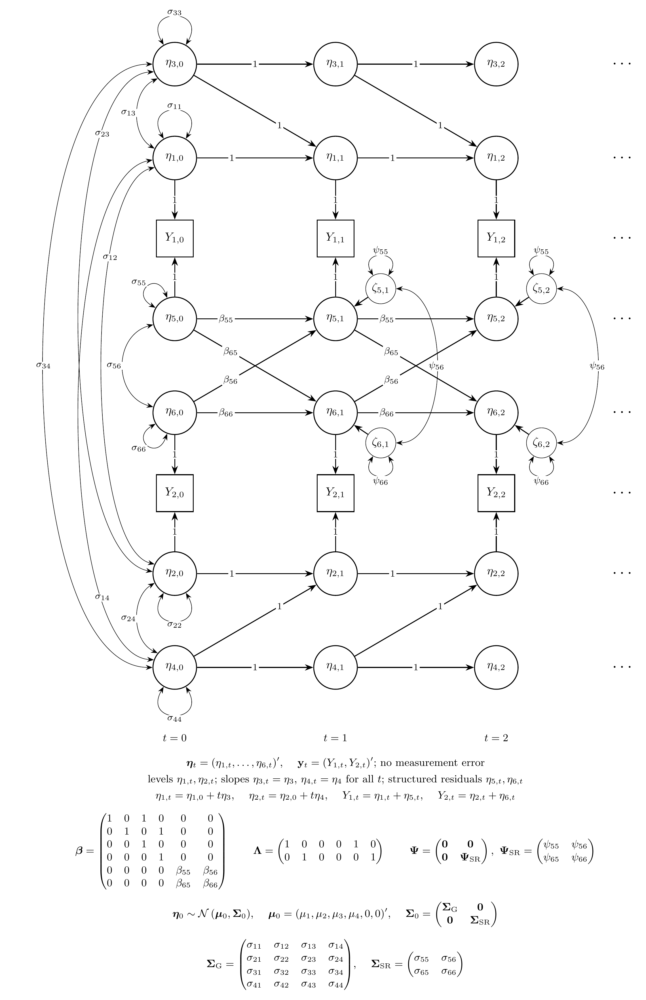

## Overview

The latent curve model with structured residuals (LCM-SR)
combines two ideas [@Curran-Howard-Bainter-etal-2014].
Take alcohol use and depressive symptoms measured once a year in adolescents.
Each adolescent follows a straight-line trajectory on each variable,
with their own intercept and slope,
as in the linear growth curve model.
On each occasion, the adolescent is also above or below the trajectory,
and these deviations, called the structured residuals,
carry over to the next occasion and affect each other.
The growth part describes how individuals differ in their long-term change;
the residual part describes the within-person dynamics around it,
with autoregressive and cross-lagged effects.

The LCM-SR is usually fitted as a structural equation model (SEM).
It can also be written as a state space model
by combining the state space forms of the linear growth curve model
and of the vector autoregressive model:
the levels and slopes of the two trajectories
and the two residuals are latent states.

This tutorial does three things:

1. It writes the LCM-SR as a state space model.
2. It simulates data from the model with `SimSSMFixed()`.
3. It fits the model to the simulated data
   as a state space model with `dynr` and `OpenMx`
   and as a structural equation model (SEM) with `lavaan` and `OpenMx`,
   and compares every set of estimates with the values used to simulate the data.

No prior knowledge of state space models is needed.
The vignette on the linear growth curve model
explains the growth part in more detail.


## Model

The measurement model is given by
$$
  \left(
  \begin{array}{c}
    Y_{1_{i, t}} \\
    Y_{2_{i, t}} \\
  \end{array}
  \right)
  =
  \left(
  \begin{array}{cccccc}
    1 & 0 & 0 & 0 & 1 & 0 \\
    0 & 1 & 0 & 0 & 0 & 1 \\
  \end{array}
  \right)
  \left(
  \begin{array}{c}
    \eta_{1_{i, t}} \\
    \eta_{2_{i, t}} \\
    \eta_{3_{i, t}} \\
    \eta_{4_{i, t}} \\
    \eta_{5_{i, t}} \\
    \eta_{6_{i, t}} \\
  \end{array}
  \right)
$$
where $Y_{1_{i, t}}$ and $Y_{2_{i, t}}$
are the two observed variables
at time $t$ and individual $i$,
$\eta_{1_{i, t}}$ and $\eta_{2_{i, t}}$
are the current levels of the two trajectories,
$\eta_{3_{i, t}}$ and $\eta_{4_{i, t}}$ are their slopes,
and $\eta_{5_{i, t}}$ and $\eta_{6_{i, t}}$
are the structured residuals.

In words,
each observed score is the point on the individual's trajectory
plus the individual's deviation from it on that occasion.
As in most applications of the LCM-SR,
there is no separate measurement error.

The dynamic structure is given by
$$
  \left(
  \begin{array}{c}
    \eta_{1_{i, t}} \\
    \eta_{2_{i, t}} \\
    \eta_{3_{i, t}} \\
    \eta_{4_{i, t}} \\
    \eta_{5_{i, t}} \\
    \eta_{6_{i, t}} \\
  \end{array}
  \right)
  =
  \left(
  \begin{array}{cccccc}
    1 & 0 & 1 & 0 & 0 & 0 \\
    0 & 1 & 0 & 1 & 0 & 0 \\
    0 & 0 & 1 & 0 & 0 & 0 \\
    0 & 0 & 0 & 1 & 0 & 0 \\
    0 & 0 & 0 & 0 & \beta_{55} & \beta_{56} \\
    0 & 0 & 0 & 0 & \beta_{65} & \beta_{66} \\
  \end{array}
  \right)
  \left(
  \begin{array}{c}
    \eta_{1_{i, t - 1}} \\
    \eta_{2_{i, t - 1}} \\
    \eta_{3_{i, t - 1}} \\
    \eta_{4_{i, t - 1}} \\
    \eta_{5_{i, t - 1}} \\
    \eta_{6_{i, t - 1}} \\
  \end{array}
  \right)
  +
  \left(
  \begin{array}{c}
    0 \\
    0 \\
    0 \\
    0 \\
    \zeta_{5_{i, t}} \\
    \zeta_{6_{i, t}} \\
  \end{array}
  \right),
  \quad
  \mathrm{with}
  \quad
  \left(
  \begin{array}{c}
    \zeta_{5_{i, t}} \\
    \zeta_{6_{i, t}} \\
  \end{array}
  \right)
  \sim
  \mathcal{N}
  \left(
  \mathbf{0},
  \left(
  \begin{array}{cc}
    \psi_{55} & \psi_{56} \\
    \psi_{65} & \psi_{66} \\
  \end{array}
  \right)
  \right) .
$$

In words,
the first four rows are the linear growth curve model for each variable:
the level at each occasion is the previous level plus the slope,
and the slope stays the same, with no process noise.
The last two rows are a vector autoregressive model for the residuals:
$\beta_{55}$ and $\beta_{66}$ are the autoregressive effects,
how much of a deviation from the trajectory carries over to the next occasion,
and $\beta_{56}$ and $\beta_{65}$ are the cross-lagged effects:
$\beta_{56}$ is the effect of a deviation in the second variable
on the deviation in the first variable at the next occasion,
and $\beta_{65}$ the reverse.
$\psi_{55}$, $\psi_{66}$, and $\psi_{56}$
are the variances and covariance of the new part of the deviations.

The initial condition holds the means, variances, and covariances
of the intercepts and slopes
(the levels at the first occasion are the intercepts),
and the variances and covariance of the residuals at the first occasion.
The residuals have mean zero,
because they are deviations from the trajectories,
and are uncorrelated with the intercepts and slopes.

### Diagrams


{width=100%}

The LCM-SR as a path diagram, for the first three occasions ($t = 0, 1, 2$).
The intercepts $\eta_{1}$ and $\eta_{2}$ load on every occasion with a loading of 1, and the slopes $\eta_{3}$ and $\eta_{4}$ with loadings $0, 1, 2, \ldots$.
The structured residuals $\eta_{5}$ and $\eta_{6}$ carry the dynamics: the horizontal arrows are the autoregressive effects and the diagonal arrows the cross-lagged effects.
$\zeta_{5}$ and $\zeta_{6}$ are the new parts of the residuals on each occasion, with variances $\psi_{55}$ and $\psi_{66}$ and covariance $\psi_{56}$;
$\sigma_{55}$, $\sigma_{66}$, and $\sigma_{56}$ are the variances and covariance of the structured residuals at $t = 0$.
A loop on a variable is its variance and a curved two-headed arrow a covariance.
The intercepts and slopes have variances $\sigma_{11}$ to $\sigma_{44}$ and all covary; to keep the diagram readable, only the covariances $\sigma_{12}$, $\sigma_{13}$, and $\sigma_{24}$ are drawn.

{width=100%}

The same model in state space form, for the first three occasions, with every element of the state drawn.
In the state space form, $\eta_{1, t}$ and $\eta_{2, t}$ are the current levels of the trajectories (the intercepts at $t = 0$):
the transition adds the slope to the level at each occasion, and the slopes are states with a transition of 1, so $\eta_{3, t} = \eta_{3}$ and $\eta_{4, t} = \eta_{4}$ for all $t$.
Each observed variable $Y_{j, t}$ is its level plus its structured residual, both with a loading of 1.
Only the structured residuals $\eta_{5, t}$ and $\eta_{6, t}$ receive process noise, from $t = 1$ on.
At $t = 0$, the initial condition $\boldsymbol{\eta}_{0} \sim \mathcal{N} \left( \boldsymbol{\mu}_{0}, \boldsymbol{\Sigma}_{0} \right)$ gives the variances and covariances at $t = 0$: the intercepts and slopes all covary, and the structured residuals covary with each other but not with the growth part.
Below the diagram, all the latent variables at one occasion form the state vector $\boldsymbol{\eta}_{t}$, and all the observed variables form $\mathbf{y}_{t}$:
$\boldsymbol{\beta}$ carries the state from one occasion to the next, $\boldsymbol{\Lambda}$ maps the state to the observed variables, and $\boldsymbol{\Psi}$ is the covariance matrix of the process noise $\boldsymbol{\zeta}_{t}$.
`SimSSMFixed()` takes `beta`, `lambda`, `mu0`, and the Cholesky factors of $\boldsymbol{\Psi}$ and $\boldsymbol{\Sigma}_{0}$ (`psi_l` and `sigma0_l`);
`theta_l` is a matrix of zeros.

## Data Generation

### Notation

Let $t = 5$ be the number of time points and $n = 5000$ be the number of individuals.

Let the means and the covariance matrix
of the intercepts and slopes, in the order
intercept 1, intercept 2, slope 1, and slope 2, be

$$
\left(
\begin{array}{c}
  2 \\
  1 \\
  0.5 \\
  0.3 \\
\end{array}
\right)
\quad \mathrm{and,} \quad
\left(
\begin{array}{cccc}
  1 & 0.4 & 0.1 & 0.05 \\
  0.4 & 1 & 0.05 & 0.1 \\
  0.1 & 0.05 & 0.1 & 0.03 \\
  0.05 & 0.1 & 0.03 & 0.1 \\
\end{array}
\right) .
$$

Let the autoregressive and cross-lagged effects of the residuals
and their process noise covariance matrix be

$$
\left(
\begin{array}{cc}
  \beta_{55} & \beta_{56} \\
  \beta_{65} & \beta_{66} \\
\end{array}
\right)
=
\left(
\begin{array}{cc}
  0.4 & 0.1 \\
  0.15 & 0.3 \\
\end{array}
\right)
\quad \mathrm{and,} \quad
\left(
\begin{array}{cc}
  \psi_{55} & \psi_{56} \\
  \psi_{65} & \psi_{66} \\
\end{array}
\right)
=
\left(
\begin{array}{cc}
  0.4 & 0.1 \\
  0.1 & 0.4 \\
\end{array}
\right) .
$$

The residuals start from their stationary distribution:
their covariance matrix at the first occasion is the one they keep
at every later occasion,
computed with `SSMCovEta()`,

$$
\left(
\begin{array}{cc}
  \sigma_{55} & \sigma_{56} \\
  \sigma_{65} & \sigma_{66} \\
\end{array}
\right)
=
\left(
\begin{array}{cc}
  0.498 & 0.166 \\
  0.166 & 0.468 \\
\end{array}
\right) .
$$

### R Function Arguments

The simulation functions take covariance matrices
as lower triangular Cholesky factors (the arguments ending in `_l`).
Because the intercepts and slopes have no process noise
and there is no measurement error,
`psi` and `theta` have rows and columns of zeros,
and their Cholesky factors are built block by block.


``` r
n
#> [1] 5000
time
#> [1] 5
mu0
#> [1] 2.0 1.0 0.5 0.3 0.0 0.0
sigma0
#>      [,1] [,2] [,3] [,4]      [,5]      [,6]
#> [1,] 1.00 0.40 0.10 0.05 0.0000000 0.0000000
#> [2,] 0.40 1.00 0.05 0.10 0.0000000 0.0000000
#> [3,] 0.10 0.05 0.10 0.03 0.0000000 0.0000000
#> [4,] 0.05 0.10 0.03 0.10 0.0000000 0.0000000
#> [5,] 0.00 0.00 0.00 0.00 0.4976100 0.1663655
#> [6,] 0.00 0.00 0.00 0.00 0.1663655 0.4683177
sigma0_l # sigma0_l <- t(chol(sigma0))
#>      [,1]       [,2]      [,3]     [,4]      [,5]      [,6]
#> [1,] 1.00 0.00000000 0.0000000 0.000000 0.0000000 0.0000000
#> [2,] 0.40 0.91651514 0.0000000 0.000000 0.0000000 0.0000000
#> [3,] 0.10 0.01091089 0.2998015 0.000000 0.0000000 0.0000000
#> [4,] 0.05 0.08728716 0.0802118 0.288872 0.0000000 0.0000000
#> [5,] 0.00 0.00000000 0.0000000 0.000000 0.7054148 0.0000000
#> [6,] 0.00 0.00000000 0.0000000 0.000000 0.2358406 0.6424149
alpha
#> [1] 0 0 0 0 0 0
beta
#>      [,1] [,2] [,3] [,4] [,5] [,6]
#> [1,]    1    0    1    0 0.00  0.0
#> [2,]    0    1    0    1 0.00  0.0
#> [3,]    0    0    1    0 0.00  0.0
#> [4,]    0    0    0    1 0.00  0.0
#> [5,]    0    0    0    0 0.40  0.1
#> [6,]    0    0    0    0 0.15  0.3
psi
#>      [,1] [,2] [,3] [,4] [,5] [,6]
#> [1,]    0    0    0    0  0.0  0.0
#> [2,]    0    0    0    0  0.0  0.0
#> [3,]    0    0    0    0  0.0  0.0
#> [4,]    0    0    0    0  0.0  0.0
#> [5,]    0    0    0    0  0.4  0.1
#> [6,]    0    0    0    0  0.1  0.4
psi_l
#>      [,1] [,2] [,3] [,4]      [,5]      [,6]
#> [1,]    0    0    0    0 0.0000000 0.0000000
#> [2,]    0    0    0    0 0.0000000 0.0000000
#> [3,]    0    0    0    0 0.0000000 0.0000000
#> [4,]    0    0    0    0 0.0000000 0.0000000
#> [5,]    0    0    0    0 0.6324555 0.0000000
#> [6,]    0    0    0    0 0.1581139 0.6123724
nu
#> [1] 0 0
lambda
#>      [,1] [,2] [,3] [,4] [,5] [,6]
#> [1,]    1    0    0    0    1    0
#> [2,]    0    1    0    0    0    1
theta
#>      [,1] [,2]
#> [1,]    0    0
#> [2,]    0    0
theta_l
#>      [,1] [,2]
#> [1,]    0    0
#> [2,]    0    0
```

### Visualizing the Dynamics Without Process Noise (n = 5 with Different Initial Condition)

Without process noise,
the residuals shrink toward zero,
so each trajectory approaches the individual's straight line.


### Using the `SimSSMFixed` Function from the `simStateSpace` Package to Simulate Data

Now we add the process noise and simulate the full data set.
`as.data.frame()` returns the data in long format,
one row per individual and time point,
with the columns `id`, `time`, `y1`, and `y2`.


``` r
library(simStateSpace)
sim <- SimSSMFixed(
  n = n,
  time = time,
  mu0 = mu0,
  sigma0_l = sigma0_l,
  alpha = alpha,
  beta = beta,
  psi_l = psi_l,
  nu = nu,
  lambda = lambda,
  theta_l = theta_l,
  type = 0
)
data <- as.data.frame(sim)
head(data)
#>   id time          y1         y2
#> 1  1    0  2.37388906 -0.1726676
#> 2  1    1  3.28150344  0.5992761
#> 3  1    2  3.16895848  0.5420004
#> 4  1    3  2.71113187  0.5169754
#> 5  1    4  3.48742737  1.2647509
#> 6  2    0 -0.01604581 -0.1810905
summary(data)
#>        id            time         y1               y2         
#>  Min.   :   1   Min.   :0   Min.   :-2.960   Min.   :-6.1187  
#>  1st Qu.:1251   1st Qu.:1   1st Qu.: 1.810   1st Qu.: 0.5105  
#>  Median :2500   Median :2   Median : 2.878   Median : 1.4937  
#>  Mean   :2500   Mean   :2   Mean   : 2.987   Mean   : 1.5868  
#>  3rd Qu.:3750   3rd Qu.:3   3rd Qu.: 4.079   3rd Qu.: 2.5951  
#>  Max.   :5000   Max.   :4   Max.   :11.177   Max.   : 9.0230
plot(sim)
```


## Model Fitting

The same simulated data are fitted
as a state space model with `dynr` and `OpenMx`
and as a structural equation model (SEM) with `lavaan` and `OpenMx`.
All of them estimate the parameters by maximum likelihood.
The section Population Values and Estimates
compares their estimates with the population values.

### dynr

We fit the model with `dynr`,
which estimates state space models by maximum likelihood
using the Kalman filter.

A `dynr` model is built from pieces that match the equations above:
the data, the initial condition, the measurement model,
the dynamic model, and the noise.
Each parameter gets a name (for example, `beta_5_6` for $\beta_{56}$),
and the same name used in two places means one shared parameter.
The starting values are set to the population values for convenience;
with real data, they would be rough guesses.

#### Prepare Data

Tell `dynr` which columns hold the individual, the time, and the observed variables.


``` r
dynr_data <- dynr::dynr.data(
  dataframe = data,
  id = "id",
  time = "time",
  observed = c("y1", "y2")
)
#> Registered S3 method overwritten by 'car':
#>   method           from
#>   na.action.merMod lme4
```

#### Prepare Initial Condition

The means, variances, and covariances of the intercepts and slopes,
and the variances and covariance of the residuals at the first occasion,
are estimated.
The means of the residuals
and their covariances with the intercepts and slopes are fixed at zero.


``` r
params_sigma0 <- matrix(data = "fixed", nrow = p, ncol = p)
params_sigma0[1:4, 1:4] <- c(
  "sigma0_1_1", "sigma0_2_1", "sigma0_3_1", "sigma0_4_1",
  "sigma0_2_1", "sigma0_2_2", "sigma0_3_2", "sigma0_4_2",
  "sigma0_3_1", "sigma0_3_2", "sigma0_3_3", "sigma0_4_3",
  "sigma0_4_1", "sigma0_4_2", "sigma0_4_3", "sigma0_4_4"
)
params_sigma0[5:6, 5:6] <- c(
  "sigma0_5_5", "sigma0_6_5",
  "sigma0_6_5", "sigma0_6_6"
)
params_sigma0
#>      [,1]         [,2]         [,3]         [,4]         [,5]        
#> [1,] "sigma0_1_1" "sigma0_2_1" "sigma0_3_1" "sigma0_4_1" "fixed"     
#> [2,] "sigma0_2_1" "sigma0_2_2" "sigma0_3_2" "sigma0_4_2" "fixed"     
#> [3,] "sigma0_3_1" "sigma0_3_2" "sigma0_3_3" "sigma0_4_3" "fixed"     
#> [4,] "sigma0_4_1" "sigma0_4_2" "sigma0_4_3" "sigma0_4_4" "fixed"     
#> [5,] "fixed"      "fixed"      "fixed"      "fixed"      "sigma0_5_5"
#> [6,] "fixed"      "fixed"      "fixed"      "fixed"      "sigma0_6_5"
#>      [,6]        
#> [1,] "fixed"     
#> [2,] "fixed"     
#> [3,] "fixed"     
#> [4,] "fixed"     
#> [5,] "sigma0_6_5"
#> [6,] "sigma0_6_6"
dynr_initial <- dynr::prep.initial(
  values.inistate = mu0,
  params.inistate = c(
    "mu0_1_1", "mu0_2_1", "mu0_3_1", "mu0_4_1", "fixed", "fixed"
  ),
  values.inicov = sigma0,
  params.inicov = params_sigma0
)
```

#### Prepare Measurement Model

The loadings are fixed.


``` r
dynr_measurement <- dynr::prep.measurement(
  values.load = lambda,
  params.load = matrix(data = "fixed", nrow = 2, ncol = 6),
  state.names = paste0("eta_", 1:6),
  obs.names = c("y1", "y2")
)
```

#### Prepare Dynamic Process

The first four formulas are the growth part, with no free parameters;
the last two are the residual dynamics.


``` r
dynr_dynamics <- dynr::prep.formulaDynamics(
  formula = list(
    eta_1 ~ eta_1 + eta_3,
    eta_2 ~ eta_2 + eta_4,
    eta_3 ~ eta_3,
    eta_4 ~ eta_4,
    eta_5 ~ beta_5_5 * eta_5 + beta_5_6 * eta_6,
    eta_6 ~ beta_6_5 * eta_5 + beta_6_6 * eta_6
  ),
  startval = c(
    beta_5_5 = beta[5, 5], beta_5_6 = beta[5, 6],
    beta_6_5 = beta[6, 5], beta_6_6 = beta[6, 6]
  ),
  isContinuousTime = FALSE
)
```

#### Prepare Process Noise

Only the residuals have process noise.
The measurement error is fixed at zero.


``` r
params_psi <- matrix(data = "fixed", nrow = p, ncol = p)
params_psi[5:6, 5:6] <- c(
  "psi_5_5", "psi_6_5",
  "psi_6_5", "psi_6_6"
)
dynr_noise <- dynr::prep.noise(
  values.latent = psi,
  params.latent = params_psi,
  values.observed = theta,
  params.observed = matrix(data = "fixed", nrow = 2, ncol = 2)
)
```

#### Prepare the Model

The pieces are put together into one model.
`dynr` writes the model as C code to `outfile` and compiles it.


``` r
model <- dynr::dynr.model(
  data = dynr_data,
  initial = dynr_initial,
  measurement = dynr_measurement,
  dynamics = dynr_dynamics,
  noise = dynr_noise,
  outfile = "lcm-sr.c"
)
```

The plot below shows the model equations with the parameter names.


#### Fit the Model


``` r
results <- dynr::dynr.cook(
  model,
  debug_flag = TRUE,
  verbose = FALSE
)
#> [1] "Get ready!!!!"
#> using C compiler: ‘gcc (Ubuntu 15.2.0-16ubuntu1) 15.2.0’
#> Optimization function called.
#> Starting Hessian calculation ...
#> Finished Hessian calculation.
#> Original exit flag:  3 
#> Modified exit flag:  3 
#> Optimization terminated successfully: ftol_rel or ftol_abs was reached. 
#> Original fitted parameters:  0.384417 0.09479975 0.153095 0.327768 -0.9403327 
#> 0.2488269 -0.9749139 1.990267 0.9891803 0.4991346 0.2990298 0.0142687 0.3642215 
#> 0.08682443 0.05249978 -0.1859039 0.01475746 0.09116218 -2.372037 0.2606286 
#> -2.485062 -0.6950005 0.3588237 -0.8986049 
#> 
#> Transformed fitted parameters:  0.384417 0.09479975 0.153095 0.327768 0.3904979 
#> 0.09716638 0.4014024 1.990267 0.9891803 0.4991346 0.2990298 1.014371 0.3694558 
#> 0.08807218 0.05325425 0.9649171 0.04433169 0.09509317 0.1011182 0.03005504 
#> 0.0993539 0.4990742 0.1790796 0.4713953 
#> 
#> Doing end processing
#> Successful trial
#> Total Time: 3.40476 
#> Backend Time: 3.398337
```

#### Summary

The summary lists each estimate with its standard error,
$t$ value, confidence interval, and $p$ value.


``` r
summary(results)
#> Coefficients:
#>            Estimate Std. Error t value ci.lower ci.upper             Pr(>|t|)
#> beta_5_5   0.384417   0.020962  18.339 0.343333 0.425501 < 0.0000000000000002
#> beta_5_6   0.094800   0.015378   6.165 0.064660 0.124939        0.00000000036
#> beta_6_5   0.153095   0.016160   9.474 0.121423 0.184767 < 0.0000000000000002
#> beta_6_6   0.327768   0.019410  16.886 0.289725 0.365811 < 0.0000000000000002
#> psi_5_5    0.390498   0.008167  47.815 0.374491 0.406505 < 0.0000000000000002
#> psi_6_5    0.097166   0.005984  16.238 0.085438 0.108895 < 0.0000000000000002
#> psi_6_6    0.401402   0.007883  50.921 0.385952 0.416853 < 0.0000000000000002
#> mu0_1_1    1.990267   0.016933 117.541 1.957080 2.023454 < 0.0000000000000002
#> mu0_2_1    0.989180   0.016484  60.009 0.956873 1.021488 < 0.0000000000000002
#> mu0_3_1    0.499135   0.005613  88.917 0.488132 0.510137 < 0.0000000000000002
#> mu0_4_1    0.299030   0.005557  53.816 0.288139 0.309921 < 0.0000000000000002
#> sigma0_1_1 1.014371   0.042257  24.005 0.931549 1.097193 < 0.0000000000000002
#> sigma0_2_1 0.369456   0.032319  11.432 0.306112 0.432800 < 0.0000000000000002
#> sigma0_3_1 0.088072   0.009661   9.116 0.069137 0.107008 < 0.0000000000000002
#> sigma0_4_1 0.053254   0.008552   6.227 0.036492 0.070017        0.00000000024
#> sigma0_2_2 0.964917   0.038300  25.194 0.889850 1.039984 < 0.0000000000000002
#> sigma0_3_2 0.044332   0.008521   5.203 0.027631 0.061032        0.00000009893
#> sigma0_4_2 0.095093   0.009053  10.504 0.077349 0.112837 < 0.0000000000000002
#> sigma0_3_3 0.101118   0.004092  24.712 0.093098 0.109138 < 0.0000000000000002
#> sigma0_4_3 0.030055   0.003052   9.849 0.024074 0.036036 < 0.0000000000000002
#> sigma0_4_4 0.099354   0.003920  25.348 0.091672 0.107036 < 0.0000000000000002
#> sigma0_5_5 0.499074   0.034694  14.385 0.431074 0.567074 < 0.0000000000000002
#> sigma0_6_5 0.179080   0.027121   6.603 0.125923 0.232236        0.00000000002
#> sigma0_6_6 0.471395   0.031358  15.033 0.409934 0.532856 < 0.0000000000000002
#>               
#> beta_5_5   ***
#> beta_5_6   ***
#> beta_6_5   ***
#> beta_6_6   ***
#> psi_5_5    ***
#> psi_6_5    ***
#> psi_6_6    ***
#> mu0_1_1    ***
#> mu0_2_1    ***
#> mu0_3_1    ***
#> mu0_4_1    ***
#> sigma0_1_1 ***
#> sigma0_2_1 ***
#> sigma0_3_1 ***
#> sigma0_4_1 ***
#> sigma0_2_2 ***
#> sigma0_3_2 ***
#> sigma0_4_2 ***
#> sigma0_3_3 ***
#> sigma0_4_3 ***
#> sigma0_4_4 ***
#> sigma0_5_5 ***
#> sigma0_6_5 ***
#> sigma0_6_6 ***
#> ---
#> Signif. codes:  0 '***' 0.001 '**' 0.01 '*' 0.05 '.' 0.1 ' ' 1
#> 
#> -2 log-likelihood value at convergence = 127121.91
#> AIC = 127169.91
#> BIC = 127364.95
```

### OpenMx: State Space Model

`OpenMx` [@Neale-Hunter-Pritikin-etal-2016] fits the same state space model
with its own Kalman filter (`OpenMx::mxExpectationStateSpace()`; @Hunter-2018).
Its matrices have the names used in engineering:
`A` is the transition matrix $\boldsymbol{\beta}$,
`B` holds the intercepts of the dynamic model,
`C` is the loading matrix $\boldsymbol{\Lambda}$,
`D` holds the intercepts of the measurement model,
`Q` is the process noise covariance matrix,
and `R` is the measurement error covariance matrix.
The parameter labels are the dynr names;
as in dynr, a label used in two places is one shared parameter,
and the starting values are the population values.

Two details differ from dynr.
First, OpenMx reads the data as a single time series.
To start the filter again at the first occasion of every individual,
each individual gets a group,
and all groups use the matrices of one parent model,
so every individual has the same parameters.
Second, OpenMx starts the filter one occasion before the first row,
so the first row has the state mean $\mathbf{A} \mathbf{x}_{0} + \mathbf{B} \mathbf{u}$
and the state covariance $\mathbf{A} \mathbf{P}_{0} \mathbf{A}^{\prime} + \mathbf{Q}$,
with the constant input $\mathbf{u} = 1$.
Setting
$\mathbf{x}_{0} = \mathbf{A}^{-1} \left( \boldsymbol{\mu}_{0} - \mathbf{B} \mathbf{u} \right)$
and
$\mathbf{P}_{0} = \mathbf{A}^{-1} \left( \boldsymbol{\Sigma}_{0} - \mathbf{Q} \right) \left( \mathbf{A}^{-1} \right)^{\prime}$
gives the first occasion the initial condition of the model,
so the likelihood is the same as in dynr.
This needs an invertible $\mathbf{A}$, which holds here.

The two helper functions below are the same in every vignette of the package.
`MxMat()` makes an OpenMx matrix from values and dynr-style labels
(`"fixed"` marks a fixed element),
and `FitMxSSM()` builds the groups and fits the model.


``` r
MxMat <- function(values, labels, name) {
  values <- as.matrix(values)
  labels <- matrix(
    data = labels,
    nrow = nrow(values),
    ncol = ncol(values)
  )
  free <- labels != "fixed"
  labels[!free] <- NA
  OpenMx::mxMatrix(
    type = "Full",
    values = values,
    free = free,
    labels = labels,
    name = name
  )
}
FitMxSSM <- function(data, observed, matrices, name) {
  # the groups refer to the matrices of the parent model
  shared <- function(x) {
    paste0(name, ".", x)
  }
  expectation <- OpenMx::mxExpectationStateSpace(
    A = shared("A"),
    B = shared("B"),
    C = shared("C"),
    D = shared("D"),
    Q = shared("Q"),
    R = shared("R"),
    x0 = shared("x0"),
    P0 = shared("P0"),
    u = shared("u")
  )
  # OpenMx needs the names of the observed variables and of the states on C
  for (i in seq_along(matrices)) {
    if (matrices[[i]]$name == "C") {
      dimnames(matrices[[i]]) <- list(
        observed,
        paste0("eta_", seq_len(ncol(matrices[[i]]$values)))
      )
    }
  }
  persons <- split(
    x = data[, observed, drop = FALSE],
    f = data[, "id"]
  )
  groups <- paste0("id_", names(persons))
  submodels <- lapply(
    X = seq_along(persons),
    FUN = function(i) {
      OpenMx::mxModel(
        name = groups[i],
        expectation,
        OpenMx::mxFitFunctionML(),
        OpenMx::mxData(
          observed = persons[[i]],
          type = "raw"
        )
      )
    }
  )
  model <- OpenMx::mxModel(
    name = name,
    matrices,
    OpenMx::mxMatrix(
      type = "Unit",
      nrow = 1,
      ncol = 1,
      name = "u"
    ),
    # the first occasion gets the initial condition of the model
    OpenMx::mxAlgebra(
      expression = solve(A) %*% (mu0 - B %*% u),
      name = "x0"
    ),
    OpenMx::mxAlgebra(
      expression = solve(A) %*% (sigma0 - Q) %*% t(solve(A)),
      name = "P0"
    ),
    submodels,
    OpenMx::mxFitFunctionMultigroup(groups = groups)
  )
  # retries from perturbed starting values only if the first run fails
  OpenMx::mxTryHard(
    model = model,
    extraTries = 5,
    silent = TRUE
  )
}
```

The matrices of the model, with the dynr labels
(`params_sigma0` and `params_psi` are the label matrices made for dynr).
There is no measurement error (`R` is zero).


``` r
labels_beta <- matrix(data = "fixed", nrow = p, ncol = p)
labels_beta[5:6, 5:6] <- c("beta_5_5", "beta_6_5", "beta_5_6", "beta_6_6")
mx_matrices <- list(
  MxMat(values = beta, labels = labels_beta, name = "A"),
  MxMat(values = alpha, labels = "fixed", name = "B"),
  MxMat(values = lambda, labels = "fixed", name = "C"),
  MxMat(values = nu, labels = "fixed", name = "D"),
  MxMat(values = psi, labels = params_psi, name = "Q"),
  MxMat(values = theta, labels = "fixed", name = "R"),
  MxMat(
    values = mu0,
    labels = c(
      "mu0_1_1", "mu0_2_1", "mu0_3_1", "mu0_4_1", "fixed", "fixed"
    ),
    name = "mu0"
  ),
  MxMat(values = sigma0, labels = params_sigma0, name = "sigma0")
)
```


``` r
fit_mx_ssm <- FitMxSSM(
  data = data,
  observed = c("y1", "y2"),
  matrices = mx_matrices,
  name = "lcm_sr"
)
#> 
Beginning initial fit attempt
Fit attempt 0, fit=127121.905417101, new current best! (was 127140.637002899)
                                                                             
#> 
#>  Solution found!  Final fit=127121.91 (started at 127140.64)  (1 attempt(s): 1 valid, 0 errors)
summary(fit_mx_ssm)
#> Summary of lcm_sr 
#>  
#> free parameters:
#>          name matrix row col   Estimate   Std.Error A
#> 1    beta_5_5      A   5   5 0.38508305 0.020988727  
#> 2    beta_6_5      A   6   5 0.15377680 0.016178499  
#> 3    beta_5_6      A   5   6 0.09546418 0.015384829  
#> 4    beta_6_6      A   6   6 0.32839423 0.019480947  
#> 5     psi_5_5      Q   5   5 0.39078647 0.008178950  
#> 6     psi_6_5      Q   6   5 0.09745437 0.005993483  
#> 7     psi_6_6      Q   6   6 0.40168283 0.007907617  
#> 8     mu0_1_1    mu0   1   1 1.99034260 0.016932161  
#> 9     mu0_2_1    mu0   2   1 0.98925223 0.016470357  
#> 10    mu0_3_1    mu0   3   1 0.49921095 0.005613790  
#> 11    mu0_4_1    mu0   4   1 0.29910688 0.005556419  
#> 12 sigma0_1_1 sigma0   1   1 1.01280945 0.042267658  
#> 13 sigma0_2_1 sigma0   2   1 0.36793304 0.032545818  
#> 14 sigma0_3_1 sigma0   3   1 0.08844527 0.009697372  
#> 15 sigma0_4_1 sigma0   4   1 0.05362276 0.008583419  
#> 16 sigma0_2_2 sigma0   2   2 0.96339690 0.038860029  
#> 17 sigma0_3_2 sigma0   3   2 0.04472970 0.008541466  
#> 18 sigma0_4_2 sigma0   4   2 0.09548767 0.009089283  
#> 19 sigma0_3_3 sigma0   3   3 0.10100716 0.004107999  
#> 20 sigma0_4_3 sigma0   4   3 0.02994125 0.003069591  
#> 21 sigma0_4_4 sigma0   4   4 0.09924228 0.003933967  
#> 22 sigma0_5_5 sigma0   5   5 0.50055428 0.034960357  
#> 23 sigma0_6_5 sigma0   6   5 0.18056852 0.027323310  
#> 24 sigma0_6_6 sigma0   6   6 0.47288815 0.031625373  
#> 
#> Model Statistics: 
#>                |  Parameters  |  Degrees of Freedom  |  Fit (-2lnL units)
#>        Model:             24                  49976              127121.9
#>    Saturated:             NA                     NA                    NA
#> Independence:             NA                     NA                    NA
#> Number of observations/statistics: 25000/50000
#> 
#> Information Criteria: 
#>       |  df Penalty  |  Parameters Penalty  |  Sample-Size Adjusted
#> AIC:       27169.91               127169.9                 127170.0
#> BIC:     -378966.61               127364.9                 127288.7
#> To get additional fit indices, see help(mxRefModels)
#> timestamp: 2026-11-05 05:22:19 
#> Wall clock time: 212.6431 secs 
#> optimizer:  SLSQP 
#> OpenMx version number: 2.22.11 
#> Need help?  See help(mxSummary)
```

### lavaan: Structural Equation Model

The same model in SEM form, fitted with `lavaan`,
should give nearly the same estimates.
In SEM, each variable at each occasion is a separate observed variable
in one row per individual (wide format).
Each variable has an intercept factor with loadings of 1,
a slope factor with loadings 0, 1, 2, 3, and 4,
and one residual factor per occasion with a loading of 1.

#### Wide Data Set

`as.data.frame()` with `long = FALSE` returns the data in wide format.


``` r
data_wide <- as.data.frame(sim, long = FALSE)
head(data_wide)
#>   id        y1_0           y2_0      y1_1       y2_1     y1_2       y2_2
#> 1  1  2.37388906 -0.17266755503 3.2815034  0.5992761 3.168958  0.5420004
#> 2  2 -0.01604581 -0.18109050141 0.6828646 -0.1135152 1.700621 -1.8224976
#> 3  3  3.26382925  1.52047814091 5.8037340  2.7814303 6.188715  3.4654056
#> 4  4  1.94339676 -0.13444204172 1.9723843 -0.1755396 1.899682  0.9515669
#> 5  5  0.87525257 -2.33329417436 1.9247151 -0.3515431 2.077691 -0.2428386
#> 6  6  0.04156401 -0.00005003437 0.5462923  1.5357655 1.735087  1.9415441
#>       y1_3       y2_3     y1_4       y2_4
#> 1 2.711132  0.5169754 3.487427  1.2647509
#> 2 2.239767 -1.1882699 2.280529 -3.1482622
#> 3 7.522857  4.3100330 7.272734  5.4493969
#> 4 1.482315 -0.5940969 1.966155 -0.1135456
#> 5 2.488611  0.2684330 2.861655  0.1558327
#> 6 2.369504  3.4956264 2.910286  5.2712928
```

#### Model

The model has the same structure for every occasion,
so we write it with `paste0()`.
The parameter labels match the dynr names.
Giving the residual effects and the process noise the same label
on every occasion constrains them to be equal over time,
as in the state space model.


``` r
waves <- 0:(time - 1)
now <- waves[-1]
before <- waves[-time]
model <- paste(
  c(
    "# growth factors",
    paste0("i1 =~ ", paste0("1 * y1_", waves, collapse = " + ")),
    paste0("i2 =~ ", paste0("1 * y2_", waves, collapse = " + ")),
    paste0("s1 =~ ", paste0(waves, " * y1_", waves, collapse = " + ")),
    paste0("s2 =~ ", paste0(waves, " * y2_", waves, collapse = " + ")),
    "# structured residuals",
    paste0("r1_", waves, " =~ 1 * y1_", waves),
    paste0("r2_", waves, " =~ 1 * y2_", waves),
    "# autoregressive and cross-lagged effects of the residuals",
    paste0(
      "r1_", now, " ~ beta_5_5 * r1_", before, " + beta_5_6 * r2_", before
    ),
    paste0(
      "r2_", now, " ~ beta_6_5 * r1_", before, " + beta_6_6 * r2_", before
    ),
    "# residuals at the first occasion",
    "r1_0 ~~ sigma0_5_5 * r1_0",
    "r2_0 ~~ sigma0_6_6 * r2_0",
    "r1_0 ~~ sigma0_6_5 * r2_0",
    "# process noise at later occasions",
    paste0("r1_", now, " ~~ psi_5_5 * r1_", now),
    paste0("r2_", now, " ~~ psi_6_6 * r2_", now),
    paste0("r1_", now, " ~~ psi_6_5 * r2_", now),
    "# growth factors: means",
    "i1 ~ mu0_1_1 * 1",
    "i2 ~ mu0_2_1 * 1",
    "s1 ~ mu0_3_1 * 1",
    "s2 ~ mu0_4_1 * 1",
    "# growth factors: variances and covariances",
    "i1 ~~ sigma0_1_1 * i1",
    "i2 ~~ sigma0_2_2 * i2",
    "s1 ~~ sigma0_3_3 * s1",
    "s2 ~~ sigma0_4_4 * s2",
    "i1 ~~ sigma0_2_1 * i2",
    "i1 ~~ sigma0_3_1 * s1",
    "i1 ~~ sigma0_4_1 * s2",
    "i2 ~~ sigma0_3_2 * s1",
    "i2 ~~ sigma0_4_2 * s2",
    "s1 ~~ sigma0_4_3 * s2",
    "# growth factors are uncorrelated with the first residuals",
    paste0(c("i1", "i2", "s1", "s2"), " ~~ 0 * r1_0 + 0 * r2_0"),
    "# no measurement error and no observed intercepts",
    paste0("y1_", waves, " ~~ 0 * y1_", waves),
    paste0("y2_", waves, " ~~ 0 * y2_", waves),
    paste0("y1_", waves, " ~ 0 * 1"),
    paste0("y2_", waves, " ~ 0 * 1")
  ),
  collapse = "\n"
)
cat(model)
#> # growth factors
#> i1 =~ 1 * y1_0 + 1 * y1_1 + 1 * y1_2 + 1 * y1_3 + 1 * y1_4
#> i2 =~ 1 * y2_0 + 1 * y2_1 + 1 * y2_2 + 1 * y2_3 + 1 * y2_4
#> s1 =~ 0 * y1_0 + 1 * y1_1 + 2 * y1_2 + 3 * y1_3 + 4 * y1_4
#> s2 =~ 0 * y2_0 + 1 * y2_1 + 2 * y2_2 + 3 * y2_3 + 4 * y2_4
#> # structured residuals
#> r1_0 =~ 1 * y1_0
#> r1_1 =~ 1 * y1_1
#> r1_2 =~ 1 * y1_2
#> r1_3 =~ 1 * y1_3
#> r1_4 =~ 1 * y1_4
#> r2_0 =~ 1 * y2_0
#> r2_1 =~ 1 * y2_1
#> r2_2 =~ 1 * y2_2
#> r2_3 =~ 1 * y2_3
#> r2_4 =~ 1 * y2_4
#> # autoregressive and cross-lagged effects of the residuals
#> r1_1 ~ beta_5_5 * r1_0 + beta_5_6 * r2_0
#> r1_2 ~ beta_5_5 * r1_1 + beta_5_6 * r2_1
#> r1_3 ~ beta_5_5 * r1_2 + beta_5_6 * r2_2
#> r1_4 ~ beta_5_5 * r1_3 + beta_5_6 * r2_3
#> r2_1 ~ beta_6_5 * r1_0 + beta_6_6 * r2_0
#> r2_2 ~ beta_6_5 * r1_1 + beta_6_6 * r2_1
#> r2_3 ~ beta_6_5 * r1_2 + beta_6_6 * r2_2
#> r2_4 ~ beta_6_5 * r1_3 + beta_6_6 * r2_3
#> # residuals at the first occasion
#> r1_0 ~~ sigma0_5_5 * r1_0
#> r2_0 ~~ sigma0_6_6 * r2_0
#> r1_0 ~~ sigma0_6_5 * r2_0
#> # process noise at later occasions
#> r1_1 ~~ psi_5_5 * r1_1
#> r1_2 ~~ psi_5_5 * r1_2
#> r1_3 ~~ psi_5_5 * r1_3
#> r1_4 ~~ psi_5_5 * r1_4
#> r2_1 ~~ psi_6_6 * r2_1
#> r2_2 ~~ psi_6_6 * r2_2
#> r2_3 ~~ psi_6_6 * r2_3
#> r2_4 ~~ psi_6_6 * r2_4
#> r1_1 ~~ psi_6_5 * r2_1
#> r1_2 ~~ psi_6_5 * r2_2
#> r1_3 ~~ psi_6_5 * r2_3
#> r1_4 ~~ psi_6_5 * r2_4
#> # growth factors: means
#> i1 ~ mu0_1_1 * 1
#> i2 ~ mu0_2_1 * 1
#> s1 ~ mu0_3_1 * 1
#> s2 ~ mu0_4_1 * 1
#> # growth factors: variances and covariances
#> i1 ~~ sigma0_1_1 * i1
#> i2 ~~ sigma0_2_2 * i2
#> s1 ~~ sigma0_3_3 * s1
#> s2 ~~ sigma0_4_4 * s2
#> i1 ~~ sigma0_2_1 * i2
#> i1 ~~ sigma0_3_1 * s1
#> i1 ~~ sigma0_4_1 * s2
#> i2 ~~ sigma0_3_2 * s1
#> i2 ~~ sigma0_4_2 * s2
#> s1 ~~ sigma0_4_3 * s2
#> # growth factors are uncorrelated with the first residuals
#> i1 ~~ 0 * r1_0 + 0 * r2_0
#> i2 ~~ 0 * r1_0 + 0 * r2_0
#> s1 ~~ 0 * r1_0 + 0 * r2_0
#> s2 ~~ 0 * r1_0 + 0 * r2_0
#> # no measurement error and no observed intercepts
#> y1_0 ~~ 0 * y1_0
#> y1_1 ~~ 0 * y1_1
#> y1_2 ~~ 0 * y1_2
#> y1_3 ~~ 0 * y1_3
#> y1_4 ~~ 0 * y1_4
#> y2_0 ~~ 0 * y2_0
#> y2_1 ~~ 0 * y2_1
#> y2_2 ~~ 0 * y2_2
#> y2_3 ~~ 0 * y2_3
#> y2_4 ~~ 0 * y2_4
#> y1_0 ~ 0 * 1
#> y1_1 ~ 0 * 1
#> y1_2 ~ 0 * 1
#> y1_3 ~ 0 * 1
#> y1_4 ~ 0 * 1
#> y2_0 ~ 0 * 1
#> y2_1 ~ 0 * 1
#> y2_2 ~ 0 * 1
#> y2_3 ~ 0 * 1
#> y2_4 ~ 0 * 1
```

`lavaan::lavaan()` adds nothing to the model by itself,
so every parameter above is exactly the one written.


``` r
fit_lavaan <- lavaan::lavaan(
  model = model,
  data = data_wide
)
lavaan::summary(fit_lavaan)
#> lavaan 0.7-3 ended normally after 64 iterations
#> 
#>   Estimator                                         ML
#>   Optimization method                           NLMINB
#>   Number of model parameters                        45
#>   Number of equality constraints                    21
#> 
#>   Number of observations                          5000
#> 
#> Model Test User Model:
#>                                                       
#>   Test statistic                                41.457
#>   Degrees of freedom                                41
#>   P-value (Chi-square)                           0.451
#>                                                       
#>   Browne's residual (NT model-based) test             
#>   Test statistic                                41.357
#>   Degrees of freedom                                41
#>   P-value (Chi-square)                           0.455
#> 
#> Parameter Estimates:
#> 
#>   Standard errors                             Standard
#>   Information                                 Expected
#>   Information saturated (h1) model          Structured
#> 
#> Latent Variables:
#>                    Estimate  Std.Err  z-value  P(>|z|)
#>   i1 =~                                               
#>     y1_0              1.000                           
#>     y1_1              1.000                           
#>     y1_2              1.000                           
#>     y1_3              1.000                           
#>     y1_4              1.000                           
#>   i2 =~                                               
#>     y2_0              1.000                           
#>     y2_1              1.000                           
#>     y2_2              1.000                           
#>     y2_3              1.000                           
#>     y2_4              1.000                           
#>   s1 =~                                               
#>     y1_0              0.000                           
#>     y1_1              1.000                           
#>     y1_2              2.000                           
#>     y1_3              3.000                           
#>     y1_4              4.000                           
#>   s2 =~                                               
#>     y2_0              0.000                           
#>     y2_1              1.000                           
#>     y2_2              2.000                           
#>     y2_3              3.000                           
#>     y2_4              4.000                           
#>   r1_0 =~                                             
#>     y1_0              1.000                           
#>   r1_1 =~                                             
#>     y1_1              1.000                           
#>   r1_2 =~                                             
#>     y1_2              1.000                           
#>   r1_3 =~                                             
#>     y1_3              1.000                           
#>   r1_4 =~                                             
#>     y1_4              1.000                           
#>   r2_0 =~                                             
#>     y2_0              1.000                           
#>   r2_1 =~                                             
#>     y2_1              1.000                           
#>   r2_2 =~                                             
#>     y2_2              1.000                           
#>   r2_3 =~                                             
#>     y2_3              1.000                           
#>   r2_4 =~                                             
#>     y2_4              1.000                           
#> 
#> Regressions:
#>                    Estimate  Std.Err  z-value  P(>|z|)
#>   r1_1 ~                                              
#>     r1_0   (b_5_5)    0.385    0.021   18.365    0.000
#>     r2_0   (b_5_6)    0.095    0.015    6.194    0.000
#>   r1_2 ~                                              
#>     r1_1   (b_5_5)    0.385    0.021   18.365    0.000
#>     r2_1   (b_5_6)    0.095    0.015    6.194    0.000
#>   r1_3 ~                                              
#>     r1_2   (b_5_5)    0.385    0.021   18.365    0.000
#>     r2_2   (b_5_6)    0.095    0.015    6.194    0.000
#>   r1_4 ~                                              
#>     r1_3   (b_5_5)    0.385    0.021   18.365    0.000
#>     r2_3   (b_5_6)    0.095    0.015    6.194    0.000
#>   r2_1 ~                                              
#>     r1_0   (b_6_5)    0.154    0.016    9.504    0.000
#>     r2_0   (b_6_6)    0.328    0.019   16.861    0.000
#>   r2_2 ~                                              
#>     r1_1   (b_6_5)    0.154    0.016    9.504    0.000
#>     r2_1   (b_6_6)    0.328    0.019   16.861    0.000
#>   r2_3 ~                                              
#>     r1_2   (b_6_5)    0.154    0.016    9.504    0.000
#>     r2_2   (b_6_6)    0.328    0.019   16.861    0.000
#>   r2_4 ~                                              
#>     r1_3   (b_6_5)    0.154    0.016    9.504    0.000
#>     r2_3   (b_6_6)    0.328    0.019   16.861    0.000
#> 
#> Covariances:
#>                    Estimate  Std.Err  z-value  P(>|z|)
#>   r1_0 ~~                                             
#>     r2_0    (s0_6)    0.181    0.028    6.425    0.000
#>  .r1_1 ~~                                             
#>    .r2_1    (p_6_)    0.097    0.006   16.205    0.000
#>  .r1_2 ~~                                             
#>    .r2_2    (p_6_)    0.097    0.006   16.205    0.000
#>  .r1_3 ~~                                             
#>    .r2_3    (p_6_)    0.097    0.006   16.205    0.000
#>  .r1_4 ~~                                             
#>    .r2_4    (p_6_)    0.097    0.006   16.205    0.000
#>   i1 ~~                                               
#>     i2      (s0_2)    0.368    0.033   11.062    0.000
#>     s1    (s0_3_1)    0.088    0.010    8.936    0.000
#>     s2    (s0_4_1)    0.054    0.009    6.168    0.000
#>   i2 ~~                                               
#>     s1    (s0_3_2)    0.045    0.009    5.149    0.000
#>     s2    (s0_4_2)    0.095    0.009   10.371    0.000
#>   s1 ~~                                               
#>     s2    (s0_4_3)    0.030    0.003    9.628    0.000
#>   i1 ~~                                               
#>     r1_0              0.000                           
#>     r2_0              0.000                           
#>   i2 ~~                                               
#>     r1_0              0.000                           
#>     r2_0              0.000                           
#>   s1 ~~                                               
#>     r1_0              0.000                           
#>     r2_0              0.000                           
#>   s2 ~~                                               
#>     r1_0              0.000                           
#>     r2_0              0.000                           
#> 
#> Intercepts:
#>                    Estimate  Std.Err  z-value  P(>|z|)
#>     i1      (m0_1)    1.990    0.017  117.548    0.000
#>     i2      (m0_2)    0.989    0.016   60.023    0.000
#>     s1      (m0_3)    0.499    0.006   88.932    0.000
#>     s2      (m0_4)    0.299    0.006   53.834    0.000
#>    .y1_0              0.000                           
#>    .y1_1              0.000                           
#>    .y1_2              0.000                           
#>    .y1_3              0.000                           
#>    .y1_4              0.000                           
#>    .y2_0              0.000                           
#>    .y2_1              0.000                           
#>    .y2_2              0.000                           
#>    .y2_3              0.000                           
#>    .y2_4              0.000                           
#> 
#> Variances:
#>                    Estimate  Std.Err  z-value  P(>|z|)
#>     r1_0    (s0_5)    0.501    0.036   13.876    0.000
#>     r2_0    (s0_6)    0.473    0.032   14.687    0.000
#>    .r1_1    (p_5_)    0.391    0.008   47.825    0.000
#>    .r1_2    (p_5_)    0.391    0.008   47.825    0.000
#>    .r1_3    (p_5_)    0.391    0.008   47.825    0.000
#>    .r1_4    (p_5_)    0.391    0.008   47.825    0.000
#>    .r2_1    (p_6_)    0.402    0.008   50.775    0.000
#>    .r2_2    (p_6_)    0.402    0.008   50.775    0.000
#>    .r2_3    (p_6_)    0.402    0.008   50.775    0.000
#>    .r2_4    (p_6_)    0.402    0.008   50.775    0.000
#>     i1      (s0_1)    1.013    0.043   23.405    0.000
#>     i2      (s0_2)    0.963    0.039   24.440    0.000
#>     s1      (s0_3)    0.101    0.004   24.312    0.000
#>     s2      (s0_4)    0.099    0.004   25.054    0.000
#>    .y1_0              0.000                           
#>    .y1_1              0.000                           
#>    .y1_2              0.000                           
#>    .y1_3              0.000                           
#>    .y1_4              0.000                           
#>    .y2_0              0.000                           
#>    .y2_1              0.000                           
#>    .y2_2              0.000                           
#>    .y2_3              0.000                           
#>    .y2_4              0.000
```

### OpenMx: Structural Equation Model

The same SEM in `OpenMx`, written with `OpenMx::mxPath()`
on the wide data.
One-headed arrows are loadings and regressions,
two-headed arrows are variances and covariances,
and arrows from `"one"` are means.
A path that is not written is fixed at zero,
so the zero residual variances, covariances, and intercepts
of the lavaan model need no lines here.
The labels are the dynr names,
and the starting values are the population values.

`connect = "unique.pairs"` adds every variance and covariance
among the growth factors;
their labels and values are the lower triangle of the first four rows and columns
of the label matrix and of $\boldsymbol{\Sigma}_{0}$,
in the same order.


``` r
waves <- 0:(time - 1)
y1 <- paste0("y1_", waves)
y2 <- paste0("y2_", waves)
r1 <- paste0("r1_", waves)
r2 <- paste0("r2_", waves)
growth <- c("i1", "i2", "s1", "s2")
labels_growth <- params_sigma0[1:4, 1:4]
sigma_growth <- sigma0[1:4, 1:4]
mx_sem <- OpenMx::mxModel(
  name = "lcm_sr_sem",
  type = "RAM",
  manifestVars = c(y1, y2),
  latentVars = c(growth, r1, r2),
  OpenMx::mxData(observed = data_wide[, c(y1, y2)], type = "raw"),
  # growth factors
  OpenMx::mxPath(from = "i1", to = y1, free = FALSE, values = 1),
  OpenMx::mxPath(from = "i2", to = y2, free = FALSE, values = 1),
  OpenMx::mxPath(from = "s1", to = y1, free = FALSE, values = waves),
  OpenMx::mxPath(from = "s2", to = y2, free = FALSE, values = waves),
  # structured residuals
  OpenMx::mxPath(from = r1, to = y1, free = FALSE, values = 1),
  OpenMx::mxPath(from = r2, to = y2, free = FALSE, values = 1),
  # autoregressive and cross-lagged effects of the residuals
  OpenMx::mxPath(
    from = r1[-time], to = r1[-1], labels = "beta_5_5", values = beta[5, 5]
  ),
  OpenMx::mxPath(
    from = r2[-time], to = r1[-1], labels = "beta_5_6", values = beta[5, 6]
  ),
  OpenMx::mxPath(
    from = r1[-time], to = r2[-1], labels = "beta_6_5", values = beta[6, 5]
  ),
  OpenMx::mxPath(
    from = r2[-time], to = r2[-1], labels = "beta_6_6", values = beta[6, 6]
  ),
  # residuals at the first occasion
  OpenMx::mxPath(
    from = c("r1_0", "r2_0", "r1_0"),
    to = c("r1_0", "r2_0", "r2_0"),
    arrows = 2,
    labels = c("sigma0_5_5", "sigma0_6_6", "sigma0_6_5"),
    values = c(sigma0[5, 5], sigma0[6, 6], sigma0[6, 5])
  ),
  # process noise at later occasions
  OpenMx::mxPath(
    from = r1[-1], arrows = 2, labels = "psi_5_5", values = psi[5, 5]
  ),
  OpenMx::mxPath(
    from = r2[-1], arrows = 2, labels = "psi_6_6", values = psi[6, 6]
  ),
  OpenMx::mxPath(
    from = r1[-1],
    to = r2[-1],
    arrows = 2,
    labels = "psi_6_5",
    values = psi[6, 5]
  ),
  # growth factors: means
  OpenMx::mxPath(
    from = "one",
    to = growth,
    labels = c("mu0_1_1", "mu0_2_1", "mu0_3_1", "mu0_4_1"),
    values = mu0[1:4]
  ),
  # growth factors: variances and covariances
  OpenMx::mxPath(
    from = growth,
    arrows = 2,
    connect = "unique.pairs",
    labels = labels_growth[lower.tri(labels_growth, diag = TRUE)],
    values = sigma_growth[lower.tri(sigma_growth, diag = TRUE)]
  )
)
```


``` r
fit_mx_sem <- OpenMx::mxRun(
  model = mx_sem,
  silent = TRUE
)
summary(fit_mx_sem)
#> Summary of lcm_sr_sem 
#>  
#> free parameters:
#>          name matrix  row  col   Estimate   Std.Error A
#> 1    beta_5_5      A r1_1 r1_0 0.38508306 0.021133060  
#> 2    beta_6_5      A r2_1 r1_0 0.15377680 0.016244283  
#> 3    beta_5_6      A r1_1 r2_0 0.09546419 0.015449083  
#> 4    beta_6_6      A r2_1 r2_0 0.32839424 0.019514514  
#> 5  sigma0_1_1      S   i1   i1 1.01280944 0.042845107  
#> 6  sigma0_2_1      S   i1   i2 0.36793303 0.032900921  
#> 7  sigma0_2_2      S   i2   i2 0.96339688 0.039066881  
#> 8  sigma0_3_1      S   i1   s1 0.08844527 0.009764722  
#> 9  sigma0_3_2      S   i2   s1 0.04472970 0.008587179  
#> 10 sigma0_3_3      S   s1   s1 0.10100716 0.004127982  
#> 11 sigma0_4_1      S   i1   s2 0.05362276 0.008621507  
#> 12 sigma0_4_2      S   i2   s2 0.09548767 0.009115657  
#> 13 sigma0_4_3      S   s1   s2 0.02994125 0.003083819  
#> 14 sigma0_4_4      S   s2   s2 0.09924227 0.003941789  
#> 15 sigma0_5_5      S r1_0 r1_0 0.50055429 0.035366474  
#> 16    psi_5_5      S r1_1 r1_1 0.39078647 0.008225116  
#> 17 sigma0_6_5      S r1_0 r2_0 0.18056854 0.027624589  
#> 18 sigma0_6_6      S r2_0 r2_0 0.47288817 0.031818939  
#> 19    psi_6_5      S r1_1 r2_1 0.09745437 0.006019823  
#> 20    psi_6_6      S r2_1 r2_1 0.40168284 0.007920034  
#> 21    mu0_1_1      M    1   i1 1.99034260 0.016932863  
#> 22    mu0_2_1      M    1   i2 0.98925223 0.016481779  
#> 23    mu0_3_1      M    1   s1 0.49921095 0.005613897  
#> 24    mu0_4_1      M    1   s2 0.29910688 0.005556583  
#> 
#> Model Statistics: 
#>                |  Parameters  |  Degrees of Freedom  |  Fit (-2lnL units)
#>        Model:             24                  49976              127121.9
#>    Saturated:             65                  49935                    NA
#> Independence:             20                  49980                    NA
#> Number of observations/statistics: 5000/50000
#> 
#> Information Criteria: 
#>       |  df Penalty  |  Parameters Penalty  |  Sample-Size Adjusted
#> AIC:       27169.91               127169.9                 127170.1
#> BIC:     -298533.34               127326.3                 127250.1
#> To get additional fit indices, see help(mxRefModels)
#> timestamp: 2026-11-05 05:26:02 
#> Wall clock time: 0.07439446 secs 
#> optimizer:  SLSQP 
#> OpenMx version number: 2.22.11 
#> Need help?  See help(mxSummary)
```

## Population Values and Estimates

Each table below puts the population values used to simulate the data
next to the estimates of one method.
Bias is the estimate minus the population value.
Because each model is fitted to a single simulated data set,
this is the error of one estimate, not a Monte Carlo bias,
which would average over many replications.
The 95% confidence interval is the Wald interval,
$\hat{\theta} \pm 1.96 \times \mathrm{SE}$,
unless the caption says otherwise,
and `Covers` shows whether it contains the population value.
The parameter names are the dynr names in every table.


``` r
EstimatesTable <- function(population, estimate, se, ll = NULL, ul = NULL) {
  z <- stats::qnorm(p = 0.975)
  if (is.null(ll)) {
    ll <- estimate - z * se
  }
  if (is.null(ul)) {
    ul <- estimate + z * se
  }
  data.frame(
    Parameter = names(population),
    Population = unname(population),
    Estimate = unname(estimate),
    SE = unname(se),
    Bias = unname(estimate - population),
    `2.5%` = unname(ll),
    `97.5%` = unname(ul),
    Covers = unname(population >= ll & population <= ul),
    check.names = FALSE
  )
}
```


``` r
population <- c(
  mu0_1_1 = mu0[1],
  mu0_2_1 = mu0[2],
  mu0_3_1 = mu0[3],
  mu0_4_1 = mu0[4],
  sigma0_1_1 = sigma0[1, 1],
  sigma0_2_1 = sigma0[2, 1],
  sigma0_3_1 = sigma0[3, 1],
  sigma0_4_1 = sigma0[4, 1],
  sigma0_2_2 = sigma0[2, 2],
  sigma0_3_2 = sigma0[3, 2],
  sigma0_4_2 = sigma0[4, 2],
  sigma0_3_3 = sigma0[3, 3],
  sigma0_4_3 = sigma0[4, 3],
  sigma0_4_4 = sigma0[4, 4],
  sigma0_5_5 = sigma0[5, 5],
  sigma0_6_5 = sigma0[6, 5],
  sigma0_6_6 = sigma0[6, 6],
  beta_5_5 = beta[5, 5],
  beta_5_6 = beta[5, 6],
  beta_6_5 = beta[6, 5],
  beta_6_6 = beta[6, 6],
  psi_5_5 = psi[5, 5],
  psi_6_5 = psi[6, 5],
  psi_6_6 = psi[6, 6]
)
```

### dynr


``` r
dynr_est <- coef(results)
dynr_se <- sqrt(diag(vcov(results)))
knitr::kable(
  x = EstimatesTable(
    population = population,
    estimate = dynr_est[names(population)],
    se = dynr_se[names(population)]
  ),
  digits = 3,
  caption = "Population values and dynr estimates (one simulated data set)"
)
```


Table: Population values and dynr estimates (one simulated data set)

|Parameter  | Population| Estimate|    SE|   Bias|  2.5%| 97.5%|Covers |
|:----------|----------:|--------:|-----:|------:|-----:|-----:|:------|
|mu0_1_1    |      2.000|    1.990| 0.017| -0.010| 1.957| 2.023|TRUE   |
|mu0_2_1    |      1.000|    0.989| 0.016| -0.011| 0.957| 1.021|TRUE   |
|mu0_3_1    |      0.500|    0.499| 0.006| -0.001| 0.488| 0.510|TRUE   |
|mu0_4_1    |      0.300|    0.299| 0.006| -0.001| 0.288| 0.310|TRUE   |
|sigma0_1_1 |      1.000|    1.014| 0.042|  0.014| 0.932| 1.097|TRUE   |
|sigma0_2_1 |      0.400|    0.369| 0.032| -0.031| 0.306| 0.433|TRUE   |
|sigma0_3_1 |      0.100|    0.088| 0.010| -0.012| 0.069| 0.107|TRUE   |
|sigma0_4_1 |      0.050|    0.053| 0.009|  0.003| 0.036| 0.070|TRUE   |
|sigma0_2_2 |      1.000|    0.965| 0.038| -0.035| 0.890| 1.040|TRUE   |
|sigma0_3_2 |      0.050|    0.044| 0.009| -0.006| 0.028| 0.061|TRUE   |
|sigma0_4_2 |      0.100|    0.095| 0.009| -0.005| 0.077| 0.113|TRUE   |
|sigma0_3_3 |      0.100|    0.101| 0.004|  0.001| 0.093| 0.109|TRUE   |
|sigma0_4_3 |      0.030|    0.030| 0.003|  0.000| 0.024| 0.036|TRUE   |
|sigma0_4_4 |      0.100|    0.099| 0.004| -0.001| 0.092| 0.107|TRUE   |
|sigma0_5_5 |      0.498|    0.499| 0.035|  0.001| 0.431| 0.567|TRUE   |
|sigma0_6_5 |      0.166|    0.179| 0.027|  0.013| 0.126| 0.232|TRUE   |
|sigma0_6_6 |      0.468|    0.471| 0.031|  0.003| 0.410| 0.533|TRUE   |
|beta_5_5   |      0.400|    0.384| 0.021| -0.016| 0.343| 0.426|TRUE   |
|beta_5_6   |      0.100|    0.095| 0.015| -0.005| 0.065| 0.125|TRUE   |
|beta_6_5   |      0.150|    0.153| 0.016|  0.003| 0.121| 0.185|TRUE   |
|beta_6_6   |      0.300|    0.328| 0.019|  0.028| 0.290| 0.366|TRUE   |
|psi_5_5    |      0.400|    0.390| 0.008| -0.010| 0.374| 0.407|TRUE   |
|psi_6_5    |      0.100|    0.097| 0.006| -0.003| 0.085| 0.109|TRUE   |
|psi_6_6    |      0.400|    0.401| 0.008|  0.001| 0.386| 0.417|TRUE   |


### OpenMx: State Space Model


``` r
mx_ssm_est <- OpenMx::omxGetParameters(fit_mx_ssm)
mx_ssm_se <- fit_mx_ssm$output$standardErrors[, 1]
knitr::kable(
  x = EstimatesTable(
    population = population,
    estimate = mx_ssm_est[names(population)],
    se = mx_ssm_se[names(population)]
  ),
  digits = 3,
  caption = paste(
    "Population values and OpenMx state space estimates",
    "(one simulated data set)"
  )
)
```


Table: Population values and OpenMx state space estimates (one simulated data set)

|Parameter  | Population| Estimate|    SE|   Bias|  2.5%| 97.5%|Covers |
|:----------|----------:|--------:|-----:|------:|-----:|-----:|:------|
|mu0_1_1    |      2.000|    1.990| 0.017| -0.010| 1.957| 2.024|TRUE   |
|mu0_2_1    |      1.000|    0.989| 0.016| -0.011| 0.957| 1.022|TRUE   |
|mu0_3_1    |      0.500|    0.499| 0.006| -0.001| 0.488| 0.510|TRUE   |
|mu0_4_1    |      0.300|    0.299| 0.006| -0.001| 0.288| 0.310|TRUE   |
|sigma0_1_1 |      1.000|    1.013| 0.042|  0.013| 0.930| 1.096|TRUE   |
|sigma0_2_1 |      0.400|    0.368| 0.033| -0.032| 0.304| 0.432|TRUE   |
|sigma0_3_1 |      0.100|    0.088| 0.010| -0.012| 0.069| 0.107|TRUE   |
|sigma0_4_1 |      0.050|    0.054| 0.009|  0.004| 0.037| 0.070|TRUE   |
|sigma0_2_2 |      1.000|    0.963| 0.039| -0.037| 0.887| 1.040|TRUE   |
|sigma0_3_2 |      0.050|    0.045| 0.009| -0.005| 0.028| 0.061|TRUE   |
|sigma0_4_2 |      0.100|    0.095| 0.009| -0.005| 0.078| 0.113|TRUE   |
|sigma0_3_3 |      0.100|    0.101| 0.004|  0.001| 0.093| 0.109|TRUE   |
|sigma0_4_3 |      0.030|    0.030| 0.003|  0.000| 0.024| 0.036|TRUE   |
|sigma0_4_4 |      0.100|    0.099| 0.004| -0.001| 0.092| 0.107|TRUE   |
|sigma0_5_5 |      0.498|    0.501| 0.035|  0.003| 0.432| 0.569|TRUE   |
|sigma0_6_5 |      0.166|    0.181| 0.027|  0.014| 0.127| 0.234|TRUE   |
|sigma0_6_6 |      0.468|    0.473| 0.032|  0.005| 0.411| 0.535|TRUE   |
|beta_5_5   |      0.400|    0.385| 0.021| -0.015| 0.344| 0.426|TRUE   |
|beta_5_6   |      0.100|    0.095| 0.015| -0.005| 0.065| 0.126|TRUE   |
|beta_6_5   |      0.150|    0.154| 0.016|  0.004| 0.122| 0.185|TRUE   |
|beta_6_6   |      0.300|    0.328| 0.019|  0.028| 0.290| 0.367|TRUE   |
|psi_5_5    |      0.400|    0.391| 0.008| -0.009| 0.375| 0.407|TRUE   |
|psi_6_5    |      0.100|    0.097| 0.006| -0.003| 0.086| 0.109|TRUE   |
|psi_6_6    |      0.400|    0.402| 0.008|  0.002| 0.386| 0.417|TRUE   |


### lavaan: Structural Equation Model


``` r
pe <- lavaan::parameterEstimates(fit_lavaan)
# a label shared by several paths is one parameter
pe <- pe[pe$label != "" & !duplicated(pe$label), ]
lavaan_est <- stats::setNames(object = pe$est, nm = pe$label)
lavaan_se <- stats::setNames(object = pe$se, nm = pe$label)
knitr::kable(
  x = EstimatesTable(
    population = population,
    estimate = lavaan_est[names(population)],
    se = lavaan_se[names(population)]
  ),
  digits = 3,
  caption = "Population values and lavaan estimates (one simulated data set)"
)
```


Table: Population values and lavaan estimates (one simulated data set)

|Parameter  | Population| Estimate|    SE|   Bias|  2.5%| 97.5%|Covers |
|:----------|----------:|--------:|-----:|------:|-----:|-----:|:------|
|mu0_1_1    |      2.000|    1.990| 0.017| -0.010| 1.957| 2.024|TRUE   |
|mu0_2_1    |      1.000|    0.989| 0.016| -0.011| 0.957| 1.022|TRUE   |
|mu0_3_1    |      0.500|    0.499| 0.006| -0.001| 0.488| 0.510|TRUE   |
|mu0_4_1    |      0.300|    0.299| 0.006| -0.001| 0.288| 0.310|TRUE   |
|sigma0_1_1 |      1.000|    1.013| 0.043|  0.013| 0.928| 1.098|TRUE   |
|sigma0_2_1 |      0.400|    0.368| 0.033| -0.032| 0.303| 0.433|TRUE   |
|sigma0_3_1 |      0.100|    0.088| 0.010| -0.012| 0.069| 0.108|TRUE   |
|sigma0_4_1 |      0.050|    0.054| 0.009|  0.004| 0.037| 0.071|TRUE   |
|sigma0_2_2 |      1.000|    0.963| 0.039| -0.037| 0.886| 1.041|TRUE   |
|sigma0_3_2 |      0.050|    0.045| 0.009| -0.005| 0.028| 0.062|TRUE   |
|sigma0_4_2 |      0.100|    0.095| 0.009| -0.005| 0.077| 0.114|TRUE   |
|sigma0_3_3 |      0.100|    0.101| 0.004|  0.001| 0.093| 0.109|TRUE   |
|sigma0_4_3 |      0.030|    0.030| 0.003|  0.000| 0.024| 0.036|TRUE   |
|sigma0_4_4 |      0.100|    0.099| 0.004| -0.001| 0.091| 0.107|TRUE   |
|sigma0_5_5 |      0.498|    0.501| 0.036|  0.003| 0.430| 0.571|TRUE   |
|sigma0_6_5 |      0.166|    0.181| 0.028|  0.014| 0.125| 0.236|TRUE   |
|sigma0_6_6 |      0.468|    0.473| 0.032|  0.005| 0.410| 0.536|TRUE   |
|beta_5_5   |      0.400|    0.385| 0.021| -0.015| 0.344| 0.426|TRUE   |
|beta_5_6   |      0.100|    0.095| 0.015| -0.005| 0.065| 0.126|TRUE   |
|beta_6_5   |      0.150|    0.154| 0.016|  0.004| 0.122| 0.185|TRUE   |
|beta_6_6   |      0.300|    0.328| 0.019|  0.028| 0.290| 0.367|TRUE   |
|psi_5_5    |      0.400|    0.391| 0.008| -0.009| 0.375| 0.407|TRUE   |
|psi_6_5    |      0.100|    0.097| 0.006| -0.003| 0.086| 0.109|TRUE   |
|psi_6_6    |      0.400|    0.402| 0.008|  0.002| 0.386| 0.417|TRUE   |


### OpenMx: Structural Equation Model


``` r
mx_sem_est <- OpenMx::omxGetParameters(fit_mx_sem)
mx_sem_se <- fit_mx_sem$output$standardErrors[, 1]
knitr::kable(
  x = EstimatesTable(
    population = population,
    estimate = mx_sem_est[names(population)],
    se = mx_sem_se[names(population)]
  ),
  digits = 3,
  caption = "Population values and OpenMx SEM estimates (one simulated data set)"
)
```


Table: Population values and OpenMx SEM estimates (one simulated data set)

|Parameter  | Population| Estimate|    SE|   Bias|  2.5%| 97.5%|Covers |
|:----------|----------:|--------:|-----:|------:|-----:|-----:|:------|
|mu0_1_1    |      2.000|    1.990| 0.017| -0.010| 1.957| 2.024|TRUE   |
|mu0_2_1    |      1.000|    0.989| 0.016| -0.011| 0.957| 1.022|TRUE   |
|mu0_3_1    |      0.500|    0.499| 0.006| -0.001| 0.488| 0.510|TRUE   |
|mu0_4_1    |      0.300|    0.299| 0.006| -0.001| 0.288| 0.310|TRUE   |
|sigma0_1_1 |      1.000|    1.013| 0.043|  0.013| 0.929| 1.097|TRUE   |
|sigma0_2_1 |      0.400|    0.368| 0.033| -0.032| 0.303| 0.432|TRUE   |
|sigma0_3_1 |      0.100|    0.088| 0.010| -0.012| 0.069| 0.108|TRUE   |
|sigma0_4_1 |      0.050|    0.054| 0.009|  0.004| 0.037| 0.071|TRUE   |
|sigma0_2_2 |      1.000|    0.963| 0.039| -0.037| 0.887| 1.040|TRUE   |
|sigma0_3_2 |      0.050|    0.045| 0.009| -0.005| 0.028| 0.062|TRUE   |
|sigma0_4_2 |      0.100|    0.095| 0.009| -0.005| 0.078| 0.113|TRUE   |
|sigma0_3_3 |      0.100|    0.101| 0.004|  0.001| 0.093| 0.109|TRUE   |
|sigma0_4_3 |      0.030|    0.030| 0.003|  0.000| 0.024| 0.036|TRUE   |
|sigma0_4_4 |      0.100|    0.099| 0.004| -0.001| 0.092| 0.107|TRUE   |
|sigma0_5_5 |      0.498|    0.501| 0.035|  0.003| 0.431| 0.570|TRUE   |
|sigma0_6_5 |      0.166|    0.181| 0.028|  0.014| 0.126| 0.235|TRUE   |
|sigma0_6_6 |      0.468|    0.473| 0.032|  0.005| 0.411| 0.535|TRUE   |
|beta_5_5   |      0.400|    0.385| 0.021| -0.015| 0.344| 0.427|TRUE   |
|beta_5_6   |      0.100|    0.095| 0.015| -0.005| 0.065| 0.126|TRUE   |
|beta_6_5   |      0.150|    0.154| 0.016|  0.004| 0.122| 0.186|TRUE   |
|beta_6_6   |      0.300|    0.328| 0.020|  0.028| 0.290| 0.367|TRUE   |
|psi_5_5    |      0.400|    0.391| 0.008| -0.009| 0.375| 0.407|TRUE   |
|psi_6_5    |      0.100|    0.097| 0.006| -0.003| 0.086| 0.109|TRUE   |
|psi_6_6    |      0.400|    0.402| 0.008|  0.002| 0.386| 0.417|TRUE   |


### All Methods

The estimates of every method side by side.
The methods maximize the same likelihood,
so their estimates should agree closely.


``` r
knitr::kable(
  x = data.frame(
    Parameter = names(population),
    Population = unname(population),
    `dynr` = unname(dynr_est[names(population)]),
    `OpenMx (SSM)` = unname(mx_ssm_est[names(population)]),
    `lavaan` = unname(lavaan_est[names(population)]),
    `OpenMx (SEM)` = unname(mx_sem_est[names(population)]),
    check.names = FALSE
  ),
  digits = 3,
  caption = "Population values and the estimates of every method"
)
```


Table: Population values and the estimates of every method

|Parameter  | Population|  dynr| OpenMx (SSM)| lavaan| OpenMx (SEM)|
|:----------|----------:|-----:|------------:|------:|------------:|
|mu0_1_1    |      2.000| 1.990|        1.990|  1.990|        1.990|
|mu0_2_1    |      1.000| 0.989|        0.989|  0.989|        0.989|
|mu0_3_1    |      0.500| 0.499|        0.499|  0.499|        0.499|
|mu0_4_1    |      0.300| 0.299|        0.299|  0.299|        0.299|
|sigma0_1_1 |      1.000| 1.014|        1.013|  1.013|        1.013|
|sigma0_2_1 |      0.400| 0.369|        0.368|  0.368|        0.368|
|sigma0_3_1 |      0.100| 0.088|        0.088|  0.088|        0.088|
|sigma0_4_1 |      0.050| 0.053|        0.054|  0.054|        0.054|
|sigma0_2_2 |      1.000| 0.965|        0.963|  0.963|        0.963|
|sigma0_3_2 |      0.050| 0.044|        0.045|  0.045|        0.045|
|sigma0_4_2 |      0.100| 0.095|        0.095|  0.095|        0.095|
|sigma0_3_3 |      0.100| 0.101|        0.101|  0.101|        0.101|
|sigma0_4_3 |      0.030| 0.030|        0.030|  0.030|        0.030|
|sigma0_4_4 |      0.100| 0.099|        0.099|  0.099|        0.099|
|sigma0_5_5 |      0.498| 0.499|        0.501|  0.501|        0.501|
|sigma0_6_5 |      0.166| 0.179|        0.181|  0.181|        0.181|
|sigma0_6_6 |      0.468| 0.471|        0.473|  0.473|        0.473|
|beta_5_5   |      0.400| 0.384|        0.385|  0.385|        0.385|
|beta_5_6   |      0.100| 0.095|        0.095|  0.095|        0.095|
|beta_6_5   |      0.150| 0.153|        0.154|  0.154|        0.154|
|beta_6_6   |      0.300| 0.328|        0.328|  0.328|        0.328|
|psi_5_5    |      0.400| 0.390|        0.391|  0.391|        0.391|
|psi_6_5    |      0.100| 0.097|        0.097|  0.097|        0.097|
|psi_6_6    |      0.400| 0.401|        0.402|  0.402|        0.402|


## References


