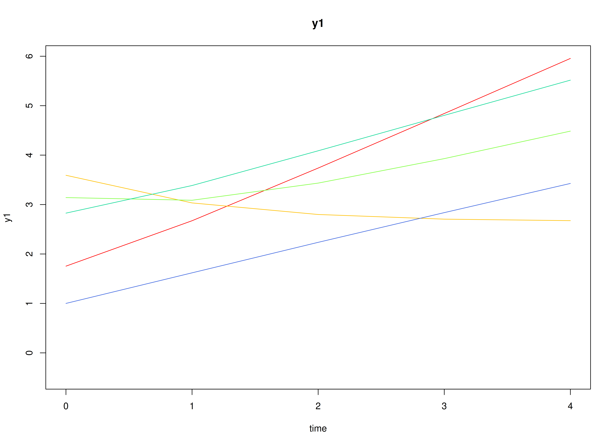
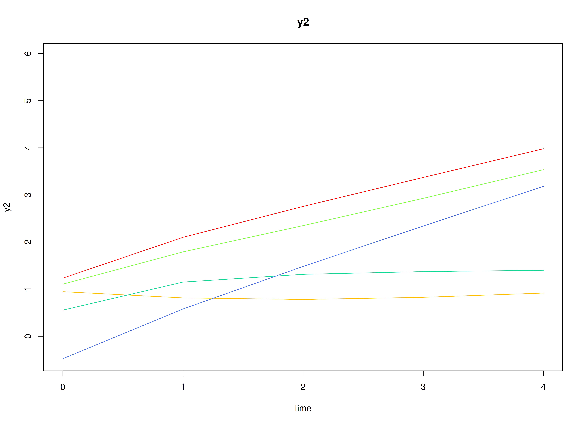
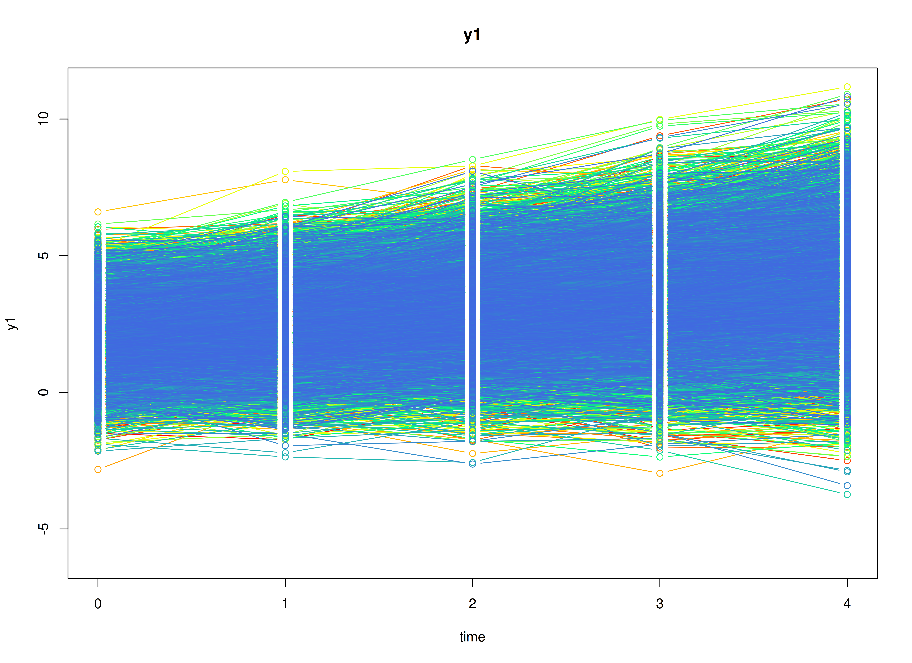
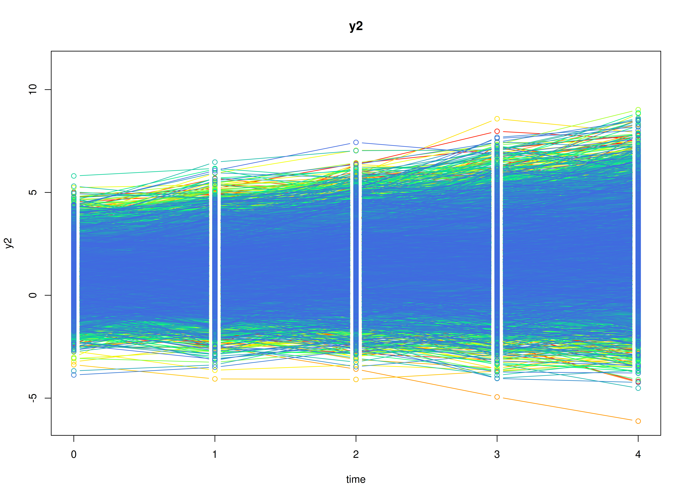
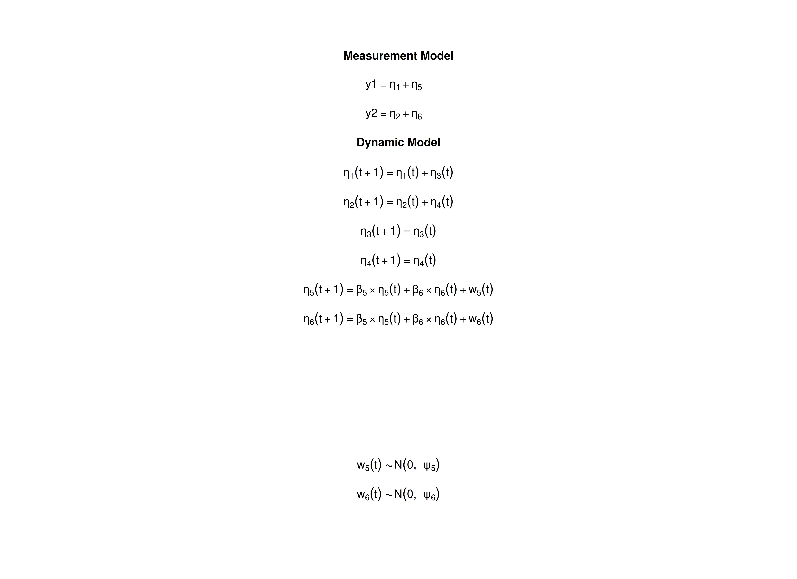

## Overview

The latent curve model with structured residuals (LCM-SR)
combines two ideas [@Curran-Howard-Bainter-etal-2014].
Take alcohol use and depressive symptoms measured once a year in adolescents.
Each adolescent follows a straight-line trajectory on each variable,
with their own intercept and slope,
as in the linear growth curve model.
On each occasion, the adolescent is also above or below the trajectory,
and these deviations, called the structured residuals,
carry over to the next occasion and affect each other.
The growth part describes how individuals differ in their long-term change;
the residual part describes the within-person dynamics around it,
with autoregressive and cross-lagged effects.

The LCM-SR is usually fitted as a structural equation model (SEM).
It can also be written as a state space model
by combining the state space forms of the linear growth curve model
and of the vector autoregressive model:
the levels and slopes of the two trajectories
and the two residuals are latent states.

This tutorial does three things:

1. It writes the LCM-SR as a state space model.
2. It simulates data from the model with `SimSSMFixed()`.
3. It fits the model to the simulated data with `dynr` (state space)
   and with `lavaan` (SEM),
   and compares both sets of estimates with the values used to simulate the data.

No prior knowledge of state space models is needed.
The vignette on the linear growth curve model
explains the growth part in more detail.


## Model

The measurement model is given by
\begin{equation}
  \left(
  \begin{array}{c}
    Y_{1_{i, t}} \\
    Y_{2_{i, t}} \\
  \end{array}
  \right)
  =
  \left(
  \begin{array}{cccccc}
    1 & 0 & 0 & 0 & 1 & 0 \\
    0 & 1 & 0 & 0 & 0 & 1 \\
  \end{array}
  \right)
  \left(
  \begin{array}{c}
    \eta_{1_{i, t}} \\
    \eta_{2_{i, t}} \\
    \eta_{3_{i, t}} \\
    \eta_{4_{i, t}} \\
    \eta_{5_{i, t}} \\
    \eta_{6_{i, t}} \\
  \end{array}
  \right)
\end{equation}
where $Y_{1_{i, t}}$ and $Y_{2_{i, t}}$
are the two observed variables
at time $t$ and individual $i$,
$\eta_{1_{i, t}}$ and $\eta_{2_{i, t}}$
are the current levels of the two trajectories,
$\eta_{3_{i, t}}$ and $\eta_{4_{i, t}}$ are their slopes,
and $\eta_{5_{i, t}}$ and $\eta_{6_{i, t}}$
are the structured residuals.

In words,
each observed score is the point on the individual's trajectory
plus the individual's deviation from it on that occasion.
As in most applications of the LCM-SR,
there is no separate measurement error.

The dynamic structure is given by
\begin{equation}
  \left(
  \begin{array}{c}
    \eta_{1_{i, t}} \\
    \eta_{2_{i, t}} \\
    \eta_{3_{i, t}} \\
    \eta_{4_{i, t}} \\
    \eta_{5_{i, t}} \\
    \eta_{6_{i, t}} \\
  \end{array}
  \right)
  =
  \left(
  \begin{array}{cccccc}
    1 & 0 & 1 & 0 & 0 & 0 \\
    0 & 1 & 0 & 1 & 0 & 0 \\
    0 & 0 & 1 & 0 & 0 & 0 \\
    0 & 0 & 0 & 1 & 0 & 0 \\
    0 & 0 & 0 & 0 & \beta_{55} & \beta_{56} \\
    0 & 0 & 0 & 0 & \beta_{65} & \beta_{66} \\
  \end{array}
  \right)
  \left(
  \begin{array}{c}
    \eta_{1_{i, t - 1}} \\
    \eta_{2_{i, t - 1}} \\
    \eta_{3_{i, t - 1}} \\
    \eta_{4_{i, t - 1}} \\
    \eta_{5_{i, t - 1}} \\
    \eta_{6_{i, t - 1}} \\
  \end{array}
  \right)
  +
  \left(
  \begin{array}{c}
    0 \\
    0 \\
    0 \\
    0 \\
    \zeta_{5_{i, t}} \\
    \zeta_{6_{i, t}} \\
  \end{array}
  \right),
  \quad
  \mathrm{with}
  \quad
  \left(
  \begin{array}{c}
    \zeta_{5_{i, t}} \\
    \zeta_{6_{i, t}} \\
  \end{array}
  \right)
  \sim
  \mathcal{N}
  \left(
  \mathbf{0},
  \left(
  \begin{array}{cc}
    \psi_{55} & \psi_{56} \\
    \psi_{65} & \psi_{66} \\
  \end{array}
  \right)
  \right) .
\end{equation}

In words,
the first four rows are the linear growth curve model for each variable:
the level at each occasion is the previous level plus the slope,
and the slope stays the same, with no process noise.
The last two rows are a vector autoregressive model for the residuals:
$\beta_{55}$ and $\beta_{66}$ are the autoregressive effects,
how much of a deviation from the trajectory carries over to the next occasion,
and $\beta_{56}$ and $\beta_{65}$ are the cross-lagged effects:
$\beta_{56}$ is the effect of a deviation in the second variable
on the deviation in the first variable at the next occasion,
and $\beta_{65}$ the reverse.
$\psi_{55}$, $\psi_{66}$, and $\psi_{56}$
are the variances and covariance of the new part of the deviations.

The initial condition holds the means, variances, and covariances
of the intercepts and slopes
(the levels at the first occasion are the intercepts),
and the variances and covariance of the residuals at the first occasion.
The residuals have mean zero,
because they are deviations from the trajectories,
and are uncorrelated with the intercepts and slopes.

## Data Generation

### Notation

Let $t = 5$ be the number of time points and $n = 10000$ be the number of individuals.

Let the means and the covariance matrix
of the intercepts and slopes, in the order
intercept 1, intercept 2, slope 1, and slope 2, be

\begin{equation}
\left(
\begin{array}{c}
  2 \\
  1 \\
  0.5 \\
  0.3 \\
\end{array}
\right)
\quad \mathrm{and,} \quad
\left(
\begin{array}{cccc}
  1 & 0.4 & 0.1 & 0.05 \\
  0.4 & 1 & 0.05 & 0.1 \\
  0.1 & 0.05 & 0.1 & 0.03 \\
  0.05 & 0.1 & 0.03 & 0.1 \\
\end{array}
\right) .
\end{equation}

Let the autoregressive and cross-lagged effects of the residuals
and their process noise covariance matrix be

\begin{equation}
\left(
\begin{array}{cc}
  \beta_{55} & \beta_{56} \\
  \beta_{65} & \beta_{66} \\
\end{array}
\right)
=
\left(
\begin{array}{cc}
  0.4 & 0.1 \\
  0.15 & 0.3 \\
\end{array}
\right)
\quad \mathrm{and,} \quad
\left(
\begin{array}{cc}
  \psi_{55} & \psi_{56} \\
  \psi_{65} & \psi_{66} \\
\end{array}
\right)
=
\left(
\begin{array}{cc}
  0.4 & 0.1 \\
  0.1 & 0.4 \\
\end{array}
\right) .
\end{equation}

The residuals start from their stationary distribution:
their covariance matrix at the first occasion is the one they keep
at every later occasion,
computed with `SSMCovEta()`,

\begin{equation}
\left(
\begin{array}{cc}
  \sigma_{55} & \sigma_{56} \\
  \sigma_{65} & \sigma_{66} \\
\end{array}
\right)
=
\left(
\begin{array}{cc}
  0.498 & 0.166 \\
  0.166 & 0.468 \\
\end{array}
\right) .
\end{equation}

### R Function Arguments

The simulation functions take covariance matrices
as lower triangular Cholesky factors (the arguments ending in `_l`).
Because the intercepts and slopes have no process noise
and there is no measurement error,
`psi` and `theta` have rows and columns of zeros,
and their Cholesky factors are built block by block.


``` r
n
#> [1] 10000
time
#> [1] 5
mu0
#> [1] 2.0 1.0 0.5 0.3 0.0 0.0
sigma0
#>      [,1] [,2] [,3] [,4]      [,5]      [,6]
#> [1,] 1.00 0.40 0.10 0.05 0.0000000 0.0000000
#> [2,] 0.40 1.00 0.05 0.10 0.0000000 0.0000000
#> [3,] 0.10 0.05 0.10 0.03 0.0000000 0.0000000
#> [4,] 0.05 0.10 0.03 0.10 0.0000000 0.0000000
#> [5,] 0.00 0.00 0.00 0.00 0.4976100 0.1663655
#> [6,] 0.00 0.00 0.00 0.00 0.1663655 0.4683177
sigma0_l # sigma0_l <- t(chol(sigma0))
#>      [,1]       [,2]      [,3]     [,4]      [,5]      [,6]
#> [1,] 1.00 0.00000000 0.0000000 0.000000 0.0000000 0.0000000
#> [2,] 0.40 0.91651514 0.0000000 0.000000 0.0000000 0.0000000
#> [3,] 0.10 0.01091089 0.2998015 0.000000 0.0000000 0.0000000
#> [4,] 0.05 0.08728716 0.0802118 0.288872 0.0000000 0.0000000
#> [5,] 0.00 0.00000000 0.0000000 0.000000 0.7054148 0.0000000
#> [6,] 0.00 0.00000000 0.0000000 0.000000 0.2358406 0.6424149
alpha
#> [1] 0 0 0 0 0 0
beta
#>      [,1] [,2] [,3] [,4] [,5] [,6]
#> [1,]    1    0    1    0 0.00  0.0
#> [2,]    0    1    0    1 0.00  0.0
#> [3,]    0    0    1    0 0.00  0.0
#> [4,]    0    0    0    1 0.00  0.0
#> [5,]    0    0    0    0 0.40  0.1
#> [6,]    0    0    0    0 0.15  0.3
psi
#>      [,1] [,2] [,3] [,4] [,5] [,6]
#> [1,]    0    0    0    0  0.0  0.0
#> [2,]    0    0    0    0  0.0  0.0
#> [3,]    0    0    0    0  0.0  0.0
#> [4,]    0    0    0    0  0.0  0.0
#> [5,]    0    0    0    0  0.4  0.1
#> [6,]    0    0    0    0  0.1  0.4
psi_l
#>      [,1] [,2] [,3] [,4]      [,5]      [,6]
#> [1,]    0    0    0    0 0.0000000 0.0000000
#> [2,]    0    0    0    0 0.0000000 0.0000000
#> [3,]    0    0    0    0 0.0000000 0.0000000
#> [4,]    0    0    0    0 0.0000000 0.0000000
#> [5,]    0    0    0    0 0.6324555 0.0000000
#> [6,]    0    0    0    0 0.1581139 0.6123724
nu
#> [1] 0 0
lambda
#>      [,1] [,2] [,3] [,4] [,5] [,6]
#> [1,]    1    0    0    0    1    0
#> [2,]    0    1    0    0    0    1
theta
#>      [,1] [,2]
#> [1,]    0    0
#> [2,]    0    0
theta_l
#>      [,1] [,2]
#> [1,]    0    0
#> [2,]    0    0
```

### Visualizing the Dynamics Without Process Noise (n = 5 with Different Initial Condition)

Without process noise,
the residuals shrink toward zero,
so each trajectory approaches the individual's straight line.



### Using the `SimSSMFixed` Function from the `simStateSpace` Package to Simulate Data

Now we add the process noise and simulate the full data set.
`as.data.frame()` returns the data in long format,
one row per individual and time point,
with the columns `id`, `time`, `y1`, and `y2`.


``` r
library(simStateSpace)
sim <- SimSSMFixed(
  n = n,
  time = time,
  mu0 = mu0,
  sigma0_l = sigma0_l,
  alpha = alpha,
  beta = beta,
  psi_l = psi_l,
  nu = nu,
  lambda = lambda,
  theta_l = theta_l,
  type = 0
)
data <- as.data.frame(sim)
head(data)
#>   id time          y1         y2
#> 1  1    0  2.37388906 -0.1726676
#> 2  1    1  3.28150344  0.5992761
#> 3  1    2  3.16895848  0.5420004
#> 4  1    3  2.71113187  0.5169754
#> 5  1    4  3.48742737  1.2647509
#> 6  2    0 -0.01604581 -0.1810905
summary(data)
#>        id             time         y1               y2         
#>  Min.   :    1   Min.   :0   Min.   :-3.737   Min.   :-6.1187  
#>  1st Qu.: 2501   1st Qu.:1   1st Qu.: 1.820   1st Qu.: 0.5017  
#>  Median : 5000   Median :2   Median : 2.889   Median : 1.5044  
#>  Mean   : 5000   Mean   :2   Mean   : 3.006   Mean   : 1.5908  
#>  3rd Qu.: 7500   3rd Qu.:3   3rd Qu.: 4.097   3rd Qu.: 2.6024  
#>  Max.   :10000   Max.   :4   Max.   :11.177   Max.   : 9.0230
plot(sim)
```



## Model Fitting

We first fit the model with `dynr`,
which estimates state space models by maximum likelihood
using the Kalman filter.

A `dynr` model is built from pieces that match the equations above:
the data, the initial condition, the measurement model,
the dynamic model, and the noise.
Each parameter gets a name (for example, `beta_5_6` for $\beta_{56}$),
and the same name used in two places means one shared parameter.
The starting values are set to the population values for convenience;
with real data, they would be rough guesses.

### Prepare Data

Tell `dynr` which columns hold the individual, the time, and the observed variables.


``` r
dynr_data <- dynr::dynr.data(
  dataframe = data,
  id = "id",
  time = "time",
  observed = c("y1", "y2")
)
#> Registered S3 method overwritten by 'car':
#>   method           from
#>   na.action.merMod lme4
```

### Prepare Initial Condition

The means, variances, and covariances of the intercepts and slopes,
and the variances and covariance of the residuals at the first occasion,
are estimated.
The means of the residuals
and their covariances with the intercepts and slopes are fixed at zero.


``` r
params_sigma0 <- matrix(data = "fixed", nrow = p, ncol = p)
params_sigma0[1:4, 1:4] <- c(
  "sigma0_1_1", "sigma0_2_1", "sigma0_3_1", "sigma0_4_1",
  "sigma0_2_1", "sigma0_2_2", "sigma0_3_2", "sigma0_4_2",
  "sigma0_3_1", "sigma0_3_2", "sigma0_3_3", "sigma0_4_3",
  "sigma0_4_1", "sigma0_4_2", "sigma0_4_3", "sigma0_4_4"
)
params_sigma0[5:6, 5:6] <- c(
  "sigma0_5_5", "sigma0_6_5",
  "sigma0_6_5", "sigma0_6_6"
)
params_sigma0
#>      [,1]         [,2]         [,3]         [,4]         [,5]        
#> [1,] "sigma0_1_1" "sigma0_2_1" "sigma0_3_1" "sigma0_4_1" "fixed"     
#> [2,] "sigma0_2_1" "sigma0_2_2" "sigma0_3_2" "sigma0_4_2" "fixed"     
#> [3,] "sigma0_3_1" "sigma0_3_2" "sigma0_3_3" "sigma0_4_3" "fixed"     
#> [4,] "sigma0_4_1" "sigma0_4_2" "sigma0_4_3" "sigma0_4_4" "fixed"     
#> [5,] "fixed"      "fixed"      "fixed"      "fixed"      "sigma0_5_5"
#> [6,] "fixed"      "fixed"      "fixed"      "fixed"      "sigma0_6_5"
#>      [,6]        
#> [1,] "fixed"     
#> [2,] "fixed"     
#> [3,] "fixed"     
#> [4,] "fixed"     
#> [5,] "sigma0_6_5"
#> [6,] "sigma0_6_6"
dynr_initial <- dynr::prep.initial(
  values.inistate = mu0,
  params.inistate = c(
    "mu0_1_1", "mu0_2_1", "mu0_3_1", "mu0_4_1", "fixed", "fixed"
  ),
  values.inicov = sigma0,
  params.inicov = params_sigma0
)
```

### Prepare Measurement Model

The loadings are fixed.


``` r
dynr_measurement <- dynr::prep.measurement(
  values.load = lambda,
  params.load = matrix(data = "fixed", nrow = 2, ncol = 6),
  state.names = paste0("eta_", 1:6),
  obs.names = c("y1", "y2")
)
```

### Prepare Dynamic Process

The first four formulas are the growth part, with no free parameters;
the last two are the residual dynamics.


``` r
dynr_dynamics <- dynr::prep.formulaDynamics(
  formula = list(
    eta_1 ~ eta_1 + eta_3,
    eta_2 ~ eta_2 + eta_4,
    eta_3 ~ eta_3,
    eta_4 ~ eta_4,
    eta_5 ~ beta_5_5 * eta_5 + beta_5_6 * eta_6,
    eta_6 ~ beta_6_5 * eta_5 + beta_6_6 * eta_6
  ),
  startval = c(
    beta_5_5 = beta[5, 5], beta_5_6 = beta[5, 6],
    beta_6_5 = beta[6, 5], beta_6_6 = beta[6, 6]
  ),
  isContinuousTime = FALSE
)
```

### Prepare Process Noise

Only the residuals have process noise.
The measurement error is fixed at zero.


``` r
params_psi <- matrix(data = "fixed", nrow = p, ncol = p)
params_psi[5:6, 5:6] <- c(
  "psi_5_5", "psi_6_5",
  "psi_6_5", "psi_6_6"
)
dynr_noise <- dynr::prep.noise(
  values.latent = psi,
  params.latent = params_psi,
  values.observed = theta,
  params.observed = matrix(data = "fixed", nrow = 2, ncol = 2)
)
```

### Prepare the Model

The pieces are put together into one model.
`dynr` writes the model as C code to `outfile` and compiles it.


``` r
model <- dynr::dynr.model(
  data = dynr_data,
  initial = dynr_initial,
  measurement = dynr_measurement,
  dynamics = dynr_dynamics,
  noise = dynr_noise,
  outfile = "lcm-sr.c"
)
```

The plot below shows the model equations with the parameter names.



### Fit the Model


``` r
results <- dynr::dynr.cook(
  model,
  debug_flag = TRUE,
  verbose = FALSE
)
#> [1] "Get ready!!!!"
#> using C compiler: ‘gcc (Ubuntu 15.2.0-16ubuntu1) 15.2.0’
#> Optimization function called.
#> Starting Hessian calculation ...
#> Finished Hessian calculation.
#> Original exit flag:  3 
#> Modified exit flag:  3 
#> Optimization terminated successfully: ftol_rel or ftol_abs was reached. 
#> Original fitted parameters:  0.3777867 0.1079022 0.1499191 0.3216473 -0.9404059 
#> 0.2526484 -0.9676209 2.008439 0.9935554 0.4986007 0.29847 0.02345068 0.3777211 
#> 0.09515251 0.0571526 -0.1716214 0.01402679 0.08892801 -2.411319 0.2477236 
#> -2.478779 -0.7015993 0.3587313 -0.9039157 
#> 
#> Transformed fitted parameters:  0.3777867 0.1079022 0.1499191 0.3216473 
#> 0.3904693 0.09865144 0.4049101 2.008439 0.9935554 0.4986007 0.29847 1.023728 
#> 0.3866836 0.09741027 0.05850871 0.9883566 0.04860865 0.09700387 0.0991315 
#> 0.02883796 0.09935493 0.4957918 0.177856 0.4687833 
#> 
#> Doing end processing
#> Successful trial
#> Total Time: 7.207033 
#> Backend Time: 7.200523
```

## Summary

The summary lists each estimate with its standard error,
$t$ value, confidence interval, and $p$ value.


``` r
summary(results)
#> Coefficients:
#>            Estimate Std. Error t value ci.lower ci.upper             Pr(>|t|)
#> beta_5_5   0.377787   0.014530  26.000 0.349308 0.406265 < 0.0000000000000002
#> beta_5_6   0.107902   0.010803   9.988 0.086728 0.129076 < 0.0000000000000002
#> beta_6_5   0.149919   0.011430  13.116 0.127517 0.172321 < 0.0000000000000002
#> beta_6_6   0.321647   0.013806  23.298 0.294589 0.348706 < 0.0000000000000002
#> psi_5_5    0.390469   0.005700  68.507 0.379298 0.401640 < 0.0000000000000002
#> psi_6_5    0.098651   0.004263  23.140 0.090295 0.107007 < 0.0000000000000002
#> psi_6_6    0.404910   0.005667  71.452 0.393803 0.416017 < 0.0000000000000002
#> mu0_1_1    2.008439   0.011999 167.382 1.984921 2.031957 < 0.0000000000000002
#> mu0_2_1    0.993555   0.011723  84.756 0.970580 1.016531 < 0.0000000000000002
#> mu0_3_1    0.498601   0.003942 126.491 0.490875 0.506326 < 0.0000000000000002
#> mu0_4_1    0.298470   0.003927  76.008 0.290774 0.306166 < 0.0000000000000002
#> sigma0_1_1 1.023728   0.029669  34.505 0.965578 1.081878 < 0.0000000000000002
#> sigma0_2_1 0.386684   0.023048  16.777 0.341510 0.431858 < 0.0000000000000002
#> sigma0_3_1 0.097410   0.006783  14.361 0.084116 0.110704 < 0.0000000000000002
#> sigma0_4_1 0.058509   0.006104   9.586 0.046545 0.070472 < 0.0000000000000002
#> sigma0_2_2 0.988357   0.027590  35.823 0.934281 1.042432 < 0.0000000000000002
#> sigma0_3_2 0.048609   0.006053   8.031 0.036745 0.060472 0.000000000000000495
#> sigma0_4_2 0.097004   0.006470  14.992 0.084322 0.109686 < 0.0000000000000002
#> sigma0_3_3 0.099131   0.002848  34.812 0.093550 0.104713 < 0.0000000000000002
#> sigma0_4_3 0.028838   0.002156  13.373 0.024611 0.033064 < 0.0000000000000002
#> sigma0_4_4 0.099355   0.002783  35.697 0.093900 0.104810 < 0.0000000000000002
#> sigma0_5_5 0.495792   0.024162  20.519 0.448435 0.543149 < 0.0000000000000002
#> sigma0_6_5 0.177856   0.019309   9.211 0.140011 0.215701 < 0.0000000000000002
#> sigma0_6_6 0.468783   0.022291  21.030 0.425094 0.512473 < 0.0000000000000002
#>               
#> beta_5_5   ***
#> beta_5_6   ***
#> beta_6_5   ***
#> beta_6_6   ***
#> psi_5_5    ***
#> psi_6_5    ***
#> psi_6_6    ***
#> mu0_1_1    ***
#> mu0_2_1    ***
#> mu0_3_1    ***
#> mu0_4_1    ***
#> sigma0_1_1 ***
#> sigma0_2_1 ***
#> sigma0_3_1 ***
#> sigma0_4_1 ***
#> sigma0_2_2 ***
#> sigma0_3_2 ***
#> sigma0_4_2 ***
#> sigma0_3_3 ***
#> sigma0_4_3 ***
#> sigma0_4_4 ***
#> sigma0_5_5 ***
#> sigma0_6_5 ***
#> sigma0_6_6 ***
#> ---
#> Signif. codes:  0 '***' 0.001 '**' 0.01 '*' 0.05 '.' 0.1 ' ' 1
#> 
#> -2 log-likelihood value at convergence = 254743.09
#> AIC = 254791.09
#> BIC = 255002.76
```

## The LCM-SR in Structural Equation Modeling

The same model in SEM form, fitted with `lavaan`,
should give nearly the same estimates.
In SEM, each variable at each occasion is a separate observed variable
in one row per individual (wide format).
Each variable has an intercept factor with loadings of 1,
a slope factor with loadings 0, 1, 2, 3, and 4,
and one residual factor per occasion with a loading of 1.

### Wide Data Set

`as.data.frame()` with `long = FALSE` returns the data in wide format.


``` r
data <- as.data.frame(sim, long = FALSE)
head(data)
#>   id        y1_0           y2_0      y1_1       y2_1     y1_2       y2_2
#> 1  1  2.37388906 -0.17266755503 3.2815034  0.5992761 3.168958  0.5420004
#> 2  2 -0.01604581 -0.18109050141 0.6828646 -0.1135152 1.700621 -1.8224976
#> 3  3  3.26382925  1.52047814091 5.8037340  2.7814303 6.188715  3.4654056
#> 4  4  1.94339676 -0.13444204172 1.9723843 -0.1755396 1.899682  0.9515669
#> 5  5  0.87525257 -2.33329417436 1.9247151 -0.3515431 2.077691 -0.2428386
#> 6  6  0.04156401 -0.00005003437 0.5462923  1.5357655 1.735087  1.9415441
#>       y1_3       y2_3     y1_4       y2_4
#> 1 2.711132  0.5169754 3.487427  1.2647509
#> 2 2.239767 -1.1882699 2.280529 -3.1482622
#> 3 7.522857  4.3100330 7.272734  5.4493969
#> 4 1.482315 -0.5940969 1.966155 -0.1135456
#> 5 2.488611  0.2684330 2.861655  0.1558327
#> 6 2.369504  3.4956264 2.910286  5.2712928
```

### Model

The model has the same structure for every occasion,
so we write it with `paste0()`.
The parameter labels match the dynr names.
Giving the residual effects and the process noise the same label
on every occasion constrains them to be equal over time,
as in the state space model.


``` r
waves <- 0:(time - 1)
now <- waves[-1]
before <- waves[-time]
model <- paste(
  c(
    "# growth factors",
    paste0("i1 =~ ", paste0("1 * y1_", waves, collapse = " + ")),
    paste0("i2 =~ ", paste0("1 * y2_", waves, collapse = " + ")),
    paste0("s1 =~ ", paste0(waves, " * y1_", waves, collapse = " + ")),
    paste0("s2 =~ ", paste0(waves, " * y2_", waves, collapse = " + ")),
    "# structured residuals",
    paste0("r1_", waves, " =~ 1 * y1_", waves),
    paste0("r2_", waves, " =~ 1 * y2_", waves),
    "# autoregressive and cross-lagged effects of the residuals",
    paste0(
      "r1_", now, " ~ beta_5_5 * r1_", before, " + beta_5_6 * r2_", before
    ),
    paste0(
      "r2_", now, " ~ beta_6_5 * r1_", before, " + beta_6_6 * r2_", before
    ),
    "# residuals at the first occasion",
    "r1_0 ~~ sigma0_5_5 * r1_0",
    "r2_0 ~~ sigma0_6_6 * r2_0",
    "r1_0 ~~ sigma0_6_5 * r2_0",
    "# process noise at later occasions",
    paste0("r1_", now, " ~~ psi_5_5 * r1_", now),
    paste0("r2_", now, " ~~ psi_6_6 * r2_", now),
    paste0("r1_", now, " ~~ psi_6_5 * r2_", now),
    "# growth factors: means",
    "i1 ~ mu0_1_1 * 1",
    "i2 ~ mu0_2_1 * 1",
    "s1 ~ mu0_3_1 * 1",
    "s2 ~ mu0_4_1 * 1",
    "# growth factors: variances and covariances",
    "i1 ~~ sigma0_1_1 * i1",
    "i2 ~~ sigma0_2_2 * i2",
    "s1 ~~ sigma0_3_3 * s1",
    "s2 ~~ sigma0_4_4 * s2",
    "i1 ~~ sigma0_2_1 * i2",
    "i1 ~~ sigma0_3_1 * s1",
    "i1 ~~ sigma0_4_1 * s2",
    "i2 ~~ sigma0_3_2 * s1",
    "i2 ~~ sigma0_4_2 * s2",
    "s1 ~~ sigma0_4_3 * s2",
    "# growth factors are uncorrelated with the first residuals",
    paste0(c("i1", "i2", "s1", "s2"), " ~~ 0 * r1_0 + 0 * r2_0"),
    "# no measurement error and no observed intercepts",
    paste0("y1_", waves, " ~~ 0 * y1_", waves),
    paste0("y2_", waves, " ~~ 0 * y2_", waves),
    paste0("y1_", waves, " ~ 0 * 1"),
    paste0("y2_", waves, " ~ 0 * 1")
  ),
  collapse = "\n"
)
cat(model)
#> # growth factors
#> i1 =~ 1 * y1_0 + 1 * y1_1 + 1 * y1_2 + 1 * y1_3 + 1 * y1_4
#> i2 =~ 1 * y2_0 + 1 * y2_1 + 1 * y2_2 + 1 * y2_3 + 1 * y2_4
#> s1 =~ 0 * y1_0 + 1 * y1_1 + 2 * y1_2 + 3 * y1_3 + 4 * y1_4
#> s2 =~ 0 * y2_0 + 1 * y2_1 + 2 * y2_2 + 3 * y2_3 + 4 * y2_4
#> # structured residuals
#> r1_0 =~ 1 * y1_0
#> r1_1 =~ 1 * y1_1
#> r1_2 =~ 1 * y1_2
#> r1_3 =~ 1 * y1_3
#> r1_4 =~ 1 * y1_4
#> r2_0 =~ 1 * y2_0
#> r2_1 =~ 1 * y2_1
#> r2_2 =~ 1 * y2_2
#> r2_3 =~ 1 * y2_3
#> r2_4 =~ 1 * y2_4
#> # autoregressive and cross-lagged effects of the residuals
#> r1_1 ~ beta_5_5 * r1_0 + beta_5_6 * r2_0
#> r1_2 ~ beta_5_5 * r1_1 + beta_5_6 * r2_1
#> r1_3 ~ beta_5_5 * r1_2 + beta_5_6 * r2_2
#> r1_4 ~ beta_5_5 * r1_3 + beta_5_6 * r2_3
#> r2_1 ~ beta_6_5 * r1_0 + beta_6_6 * r2_0
#> r2_2 ~ beta_6_5 * r1_1 + beta_6_6 * r2_1
#> r2_3 ~ beta_6_5 * r1_2 + beta_6_6 * r2_2
#> r2_4 ~ beta_6_5 * r1_3 + beta_6_6 * r2_3
#> # residuals at the first occasion
#> r1_0 ~~ sigma0_5_5 * r1_0
#> r2_0 ~~ sigma0_6_6 * r2_0
#> r1_0 ~~ sigma0_6_5 * r2_0
#> # process noise at later occasions
#> r1_1 ~~ psi_5_5 * r1_1
#> r1_2 ~~ psi_5_5 * r1_2
#> r1_3 ~~ psi_5_5 * r1_3
#> r1_4 ~~ psi_5_5 * r1_4
#> r2_1 ~~ psi_6_6 * r2_1
#> r2_2 ~~ psi_6_6 * r2_2
#> r2_3 ~~ psi_6_6 * r2_3
#> r2_4 ~~ psi_6_6 * r2_4
#> r1_1 ~~ psi_6_5 * r2_1
#> r1_2 ~~ psi_6_5 * r2_2
#> r1_3 ~~ psi_6_5 * r2_3
#> r1_4 ~~ psi_6_5 * r2_4
#> # growth factors: means
#> i1 ~ mu0_1_1 * 1
#> i2 ~ mu0_2_1 * 1
#> s1 ~ mu0_3_1 * 1
#> s2 ~ mu0_4_1 * 1
#> # growth factors: variances and covariances
#> i1 ~~ sigma0_1_1 * i1
#> i2 ~~ sigma0_2_2 * i2
#> s1 ~~ sigma0_3_3 * s1
#> s2 ~~ sigma0_4_4 * s2
#> i1 ~~ sigma0_2_1 * i2
#> i1 ~~ sigma0_3_1 * s1
#> i1 ~~ sigma0_4_1 * s2
#> i2 ~~ sigma0_3_2 * s1
#> i2 ~~ sigma0_4_2 * s2
#> s1 ~~ sigma0_4_3 * s2
#> # growth factors are uncorrelated with the first residuals
#> i1 ~~ 0 * r1_0 + 0 * r2_0
#> i2 ~~ 0 * r1_0 + 0 * r2_0
#> s1 ~~ 0 * r1_0 + 0 * r2_0
#> s2 ~~ 0 * r1_0 + 0 * r2_0
#> # no measurement error and no observed intercepts
#> y1_0 ~~ 0 * y1_0
#> y1_1 ~~ 0 * y1_1
#> y1_2 ~~ 0 * y1_2
#> y1_3 ~~ 0 * y1_3
#> y1_4 ~~ 0 * y1_4
#> y2_0 ~~ 0 * y2_0
#> y2_1 ~~ 0 * y2_1
#> y2_2 ~~ 0 * y2_2
#> y2_3 ~~ 0 * y2_3
#> y2_4 ~~ 0 * y2_4
#> y1_0 ~ 0 * 1
#> y1_1 ~ 0 * 1
#> y1_2 ~ 0 * 1
#> y1_3 ~ 0 * 1
#> y1_4 ~ 0 * 1
#> y2_0 ~ 0 * 1
#> y2_1 ~ 0 * 1
#> y2_2 ~ 0 * 1
#> y2_3 ~ 0 * 1
#> y2_4 ~ 0 * 1
```

`lavaan::lavaan()` adds nothing to the model by itself,
so every parameter above is exactly the one written.


``` r
fit <- lavaan::lavaan(
  model = model,
  data = data
)
lavaan::summary(fit)
#> lavaan 0.7-3 ended normally after 61 iterations
#> 
#>   Estimator                                         ML
#>   Optimization method                           NLMINB
#>   Number of model parameters                        45
#>   Number of equality constraints                    21
#> 
#>   Number of observations                         10000
#> 
#> Model Test User Model:
#>                                                       
#>   Test statistic                                33.785
#>   Degrees of freedom                                41
#>   P-value (Chi-square)                           0.781
#>                                                       
#>   Browne's residual (NT model-based) test             
#>   Test statistic                                33.829
#>   Degrees of freedom                                41
#>   P-value (Chi-square)                           0.779
#> 
#> Parameter Estimates:
#> 
#>   Standard errors                             Standard
#>   Information                                 Expected
#>   Information saturated (h1) model          Structured
#> 
#> Latent Variables:
#>                    Estimate  Std.Err  z-value  P(>|z|)
#>   i1 =~                                               
#>     y1_0              1.000                           
#>     y1_1              1.000                           
#>     y1_2              1.000                           
#>     y1_3              1.000                           
#>     y1_4              1.000                           
#>   i2 =~                                               
#>     y2_0              1.000                           
#>     y2_1              1.000                           
#>     y2_2              1.000                           
#>     y2_3              1.000                           
#>     y2_4              1.000                           
#>   s1 =~                                               
#>     y1_0              0.000                           
#>     y1_1              1.000                           
#>     y1_2              2.000                           
#>     y1_3              3.000                           
#>     y1_4              4.000                           
#>   s2 =~                                               
#>     y2_0              0.000                           
#>     y2_1              1.000                           
#>     y2_2              2.000                           
#>     y2_3              3.000                           
#>     y2_4              4.000                           
#>   r1_0 =~                                             
#>     y1_0              1.000                           
#>   r1_1 =~                                             
#>     y1_1              1.000                           
#>   r1_2 =~                                             
#>     y1_2              1.000                           
#>   r1_3 =~                                             
#>     y1_3              1.000                           
#>   r1_4 =~                                             
#>     y1_4              1.000                           
#>   r2_0 =~                                             
#>     y2_0              1.000                           
#>   r2_1 =~                                             
#>     y2_1              1.000                           
#>   r2_2 =~                                             
#>     y2_2              1.000                           
#>   r2_3 =~                                             
#>     y2_3              1.000                           
#>   r2_4 =~                                             
#>     y2_4              1.000                           
#> 
#> Regressions:
#>                    Estimate  Std.Err  z-value  P(>|z|)
#>   r1_1 ~                                              
#>     r1_0   (b_5_5)    0.378    0.015   25.727    0.000
#>     r2_0   (b_5_6)    0.109    0.011   10.066    0.000
#>   r1_2 ~                                              
#>     r1_1   (b_5_5)    0.378    0.015   25.727    0.000
#>     r2_1   (b_5_6)    0.109    0.011   10.066    0.000
#>   r1_3 ~                                              
#>     r1_2   (b_5_5)    0.378    0.015   25.727    0.000
#>     r2_2   (b_5_6)    0.109    0.011   10.066    0.000
#>   r1_4 ~                                              
#>     r1_3   (b_5_5)    0.378    0.015   25.727    0.000
#>     r2_3   (b_5_6)    0.109    0.011   10.066    0.000
#>   r2_1 ~                                              
#>     r1_0   (b_6_5)    0.151    0.011   13.162    0.000
#>     r2_0   (b_6_6)    0.322    0.014   23.533    0.000
#>   r2_2 ~                                              
#>     r1_1   (b_6_5)    0.151    0.011   13.162    0.000
#>     r2_1   (b_6_6)    0.322    0.014   23.533    0.000
#>   r2_3 ~                                              
#>     r1_2   (b_6_5)    0.151    0.011   13.162    0.000
#>     r2_2   (b_6_6)    0.322    0.014   23.533    0.000
#>   r2_4 ~                                              
#>     r1_3   (b_6_5)    0.151    0.011   13.162    0.000
#>     r2_3   (b_6_6)    0.322    0.014   23.533    0.000
#> 
#> Covariances:
#>                    Estimate  Std.Err  z-value  P(>|z|)
#>   r1_0 ~~                                             
#>     r2_0    (s0_6)    0.179    0.020    9.136    0.000
#>  .r1_1 ~~                                             
#>    .r2_1    (p_6_)    0.099    0.004   23.233    0.000
#>  .r1_2 ~~                                             
#>    .r2_2    (p_6_)    0.099    0.004   23.233    0.000
#>  .r1_3 ~~                                             
#>    .r2_3    (p_6_)    0.099    0.004   23.233    0.000
#>  .r1_4 ~~                                             
#>    .r2_4    (p_6_)    0.099    0.004   23.233    0.000
#>   i1 ~~                                               
#>     i2      (s0_2)    0.385    0.023   16.416    0.000
#>     s1    (s0_3_1)    0.098    0.007   14.085    0.000
#>     s2    (s0_4_1)    0.059    0.006    9.589    0.000
#>   i2 ~~                                               
#>     s1    (s0_3_2)    0.049    0.006    8.031    0.000
#>     s2    (s0_4_2)    0.097    0.006   15.042    0.000
#>   s1 ~~                                               
#>     s2    (s0_4_3)    0.029    0.002   13.171    0.000
#>   i1 ~~                                               
#>     r1_0              0.000                           
#>     r2_0              0.000                           
#>   i2 ~~                                               
#>     r1_0              0.000                           
#>     r2_0              0.000                           
#>   s1 ~~                                               
#>     r1_0              0.000                           
#>     r2_0              0.000                           
#>   s2 ~~                                               
#>     r1_0              0.000                           
#>     r2_0              0.000                           
#> 
#> Intercepts:
#>                    Estimate  Std.Err  z-value  P(>|z|)
#>     i1      (m0_1)    2.009    0.012  167.360    0.000
#>     i2      (m0_2)    0.994    0.012   84.652    0.000
#>     s1      (m0_3)    0.499    0.004  126.509    0.000
#>     s2      (m0_4)    0.299    0.004   76.026    0.000
#>    .y1_0              0.000                           
#>    .y1_1              0.000                           
#>    .y1_2              0.000                           
#>    .y1_3              0.000                           
#>    .y1_4              0.000                           
#>    .y2_0              0.000                           
#>    .y2_1              0.000                           
#>    .y2_2              0.000                           
#>    .y2_3              0.000                           
#>    .y2_4              0.000                           
#> 
#> Variances:
#>                    Estimate  Std.Err  z-value  P(>|z|)
#>     r1_0    (s0_5)    0.497    0.025   19.713    0.000
#>     r2_0    (s0_6)    0.470    0.022   21.030    0.000
#>    .r1_1    (p_5_)    0.391    0.006   68.062    0.000
#>    .r1_2    (p_5_)    0.391    0.006   68.062    0.000
#>    .r1_3    (p_5_)    0.391    0.006   68.062    0.000
#>    .r1_4    (p_5_)    0.391    0.006   68.062    0.000
#>    .r2_1    (p_6_)    0.405    0.006   71.958    0.000
#>    .r2_2    (p_6_)    0.405    0.006   71.958    0.000
#>    .r2_3    (p_6_)    0.405    0.006   71.958    0.000
#>    .r2_4    (p_6_)    0.405    0.006   71.958    0.000
#>     i1      (s0_1)    1.022    0.030   33.524    0.000
#>     i2      (s0_2)    0.987    0.028   35.565    0.000
#>     s1      (s0_3)    0.099    0.003   34.092    0.000
#>     s2      (s0_4)    0.099    0.003   35.627    0.000
#>    .y1_0              0.000                           
#>    .y1_1              0.000                           
#>    .y1_2              0.000                           
#>    .y1_3              0.000                           
#>    .y1_4              0.000                           
#>    .y2_0              0.000                           
#>    .y2_1              0.000                           
#>    .y2_2              0.000                           
#>    .y2_3              0.000                           
#>    .y2_4              0.000
```

## Table of Parameters and Estimates

The table below puts each population value used to simulate the data
next to its estimate.
Bias is the estimate minus the population value.
Because the model is fitted to a single simulated data set,
this is the error of one estimate, not a Monte Carlo bias,
which would average over many replications.
The 95% confidence interval is the Wald interval,
$\hat{\theta} \pm 1.96 \times \mathrm{SE}$,
and `Covers` shows whether it contains the population value.


``` r
EstimatesTable <- function(population, estimate, se) {
  z <- stats::qnorm(p = 0.975)
  ll <- estimate - z * se
  ul <- estimate + z * se
  data.frame(
    Parameter = names(population),
    Population = unname(population),
    Estimate = unname(estimate),
    SE = unname(se),
    Bias = unname(estimate - population),
    `2.5%` = unname(ll),
    `97.5%` = unname(ul),
    Covers = unname(population >= ll & population <= ul),
    check.names = FALSE
  )
}
```


``` r
population <- c(
  mu0_1_1 = mu0[1],
  mu0_2_1 = mu0[2],
  mu0_3_1 = mu0[3],
  mu0_4_1 = mu0[4],
  sigma0_1_1 = sigma0[1, 1],
  sigma0_2_1 = sigma0[2, 1],
  sigma0_3_1 = sigma0[3, 1],
  sigma0_4_1 = sigma0[4, 1],
  sigma0_2_2 = sigma0[2, 2],
  sigma0_3_2 = sigma0[3, 2],
  sigma0_4_2 = sigma0[4, 2],
  sigma0_3_3 = sigma0[3, 3],
  sigma0_4_3 = sigma0[4, 3],
  sigma0_4_4 = sigma0[4, 4],
  sigma0_5_5 = sigma0[5, 5],
  sigma0_6_5 = sigma0[6, 5],
  sigma0_6_6 = sigma0[6, 6],
  beta_5_5 = beta[5, 5],
  beta_5_6 = beta[5, 6],
  beta_6_5 = beta[6, 5],
  beta_6_6 = beta[6, 6],
  psi_5_5 = psi[5, 5],
  psi_6_5 = psi[6, 5],
  psi_6_6 = psi[6, 6]
)
```

### dynr


``` r
estimates <- coef(results)[names(population)]
se <- sqrt(diag(vcov(results)))
names(se) <- names(coef(results))
knitr::kable(
  x = EstimatesTable(
    population = population,
    estimate = estimates,
    se = se[names(population)]
  ),
  digits = 3,
  caption = "Population values and dynr estimates (one simulated data set)"
)
```


Table: Population values and dynr estimates (one simulated data set)

|Parameter  | Population| Estimate|    SE|   Bias|  2.5%| 97.5%|Covers |
|:----------|----------:|--------:|-----:|------:|-----:|-----:|:------|
|mu0_1_1    |      2.000|    2.008| 0.012|  0.008| 1.985| 2.032|TRUE   |
|mu0_2_1    |      1.000|    0.994| 0.012| -0.006| 0.971| 1.017|TRUE   |
|mu0_3_1    |      0.500|    0.499| 0.004| -0.001| 0.491| 0.506|TRUE   |
|mu0_4_1    |      0.300|    0.298| 0.004| -0.002| 0.291| 0.306|TRUE   |
|sigma0_1_1 |      1.000|    1.024| 0.030|  0.024| 0.966| 1.082|TRUE   |
|sigma0_2_1 |      0.400|    0.387| 0.023| -0.013| 0.342| 0.432|TRUE   |
|sigma0_3_1 |      0.100|    0.097| 0.007| -0.003| 0.084| 0.111|TRUE   |
|sigma0_4_1 |      0.050|    0.059| 0.006|  0.009| 0.047| 0.070|TRUE   |
|sigma0_2_2 |      1.000|    0.988| 0.028| -0.012| 0.934| 1.042|TRUE   |
|sigma0_3_2 |      0.050|    0.049| 0.006| -0.001| 0.037| 0.060|TRUE   |
|sigma0_4_2 |      0.100|    0.097| 0.006| -0.003| 0.084| 0.110|TRUE   |
|sigma0_3_3 |      0.100|    0.099| 0.003| -0.001| 0.094| 0.105|TRUE   |
|sigma0_4_3 |      0.030|    0.029| 0.002| -0.001| 0.025| 0.033|TRUE   |
|sigma0_4_4 |      0.100|    0.099| 0.003| -0.001| 0.094| 0.105|TRUE   |
|sigma0_5_5 |      0.498|    0.496| 0.024| -0.002| 0.448| 0.543|TRUE   |
|sigma0_6_5 |      0.166|    0.178| 0.019|  0.011| 0.140| 0.216|TRUE   |
|sigma0_6_6 |      0.468|    0.469| 0.022|  0.000| 0.425| 0.512|TRUE   |
|beta_5_5   |      0.400|    0.378| 0.015| -0.022| 0.349| 0.406|TRUE   |
|beta_5_6   |      0.100|    0.108| 0.011|  0.008| 0.087| 0.129|TRUE   |
|beta_6_5   |      0.150|    0.150| 0.011|  0.000| 0.128| 0.172|TRUE   |
|beta_6_6   |      0.300|    0.322| 0.014|  0.022| 0.295| 0.349|TRUE   |
|psi_5_5    |      0.400|    0.390| 0.006| -0.010| 0.379| 0.402|TRUE   |
|psi_6_5    |      0.100|    0.099| 0.004| -0.001| 0.090| 0.107|TRUE   |
|psi_6_6    |      0.400|    0.405| 0.006|  0.005| 0.394| 0.416|TRUE   |


### lavaan


``` r
pe <- lavaan::parameterEstimates(fit)
# a label shared by several occasions is one parameter
pe <- pe[pe$label != "" & !duplicated(pe$label), ]
rownames(pe) <- pe$label
knitr::kable(
  x = EstimatesTable(
    population = population,
    estimate = pe[names(population), "est"],
    se = pe[names(population), "se"]
  ),
  digits = 3,
  caption = "Population values and lavaan estimates (one simulated data set)"
)
```


Table: Population values and lavaan estimates (one simulated data set)

|Parameter  | Population| Estimate|    SE|   Bias|  2.5%| 97.5%|Covers |
|:----------|----------:|--------:|-----:|------:|-----:|-----:|:------|
|mu0_1_1    |      2.000|    2.009| 0.012|  0.009| 1.985| 2.032|TRUE   |
|mu0_2_1    |      1.000|    0.994| 0.012| -0.006| 0.971| 1.017|TRUE   |
|mu0_3_1    |      0.500|    0.499| 0.004| -0.001| 0.491| 0.506|TRUE   |
|mu0_4_1    |      0.300|    0.299| 0.004| -0.001| 0.291| 0.306|TRUE   |
|sigma0_1_1 |      1.000|    1.022| 0.030|  0.022| 0.962| 1.082|TRUE   |
|sigma0_2_1 |      0.400|    0.385| 0.023| -0.015| 0.339| 0.431|TRUE   |
|sigma0_3_1 |      0.100|    0.098| 0.007| -0.002| 0.084| 0.111|TRUE   |
|sigma0_4_1 |      0.050|    0.059| 0.006|  0.009| 0.047| 0.071|TRUE   |
|sigma0_2_2 |      1.000|    0.987| 0.028| -0.013| 0.932| 1.041|TRUE   |
|sigma0_3_2 |      0.050|    0.049| 0.006| -0.001| 0.037| 0.061|TRUE   |
|sigma0_4_2 |      0.100|    0.097| 0.006| -0.003| 0.085| 0.110|TRUE   |
|sigma0_3_3 |      0.100|    0.099| 0.003| -0.001| 0.093| 0.105|TRUE   |
|sigma0_4_3 |      0.030|    0.029| 0.002| -0.001| 0.024| 0.033|TRUE   |
|sigma0_4_4 |      0.100|    0.099| 0.003| -0.001| 0.094| 0.105|TRUE   |
|sigma0_5_5 |      0.498|    0.497| 0.025|  0.000| 0.448| 0.547|TRUE   |
|sigma0_6_5 |      0.166|    0.179| 0.020|  0.013| 0.141| 0.218|TRUE   |
|sigma0_6_6 |      0.468|    0.470| 0.022|  0.002| 0.426| 0.514|TRUE   |
|beta_5_5   |      0.400|    0.378| 0.015| -0.022| 0.350| 0.407|TRUE   |
|beta_5_6   |      0.100|    0.109| 0.011|  0.009| 0.087| 0.130|TRUE   |
|beta_6_5   |      0.150|    0.151| 0.011|  0.001| 0.128| 0.173|TRUE   |
|beta_6_6   |      0.300|    0.322| 0.014|  0.022| 0.295| 0.349|TRUE   |
|psi_5_5    |      0.400|    0.391| 0.006| -0.009| 0.380| 0.402|TRUE   |
|psi_6_5    |      0.100|    0.099| 0.004| -0.001| 0.091| 0.107|TRUE   |
|psi_6_6    |      0.400|    0.405| 0.006|  0.005| 0.394| 0.416|TRUE   |


## References


