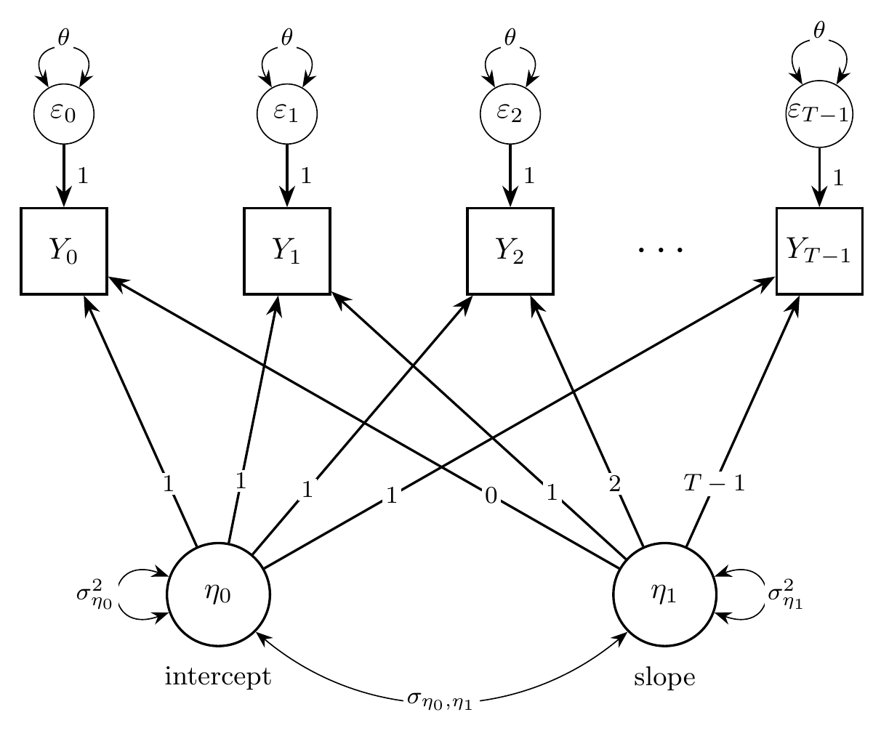
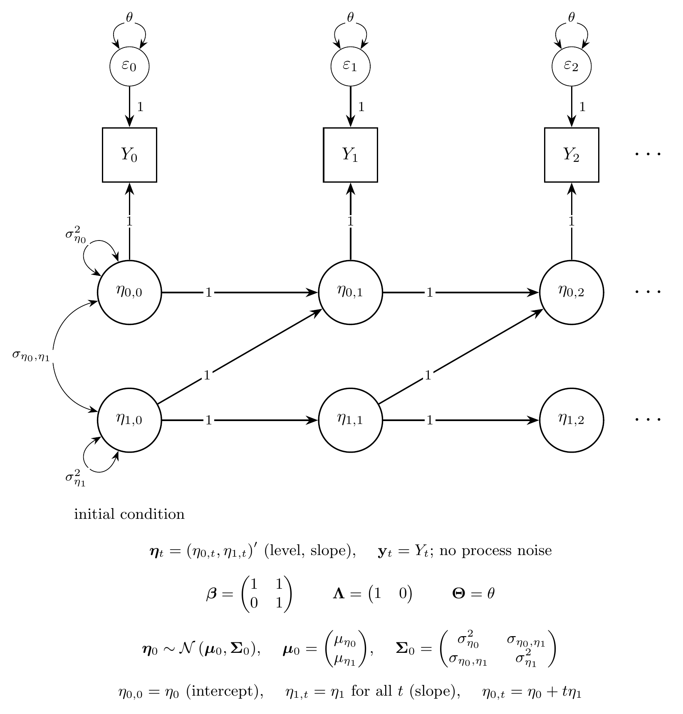
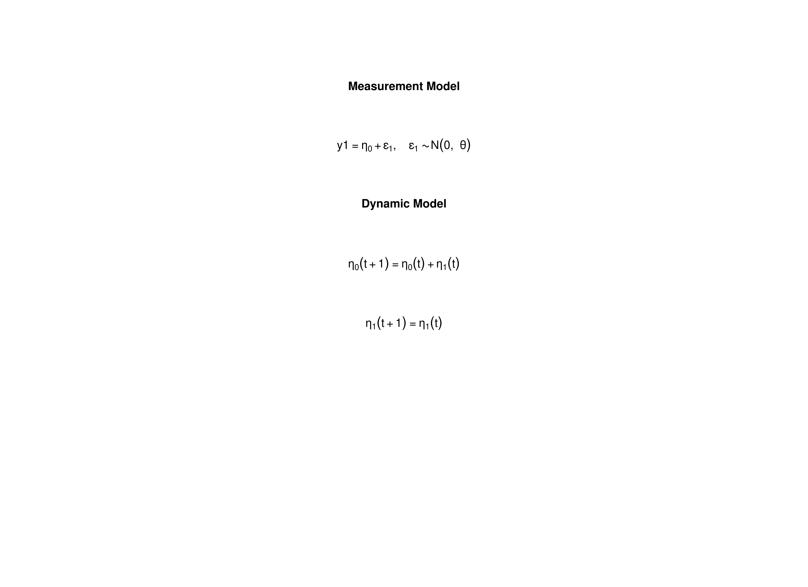

## Overview

The linear growth curve model describes individuals who each follow
their own straight-line trajectory over time,
for example, reading scores that start at different levels
and grow at different rates.
Each individual has a latent intercept (the level at the first occasion)
and a latent slope (the change per occasion).
The model estimates the average intercept and slope,
how much individuals differ in them,
and how much the measurements scatter around each trajectory.

The growth curve model is usually fitted
as a structural equation model (SEM).
It can also be written as a state space model:
the intercept and slope are latent states
that are set at the first occasion and then follow a fixed rule.

This tutorial does three things:

1. It writes the linear growth curve model as a state space model.
2. It simulates data from the model with `SimSSMLinGrowth()`.
3. It fits the model to the simulated data
   as a state space model with `dynr` and `OpenMx`
   and as a structural equation model (SEM) with `lavaan` and `OpenMx`,
   and as a multilevel model with `lme4`,
   and compares every set of estimates with the values used to simulate the data.

No prior knowledge of state space models is needed.


## Model

The measurement model is given by
$$
  Y_{i, t}
  =
  \left(
  \begin{array}{cc}
    1 & 0 \\
  \end{array}
  \right)
  \left(
  \begin{array}{c}
    \eta_{0_{i, t}} \\
    \eta_{1_{i, t}} \\
  \end{array}
  \right)
  +
  \boldsymbol{\varepsilon}_{i, t},
  \quad
  \mathrm{with}
  \quad
  \boldsymbol{\varepsilon}_{i, t}
  \sim
  \mathcal{N}
  \left(
  0,
  \theta
  \right)
$$
where $Y_{i, t}$, $\eta_{0_{i, t}}$,
$\eta_{1_{i, t}}$,
and $\boldsymbol{\varepsilon}_{i, t}$
are random variables and
$\theta$ is a model parameter.
$Y_{i, t}$ is the observed random variable
at time $t$ and individual $i$,
$\eta_{0_{i, t}}$ (intercept)
and
$\eta_{1_{i, t}}$ (slope)
form a vector of latent random variables
at time $t$ and individual $i$,
and $\boldsymbol{\varepsilon}_{i, t}$
a vector of random measurement errors
at time $t$ and individual $i$.
$\theta$ is the variance of
$\boldsymbol{\varepsilon}$.

In words,
the observed score is the current level of the trajectory,
$\eta_{0_{i, t}}$, plus measurement error.
The loading of the slope is 0, because the slope affects
the score only through its effect on the level over time.

The dynamic structure is given by
$$
  \left(
  \begin{array}{c}
  \eta_{0_{i, t}} \\
  \eta_{1_{i, t}} \\
  \end{array}
  \right)
  =
  \left(
  \begin{array}{cc}
    1 & 1 \\
    0 & 1 \\
  \end{array}
  \right)
  \left(
  \begin{array}{c}
  \eta_{0_{i, t - 1}} \\
  \eta_{1_{i, t - 1}} \\
  \end{array}
  \right) .
$$

In words,
the level at each occasion is the previous level plus the slope,
$\eta_{0_{i, t}} = \eta_{0_{i, t - 1}} + \eta_{1_{i, t - 1}}$,
and the slope stays the same,
$\eta_{1_{i, t}} = \eta_{1_{i, t - 1}}$.
There is no process noise,
so once an individual's intercept and slope are set,
the trajectory is a straight line.
All the variation in the trajectories between individuals
comes from the initial condition below.

The mean vector and covariance matrix of the intercept and slope
are captured in the mean vector and covariance matrix
of the initial condition given by
$$
  \boldsymbol{\mu}_{0}
  =
  \left(
  \begin{array}{c}
    \mu_{\eta_{0}} \\
    \mu_{\eta_{1}} \\
  \end{array}
  \right) \quad \mathrm{and,}
$$

$$
  \boldsymbol{\Sigma}_{0}
  =
  \left(
  \begin{array}{cc}
    \sigma^{2}_{\eta_{0}} &
    \sigma_{\eta_{0}, \eta_{1}} \\
    \sigma_{\eta_{1}, \eta_{0}} &
    \sigma^{2}_{\eta_{1}} \\
  \end{array}
  \right) .
$$

Here, $\mu_{\eta_{0}}$ and $\mu_{\eta_{1}}$
are the average intercept and slope,
$\sigma^{2}_{\eta_{0}}$ and $\sigma^{2}_{\eta_{1}}$
are how much individuals differ in them,
and $\sigma_{\eta_{0}, \eta_{1}}$ is their covariance,
for example, positive if individuals who start higher also grow faster.

### Diagrams


{width=100%}

The model as a path diagram, for the occasions $t = 0, 1, \ldots, T - 1$.
The intercept $\eta_{0}$ loads on every occasion with a loading of 1, and the slope $\eta_{1}$ with loadings $0, 1, 2, \ldots, T - 1$, so the slope is the change per occasion.
$\varepsilon_{t}$ is the measurement error, with variance $\theta$.
A loop on a variable is its variance and a curved two-headed arrow a covariance.
$\sigma^{2}_{\eta_{0}}$ and $\sigma^{2}_{\eta_{1}}$ are the variances of the intercept and the slope, and $\sigma_{\eta_{0}, \eta_{1}}$ their covariance.

{width=100%}

The same model in state space form, for the first three occasions ($t = 0, 1, 2$), with every element of the state drawn.
The state holds the current level $\eta_{0, t}$ and the slope $\eta_{1, t}$.
The transition adds the slope to the level at each occasion and keeps the slope, so $\eta_{1, t} = \eta_{1}$ for all $t$ and $\eta_{0, t} = \eta_{0} + t \eta_{1}$;
the level is measured by $Y_{t}$ with a loading of 1 and measurement error $\varepsilon_{t}$, with variance $\theta$.
There is no process noise: the loadings of the path diagram are produced by the transition, and the differences between individuals come from the initial condition.
At $t = 0$, the initial condition $\boldsymbol{\eta}_{0} \sim \mathcal{N} \left( \boldsymbol{\mu}_{0}, \boldsymbol{\Sigma}_{0} \right)$ holds the means, variances, and covariance of the intercept and the slope.
Below the diagram, $\boldsymbol{\beta}$, $\boldsymbol{\Lambda}$, and $\boldsymbol{\Theta}$ are the same matrices in compact form.
`SimSSMLinGrowth()` fixes $\boldsymbol{\beta}$ and $\boldsymbol{\Lambda}$ and takes `mu0` and the Cholesky factors of $\boldsymbol{\Sigma}_{0}$ and of $\theta$ (`sigma0_l` and `theta_l`).

## Data Generation

### Notation

Let $t = 5$ be the number of time points and $n = 2000$ be the number of individuals.

Let the measurement error variance $\theta$ be given by

$$
\theta
=
0.6 .
$$

Let the initial condition
$\boldsymbol{\eta}_{0}$
be given by

$$
\boldsymbol{\eta}_{0}
\sim
\mathcal{N}
\left(
\boldsymbol{\mu}_{0},
\boldsymbol{\Sigma}_{0}
\right)
$$

$$
\boldsymbol{\mu}_{0}
=
\left(
\begin{array}{c}
  0.615 \\
  1.006 \\
\end{array}
\right)
$$

$$
\boldsymbol{\Sigma}_{0}
=
\left(
\begin{array}{cc}
  1.932 & 0.618 \\
  0.618 & 0.587 \\
\end{array}
\right) .
$$

### R Function Arguments

The simulation functions take covariance matrices
as lower triangular Cholesky factors (the arguments ending in `_l`).


``` r
n
#> [1] 2000
time
#> [1] 5
mu0
#> [1] 0.615 1.006
sigma0
#>       [,1]  [,2]
#> [1,] 1.932 0.618
#> [2,] 0.618 0.587
sigma0_l # sigma0_l <- t(chol(sigma0))
#>           [,1]      [,2]
#> [1,] 1.3899640 0.0000000
#> [2,] 0.4446158 0.6239525
theta
#> [1] 0.6
theta_l # theta_l <- t(chol(theta))
#> [1] 0.7745967
```

### Visualizing the Dynamics Without Measurement Error (n = 5 with Different Initial Condition)

Without measurement error, each of the five simulated individuals
follows an exact straight line,
with its own intercept and slope.


### Using the `SimSSMLinGrowth` Function from the `simStateSpace` Package to Simulate Data

Now we add the measurement error and simulate the full data set.
`as.data.frame()` returns the data in long format,
one row per individual and time point,
with the columns `id`, `time`, and `y1`.


``` r
library(simStateSpace)
sim <- SimSSMLinGrowth(
  n = n,
  time = time,
  mu0 = mu0,
  sigma0_l = sigma0_l,
  theta_l = theta_l,
  type = 0
)
data <- as.data.frame(sim)
head(data)
#>   id time       y1
#> 1  1    0 1.723564
#> 2  1    1 2.148702
#> 3  1    2 3.384974
#> 4  1    3 6.225426
#> 5  1    4 5.993965
#> 6  2    0 1.951861
summary(data)
#>        id              time         y1         
#>  Min.   :   1.0   Min.   :0   Min.   :-8.1963  
#>  1st Qu.: 500.8   1st Qu.:1   1st Qu.: 0.4226  
#>  Median :1000.5   Median :2   Median : 2.1950  
#>  Mean   :1000.5   Mean   :2   Mean   : 2.5922  
#>  3rd Qu.:1500.2   3rd Qu.:3   3rd Qu.: 4.4219  
#>  Max.   :2000.0   Max.   :4   Max.   :17.0616
plot(sim)
```


## Model Fitting

The same simulated data are fitted
as a state space model with `dynr` and `OpenMx`
and as a structural equation model (SEM) with `lavaan` and `OpenMx`, and as a multilevel model with `lme4`.
All of them estimate the parameters by maximum likelihood.
The section Population Values and Estimates
compares their estimates with the population values.

### dynr

We fit the model with `dynr`,
which estimates state space models by maximum likelihood
using the Kalman filter.

A `dynr` model is built from pieces that match the equations above:
the data, the initial condition, the measurement model,
the dynamic model, and the noise.
Each parameter gets a name (for example, `sigma0_01` for $\sigma_{\eta_{0}, \eta_{1}}$`),
and the same name used in two places means one shared parameter.
The starting values are set to the population values for convenience;
with real data, they would be rough guesses.
The intercept and slope are indexed 0 and 1 in the parameter names.

#### Prepare Data

Tell `dynr` which columns hold the individual, the time, and the observed variables.


``` r
dynr_data <- dynr::dynr.data(
  dataframe = data,
  id = "id",
  time = "time",
  observed = "y1"
)
```

#### Prepare Initial Condition

The mean and covariance of the initial state are
the means, variances, and covariance of the intercept and slope,
so these are the main parameters of the growth model.
The covariance matrix is symmetric,
so `sigma0_01` appears both above and below the diagonal.


``` r
dynr_initial <- dynr::prep.initial(
  values.inistate = mu0,
  params.inistate = c("mu0_0", "mu0_1"),
  values.inicov = sigma0,
  params.inicov = matrix(
    data = c(
      "sigma0_00", "sigma0_01",
      "sigma0_01", "sigma0_11"
    ),
    nrow = 2
  )
)
```

#### Prepare Measurement Model

The loadings $\left( 1, 0 \right)$ are fixed.


``` r
dynr_measurement <- dynr::prep.measurement(
  values.load = matrix(data = c(1, 0), nrow = 1),
  params.load = matrix(data = "fixed", nrow = 1, ncol = 2),
  state.names = c("eta_0", "eta_1"),
  obs.names = "y1"
)
```

#### Prepare Dynamic Process

The two formulas are the two rows of the dynamic equation.
They have no free parameters.


``` r
dynr_dynamics <- dynr::prep.formulaDynamics(
  formula = list(
    eta_0 ~ eta_0 + eta_1,
    eta_1 ~ eta_1
  ),
  isContinuousTime = FALSE
)
#> Warning in dynr::prep.formulaDynamics(formula = list(eta_0 ~ eta_0 + eta_1, :
#> You provided no start values: length(startval)==0. If you have no free
#> parameters, keep calm and carry on.
```

#### Prepare Process Noise

The process noise is fixed at zero,
and the measurement error variance $\theta$ is estimated.


``` r
dynr_noise <- dynr::prep.noise(
  values.latent = matrix(data = 0, nrow = 2, ncol = 2),
  params.latent = matrix(data = "fixed", nrow = 2, ncol = 2),
  values.observed = theta,
  params.observed = "theta"
)
```

#### Prepare the Model

The pieces are put together into one model.
`dynr` writes the model as C code to `outfile` and compiles it.


``` r
model <- dynr::dynr.model(
  data = dynr_data,
  initial = dynr_initial,
  measurement = dynr_measurement,
  dynamics = dynr_dynamics,
  noise = dynr_noise,
  outfile = "lin-growth.c"
)
```

The plot below shows the model equations with the parameter names.



#### Fit the Model


``` r
results <- dynr::dynr.cook(
  model,
  debug_flag = TRUE,
  verbose = FALSE
)
#> [1] "Get ready!!!!"
#> using C compiler: ‘gcc (Ubuntu 15.2.0-16ubuntu1) 15.2.0’
#> Optimization function called.
#> Starting Hessian calculation ...
#> Finished Hessian calculation.
#> Original exit flag:  3 
#> Modified exit flag:  3 
#> Optimization terminated successfully: ftol_rel or ftol_abs was reached. 
#> Original fitted parameters:  -0.5214641 0.6200474 0.9859686 0.5990437 0.3061706 
#> -0.901686 
#> 
#> Transformed fitted parameters:  0.5936507 0.6200474 0.9859686 1.820377 
#> 0.5573459 0.5765277 
#> 
#> Doing end processing
#> Successful trial
#> Total Time: 5.789685 
#> Backend Time: 5.362604
```

#### Summary

The summary lists each estimate with its standard error,
$t$ value, confidence interval, and $p$ value.


``` r
summary(results)
#> Coefficients:
#>           Estimate Std. Error t value ci.lower ci.upper            Pr(>|t|)    
#> theta      0.59365    0.01084   54.78  0.57241  0.61489 <0.0000000000000002 ***
#> mu0_0      0.62005    0.03299   18.79  0.55538  0.68471 <0.0000000000000002 ***
#> mu0_1      0.98597    0.01783   55.30  0.95102  1.02091 <0.0000000000000002 ***
#> sigma0_00  1.82038    0.06912   26.34  1.68491  1.95584 <0.0000000000000002 ***
#> sigma0_01  0.55735    0.02815   19.80  0.50216  0.61253 <0.0000000000000002 ***
#> sigma0_11  0.57653    0.02014   28.63  0.53706  0.61599 <0.0000000000000002 ***
#> ---
#> Signif. codes:  0 '***' 0.001 '**' 0.01 '*' 0.05 '.' 0.1 ' ' 1
#> 
#> -2 log-likelihood value at convergence = 33425.11
#> AIC = 33437.11
#> BIC = 33480.37
```

### OpenMx: State Space Model

`OpenMx` [@Neale-Hunter-Pritikin-etal-2016] fits the same state space model
with its own Kalman filter (`OpenMx::mxExpectationStateSpace()`; @Hunter-2018).
Its matrices have the names used in engineering:
`A` is the transition matrix $\boldsymbol{\beta}$,
`B` holds the intercepts of the dynamic model,
`C` is the loading matrix $\boldsymbol{\Lambda}$,
`D` holds the intercepts of the measurement model,
`Q` is the process noise covariance matrix,
and `R` is the measurement error covariance matrix.
The parameter labels are the dynr names;
as in dynr, a label used in two places is one shared parameter,
and the starting values are the population values.

Two details differ from dynr.
First, OpenMx reads the data as a single time series.
To start the filter again at the first occasion of every individual,
each individual gets a group,
and all groups use the matrices of one parent model,
so every individual has the same parameters.
Second, OpenMx starts the filter one occasion before the first row,
so the first row has the state mean $\mathbf{A} \mathbf{x}_{0} + \mathbf{B} \mathbf{u}$
and the state covariance $\mathbf{A} \mathbf{P}_{0} \mathbf{A}^{\prime} + \mathbf{Q}$,
with the constant input $\mathbf{u} = 1$.
Setting
$\mathbf{x}_{0} = \mathbf{A}^{-1} \left( \boldsymbol{\mu}_{0} - \mathbf{B} \mathbf{u} \right)$
and
$\mathbf{P}_{0} = \mathbf{A}^{-1} \left( \boldsymbol{\Sigma}_{0} - \mathbf{Q} \right) \left( \mathbf{A}^{-1} \right)^{\prime}$
gives the first occasion the initial condition of the model,
so the likelihood is the same as in dynr.
This needs an invertible $\mathbf{A}$, which holds here.

The two helper functions below are the same in every vignette of the package.
`MxMat()` makes an OpenMx matrix from values and dynr-style labels
(`"fixed"` marks a fixed element),
and `FitMxSSM()` builds the groups and fits the model.


``` r
MxMat <- function(values, labels, name) {
  values <- as.matrix(values)
  labels <- matrix(
    data = labels,
    nrow = nrow(values),
    ncol = ncol(values)
  )
  free <- labels != "fixed"
  labels[!free] <- NA
  OpenMx::mxMatrix(
    type = "Full",
    values = values,
    free = free,
    labels = labels,
    name = name
  )
}
FitMxSSM <- function(data, observed, matrices, name) {
  # the groups refer to the matrices of the parent model
  shared <- function(x) {
    paste0(name, ".", x)
  }
  expectation <- OpenMx::mxExpectationStateSpace(
    A = shared("A"),
    B = shared("B"),
    C = shared("C"),
    D = shared("D"),
    Q = shared("Q"),
    R = shared("R"),
    x0 = shared("x0"),
    P0 = shared("P0"),
    u = shared("u")
  )
  # OpenMx needs the names of the observed variables and of the states on C
  for (i in seq_along(matrices)) {
    if (matrices[[i]]$name == "C") {
      dimnames(matrices[[i]]) <- list(
        observed,
        paste0("eta_", seq_len(ncol(matrices[[i]]$values)))
      )
    }
  }
  persons <- split(
    x = data[, observed, drop = FALSE],
    f = data[, "id"]
  )
  groups <- paste0("id_", names(persons))
  submodels <- lapply(
    X = seq_along(persons),
    FUN = function(i) {
      OpenMx::mxModel(
        name = groups[i],
        expectation,
        OpenMx::mxFitFunctionML(),
        OpenMx::mxData(
          observed = persons[[i]],
          type = "raw"
        )
      )
    }
  )
  model <- OpenMx::mxModel(
    name = name,
    matrices,
    OpenMx::mxMatrix(
      type = "Unit",
      nrow = 1,
      ncol = 1,
      name = "u"
    ),
    # the first occasion gets the initial condition of the model
    OpenMx::mxAlgebra(
      expression = solve(A) %*% (mu0 - B %*% u),
      name = "x0"
    ),
    OpenMx::mxAlgebra(
      expression = solve(A) %*% (sigma0 - Q) %*% t(solve(A)),
      name = "P0"
    ),
    submodels,
    OpenMx::mxFitFunctionMultigroup(groups = groups)
  )
  # retries from perturbed starting values only if the first run fails
  OpenMx::mxTryHard(
    model = model,
    extraTries = 5,
    silent = TRUE
  )
}
```

The matrices of the model, with the dynr labels.
The transition matrix carries the intercept and adds the slope,
and there is no process noise (`Q` is zero).


``` r
mx_matrices <- list(
  MxMat(
    values = matrix(data = c(1, 0, 1, 1), nrow = 2),
    labels = "fixed",
    name = "A"
  ),
  MxMat(values = c(0, 0), labels = "fixed", name = "B"),
  MxMat(
    values = matrix(data = c(1, 0), nrow = 1),
    labels = "fixed",
    name = "C"
  ),
  MxMat(values = 0, labels = "fixed", name = "D"),
  MxMat(
    values = matrix(data = 0, nrow = 2, ncol = 2),
    labels = "fixed",
    name = "Q"
  ),
  MxMat(values = theta, labels = "theta", name = "R"),
  MxMat(values = mu0, labels = c("mu0_0", "mu0_1"), name = "mu0"),
  MxMat(
    values = sigma0,
    labels = matrix(
      data = c(
        "sigma0_00", "sigma0_01",
        "sigma0_01", "sigma0_11"
      ),
      nrow = 2
    ),
    name = "sigma0"
  )
)
```


``` r
fit_mx_ssm <- FitMxSSM(
  data = data,
  observed = "y1",
  matrices = mx_matrices,
  name = "lin_growth"
)
#> 
Beginning initial fit attempt
Fit attempt 0, fit=33425.1055806257, new current best! (was 33432.008312779)
                                                                            
#> 
#>  Solution found!  Final fit=33425.106 (started at 33432.008)  (1 attempt(s): 1 valid, 0 errors)
summary(fit_mx_ssm)
#> Summary of lin_growth 
#>  
#> free parameters:
#>        name matrix row col  Estimate  Std.Error A
#> 1     theta      R   1   1 0.5936771 0.01083943  
#> 2     mu0_0    mu0   1   1 0.6201697 0.03299043  
#> 3     mu0_1    mu0   2   1 0.9860179 0.01783248  
#> 4 sigma0_00 sigma0   1   1 1.8202777 0.06914596  
#> 5 sigma0_01 sigma0   2   1 0.5573863 0.02815680  
#> 6 sigma0_11 sigma0   2   2 0.5765853 0.02014077  
#> 
#> Model Statistics: 
#>                |  Parameters  |  Degrees of Freedom  |  Fit (-2lnL units)
#>        Model:              6                   9994              33425.11
#>    Saturated:             NA                     NA                    NA
#> Independence:             NA                     NA                    NA
#> Number of observations/statistics: 10000/10000
#> 
#> Information Criteria: 
#>       |  df Penalty  |  Parameters Penalty  |  Sample-Size Adjusted
#> AIC:       13437.11               33437.11                 33437.11
#> BIC:      -58623.04               33480.37                 33461.30
#> To get additional fit indices, see help(mxRefModels)
#> timestamp: 2026-11-02 05:51:22 
#> Wall clock time: 17.71462 secs 
#> optimizer:  SLSQP 
#> OpenMx version number: 2.22.11 
#> Need help?  See help(mxSummary)
```

### lavaan: Structural Equation Model

The same model in SEM form, fitted with `lavaan`,
should give nearly the same estimates.
In SEM, the five occasions are five observed variables
in one row per individual (wide format).
The intercept factor has loadings of 1 on all occasions,
and the slope factor has loadings 0, 1, 2, 3, and 4.

#### Wide Data Set

`as.data.frame()` with `long = FALSE` returns the data in wide format.


``` r
data_wide <- as.data.frame(sim, long = FALSE)
head(data_wide)
#>   id        y1_0       y1_1        y1_2        y1_3       y1_4
#> 1  1  1.72356430  2.1487019  3.38497364  6.22542609  5.9939649
#> 2  2  1.95186051  2.6140623  5.60107919  5.59791920  7.6881040
#> 3  3  0.07909854 -1.1410633 -0.02940765  0.07103948 -0.4998955
#> 4  4 -0.14827866 -0.6478676 -0.33440620 -0.29683127 -0.6950588
#> 5  5  1.14625267  2.3844799  0.39101270 -0.76159166  1.6750324
#> 6  6  1.02604168  2.1852479  2.55168739  2.13223414  4.1499727
```

#### Model

The parameter labels match the dynr names.
Giving the five error variances the same label, `theta`,
constrains them to be equal, as in the state space model.


``` r
model <- "
  # factor loadings
  eta0 =~ 1 * y1_0 + 1 * y1_1 + 1 * y1_2 + 1 * y1_3 + 1 * y1_4
  eta1 =~ 0 * y1_0 + 1 * y1_1 + 2 * y1_2 + 3 * y1_3 + 4 * y1_4
  # means of latent variables
  eta0 ~ mu0_0 * 1
  eta1 ~ mu0_1 * 1
  # variances and covariances of latent variables
  eta0 ~~ sigma0_00 * eta0
  eta0 ~~ sigma0_01 * eta1
  eta1 ~~ sigma0_11 * eta1
  # constrain error variance theta to be equal
  y1_0 ~~ theta * y1_0
  y1_1 ~~ theta * y1_1
  y1_2 ~~ theta * y1_2
  y1_3 ~~ theta * y1_3
  y1_4 ~~ theta * y1_4
"
```


``` r
fit_lavaan <- lavaan::growth(
  model = model,
  data = data_wide
)
lavaan::summary(fit_lavaan)
#> lavaan 0.7-3 ended normally after 30 iterations
#> 
#>   Estimator                                         ML
#>   Optimization method                           NLMINB
#>   Number of model parameters                        10
#>   Number of equality constraints                     4
#> 
#>   Number of observations                          2000
#> 
#> Model Test User Model:
#>                                                       
#>   Test statistic                                22.264
#>   Degrees of freedom                                14
#>   P-value (Chi-square)                           0.073
#>                                                       
#>   Browne's residual (NT model-based) test             
#>   Test statistic                                22.030
#>   Degrees of freedom                                14
#>   P-value (Chi-square)                           0.078
#> 
#> Parameter Estimates:
#> 
#>   Standard errors                             Standard
#>   Information                                 Expected
#>   Information saturated (h1) model          Structured
#> 
#> Latent Variables:
#>                    Estimate  Std.Err  z-value  P(>|z|)
#>   eta0 =~                                             
#>     y1_0              1.000                           
#>     y1_1              1.000                           
#>     y1_2              1.000                           
#>     y1_3              1.000                           
#>     y1_4              1.000                           
#>   eta1 =~                                             
#>     y1_0              0.000                           
#>     y1_1              1.000                           
#>     y1_2              2.000                           
#>     y1_3              3.000                           
#>     y1_4              4.000                           
#> 
#> Covariances:
#>                    Estimate  Std.Err  z-value  P(>|z|)
#>   eta0 ~~                                             
#>     eta1    (s0_0)    0.557    0.028   19.794    0.000
#> 
#> Intercepts:
#>                    Estimate  Std.Err  z-value  P(>|z|)
#>     eta0    (m0_0)    0.620    0.033   18.800    0.000
#>     eta1    (m0_1)    0.986    0.018   55.295    0.000
#> 
#> Variances:
#>                    Estimate  Std.Err  z-value  P(>|z|)
#>     eta0    (s0_0)    1.820    0.069   26.330    0.000
#>     eta1    (s0_1)    0.577    0.020   28.629    0.000
#>    .y1_0    (thet)    0.594    0.011   54.772    0.000
#>    .y1_1    (thet)    0.594    0.011   54.772    0.000
#>    .y1_2    (thet)    0.594    0.011   54.772    0.000
#>    .y1_3    (thet)    0.594    0.011   54.772    0.000
#>    .y1_4    (thet)    0.594    0.011   54.772    0.000
```

### OpenMx: Structural Equation Model

The same SEM in `OpenMx`, written with `OpenMx::mxPath()`
on the wide data.
One-headed arrows are loadings and regressions,
two-headed arrows are variances and covariances,
and arrows from `"one"` are means.
A path that is not written is fixed at zero,
so the zero residual variances, covariances, and intercepts
of the lavaan model need no lines here.
The labels are the dynr names,
and the starting values are the population values.


``` r
waves <- 0:(time - 1)
manifest <- paste0("y1_", waves)
mx_sem <- OpenMx::mxModel(
  name = "lin_growth_sem",
  type = "RAM",
  manifestVars = manifest,
  latentVars = c("eta0", "eta1"),
  OpenMx::mxData(observed = data_wide[, manifest], type = "raw"),
  # factor loadings
  OpenMx::mxPath(from = "eta0", to = manifest, free = FALSE, values = 1),
  OpenMx::mxPath(from = "eta1", to = manifest, free = FALSE, values = waves),
  # means of latent variables
  OpenMx::mxPath(
    from = "one",
    to = c("eta0", "eta1"),
    labels = c("mu0_0", "mu0_1"),
    values = mu0
  ),
  # variances and covariances of latent variables
  OpenMx::mxPath(
    from = c("eta0", "eta0", "eta1"),
    to = c("eta0", "eta1", "eta1"),
    arrows = 2,
    labels = c("sigma0_00", "sigma0_01", "sigma0_11"),
    values = c(sigma0[1, 1], sigma0[1, 2], sigma0[2, 2])
  ),
  # error variance theta, equal over time
  OpenMx::mxPath(from = manifest, arrows = 2, labels = "theta", values = theta)
)
```


``` r
fit_mx_sem <- OpenMx::mxRun(
  model = mx_sem,
  silent = TRUE
)
summary(fit_mx_sem)
#> Summary of lin_growth_sem 
#>  
#> free parameters:
#>        name matrix  row  col  Estimate  Std.Error A
#> 1     theta      S y1_0 y1_0 0.5936771 0.01083906  
#> 2 sigma0_00      S eta0 eta0 1.8202777 0.06913399  
#> 3 sigma0_01      S eta0 eta1 0.5573863 0.02815924  
#> 4 sigma0_11      S eta1 eta1 0.5765853 0.02013960  
#> 5     mu0_0      M    1 eta0 0.6201697 0.03298763  
#> 6     mu0_1      M    1 eta1 0.9860179 0.01783185  
#> 
#> Model Statistics: 
#>                |  Parameters  |  Degrees of Freedom  |  Fit (-2lnL units)
#>        Model:              6                   9994              33425.11
#>    Saturated:             20                   9980                    NA
#> Independence:             10                   9990                    NA
#> Number of observations/statistics: 2000/10000
#> 
#> Information Criteria: 
#>       |  df Penalty  |  Parameters Penalty  |  Sample-Size Adjusted
#> AIC:       13437.11               33437.11                 33437.15
#> BIC:      -42538.31               33470.71                 33451.65
#> To get additional fit indices, see help(mxRefModels)
#> timestamp: 2026-11-02 05:52:02 
#> Wall clock time: 0.01413393 secs 
#> optimizer:  SLSQP 
#> OpenMx version number: 2.22.11 
#> Need help?  See help(mxSummary)
```

### lme4: Multilevel Model

The linear growth curve model is also a multilevel (mixed-effects) model
of the long data:
the occasions are nested in individuals,
the fixed intercept and slope are the means
$\mu_{\eta_{0}}$ and $\mu_{\eta_{1}}$ (`mu0_0` and `mu0_1`),
the random intercept and slope have the covariance matrix
$\boldsymbol{\Sigma}_{0}$
(`sigma0_00`, `sigma0_01`, and `sigma0_11`),
and the residual variance is $\theta$.
`lme4::lmer()` fits it with a random intercept and a random slope of `time`
for each `id` [@Bates-Machler-Bolker-etal-2015].
`REML = FALSE` gives maximum likelihood estimates,
as in the other methods.


``` r
fit_lme4 <- lme4::lmer(
  formula = y1 ~ time + (time | id),
  data = data,
  REML = FALSE
)
summary(fit_lme4)
#> Linear mixed model fit by maximum likelihood  ['lmerMod']
#> Formula: y1 ~ time + (time | id)
#>    Data: data
#> 
#>       AIC       BIC    logLik -2*log(L)  df.resid 
#>   33437.1   33480.4  -16712.6   33425.1      9994 
#> 
#> Scaled residuals: 
#>      Min       1Q   Median       3Q      Max 
#> -2.93296 -0.55042  0.01077  0.54126  3.06952 
#> 
#> Random effects:
#>  Groups   Name        Variance Std.Dev. Corr 
#>  id       (Intercept) 1.8203   1.3492        
#>           time        0.5766   0.7593   0.54 
#>  Residual             0.5937   0.7705        
#> Number of obs: 10000, groups:  id, 2000
#> 
#> Fixed effects:
#>             Estimate Std. Error t value
#> (Intercept)  0.62017    0.03299    18.8
#> time         0.98602    0.01783    55.3
#> 
#> Correlation of Fixed Effects:
#>      (Intr)
#> time 0.373
```

## Population Values and Estimates

Each table below puts the population values used to simulate the data
next to the estimates of one method.
Bias is the estimate minus the population value.
Because each model is fitted to a single simulated data set,
this is the error of one estimate, not a Monte Carlo bias,
which would average over many replications.
The 95% confidence interval is the Wald interval,
$\hat{\theta} \pm 1.96 \times \mathrm{SE}$,
unless the caption says otherwise,
and `Covers` shows whether it contains the population value.
The parameter names are the dynr names in every table.


``` r
EstimatesTable <- function(population, estimate, se, ll = NULL, ul = NULL) {
  z <- stats::qnorm(p = 0.975)
  if (is.null(ll)) {
    ll <- estimate - z * se
  }
  if (is.null(ul)) {
    ul <- estimate + z * se
  }
  data.frame(
    Parameter = names(population),
    Population = unname(population),
    Estimate = unname(estimate),
    SE = unname(se),
    Bias = unname(estimate - population),
    `2.5%` = unname(ll),
    `97.5%` = unname(ul),
    Covers = unname(population >= ll & population <= ul),
    check.names = FALSE
  )
}
```


``` r
population <- c(
  mu0_0 = mu0[1],
  mu0_1 = mu0[2],
  sigma0_00 = sigma0[1, 1],
  sigma0_01 = sigma0[1, 2],
  sigma0_11 = sigma0[2, 2],
  theta = theta
)
```

### dynr


``` r
dynr_est <- coef(results)
dynr_se <- sqrt(diag(vcov(results)))
knitr::kable(
  x = EstimatesTable(
    population = population,
    estimate = dynr_est[names(population)],
    se = dynr_se[names(population)]
  ),
  digits = 3,
  caption = "Population values and dynr estimates (one simulated data set)"
)
```


Table: Population values and dynr estimates (one simulated data set)

|Parameter | Population| Estimate|    SE|   Bias|  2.5%| 97.5%|Covers |
|:---------|----------:|--------:|-----:|------:|-----:|-----:|:------|
|mu0_0     |      0.615|    0.620| 0.033|  0.005| 0.555| 0.685|TRUE   |
|mu0_1     |      1.006|    0.986| 0.018| -0.020| 0.951| 1.021|TRUE   |
|sigma0_00 |      1.932|    1.820| 0.069| -0.112| 1.685| 1.956|TRUE   |
|sigma0_01 |      0.618|    0.557| 0.028| -0.061| 0.502| 0.613|FALSE  |
|sigma0_11 |      0.587|    0.577| 0.020| -0.010| 0.537| 0.616|TRUE   |
|theta     |      0.600|    0.594| 0.011| -0.006| 0.572| 0.615|TRUE   |


### OpenMx: State Space Model


``` r
mx_ssm_est <- OpenMx::omxGetParameters(fit_mx_ssm)
mx_ssm_se <- fit_mx_ssm$output$standardErrors[, 1]
knitr::kable(
  x = EstimatesTable(
    population = population,
    estimate = mx_ssm_est[names(population)],
    se = mx_ssm_se[names(population)]
  ),
  digits = 3,
  caption = paste(
    "Population values and OpenMx state space estimates",
    "(one simulated data set)"
  )
)
```


Table: Population values and OpenMx state space estimates (one simulated data set)

|Parameter | Population| Estimate|    SE|   Bias|  2.5%| 97.5%|Covers |
|:---------|----------:|--------:|-----:|------:|-----:|-----:|:------|
|mu0_0     |      0.615|    0.620| 0.033|  0.005| 0.556| 0.685|TRUE   |
|mu0_1     |      1.006|    0.986| 0.018| -0.020| 0.951| 1.021|TRUE   |
|sigma0_00 |      1.932|    1.820| 0.069| -0.112| 1.685| 1.956|TRUE   |
|sigma0_01 |      0.618|    0.557| 0.028| -0.061| 0.502| 0.613|FALSE  |
|sigma0_11 |      0.587|    0.577| 0.020| -0.010| 0.537| 0.616|TRUE   |
|theta     |      0.600|    0.594| 0.011| -0.006| 0.572| 0.615|TRUE   |


### lavaan: Structural Equation Model


``` r
pe <- lavaan::parameterEstimates(fit_lavaan)
# a label shared by several paths is one parameter
pe <- pe[pe$label != "" & !duplicated(pe$label), ]
lavaan_est <- stats::setNames(object = pe$est, nm = pe$label)
lavaan_se <- stats::setNames(object = pe$se, nm = pe$label)
knitr::kable(
  x = EstimatesTable(
    population = population,
    estimate = lavaan_est[names(population)],
    se = lavaan_se[names(population)]
  ),
  digits = 3,
  caption = "Population values and lavaan estimates (one simulated data set)"
)
```


Table: Population values and lavaan estimates (one simulated data set)

|Parameter | Population| Estimate|    SE|   Bias|  2.5%| 97.5%|Covers |
|:---------|----------:|--------:|-----:|------:|-----:|-----:|:------|
|mu0_0     |      0.615|    0.620| 0.033|  0.005| 0.556| 0.685|TRUE   |
|mu0_1     |      1.006|    0.986| 0.018| -0.020| 0.951| 1.021|TRUE   |
|sigma0_00 |      1.932|    1.820| 0.069| -0.112| 1.685| 1.956|TRUE   |
|sigma0_01 |      0.618|    0.557| 0.028| -0.061| 0.502| 0.613|FALSE  |
|sigma0_11 |      0.587|    0.577| 0.020| -0.010| 0.537| 0.616|TRUE   |
|theta     |      0.600|    0.594| 0.011| -0.006| 0.572| 0.615|TRUE   |


### OpenMx: Structural Equation Model


``` r
mx_sem_est <- OpenMx::omxGetParameters(fit_mx_sem)
mx_sem_se <- fit_mx_sem$output$standardErrors[, 1]
knitr::kable(
  x = EstimatesTable(
    population = population,
    estimate = mx_sem_est[names(population)],
    se = mx_sem_se[names(population)]
  ),
  digits = 3,
  caption = "Population values and OpenMx SEM estimates (one simulated data set)"
)
```


Table: Population values and OpenMx SEM estimates (one simulated data set)

|Parameter | Population| Estimate|    SE|   Bias|  2.5%| 97.5%|Covers |
|:---------|----------:|--------:|-----:|------:|-----:|-----:|:------|
|mu0_0     |      0.615|    0.620| 0.033|  0.005| 0.556| 0.685|TRUE   |
|mu0_1     |      1.006|    0.986| 0.018| -0.020| 0.951| 1.021|TRUE   |
|sigma0_00 |      1.932|    1.820| 0.069| -0.112| 1.685| 1.956|TRUE   |
|sigma0_01 |      0.618|    0.557| 0.028| -0.061| 0.502| 0.613|FALSE  |
|sigma0_11 |      0.587|    0.577| 0.020| -0.010| 0.537| 0.616|TRUE   |
|theta     |      0.600|    0.594| 0.011| -0.006| 0.572| 0.615|TRUE   |


### lme4: Multilevel Model

lme4 gives standard errors for the fixed effects only.
For the variances, the interval is the profile likelihood interval
of the standard deviation, squared;
lme4 has no interval for a covariance.


``` r
vc <- as.data.frame(lme4::VarCorr(fit_lme4))
random <- vc[vc$grp == "id", ]
lme4_est <- c(
  mu0_0 = unname(lme4::fixef(fit_lme4)["(Intercept)"]),
  mu0_1 = unname(lme4::fixef(fit_lme4)["time"]),
  sigma0_00 = random$vcov[random$var1 == "(Intercept)" & is.na(random$var2)],
  sigma0_01 = random$vcov[!is.na(random$var2)],
  sigma0_11 = random$vcov[random$var1 == "time" & is.na(random$var2)],
  theta = vc$vcov[vc$grp == "Residual"]
)
lme4_se <- c(
  sqrt(diag(as.matrix(stats::vcov(fit_lme4)))),
  rep(x = NA, times = 4)
)
names(lme4_se) <- names(lme4_est)
profile_ci <- stats::confint(
  fit_lme4,
  method = "profile",
  oldNames = FALSE
)
#> Warning: 'oldNames' is deprecated. Please use 'signames' instead.
#> Computing profile confidence intervals ...
z <- stats::qnorm(p = 0.975)
lme4_ll <- c(
  lme4_est[1:2] - z * lme4_se[1:2],
  sigma0_00 = profile_ci["sd_(Intercept)|id", 1]^2,
  sigma0_01 = NA,
  sigma0_11 = profile_ci["sd_time|id", 1]^2,
  theta = profile_ci["sigma", 1]^2
)
lme4_ul <- c(
  lme4_est[1:2] + z * lme4_se[1:2],
  sigma0_00 = profile_ci["sd_(Intercept)|id", 2]^2,
  sigma0_01 = NA,
  sigma0_11 = profile_ci["sd_time|id", 2]^2,
  theta = profile_ci["sigma", 2]^2
)
knitr::kable(
  x = EstimatesTable(
    population = population,
    estimate = lme4_est[names(population)],
    se = lme4_se[names(population)],
    ll = lme4_ll[names(population)],
    ul = lme4_ul[names(population)]
  ),
  digits = 3,
  caption = paste(
    "Population values and lme4 estimates (one simulated data set);",
    "intervals for the variances: profile likelihood"
  )
)
```


Table: Population values and lme4 estimates (one simulated data set); intervals for the variances: profile likelihood

|Parameter | Population| Estimate|    SE|   Bias|  2.5%| 97.5%|Covers |
|:---------|----------:|--------:|-----:|------:|-----:|-----:|:------|
|mu0_0     |      0.615|    0.620| 0.033|  0.005| 0.556| 0.685|TRUE   |
|mu0_1     |      1.006|    0.986| 0.018| -0.020| 0.951| 1.021|TRUE   |
|sigma0_00 |      1.932|    1.820|    NA| -0.112| 1.690| 1.961|TRUE   |
|sigma0_01 |      0.618|    0.557|    NA| -0.061|    NA|    NA|NA     |
|sigma0_11 |      0.587|    0.577|    NA| -0.010| 0.539| 0.618|TRUE   |
|theta     |      0.600|    0.594|    NA| -0.006| 0.573| 0.615|TRUE   |


### All Methods

The estimates of every method side by side.
The methods maximize the same likelihood,
so their estimates should agree closely.


``` r
knitr::kable(
  x = data.frame(
    Parameter = names(population),
    Population = unname(population),
    `dynr` = unname(dynr_est[names(population)]),
    `OpenMx (SSM)` = unname(mx_ssm_est[names(population)]),
    `lavaan` = unname(lavaan_est[names(population)]),
    `OpenMx (SEM)` = unname(mx_sem_est[names(population)]),
    `lme4` = unname(lme4_est[names(population)]),
    check.names = FALSE
  ),
  digits = 3,
  caption = "Population values and the estimates of every method"
)
```


Table: Population values and the estimates of every method

|Parameter | Population|  dynr| OpenMx (SSM)| lavaan| OpenMx (SEM)|  lme4|
|:---------|----------:|-----:|------------:|------:|------------:|-----:|
|mu0_0     |      0.615| 0.620|        0.620|  0.620|        0.620| 0.620|
|mu0_1     |      1.006| 0.986|        0.986|  0.986|        0.986| 0.986|
|sigma0_00 |      1.932| 1.820|        1.820|  1.820|        1.820| 1.820|
|sigma0_01 |      0.618| 0.557|        0.557|  0.557|        0.557| 0.557|
|sigma0_11 |      0.587| 0.577|        0.577|  0.577|        0.577| 0.577|
|theta     |      0.600| 0.594|        0.594|  0.594|        0.594| 0.594|


## References


