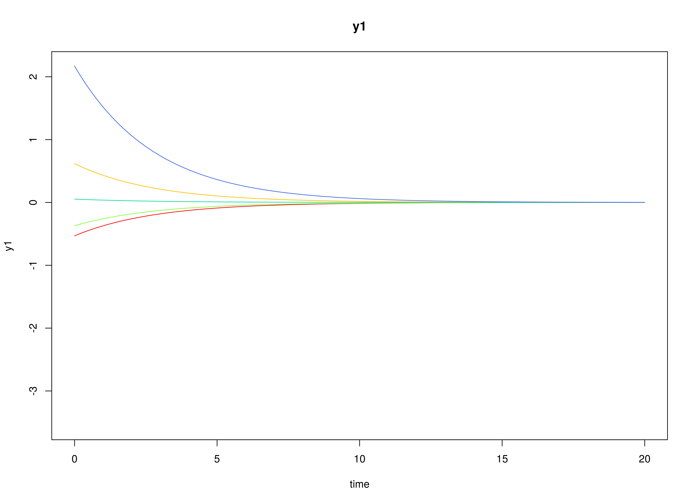
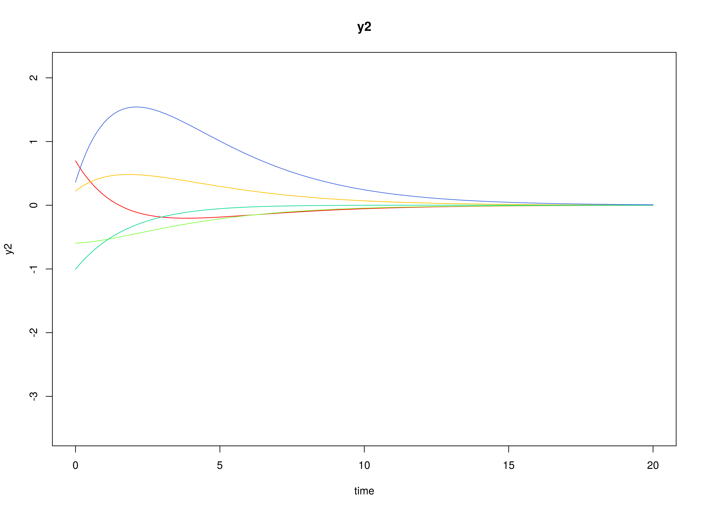
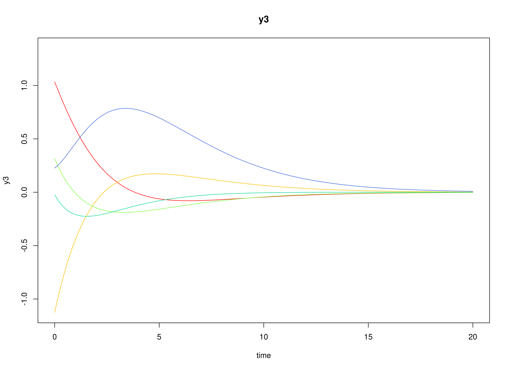
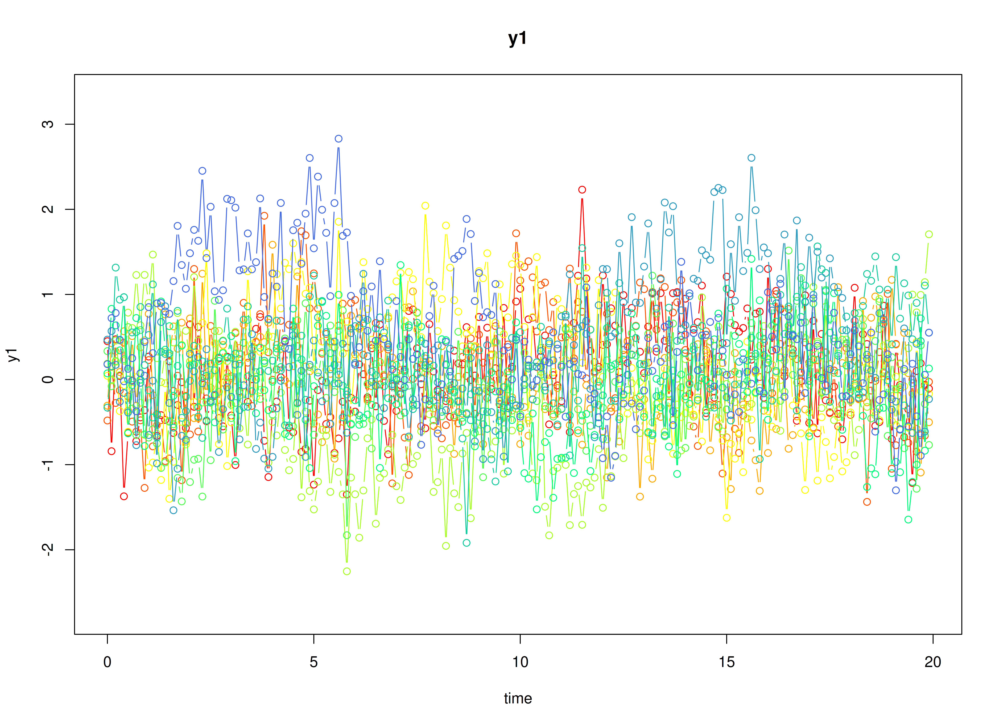
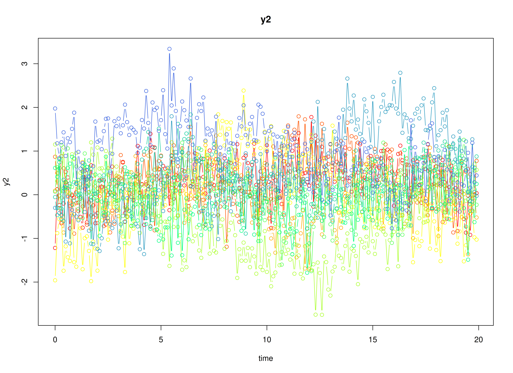
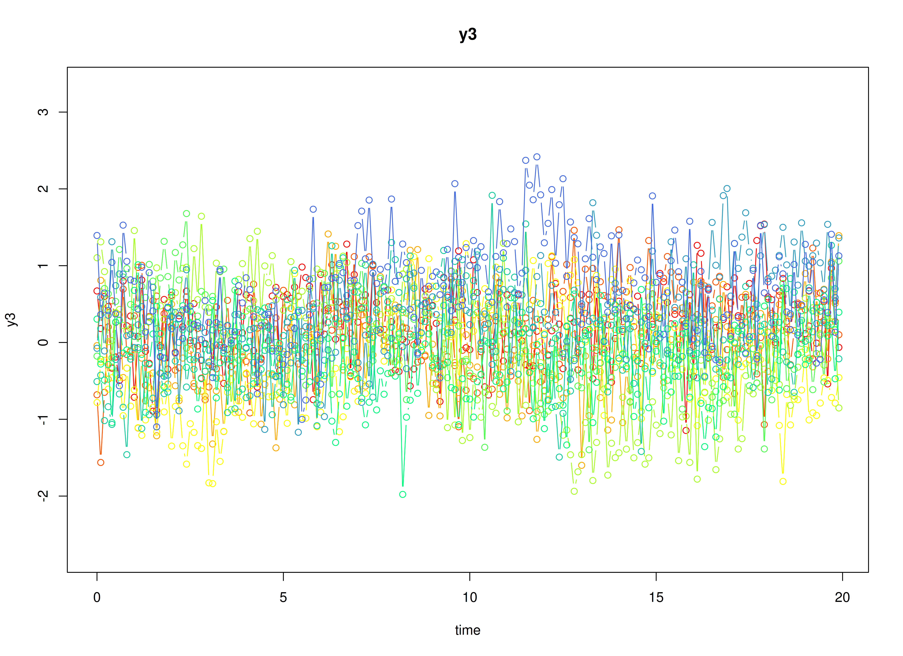
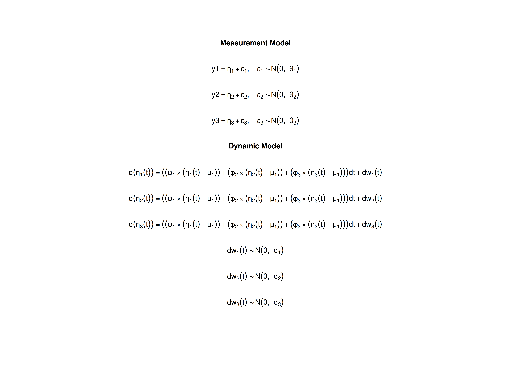

## Model

The measurement model is given by
\begin{equation}
  \mathbf{y}_{i, t}
  =
  \boldsymbol{\nu}
  +
  \boldsymbol{\Lambda}
  \boldsymbol{\eta}_{i, t}
  +
  \boldsymbol{\varepsilon}_{i, t},
  \quad
  \mathrm{with}
  \quad
  \boldsymbol{\varepsilon}_{i, t}
  \sim
  \mathcal{N}
  \left(
  \mathbf{0},
  \boldsymbol{\Theta}
  \right)
\end{equation}
where
$\mathbf{y}_{i, t}$,
$\boldsymbol{\eta}_{i, t}$,
and
$\boldsymbol{\varepsilon}_{i, t}$
are random variables
and
$\boldsymbol{\nu}$,
$\boldsymbol{\Lambda}$,
and
$\boldsymbol{\Theta}$
are model parameters.
$\mathbf{y}_{i, t}$
represents a vector of observed random variables,
$\boldsymbol{\eta}_{i, t}$
a vector of latent random variables,
and
$\boldsymbol{\varepsilon}_{i, t}$
a vector of random measurement errors,
at time $t$ and individual $i$.
$\boldsymbol{\nu}$
denotes a vector of intercepts,
$\boldsymbol{\Lambda}$
a matrix of factor loadings,
and
$\boldsymbol{\Theta}$
the covariance matrix of
$\boldsymbol{\varepsilon}$.

An alternative representation of the measurement error
is given by
\begin{equation}
  \boldsymbol{\varepsilon}_{i, t}
  =
  \boldsymbol{\Theta}^{\frac{1}{2}}
  \mathbf{z}_{i, t},
  \quad
  \mathrm{with}
  \quad
  \mathbf{z}_{i, t}
  \sim
  \mathcal{N}
  \left(
  \mathbf{0},
  \mathbf{I}
  \right)
\end{equation}
where
$\mathbf{z}_{i, t}$ is a vector of
independent standard normal random variables and
$\left( \boldsymbol{\Theta}^{\frac{1}{2}} \right) \left( \boldsymbol{\Theta}^{\frac{1}{2}} \right)^{\prime} = \boldsymbol{\Theta}$ .

The dynamic structure is given by
\begin{equation}
  \mathrm{d} \boldsymbol{\eta}_{i, t}
  =
  \boldsymbol{\Phi}
  \left(
  \boldsymbol{\eta}_{i, t}
  -
  \boldsymbol{\mu}
  \right)
  \mathrm{d}t
  +
  \boldsymbol{\Sigma}^{\frac{1}{2}}
  \mathrm{d}
  \mathbf{W}_{i, t}
\end{equation}
where
$\boldsymbol{\mu}$
is the long-term mean or equilibrium level,
$\boldsymbol{\Phi}$
is the rate of mean reversion,
determining how quickly the variable returns to its mean,
$\boldsymbol{\Sigma}$
is the matrix of volatility
or randomness in the process, and
$\mathrm{d}\boldsymbol{W}$
is a Wiener process or Brownian motion,
which represents random fluctuations.

## Data Generation

### Notation

Let $t = 200$ be the number of time points and $n = 10$ be the number of individuals.

Let the measurement model intecept vector $\boldsymbol{\nu}$ be given by

\begin{equation}
\boldsymbol{\nu}
=
\left(
\begin{array}{c}
  0 \\
  0 \\
  0 \\
\end{array}
\right) .
\end{equation}

Let the factor loadings matrix $\boldsymbol{\Lambda}$ be given by

\begin{equation}
\boldsymbol{\Lambda}
=
\left(
\begin{array}{ccc}
  1 & 0 & 0 \\
  0 & 1 & 0 \\
  0 & 0 & 1 \\
\end{array}
\right) .
\end{equation}

Let the measurement error covariance matrix $\boldsymbol{\Theta}$ be given by

\begin{equation}
\boldsymbol{\Theta}
=
\left(
\begin{array}{ccc}
  0.2 & 0 & 0 \\
  0 & 0.2 & 0 \\
  0 & 0 & 0.2 \\
\end{array}
\right) .
\end{equation}

Let the initial condition
$\boldsymbol{\eta}_{0}$
be given by

\begin{equation}
\boldsymbol{\eta}_{0} \sim \mathcal{N} \left( \boldsymbol{\mu}_{\boldsymbol{\eta} \mid 0}, \boldsymbol{\Sigma}_{\boldsymbol{\eta} \mid 0} \right)
\end{equation}

\begin{equation}
\boldsymbol{\mu}_{\boldsymbol{\eta} \mid 0}
=
\left(
\begin{array}{c}
  0 \\
  0 \\
  0 \\
\end{array}
\right)
\end{equation}

\begin{equation}
\boldsymbol{\Sigma}_{\boldsymbol{\eta} \mid 0}
=
\left(
\begin{array}{ccc}
  0.3425148 & 0.3296023 & 0.0343817 \\
  0.3296023 & 0.5664625 & 0.2545955 \\
  0.0343817 & 0.2545955 & 0.2999909 \\
\end{array}
\right) .
\end{equation}

Let the long-term mean vector $\boldsymbol{\mu}$ be given by

\begin{equation}
\boldsymbol{\mu}
=
\left(
\begin{array}{c}
  0 \\
  0 \\
  0 \\
\end{array}
\right) .
\end{equation}

Let the rate of mean reversion matrix $\boldsymbol{\Phi}$ be given by

\begin{equation}
\boldsymbol{\Phi}
=
\left(
\begin{array}{ccc}
  -0.357 & 0 & 0 \\
  0.771 & -0.511 & 0 \\
  -0.45 & 0.729 & -0.693 \\
\end{array}
\right) .
\end{equation}

Let the dynamic process noise covariance matrix $\boldsymbol{\Sigma}$ be given by

\begin{equation}
\boldsymbol{\Sigma}
=
\left(
\begin{array}{ccc}
  0.2445556 & 0.0220159 & -0.0500476 \\
  0.0220159 & 0.070678 & 0.0153946 \\
  -0.0500476 & 0.0153946 & 0.0755306 \\
\end{array}
\right) .
\end{equation}

Let $\Delta t = 0.1$.

### R Function Arguments


``` r
n
#> [1] 10
time
#> [1] 200
delta_t
#> [1] 0.1
mu0
#> [1] 0 0 0
sigma0
#>           [,1]      [,2]      [,3]
#> [1,] 0.3425148 0.3296023 0.0343817
#> [2,] 0.3296023 0.5664625 0.2545955
#> [3,] 0.0343817 0.2545955 0.2999909
sigma0_l # sigma0_l <- t(chol(sigma0))
#>            [,1]      [,2]      [,3]
#> [1,] 0.58524763 0.0000000 0.0000000
#> [2,] 0.56318429 0.4992855 0.0000000
#> [3,] 0.05874726 0.4436540 0.3157701
mu
#> [1] 0 0 0
phi
#>        [,1]   [,2]   [,3]
#> [1,] -0.357  0.000  0.000
#> [2,]  0.771 -0.511  0.000
#> [3,] -0.450  0.729 -0.693
sigma
#>             [,1]       [,2]        [,3]
#> [1,]  0.24455556 0.02201587 -0.05004762
#> [2,]  0.02201587 0.07067800  0.01539456
#> [3,] -0.05004762 0.01539456  0.07553061
sigma_l # sigma_l <- t(chol(sigma))
#>             [,1]      [,2]     [,3]
#> [1,]  0.49452559 0.0000000 0.000000
#> [2,]  0.04451917 0.2620993 0.000000
#> [3,] -0.10120330 0.0759256 0.243975
nu
#> [1] 0 0 0
lambda
#>      [,1] [,2] [,3]
#> [1,]    1    0    0
#> [2,]    0    1    0
#> [3,]    0    0    1
theta
#>      [,1] [,2] [,3]
#> [1,]  0.2  0.0  0.0
#> [2,]  0.0  0.2  0.0
#> [3,]  0.0  0.0  0.2
theta_l # theta_l <- t(chol(theta))
#>           [,1]      [,2]      [,3]
#> [1,] 0.4472136 0.0000000 0.0000000
#> [2,] 0.0000000 0.4472136 0.0000000
#> [3,] 0.0000000 0.0000000 0.4472136
```

### Visualizing the Dynamics Without Measurement Error and Process Noise (n = 5 with Different Initial Condition)



### Using the `SimSSMOUFixed` Function from the `simStateSpace` Package to Simulate Data


``` r
library(simStateSpace)
sim <- SimSSMOUFixed(
  n = n,
  time = time,
  delta_t = delta_t,
  mu0 = mu0,
  sigma0_l = sigma0_l,
  mu = mu,
  phi = phi,
  sigma_l = sigma_l,
  nu = nu,
  lambda = lambda,
  theta_l = theta_l,
  type = 0
)
data <- as.data.frame(sim)
head(data)
#>   id time          y1         y2         y3
#> 1  1  0.0  0.45047365 -1.2185550  0.6708638
#> 2  1  0.1 -0.84190461  0.1242594  0.1813493
#> 3  1  0.2  0.47289651 -0.2398710  0.5995107
#> 4  1  0.3  0.04089817 -0.6547109  0.4674929
#> 5  1  0.4 -1.37222946 -0.2010512 -0.3341885
#> 6  1  0.5 -0.62410106  0.5262251 -0.1892906
summary(data)
#>        id            time              y1                 y2         
#>  Min.   : 1.0   Min.   : 0.000   Min.   :-2.25288   Min.   :-2.7497  
#>  1st Qu.: 3.0   1st Qu.: 4.975   1st Qu.:-0.35833   1st Qu.:-0.3289  
#>  Median : 5.5   Median : 9.950   Median : 0.09071   Median : 0.1856  
#>  Mean   : 5.5   Mean   : 9.950   Mean   : 0.11195   Mean   : 0.1852  
#>  3rd Qu.: 8.0   3rd Qu.:14.925   3rd Qu.: 0.54617   3rd Qu.: 0.6858  
#>  Max.   :10.0   Max.   :19.900   Max.   : 2.83007   Max.   : 3.3403  
#>        y3         
#>  Min.   :-1.9782  
#>  1st Qu.:-0.3253  
#>  Median : 0.1306  
#>  Mean   : 0.1034  
#>  3rd Qu.: 0.5321  
#>  Max.   : 2.4172
plot(sim)
```



## Model Fitting

### Prepare Data


``` r
dynr_data <- dynr::dynr.data(
  dataframe = data,
  id = "id",
  time = "time",
  observed = c("y1", "y2", "y3")
)
```

### Prepare Initial Condition


``` r
dynr_initial <- dynr::prep.initial(
  values.inistate = mu0,
  params.inistate = c("mu0_1_1", "mu0_2_1", "mu0_3_1"),
  values.inicov = sigma0,
  params.inicov = matrix(
    data = c(
      "sigma0_1_1", "sigma0_2_1", "sigma0_3_1",
      "sigma0_2_1", "sigma0_2_2", "sigma0_3_2",
      "sigma0_3_1", "sigma0_3_2", "sigma0_3_3"
    ),
    nrow = 3
  )
)
```

### Prepare Measurement Model


``` r
dynr_measurement <- dynr::prep.measurement(
  values.load = diag(3),
  params.load = matrix(data = "fixed", nrow = 3, ncol = 3),
  state.names = c("eta_1", "eta_2", "eta_3"),
  obs.names = c("y1", "y2", "y3")
)
```

### Prepare Dynamic Process


``` r
dynr_dynamics <- dynr::prep.formulaDynamics(
  formula = list(  
    eta_1 ~ (phi_1_1 * (eta_1 - mu_1_1)) + (phi_1_2 * (eta_2 - mu_2_1)) + (phi_1_3 * (eta_3 - mu_3_1)),
    eta_2 ~ (phi_2_1 * (eta_1 - mu_1_1)) + (phi_2_2 * (eta_2 - mu_2_1)) + (phi_2_3 * (eta_3 - mu_3_1)),
    eta_3 ~ (phi_3_1 * (eta_1 - mu_1_1)) + (phi_3_2 * (eta_2 - mu_2_1)) + (phi_3_3 * (eta_3 - mu_3_1))
  ),
  startval = c(
    mu_1_1 = mu[1], mu_2_1 = mu[2], mu_3_1 = mu[3],
    phi_1_1 = phi[1, 1], phi_1_2 = phi[1, 2], phi_1_3 = phi[1, 3],
    phi_2_1 = phi[2, 1], phi_2_2 = phi[2, 2], phi_2_3 = phi[2, 3],
    phi_3_1 = phi[3, 1], phi_3_2 = phi[3, 2], phi_3_3 = phi[3, 3]
  ),
  isContinuousTime = TRUE
)
```

### Prepare Process Noise


``` r
dynr_noise <- dynr::prep.noise(
  values.latent = sigma,
  params.latent = matrix(
    data = c(
      "sigma_1_1", "sigma_2_1", "sigma_3_1",
      "sigma_2_1", "sigma_2_2", "sigma_3_2",
      "sigma_3_1", "sigma_3_2", "sigma_3_3"
    ),
    nrow = 3
  ),
  values.observed = theta,
  params.observed = matrix(
    data = c(
      "theta_1_1", "fixed", "fixed",
      "fixed", "theta_2_2", "fixed",
      "fixed", "fixed", "theta_3_3"
    ),
    nrow = 3
  )
)
```

### Prepare the Model


``` r
model <- dynr::dynr.model(
  data = dynr_data,
  initial = dynr_initial,
  measurement = dynr_measurement,
  dynamics = dynr_dynamics,
  noise = dynr_noise,
  outfile = "ou.c"
)
```

Add lower and upper bounds to aid in the optimization.


``` r
model$lb[
  c(
    "phi_1_1",
    "phi_1_2",
    "phi_1_3",
    "phi_2_1",
    "phi_2_2",
    "phi_2_3",
    "phi_3_1",
    "phi_3_2",
    "phi_3_3"
  )
] <- -1.5
model$ub[
  c(
    "phi_1_1",
    "phi_1_2",
    "phi_1_3",
    "phi_2_1",
    "phi_2_2",
    "phi_2_3",
    "phi_3_1",
    "phi_3_2",
    "phi_3_3"
  )
] <- +1.5
```



### Fit the Model


``` r
results <- dynr::dynr.cook(
  model,
  debug_flag = TRUE,
  verbose = FALSE
)
#> [1] "Get ready!!!!"
#> using C compiler: ‘gcc (Ubuntu 13.3.0-6ubuntu2~24.04.1) 13.3.0’
#> Optimization function called.
#> Starting Hessian calculation ...
#> Finished Hessian calculation.
#> Original exit flag:  3 
#> Modified exit flag:  3 
#> Optimization terminated successfully: ftol_rel or ftol_abs was reached. 
#> Original fitted parameters:  0.08283144 0.1453763 0.09458133 -0.7229715 
#> 0.3040495 -0.1753704 0.6566509 -0.4967513 0.04628819 -0.1656435 0.4463284 
#> -0.4893126 -1.260945 0.07872374 -0.2825057 -2.53622 0.1628742 -3.298738 
#> -1.633867 -1.639133 -1.59292 0.1528623 0.08530866 0.0648912 -4.928975 7.66686 
#> 4.019894 -3.32551 -1.394416 -7.401379 
#> 
#> Transformed fitted parameters:  0.08283144 0.1453763 0.09458133 -0.7229715 
#> 0.3040495 -0.1753704 0.6566509 -0.4967513 0.04628819 -0.1656435 0.4463284 
#> -0.4893126 0.283386 0.0223092 -0.08005815 0.08092138 0.006591481 0.06164672 
#> 0.1951734 0.1941483 0.203331 0.1528623 0.08530866 0.0648912 0.007233912 
#> 0.05546139 0.02907956 0.4611689 0.1728138 0.1874164 
#> 
#> Doing end processing
#> Warning in sqrt(diag(x$inv.hessian)): NaNs produced
#> Successful trial
#> Total Time: 1.959645 
#> Backend Time: 1.942731
```

## Summary


``` r
summary(results)
#> Coefficients:
#>             Estimate Std. Error t value  ci.lower  ci.upper Pr(>|t|)    
#> mu_1_1      0.082831   0.094877   0.873 -0.103124  0.268787   0.1914    
#> mu_2_1      0.145376   0.150119   0.968 -0.148851  0.439604   0.1665    
#> mu_3_1      0.094581   0.095324   0.992 -0.092250  0.281413   0.1606    
#> phi_1_1    -0.722972   0.304583  -2.374 -1.319943 -0.126000   0.0089 ** 
#> phi_1_2     0.304050   0.268004   1.134 -0.221230  0.829329   0.1284    
#> phi_1_3    -0.175370   0.213814  -0.820 -0.594438  0.243697   0.2061    
#> phi_2_1     0.656651   0.195301   3.362  0.273868  1.039433   0.0004 ***
#> phi_2_2    -0.496751   0.175118  -2.837 -0.839975 -0.153527   0.0023 ** 
#> phi_2_3     0.046288   0.136213   0.340 -0.220684  0.313261   0.3670    
#> phi_3_1    -0.165643   0.173438  -0.955 -0.505575  0.174288   0.1698    
#> phi_3_2     0.446328   0.154272   2.893  0.143962  0.748695   0.0019 ** 
#> phi_3_3    -0.489313   0.121141  -4.039 -0.726745 -0.251880   <2e-16 ***
#> sigma_1_1   0.283386   0.055981   5.062  0.173664  0.393107   <2e-16 ***
#> sigma_2_1   0.022309   0.022335   0.999 -0.021467  0.066086   0.1590    
#> sigma_3_1  -0.080058   0.022192  -3.608 -0.123553 -0.036563   0.0002 ***
#> sigma_2_2   0.080921   0.016739   4.834  0.048113  0.113729   <2e-16 ***
#> sigma_3_2   0.006591   0.010735   0.614 -0.014449  0.027632   0.2696    
#> sigma_3_3   0.061647   0.014056   4.386  0.034098  0.089195   <2e-16 ***
#> theta_1_1   0.195173   0.008275  23.587  0.178956  0.211391   <2e-16 ***
#> theta_2_2   0.194148   0.007030  27.618  0.180370  0.207926   <2e-16 ***
#> theta_3_3   0.203331   0.007207  28.211  0.189205  0.217457   <2e-16 ***
#> mu0_1_1     0.152862   0.089204   1.714 -0.021974  0.327698   0.0434 *  
#> mu0_2_1     0.085309   0.226054   0.377 -0.357749  0.528367   0.3530    
#> mu0_3_1     0.064891   0.151573   0.428 -0.232187  0.361969   0.3343    
#> sigma0_1_1  0.007234   0.016038   0.451 -0.024200  0.038668   0.3260    
#> sigma0_2_1  0.055461   0.062418   0.889 -0.066875  0.177798   0.1872    
#> sigma0_3_1  0.029080   0.041812   0.695 -0.052871  0.111030   0.2434    
#> sigma0_2_2  0.461169   0.228771   2.016  0.012785  0.909553   0.0220 *  
#> sigma0_3_2  0.172814   0.121690   1.420 -0.065694  0.411321   0.0779 .  
#> sigma0_3_3  0.187416   0.102727   1.824 -0.013924  0.388757   0.0341 *  
#> ---
#> Signif. codes:  0 '***' 0.001 '**' 0.01 '*' 0.05 '.' 0.1 ' ' 1
#> 
#> -2 log-likelihood value at convergence = 8521.43
#> AIC = 8581.43
#> BIC = 8749.46
```


### Parameter Estimates


``` r
mu_hat
#> [1] 0.08283144 0.14537632 0.09458133
phi_hat
#>            [,1]       [,2]        [,3]
#> [1,] -0.7229715  0.3040495 -0.17537045
#> [2,]  0.6566509 -0.4967513  0.04628819
#> [3,] -0.1656435  0.4463284 -0.48931262
sigma_hat
#>             [,1]        [,2]         [,3]
#> [1,]  0.28338597 0.022309204 -0.080058151
#> [2,]  0.02230920 0.080921382  0.006591481
#> [3,] -0.08005815 0.006591481  0.061646718
theta_hat
#>           [,1]      [,2]     [,3]
#> [1,] 0.1951734 0.0000000 0.000000
#> [2,] 0.0000000 0.1941483 0.000000
#> [3,] 0.0000000 0.0000000 0.203331
mu0_hat
#> [1] 0.15286229 0.08530866 0.06489120
sigma0_hat
#>             [,1]       [,2]       [,3]
#> [1,] 0.007233912 0.05546139 0.02907956
#> [2,] 0.055461391 0.46116889 0.17281383
#> [3,] 0.029079563 0.17281383 0.18741639
beta_var1_hat <- simStateSpace::ExpMat(phi_hat)
beta_var1_hat
#>              [,1]      [,2]         [,3]
#> [1,]  0.541538486 0.1495829 -0.095629580
#> [2,]  0.369668974 0.6672313 -0.003926662
#> [3,] -0.009502609 0.2683484  0.622663227
```

## References


