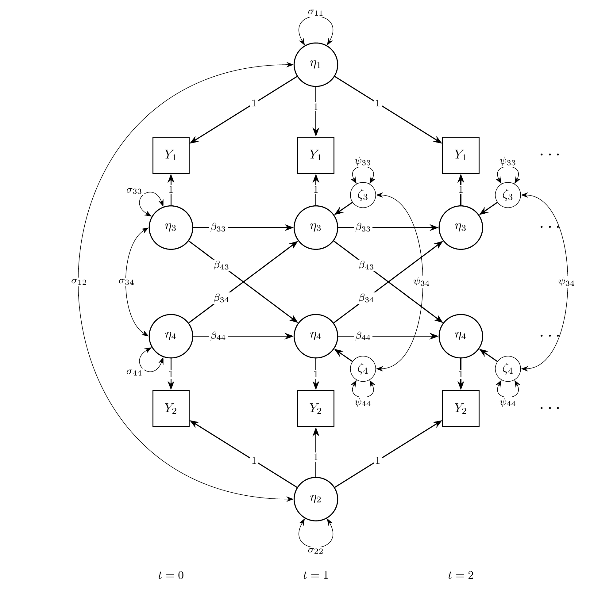
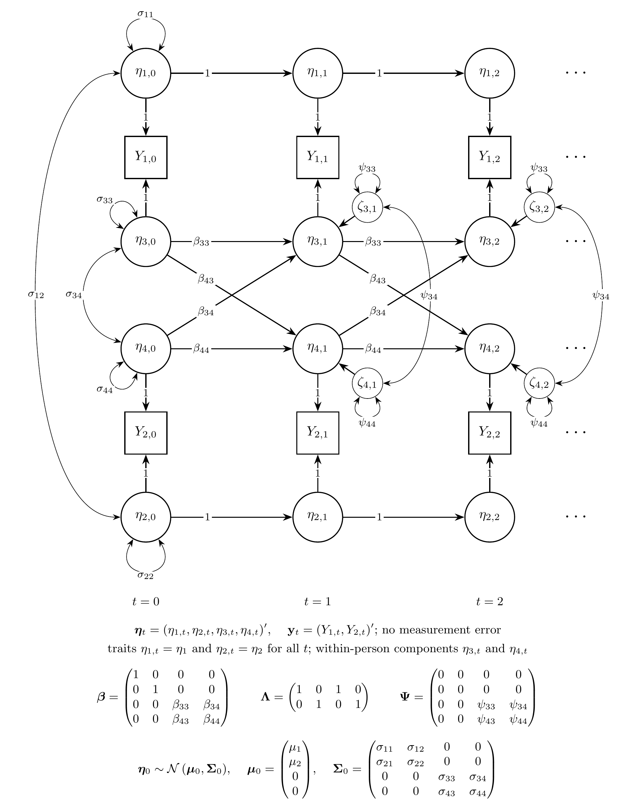
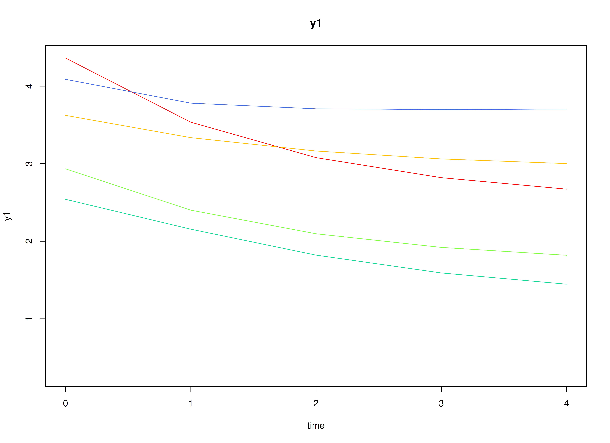
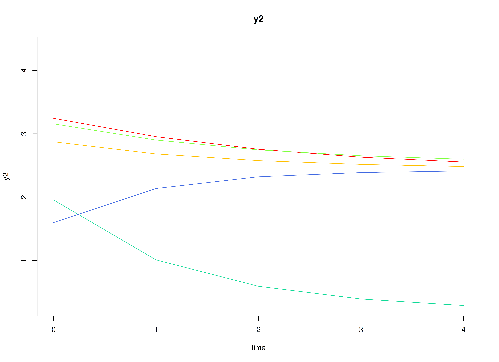
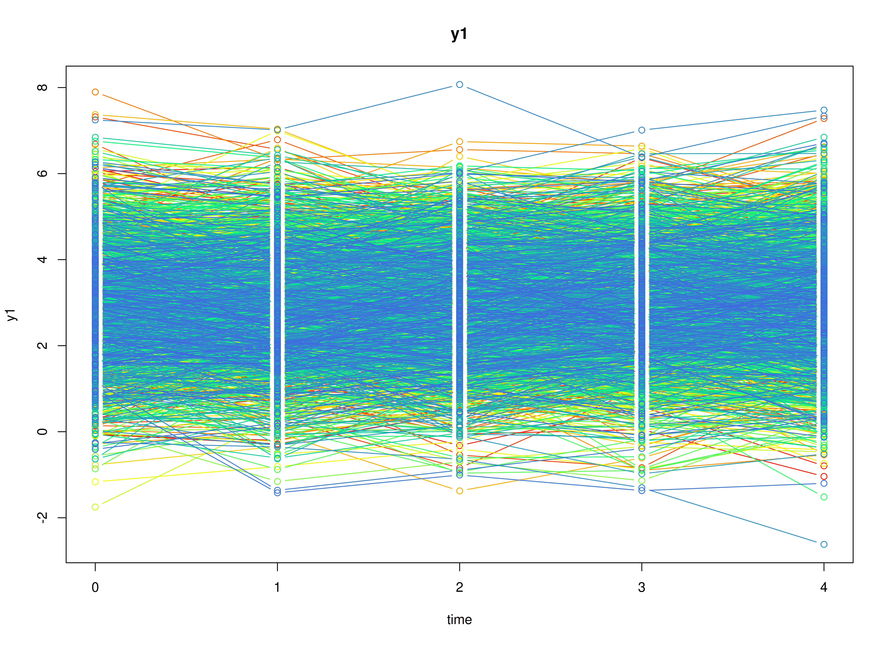
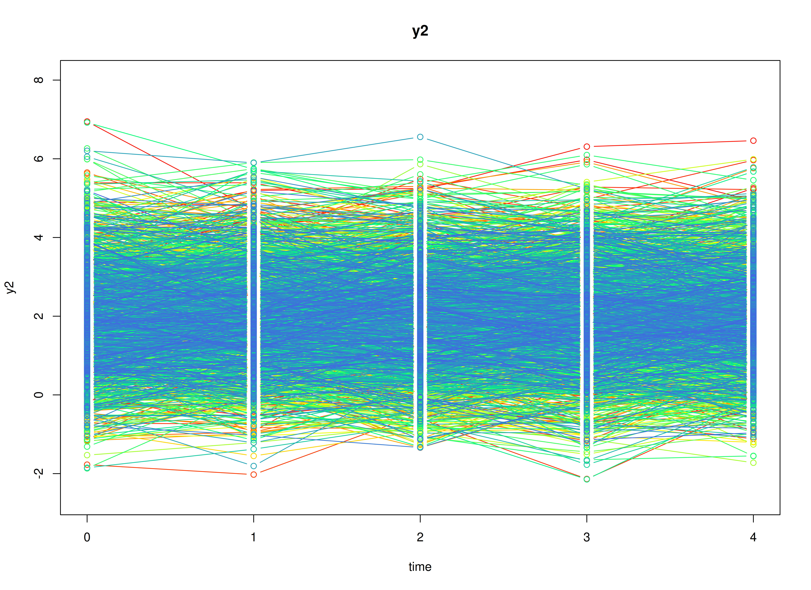
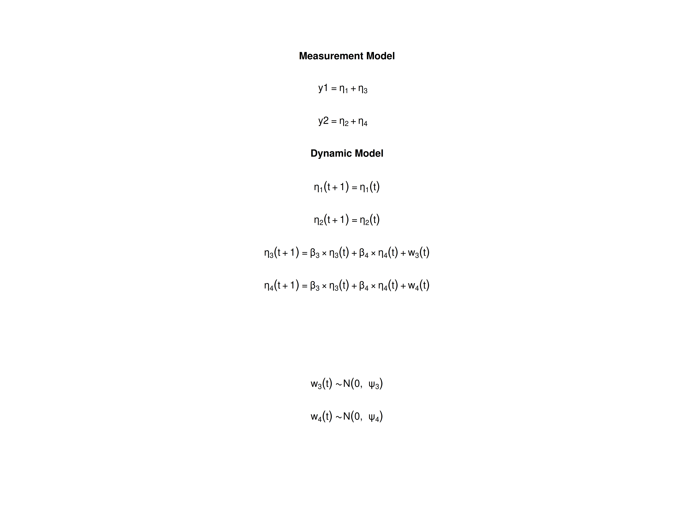

## Overview

The random intercept cross-lagged panel model (RI-CLPM)
studies how two variables measured on the same individuals
over several occasions relate to each other over time,
for example, self-esteem and depression measured once a year
[@Hamaker-Kuiper-Grasman-2015].
Each individual has a stable level on each variable, called a trait,
and fluctuates around it from occasion to occasion.
The model separates the two:
the traits describe stable differences between individuals,
and the cross-lagged effects describe how a fluctuation in one variable
is followed by a fluctuation in the other at the next occasion,
within the same individual.
The traditional cross-lagged panel model (CLPM) has no traits,
so it mixes the two kinds of differences;
it is the VAR model in the vignette on vector autoregressive models,
fitted to panel data.

The RI-CLPM is usually fitted as a structural equation model (SEM)
[@Mulder-Hamaker-2021].
It can also be written as a state space model:
the traits are latent states that never change,
and the within-person components are latent states
that follow a vector autoregressive process.

This tutorial does three things:

1. It writes the RI-CLPM as a state space model.
2. It simulates data from the model with `SimSSMFixed()`.
3. It fits the model to the simulated data
   as a state space model with `dynr` and `OpenMx`
   and as a structural equation model (SEM) with `lavaan` and `OpenMx`,
   and compares every set of estimates with the values used to simulate the data.

No prior knowledge of state space models is needed.


## Model

The measurement model is given by
$$
  \left(
  \begin{array}{c}
    Y_{1_{i, t}} \\
    Y_{2_{i, t}} \\
  \end{array}
  \right)
  =
  \left(
  \begin{array}{cccc}
    1 & 0 & 1 & 0 \\
    0 & 1 & 0 & 1 \\
  \end{array}
  \right)
  \left(
  \begin{array}{c}
    \eta_{1_{i, t}} \\
    \eta_{2_{i, t}} \\
    \eta_{3_{i, t}} \\
    \eta_{4_{i, t}} \\
  \end{array}
  \right)
$$
where $Y_{1_{i, t}}$ and $Y_{2_{i, t}}$
are the two observed variables
at time $t$ and individual $i$,
$\eta_{1_{i, t}}$ and $\eta_{2_{i, t}}$
are the traits of the two variables,
and
$\eta_{3_{i, t}}$ and $\eta_{4_{i, t}}$
are their within-person components.

In words,
each observed score is the individual's trait
plus the individual's deviation from it on that occasion.
As in most applications of the RI-CLPM,
there is no measurement error.

The dynamic structure is given by
$$
  \left(
  \begin{array}{c}
    \eta_{1_{i, t}} \\
    \eta_{2_{i, t}} \\
    \eta_{3_{i, t}} \\
    \eta_{4_{i, t}} \\
  \end{array}
  \right)
  =
  \left(
  \begin{array}{cccc}
    1 & 0 & 0 & 0 \\
    0 & 1 & 0 & 0 \\
    0 & 0 & \beta_{33} & \beta_{34} \\
    0 & 0 & \beta_{43} & \beta_{44} \\
  \end{array}
  \right)
  \left(
  \begin{array}{c}
    \eta_{1_{i, t - 1}} \\
    \eta_{2_{i, t - 1}} \\
    \eta_{3_{i, t - 1}} \\
    \eta_{4_{i, t - 1}} \\
  \end{array}
  \right)
  +
  \left(
  \begin{array}{c}
    0 \\
    0 \\
    \zeta_{3_{i, t}} \\
    \zeta_{4_{i, t}} \\
  \end{array}
  \right),
  \quad
  \mathrm{with}
  \quad
  \left(
  \begin{array}{c}
    \zeta_{3_{i, t}} \\
    \zeta_{4_{i, t}} \\
  \end{array}
  \right)
  \sim
  \mathcal{N}
  \left(
  \mathbf{0},
  \left(
  \begin{array}{cc}
    \psi_{33} & \psi_{34} \\
    \psi_{43} & \psi_{44} \\
  \end{array}
  \right)
  \right) .
$$

In words,
the traits stay the same over time:
the first two rows have a 1 on the diagonal and no process noise.
The within-person components follow a vector autoregressive process.
$\beta_{33}$ and $\beta_{44}$ are the autoregressive effects:
how much of an individual's deviation from the trait
carries over to the next occasion.
$\beta_{34}$ and $\beta_{43}$ are the cross-lagged effects:
$\beta_{34}$ is the effect of a deviation in the second variable
on the deviation in the first variable at the next occasion,
and $\beta_{43}$ the reverse.
$\psi_{33}$, $\psi_{44}$, and $\psi_{34}$
are the variances and covariance of the new, unpredictable part
of the deviations on each occasion.

The initial condition is given by
$$
  \boldsymbol{\eta}_{i, 0}
  \sim
  \mathcal{N}
  \left(
  \boldsymbol{\mu}_{0},
  \boldsymbol{\Sigma}_{0}
  \right)
$$

$$
  \boldsymbol{\mu}_{0}
  =
  \left(
  \begin{array}{c}
    \mu_{1} \\
    \mu_{2} \\
    0 \\
    0 \\
  \end{array}
  \right) \quad \mathrm{and,}
  \quad
  \boldsymbol{\Sigma}_{0}
  =
  \left(
  \begin{array}{cccc}
    \sigma_{11} & \sigma_{12} & 0 & 0 \\
    \sigma_{21} & \sigma_{22} & 0 & 0 \\
    0 & 0 & \sigma_{33} & \sigma_{34} \\
    0 & 0 & \sigma_{43} & \sigma_{44} \\
  \end{array}
  \right) .
$$

Here, $\mu_{1}$ and $\mu_{2}$ are the average traits,
$\sigma_{11}$, $\sigma_{22}$, and $\sigma_{12}$
are how much individuals differ in their traits
and how the two traits covary,
for example, positive if individuals with higher self-esteem
also tend to have higher well-being.
The within-person components have mean zero,
because they are deviations from the traits,
and are uncorrelated with the traits.
$\sigma_{33}$, $\sigma_{44}$, and $\sigma_{34}$
are their variances and covariance at the first occasion.

### Diagrams


{width=100%}

The RI-CLPM as a path diagram, for the first three occasions ($t = 0, 1, 2$).
Squares are observed variables and circles are latent variables.
The traits $\eta_{1}$ and $\eta_{2}$ load on every occasion with a loading of 1, have variances $\sigma_{11}$ and $\sigma_{22}$, and covary ($\sigma_{12}$).
The within-person components $\eta_{3}$ and $\eta_{4}$ carry the dynamics: the horizontal arrows are the autoregressive effects and the diagonal arrows the cross-lagged effects.
$\zeta_{3}$ and $\zeta_{4}$ are the new parts of the deviations on each occasion, with variances $\psi_{33}$ and $\psi_{44}$ and covariance $\psi_{34}$;
$\sigma_{33}$, $\sigma_{44}$, and $\sigma_{34}$ are the variances and covariance of the within-person components at $t = 0$.
A loop on a variable is its variance and a curved two-headed arrow a covariance.

{width=100%}

The same model in state space form, for the first three occasions, with every element of the state drawn.
The traits are states with a transition of 1 and no process noise, so they keep their values over time: $\eta_{1, t} = \eta_{1}$ and $\eta_{2, t} = \eta_{2}$ for all $t$.
Each observed variable $Y_{j, t}$ is its trait plus its within-person component, both with a loading of 1.
The within-person components $\eta_{3, t}$ and $\eta_{4, t}$ carry the dynamics and receive the process noise $\zeta_{3, t}$ and $\zeta_{4, t}$ from $t = 1$ on.
At $t = 0$, the initial condition $\boldsymbol{\eta}_{0} \sim \mathcal{N} \left( \boldsymbol{\mu}_{0}, \boldsymbol{\Sigma}_{0} \right)$ gives the variances and covariances at $t = 0$: the traits and the within-person components do not covary.
Below the diagram, all the latent variables at one occasion form the state vector $\boldsymbol{\eta}_{t}$, and all the observed variables form $\mathbf{y}_{t}$:
$\boldsymbol{\beta}$ carries the state from one occasion to the next, $\boldsymbol{\Lambda}$ maps the state to the observed variables, and $\boldsymbol{\Psi}$ is the covariance matrix of the process noise $\boldsymbol{\zeta}_{t}$.
`SimSSMFixed()` takes `beta`, `lambda`, `mu0`, and the Cholesky factors of $\boldsymbol{\Psi}$ and $\boldsymbol{\Sigma}_{0}$ (`psi_l` and `sigma0_l`);
`theta_l` is a matrix of zeros.

## Data Generation

### Notation

Let $t = 5$ be the number of time points and $n = 2000$ be the number of individuals.

Let the traits have the means and the covariance matrix

$$
\left(
\begin{array}{c}
  \mu_{1} \\
  \mu_{2} \\
\end{array}
\right)
=
\left(
\begin{array}{c}
  3 \\
  2 \\
\end{array}
\right)
\quad \mathrm{and,} \quad
\left(
\begin{array}{cc}
  \sigma_{11} & \sigma_{12} \\
  \sigma_{21} & \sigma_{22} \\
\end{array}
\right)
=
\left(
\begin{array}{cc}
  1 & 0.5 \\
  0.5 & 1 \\
\end{array}
\right) .
$$

Let the autoregressive and cross-lagged effects
and the process noise covariance matrix be

$$
\left(
\begin{array}{cc}
  \beta_{33} & \beta_{34} \\
  \beta_{43} & \beta_{44} \\
\end{array}
\right)
=
\left(
\begin{array}{cc}
  0.5 & 0.15 \\
  0.1 & 0.4 \\
\end{array}
\right)
\quad \mathrm{and,} \quad
\left(
\begin{array}{cc}
  \psi_{33} & \psi_{34} \\
  \psi_{43} & \psi_{44} \\
\end{array}
\right)
=
\left(
\begin{array}{cc}
  0.5 & 0.1 \\
  0.1 & 0.5 \\
\end{array}
\right) .
$$

The within-person components start from their stationary distribution:
their covariance matrix at the first occasion is the one they keep
at every later occasion,
computed with `SSMCovEta()` from the autoregressive and cross-lagged effects
and the process noise covariance matrix,

$$
\left(
\begin{array}{cc}
  \sigma_{33} & \sigma_{34} \\
  \sigma_{43} & \sigma_{44} \\
\end{array}
\right)
=
\left(
\begin{array}{cc}
  0.73 & 0.222 \\
  0.222 & 0.625 \\
\end{array}
\right) .
$$

### R Function Arguments

The simulation functions take covariance matrices
as lower triangular Cholesky factors (the arguments ending in `_l`).
Because the traits have no process noise and there is no measurement error,
`psi` and `theta` have rows and columns of zeros,
and their Cholesky factors are built block by block.


``` r
n
#> [1] 2000
time
#> [1] 5
mu0
#> [1] 3 2 0 0
sigma0
#>      [,1] [,2]      [,3]      [,4]
#> [1,]  1.0  0.5 0.0000000 0.0000000
#> [2,]  0.5  1.0 0.0000000 0.0000000
#> [3,]  0.0  0.0 0.7297462 0.2216425
#> [4,]  0.0  0.0 0.2216425 0.6250344
sigma0_l # sigma0_l <- t(chol(sigma0))
#>      [,1]      [,2]      [,3]      [,4]
#> [1,]  1.0 0.0000000 0.0000000 0.0000000
#> [2,]  0.5 0.8660254 0.0000000 0.0000000
#> [3,]  0.0 0.0000000 0.8542518 0.0000000
#> [4,]  0.0 0.0000000 0.2594580 0.7468038
alpha
#> [1] 0 0 0 0
beta
#>      [,1] [,2] [,3] [,4]
#> [1,]    1    0  0.0 0.00
#> [2,]    0    1  0.0 0.00
#> [3,]    0    0  0.5 0.15
#> [4,]    0    0  0.1 0.40
psi
#>      [,1] [,2] [,3] [,4]
#> [1,]    0    0  0.0  0.0
#> [2,]    0    0  0.0  0.0
#> [3,]    0    0  0.5  0.1
#> [4,]    0    0  0.1  0.5
psi_l
#>      [,1] [,2]      [,3]      [,4]
#> [1,]    0    0 0.0000000 0.0000000
#> [2,]    0    0 0.0000000 0.0000000
#> [3,]    0    0 0.7071068 0.0000000
#> [4,]    0    0 0.1414214 0.6928203
nu
#> [1] 0 0
lambda
#>      [,1] [,2] [,3] [,4]
#> [1,]    1    0    1    0
#> [2,]    0    1    0    1
theta
#>      [,1] [,2]
#> [1,]    0    0
#> [2,]    0    0
theta_l
#>      [,1] [,2]
#> [1,]    0    0
#> [2,]    0    0
```

### Visualizing the Dynamics Without Process Noise (n = 5 with Different Initial Condition)

Without process noise,
each individual's deviations shrink toward zero,
so each trajectory settles at the individual's trait.



### Using the `SimSSMFixed` Function from the `simStateSpace` Package to Simulate Data

Now we add the process noise and simulate the full data set.
`as.data.frame()` returns the data in long format,
one row per individual and time point,
with the columns `id`, `time`, `y1`, and `y2`.


``` r
library(simStateSpace)
sim <- SimSSMFixed(
  n = n,
  time = time,
  mu0 = mu0,
  sigma0_l = sigma0_l,
  alpha = alpha,
  beta = beta,
  psi_l = psi_l,
  nu = nu,
  lambda = lambda,
  theta_l = theta_l,
  type = 0
)
data <- as.data.frame(sim)
head(data)
#>   id time       y1         y2
#> 1  1    0 4.785347  3.5092972
#> 2  1    1 4.758437  3.4784088
#> 3  1    2 4.250888  3.0461680
#> 4  1    3 4.140226  3.8609873
#> 5  1    4 3.736337  4.0710355
#> 6  2    0 3.817745 -0.2774656
summary(data)
#>        id              time         y1               y2        
#>  Min.   :   1.0   Min.   :0   Min.   :-2.619   Min.   :-2.146  
#>  1st Qu.: 500.8   1st Qu.:1   1st Qu.: 2.077   1st Qu.: 1.112  
#>  Median :1000.5   Median :2   Median : 2.978   Median : 1.968  
#>  Mean   :1000.5   Mean   :2   Mean   : 2.983   Mean   : 1.988  
#>  3rd Qu.:1500.2   3rd Qu.:3   3rd Qu.: 3.902   3rd Qu.: 2.837  
#>  Max.   :2000.0   Max.   :4   Max.   : 8.071   Max.   : 6.948
plot(sim)
```



## Model Fitting

The same simulated data are fitted
as a state space model with `dynr` and `OpenMx`
and as a structural equation model (SEM) with `lavaan` and `OpenMx`.
All of them estimate the parameters by maximum likelihood.
The section Population Values and Estimates
compares their estimates with the population values.

### dynr

We fit the model with `dynr`,
which estimates state space models by maximum likelihood
using the Kalman filter.

A `dynr` model is built from pieces that match the equations above:
the data, the initial condition, the measurement model,
the dynamic model, and the noise.
Each parameter gets a name (for example, `beta_3_4` for $\beta_{34}$),
and the same name used in two places means one shared parameter.
The starting values are set to the population values for convenience;
with real data, they would be rough guesses.

#### Prepare Data

Tell `dynr` which columns hold the individual, the time, and the observed variables.


``` r
dynr_data <- dynr::dynr.data(
  dataframe = data,
  id = "id",
  time = "time",
  observed = c("y1", "y2")
)
```

#### Prepare Initial Condition

The means of the traits are estimated;
the means of the within-person components are fixed at zero.
The covariance matrix has two free blocks,
the traits and the within-person components at the first occasion;
the covariances between the blocks are fixed at zero.


``` r
dynr_initial <- dynr::prep.initial(
  values.inistate = mu0,
  params.inistate = c("mu0_1_1", "mu0_2_1", "fixed", "fixed"),
  values.inicov = sigma0,
  params.inicov = matrix(
    data = c(
      "sigma0_1_1", "sigma0_2_1", "fixed", "fixed",
      "sigma0_2_1", "sigma0_2_2", "fixed", "fixed",
      "fixed", "fixed", "sigma0_3_3", "sigma0_4_3",
      "fixed", "fixed", "sigma0_4_3", "sigma0_4_4"
    ),
    nrow = 4
  )
)
```

#### Prepare Measurement Model

The loadings are fixed:
each observed variable is its trait plus its within-person component.


``` r
dynr_measurement <- dynr::prep.measurement(
  values.load = lambda,
  params.load = matrix(data = "fixed", nrow = 2, ncol = 4),
  state.names = c("eta_1", "eta_2", "eta_3", "eta_4"),
  obs.names = c("y1", "y2")
)
```

#### Prepare Dynamic Process

Each formula is one row of the dynamic equation.
The traits carry over unchanged;
the within-person components have the autoregressive
and cross-lagged effects.


``` r
dynr_dynamics <- dynr::prep.formulaDynamics(
  formula = list(
    eta_1 ~ eta_1,
    eta_2 ~ eta_2,
    eta_3 ~ beta_3_3 * eta_3 + beta_3_4 * eta_4,
    eta_4 ~ beta_4_3 * eta_3 + beta_4_4 * eta_4
  ),
  startval = c(
    beta_3_3 = beta[3, 3], beta_3_4 = beta[3, 4],
    beta_4_3 = beta[4, 3], beta_4_4 = beta[4, 4]
  ),
  isContinuousTime = FALSE
)
```

#### Prepare Process Noise

Only the within-person components have process noise.
The measurement error is fixed at zero.


``` r
dynr_noise <- dynr::prep.noise(
  values.latent = psi,
  params.latent = matrix(
    data = c(
      "fixed", "fixed", "fixed", "fixed",
      "fixed", "fixed", "fixed", "fixed",
      "fixed", "fixed", "psi_3_3", "psi_4_3",
      "fixed", "fixed", "psi_4_3", "psi_4_4"
    ),
    nrow = 4
  ),
  values.observed = theta,
  params.observed = matrix(data = "fixed", nrow = 2, ncol = 2)
)
```

#### Prepare the Model

The pieces are put together into one model.
`dynr` writes the model as C code to `outfile` and compiles it.


``` r
model <- dynr::dynr.model(
  data = dynr_data,
  initial = dynr_initial,
  measurement = dynr_measurement,
  dynamics = dynr_dynamics,
  noise = dynr_noise,
  outfile = "ri-clpm.c"
)
```

The plot below shows the model equations with the parameter names.



#### Fit the Model


``` r
results <- dynr::dynr.cook(
  model,
  debug_flag = TRUE,
  verbose = FALSE
)
#> [1] "Get ready!!!!"
#> using C compiler: ‘gcc (Ubuntu 15.2.0-16ubuntu1) 15.2.0’
#> Optimization function called.
#> Starting Hessian calculation ...
#> Finished Hessian calculation.
#> Original exit flag:  3 
#> Modified exit flag:  3 
#> Optimization terminated successfully: ftol_rel or ftol_abs was reached. 
#> Original fitted parameters:  0.4687625 0.1400854 0.06179287 0.3956198 
#> -0.6977308 0.1725888 -0.7642126 2.987923 1.991662 0.07834838 0.4952377 
#> -0.2896519 -0.3914968 0.319038 -0.5485416 
#> 
#> Transformed fitted parameters:  0.4687625 0.1400854 0.06179287 0.3956198 
#> 0.4977134 0.08589975 0.4805258 2.987923 1.991662 1.081499 0.5355993 1.013773 
#> 0.6760442 0.2156838 0.6466032 
#> 
#> Doing end processing
#> Successful trial
#> Total Time: 31.0564 
#> Backend Time: 30.646
```

#### Summary

The summary lists each estimate with its standard error,
$t$ value, confidence interval, and $p$ value.


``` r
summary(results)
#> Coefficients:
#>            Estimate Std. Error t value ci.lower ci.upper             Pr(>|t|)
#> beta_3_3   0.468762   0.020351  23.034 0.428875 0.508650 < 0.0000000000000002
#> beta_3_4   0.140085   0.016449   8.516 0.107845 0.172326 < 0.0000000000000002
#> beta_4_3   0.061793   0.016308   3.789 0.029829 0.093757            0.0000761
#> beta_4_4   0.395620   0.019524  20.263 0.357354 0.433886 < 0.0000000000000002
#> psi_3_3    0.497713   0.010715  46.450 0.476712 0.518715 < 0.0000000000000002
#> psi_4_3    0.085900   0.007669  11.201 0.070869 0.100930 < 0.0000000000000002
#> psi_4_4    0.480526   0.010365  46.359 0.460210 0.500842 < 0.0000000000000002
#> mu0_1_1    2.987923   0.026249 113.830 2.936476 3.039370 < 0.0000000000000002
#> mu0_2_1    1.991662   0.024956  79.807 1.942748 2.040575 < 0.0000000000000002
#> sigma0_1_1 1.081499   0.047413  22.810 0.988572 1.174427 < 0.0000000000000002
#> sigma0_2_1 0.535599   0.035229  15.203 0.466552 0.604647 < 0.0000000000000002
#> sigma0_2_2 1.013773   0.041844  24.227 0.931760 1.095786 < 0.0000000000000002
#> sigma0_3_3 0.676044   0.033542  20.155 0.610303 0.741785 < 0.0000000000000002
#> sigma0_4_3 0.215684   0.023925   9.015 0.168791 0.262577 < 0.0000000000000002
#> sigma0_4_4 0.646603   0.029655  21.804 0.588480 0.704726 < 0.0000000000000002
#>               
#> beta_3_3   ***
#> beta_3_4   ***
#> beta_4_3   ***
#> beta_4_4   ***
#> psi_3_3    ***
#> psi_4_3    ***
#> psi_4_4    ***
#> mu0_1_1    ***
#> mu0_2_1    ***
#> sigma0_1_1 ***
#> sigma0_2_1 ***
#> sigma0_2_2 ***
#> sigma0_3_3 ***
#> sigma0_4_3 ***
#> sigma0_4_4 ***
#> ---
#> Signif. codes:  0 '***' 0.001 '**' 0.01 '*' 0.05 '.' 0.1 ' ' 1
#> 
#> -2 log-likelihood value at convergence = 49468.42
#> AIC = 49498.42
#> BIC = 49606.57
```

### OpenMx: State Space Model

`OpenMx` [@Neale-Hunter-Pritikin-etal-2016] fits the same state space model
with its own Kalman filter (`OpenMx::mxExpectationStateSpace()`; @Hunter-2018).
Its matrices have the names used in engineering:
`A` is the transition matrix $\boldsymbol{\beta}$,
`B` holds the intercepts of the dynamic model,
`C` is the loading matrix $\boldsymbol{\Lambda}$,
`D` holds the intercepts of the measurement model,
`Q` is the process noise covariance matrix,
and `R` is the measurement error covariance matrix.
The parameter labels are the dynr names;
as in dynr, a label used in two places is one shared parameter,
and the starting values are the population values.

Two details differ from dynr.
First, OpenMx reads the data as a single time series.
To start the filter again at the first occasion of every individual,
each individual gets a group,
and all groups use the matrices of one parent model,
so every individual has the same parameters.
Second, OpenMx starts the filter one occasion before the first row,
so the first row has the state mean $\mathbf{A} \mathbf{x}_{0} + \mathbf{B} \mathbf{u}$
and the state covariance $\mathbf{A} \mathbf{P}_{0} \mathbf{A}^{\prime} + \mathbf{Q}$,
with the constant input $\mathbf{u} = 1$.
Setting
$\mathbf{x}_{0} = \mathbf{A}^{-1} \left( \boldsymbol{\mu}_{0} - \mathbf{B} \mathbf{u} \right)$
and
$\mathbf{P}_{0} = \mathbf{A}^{-1} \left( \boldsymbol{\Sigma}_{0} - \mathbf{Q} \right) \left( \mathbf{A}^{-1} \right)^{\prime}$
gives the first occasion the initial condition of the model,
so the likelihood is the same as in dynr.
This needs an invertible $\mathbf{A}$, which holds here.

The two helper functions below are the same in every vignette of the package.
`MxMat()` makes an OpenMx matrix from values and dynr-style labels
(`"fixed"` marks a fixed element),
and `FitMxSSM()` builds the groups and fits the model.


``` r
MxMat <- function(values, labels, name) {
  values <- as.matrix(values)
  labels <- matrix(
    data = labels,
    nrow = nrow(values),
    ncol = ncol(values)
  )
  free <- labels != "fixed"
  labels[!free] <- NA
  OpenMx::mxMatrix(
    type = "Full",
    values = values,
    free = free,
    labels = labels,
    name = name
  )
}
FitMxSSM <- function(data, observed, matrices, name) {
  # the groups refer to the matrices of the parent model
  shared <- function(x) {
    paste0(name, ".", x)
  }
  expectation <- OpenMx::mxExpectationStateSpace(
    A = shared("A"),
    B = shared("B"),
    C = shared("C"),
    D = shared("D"),
    Q = shared("Q"),
    R = shared("R"),
    x0 = shared("x0"),
    P0 = shared("P0"),
    u = shared("u")
  )
  # OpenMx needs the names of the observed variables and of the states on C
  for (i in seq_along(matrices)) {
    if (matrices[[i]]$name == "C") {
      dimnames(matrices[[i]]) <- list(
        observed,
        paste0("eta_", seq_len(ncol(matrices[[i]]$values)))
      )
    }
  }
  persons <- split(
    x = data[, observed, drop = FALSE],
    f = data[, "id"]
  )
  groups <- paste0("id_", names(persons))
  submodels <- lapply(
    X = seq_along(persons),
    FUN = function(i) {
      OpenMx::mxModel(
        name = groups[i],
        expectation,
        OpenMx::mxFitFunctionML(),
        OpenMx::mxData(
          observed = persons[[i]],
          type = "raw"
        )
      )
    }
  )
  model <- OpenMx::mxModel(
    name = name,
    matrices,
    OpenMx::mxMatrix(
      type = "Unit",
      nrow = 1,
      ncol = 1,
      name = "u"
    ),
    # the first occasion gets the initial condition of the model
    OpenMx::mxAlgebra(
      expression = solve(A) %*% (mu0 - B %*% u),
      name = "x0"
    ),
    OpenMx::mxAlgebra(
      expression = solve(A) %*% (sigma0 - Q) %*% t(solve(A)),
      name = "P0"
    ),
    submodels,
    OpenMx::mxFitFunctionMultigroup(groups = groups)
  )
  # retries from perturbed starting values only if the first run fails
  OpenMx::mxTryHard(
    model = model,
    extraTries = 5,
    silent = TRUE
  )
}
```

The matrices of the model, with the dynr labels.
There is no measurement error (`R` is zero).


``` r
labels_beta <- matrix(data = "fixed", nrow = 4, ncol = 4)
labels_beta[3:4, 3:4] <- c("beta_3_3", "beta_4_3", "beta_3_4", "beta_4_4")
labels_psi <- matrix(data = "fixed", nrow = 4, ncol = 4)
labels_psi[3:4, 3:4] <- c("psi_3_3", "psi_4_3", "psi_4_3", "psi_4_4")
labels_sigma0 <- matrix(data = "fixed", nrow = 4, ncol = 4)
labels_sigma0[1:2, 1:2] <- c(
  "sigma0_1_1", "sigma0_2_1", "sigma0_2_1", "sigma0_2_2"
)
labels_sigma0[3:4, 3:4] <- c(
  "sigma0_3_3", "sigma0_4_3", "sigma0_4_3", "sigma0_4_4"
)
mx_matrices <- list(
  MxMat(values = beta, labels = labels_beta, name = "A"),
  MxMat(values = alpha, labels = "fixed", name = "B"),
  MxMat(values = lambda, labels = "fixed", name = "C"),
  MxMat(values = nu, labels = "fixed", name = "D"),
  MxMat(values = psi, labels = labels_psi, name = "Q"),
  MxMat(values = theta, labels = "fixed", name = "R"),
  MxMat(
    values = mu0,
    labels = c("mu0_1_1", "mu0_2_1", "fixed", "fixed"),
    name = "mu0"
  ),
  MxMat(values = sigma0, labels = labels_sigma0, name = "sigma0")
)
```


``` r
fit_mx_ssm <- FitMxSSM(
  data = data,
  observed = c("y1", "y2"),
  matrices = mx_matrices,
  name = "ri_clpm"
)
#> 
Beginning initial fit attempt
Fit attempt 0, fit=49468.4158093284, new current best! (was 49482.6738513984)
                                                                             
#> 
#>  Solution found!  Final fit=49468.416 (started at 49482.674)  (1 attempt(s): 1 valid, 0 errors)
summary(fit_mx_ssm)
#> Summary of ri_clpm 
#>  
#> free parameters:
#>          name matrix row col   Estimate   Std.Error A
#> 1    beta_3_3      A   3   3 0.46892006 0.020362637  
#> 2    beta_4_3      A   4   3 0.06198303 0.016315793  
#> 3    beta_3_4      A   3   4 0.14026395 0.016449384  
#> 4    beta_4_4      A   4   4 0.39576266 0.019513813  
#> 5     psi_3_3      Q   3   3 0.49779783 0.010720610  
#> 6     psi_4_3      Q   4   3 0.08599355 0.007671131  
#> 7     psi_4_4      Q   4   4 0.48061624 0.010365544  
#> 8     mu0_1_1    mu0   1   1 2.98803211 0.026248155  
#> 9     mu0_2_1    mu0   2   1 1.99176556 0.024955560  
#> 10 sigma0_1_1 sigma0   1   1 1.08131252 0.047456708  
#> 11 sigma0_2_1 sigma0   2   1 0.53546477 0.035205384  
#> 12 sigma0_2_2 sigma0   2   2 1.01370689 0.041786701  
#> 13 sigma0_3_3 sigma0   3   3 0.67612300 0.033512335  
#> 14 sigma0_4_3 sigma0   4   3 0.21577639 0.023934086  
#> 15 sigma0_4_4 sigma0   4   4 0.64670635 0.029663499  
#> 
#> Model Statistics: 
#>                |  Parameters  |  Degrees of Freedom  |  Fit (-2lnL units)
#>        Model:             15                  19985              49468.42
#>    Saturated:             NA                     NA                    NA
#> Independence:             NA                     NA                    NA
#> Number of observations/statistics: 10000/20000
#> 
#> Information Criteria: 
#>       |  df Penalty  |  Parameters Penalty  |  Sample-Size Adjusted
#> AIC:       9498.416               49498.42                 49498.46
#> BIC:    -134600.237               49606.57                 49558.90
#> To get additional fit indices, see help(mxRefModels)
#> timestamp: 2026-11-02 06:41:08 
#> Wall clock time: 30.37944 secs 
#> optimizer:  SLSQP 
#> OpenMx version number: 2.22.11 
#> Need help?  See help(mxSummary)
```

### lavaan: Structural Equation Model

The same model in SEM form, fitted with `lavaan`,
should give nearly the same estimates.
In SEM, each variable at each occasion is a separate observed variable
in one row per individual (wide format).
Each trait is a factor with loadings of 1 on all occasions of its variable,
and each within-person component is a factor
with a loading of 1 on one observed variable.

#### Wide Data Set

`as.data.frame()` with `long = FALSE` returns the data in wide format,
with the columns `y1_0`, `y2_0`, `y1_1`, and so on,
for the variable and the occasion.


``` r
data_wide <- as.data.frame(sim, long = FALSE)
head(data_wide)
#>   id     y1_0       y2_0     y1_1       y2_1     y1_2      y2_2     y1_3
#> 1  1 4.785347  3.5092972 4.758437  3.4784088 4.250888 3.0461680 4.140226
#> 2  2 3.817745 -0.2774656 2.862270  0.3853853 1.406240 0.6507028 2.209588
#> 3  3 3.522707  0.9306157 3.149694  0.5750247 2.908617 0.7347837 2.661809
#> 4  4 1.903810 -0.2370393 1.303083 -0.2325082 2.098658 0.8861675 2.326190
#> 5  5 2.870433  3.2662374 2.739691  4.6945798 1.780855 2.6131866 1.442110
#> 6  6 5.227972  1.7285270 5.823289  1.1025812 4.059610 1.8672333 3.877255
#>         y2_3     y1_4       y2_4
#> 1  3.8609873 3.736337  4.0710355
#> 2  0.2949086 2.555893  0.4813110
#> 3  0.4009566 2.359547  0.5418111
#> 4 -0.6644187 2.777429 -0.1732977
#> 5  2.6954513 1.660217  3.7470628
#> 6  1.0967300 3.442963 -0.2470748
```

#### Model

The model has the same structure for every occasion,
so we write it with `paste0()`.
The parameter labels match the dynr names.
Giving the lagged effects and the residual variances the same label
on every occasion constrains them to be equal over time,
as in the state space model.


``` r
waves <- 0:(time - 1)
now <- waves[-1]
before <- waves[-time]
model <- paste(
  c(
    "# traits: loadings fixed at 1",
    paste0("eta_1 =~ ", paste0("1 * y1_", waves, collapse = " + ")),
    paste0("eta_2 =~ ", paste0("1 * y2_", waves, collapse = " + ")),
    "# within-person components",
    paste0("w1_", waves, " =~ 1 * y1_", waves),
    paste0("w2_", waves, " =~ 1 * y2_", waves),
    "# autoregressive and cross-lagged effects",
    paste0(
      "w1_", now, " ~ beta_3_3 * w1_", before, " + beta_3_4 * w2_", before
    ),
    paste0(
      "w2_", now, " ~ beta_4_3 * w1_", before, " + beta_4_4 * w2_", before
    ),
    "# within-person components at the first occasion",
    "w1_0 ~~ sigma0_3_3 * w1_0",
    "w2_0 ~~ sigma0_4_4 * w2_0",
    "w1_0 ~~ sigma0_4_3 * w2_0",
    "# process noise at later occasions",
    paste0("w1_", now, " ~~ psi_3_3 * w1_", now),
    paste0("w2_", now, " ~~ psi_4_4 * w2_", now),
    paste0("w1_", now, " ~~ psi_4_3 * w2_", now),
    "# traits: means, variances, and covariance",
    "eta_1 ~ mu0_1_1 * 1",
    "eta_2 ~ mu0_2_1 * 1",
    "eta_1 ~~ sigma0_1_1 * eta_1",
    "eta_2 ~~ sigma0_2_2 * eta_2",
    "eta_1 ~~ sigma0_2_1 * eta_2",
    "# traits are uncorrelated with the first within-person components",
    "eta_1 ~~ 0 * w1_0 + 0 * w2_0",
    "eta_2 ~~ 0 * w1_0 + 0 * w2_0",
    "# no measurement error and no observed intercepts",
    paste0("y1_", waves, " ~~ 0 * y1_", waves),
    paste0("y2_", waves, " ~~ 0 * y2_", waves),
    paste0("y1_", waves, " ~ 0 * 1"),
    paste0("y2_", waves, " ~ 0 * 1")
  ),
  collapse = "\n"
)
cat(model)
#> # traits: loadings fixed at 1
#> eta_1 =~ 1 * y1_0 + 1 * y1_1 + 1 * y1_2 + 1 * y1_3 + 1 * y1_4
#> eta_2 =~ 1 * y2_0 + 1 * y2_1 + 1 * y2_2 + 1 * y2_3 + 1 * y2_4
#> # within-person components
#> w1_0 =~ 1 * y1_0
#> w1_1 =~ 1 * y1_1
#> w1_2 =~ 1 * y1_2
#> w1_3 =~ 1 * y1_3
#> w1_4 =~ 1 * y1_4
#> w2_0 =~ 1 * y2_0
#> w2_1 =~ 1 * y2_1
#> w2_2 =~ 1 * y2_2
#> w2_3 =~ 1 * y2_3
#> w2_4 =~ 1 * y2_4
#> # autoregressive and cross-lagged effects
#> w1_1 ~ beta_3_3 * w1_0 + beta_3_4 * w2_0
#> w1_2 ~ beta_3_3 * w1_1 + beta_3_4 * w2_1
#> w1_3 ~ beta_3_3 * w1_2 + beta_3_4 * w2_2
#> w1_4 ~ beta_3_3 * w1_3 + beta_3_4 * w2_3
#> w2_1 ~ beta_4_3 * w1_0 + beta_4_4 * w2_0
#> w2_2 ~ beta_4_3 * w1_1 + beta_4_4 * w2_1
#> w2_3 ~ beta_4_3 * w1_2 + beta_4_4 * w2_2
#> w2_4 ~ beta_4_3 * w1_3 + beta_4_4 * w2_3
#> # within-person components at the first occasion
#> w1_0 ~~ sigma0_3_3 * w1_0
#> w2_0 ~~ sigma0_4_4 * w2_0
#> w1_0 ~~ sigma0_4_3 * w2_0
#> # process noise at later occasions
#> w1_1 ~~ psi_3_3 * w1_1
#> w1_2 ~~ psi_3_3 * w1_2
#> w1_3 ~~ psi_3_3 * w1_3
#> w1_4 ~~ psi_3_3 * w1_4
#> w2_1 ~~ psi_4_4 * w2_1
#> w2_2 ~~ psi_4_4 * w2_2
#> w2_3 ~~ psi_4_4 * w2_3
#> w2_4 ~~ psi_4_4 * w2_4
#> w1_1 ~~ psi_4_3 * w2_1
#> w1_2 ~~ psi_4_3 * w2_2
#> w1_3 ~~ psi_4_3 * w2_3
#> w1_4 ~~ psi_4_3 * w2_4
#> # traits: means, variances, and covariance
#> eta_1 ~ mu0_1_1 * 1
#> eta_2 ~ mu0_2_1 * 1
#> eta_1 ~~ sigma0_1_1 * eta_1
#> eta_2 ~~ sigma0_2_2 * eta_2
#> eta_1 ~~ sigma0_2_1 * eta_2
#> # traits are uncorrelated with the first within-person components
#> eta_1 ~~ 0 * w1_0 + 0 * w2_0
#> eta_2 ~~ 0 * w1_0 + 0 * w2_0
#> # no measurement error and no observed intercepts
#> y1_0 ~~ 0 * y1_0
#> y1_1 ~~ 0 * y1_1
#> y1_2 ~~ 0 * y1_2
#> y1_3 ~~ 0 * y1_3
#> y1_4 ~~ 0 * y1_4
#> y2_0 ~~ 0 * y2_0
#> y2_1 ~~ 0 * y2_1
#> y2_2 ~~ 0 * y2_2
#> y2_3 ~~ 0 * y2_3
#> y2_4 ~~ 0 * y2_4
#> y1_0 ~ 0 * 1
#> y1_1 ~ 0 * 1
#> y1_2 ~ 0 * 1
#> y1_3 ~ 0 * 1
#> y1_4 ~ 0 * 1
#> y2_0 ~ 0 * 1
#> y2_1 ~ 0 * 1
#> y2_2 ~ 0 * 1
#> y2_3 ~ 0 * 1
#> y2_4 ~ 0 * 1
```

`lavaan::lavaan()` adds nothing to the model by itself,
so every parameter above is exactly the one written.


``` r
fit_lavaan <- lavaan::lavaan(
  model = model,
  data = data_wide
)
lavaan::summary(fit_lavaan)
#> lavaan 0.7-3 ended normally after 60 iterations
#> 
#>   Estimator                                         ML
#>   Optimization method                           NLMINB
#>   Number of model parameters                        36
#>   Number of equality constraints                    21
#> 
#>   Number of observations                          2000
#> 
#> Model Test User Model:
#>                                                       
#>   Test statistic                                67.942
#>   Degrees of freedom                                50
#>   P-value (Chi-square)                           0.046
#>                                                       
#>   Browne's residual (NT model-based) test             
#>   Test statistic                                67.650
#>   Degrees of freedom                                50
#>   P-value (Chi-square)                           0.049
#> 
#> Parameter Estimates:
#> 
#>   Standard errors                             Standard
#>   Information                                 Expected
#>   Information saturated (h1) model          Structured
#> 
#> Latent Variables:
#>                    Estimate  Std.Err  z-value  P(>|z|)
#>   eta_1 =~                                            
#>     y1_0              1.000                           
#>     y1_1              1.000                           
#>     y1_2              1.000                           
#>     y1_3              1.000                           
#>     y1_4              1.000                           
#>   eta_2 =~                                            
#>     y2_0              1.000                           
#>     y2_1              1.000                           
#>     y2_2              1.000                           
#>     y2_3              1.000                           
#>     y2_4              1.000                           
#>   w1_0 =~                                             
#>     y1_0              1.000                           
#>   w1_1 =~                                             
#>     y1_1              1.000                           
#>   w1_2 =~                                             
#>     y1_2              1.000                           
#>   w1_3 =~                                             
#>     y1_3              1.000                           
#>   w1_4 =~                                             
#>     y1_4              1.000                           
#>   w2_0 =~                                             
#>     y2_0              1.000                           
#>   w2_1 =~                                             
#>     y2_1              1.000                           
#>   w2_2 =~                                             
#>     y2_2              1.000                           
#>   w2_3 =~                                             
#>     y2_3              1.000                           
#>   w2_4 =~                                             
#>     y2_4              1.000                           
#> 
#> Regressions:
#>                    Estimate  Std.Err  z-value  P(>|z|)
#>   w1_1 ~                                              
#>     w1_0   (b_3_3)    0.469    0.020   23.716    0.000
#>     w2_0   (b_3_4)    0.140    0.016    8.659    0.000
#>   w1_2 ~                                              
#>     w1_1   (b_3_3)    0.469    0.020   23.716    0.000
#>     w2_1   (b_3_4)    0.140    0.016    8.659    0.000
#>   w1_3 ~                                              
#>     w1_2   (b_3_3)    0.469    0.020   23.716    0.000
#>     w2_2   (b_3_4)    0.140    0.016    8.659    0.000
#>   w1_4 ~                                              
#>     w1_3   (b_3_3)    0.469    0.020   23.716    0.000
#>     w2_3   (b_3_4)    0.140    0.016    8.659    0.000
#>   w2_1 ~                                              
#>     w1_0   (b_4_3)    0.062    0.016    3.876    0.000
#>     w2_0   (b_4_4)    0.396    0.019   20.603    0.000
#>   w2_2 ~                                              
#>     w1_1   (b_4_3)    0.062    0.016    3.876    0.000
#>     w2_1   (b_4_4)    0.396    0.019   20.603    0.000
#>   w2_3 ~                                              
#>     w1_2   (b_4_3)    0.062    0.016    3.876    0.000
#>     w2_2   (b_4_4)    0.396    0.019   20.603    0.000
#>   w2_4 ~                                              
#>     w1_3   (b_4_3)    0.062    0.016    3.876    0.000
#>     w2_3   (b_4_4)    0.396    0.019   20.603    0.000
#> 
#> Covariances:
#>                    Estimate  Std.Err  z-value  P(>|z|)
#>   w1_0 ~~                                             
#>     w2_0    (s0_4)    0.216    0.024    8.927    0.000
#>  .w1_1 ~~                                             
#>    .w2_1    (p_4_)    0.086    0.007   11.476    0.000
#>  .w1_2 ~~                                             
#>    .w2_2    (p_4_)    0.086    0.007   11.476    0.000
#>  .w1_3 ~~                                             
#>    .w2_3    (p_4_)    0.086    0.007   11.476    0.000
#>  .w1_4 ~~                                             
#>    .w2_4    (p_4_)    0.086    0.007   11.476    0.000
#>   eta_1 ~~                                            
#>     eta_2   (s0_2)    0.535    0.035   15.248    0.000
#>     w1_0              0.000                           
#>     w2_0              0.000                           
#>   eta_2 ~~                                            
#>     w1_0              0.000                           
#>     w2_0              0.000                           
#> 
#> Intercepts:
#>                    Estimate  Std.Err  z-value  P(>|z|)
#>     eta_1   (m0_1)    2.988    0.026  113.876    0.000
#>     eta_2   (m0_2)    1.992    0.025   79.841    0.000
#>    .y1_0              0.000                           
#>    .y1_1              0.000                           
#>    .y1_2              0.000                           
#>    .y1_3              0.000                           
#>    .y1_4              0.000                           
#>    .y2_0              0.000                           
#>    .y2_1              0.000                           
#>    .y2_2              0.000                           
#>    .y2_3              0.000                           
#>    .y2_4              0.000                           
#> 
#> Variances:
#>                    Estimate  Std.Err  z-value  P(>|z|)
#>     w1_0    (s0_3)    0.676    0.034   19.951    0.000
#>     w2_0    (s0_4)    0.647    0.030   21.671    0.000
#>    .w1_1    (p_3_)    0.498    0.010   47.630    0.000
#>    .w1_2    (p_3_)    0.498    0.010   47.630    0.000
#>    .w1_3    (p_3_)    0.498    0.010   47.630    0.000
#>    .w1_4    (p_3_)    0.498    0.010   47.630    0.000
#>    .w2_1    (p_4_)    0.481    0.010   47.160    0.000
#>    .w2_2    (p_4_)    0.481    0.010   47.160    0.000
#>    .w2_3    (p_4_)    0.481    0.010   47.160    0.000
#>    .w2_4    (p_4_)    0.481    0.010   47.160    0.000
#>     eta_1   (s0_1)    1.081    0.047   22.808    0.000
#>     eta_2   (s0_2)    1.014    0.042   24.334    0.000
#>    .y1_0              0.000                           
#>    .y1_1              0.000                           
#>    .y1_2              0.000                           
#>    .y1_3              0.000                           
#>    .y1_4              0.000                           
#>    .y2_0              0.000                           
#>    .y2_1              0.000                           
#>    .y2_2              0.000                           
#>    .y2_3              0.000                           
#>    .y2_4              0.000
```

### OpenMx: Structural Equation Model

The same SEM in `OpenMx`, written with `OpenMx::mxPath()`
on the wide data.
One-headed arrows are loadings and regressions,
two-headed arrows are variances and covariances,
and arrows from `"one"` are means.
A path that is not written is fixed at zero,
so the zero residual variances, covariances, and intercepts
of the lavaan model need no lines here.
The labels are the dynr names,
and the starting values are the population values.


``` r
waves <- 0:(time - 1)
y1 <- paste0("y1_", waves)
y2 <- paste0("y2_", waves)
w1 <- paste0("w1_", waves)
w2 <- paste0("w2_", waves)
mx_sem <- OpenMx::mxModel(
  name = "ri_clpm_sem",
  type = "RAM",
  manifestVars = c(y1, y2),
  latentVars = c("eta_1", "eta_2", w1, w2),
  OpenMx::mxData(observed = data_wide[, c(y1, y2)], type = "raw"),
  # traits: loadings fixed at 1
  OpenMx::mxPath(from = "eta_1", to = y1, free = FALSE, values = 1),
  OpenMx::mxPath(from = "eta_2", to = y2, free = FALSE, values = 1),
  # within-person components
  OpenMx::mxPath(from = w1, to = y1, free = FALSE, values = 1),
  OpenMx::mxPath(from = w2, to = y2, free = FALSE, values = 1),
  # autoregressive and cross-lagged effects
  OpenMx::mxPath(
    from = w1[-time], to = w1[-1], labels = "beta_3_3", values = beta[3, 3]
  ),
  OpenMx::mxPath(
    from = w2[-time], to = w1[-1], labels = "beta_3_4", values = beta[3, 4]
  ),
  OpenMx::mxPath(
    from = w1[-time], to = w2[-1], labels = "beta_4_3", values = beta[4, 3]
  ),
  OpenMx::mxPath(
    from = w2[-time], to = w2[-1], labels = "beta_4_4", values = beta[4, 4]
  ),
  # within-person components at the first occasion
  OpenMx::mxPath(
    from = c("w1_0", "w2_0", "w1_0"),
    to = c("w1_0", "w2_0", "w2_0"),
    arrows = 2,
    labels = c("sigma0_3_3", "sigma0_4_4", "sigma0_4_3"),
    values = c(sigma0[3, 3], sigma0[4, 4], sigma0[4, 3])
  ),
  # process noise at later occasions
  OpenMx::mxPath(
    from = w1[-1], arrows = 2, labels = "psi_3_3", values = psi[3, 3]
  ),
  OpenMx::mxPath(
    from = w2[-1], arrows = 2, labels = "psi_4_4", values = psi[4, 4]
  ),
  OpenMx::mxPath(
    from = w1[-1],
    to = w2[-1],
    arrows = 2,
    labels = "psi_4_3",
    values = psi[4, 3]
  ),
  # traits: means, variances, and covariance
  OpenMx::mxPath(
    from = "one",
    to = c("eta_1", "eta_2"),
    labels = c("mu0_1_1", "mu0_2_1"),
    values = mu0[1:2]
  ),
  OpenMx::mxPath(
    from = c("eta_1", "eta_2", "eta_1"),
    to = c("eta_1", "eta_2", "eta_2"),
    arrows = 2,
    labels = c("sigma0_1_1", "sigma0_2_2", "sigma0_2_1"),
    values = c(sigma0[1, 1], sigma0[2, 2], sigma0[2, 1])
  )
)
```


``` r
fit_mx_sem <- OpenMx::mxRun(
  model = mx_sem,
  silent = TRUE
)
summary(fit_mx_sem)
#> Summary of ri_clpm_sem 
#>  
#> free parameters:
#>          name matrix   row   col   Estimate   Std.Error A
#> 1    beta_3_3      A  w1_1  w1_0 0.46892006 0.020362905  
#> 2    beta_4_3      A  w2_1  w1_0 0.06198303 0.016315971  
#> 3    beta_3_4      A  w1_1  w2_0 0.14026396 0.016450999  
#> 4    beta_4_4      A  w2_1  w2_0 0.39576267 0.019521012  
#> 5  sigma0_1_1      S eta_1 eta_1 1.08131252 0.047468108  
#> 6  sigma0_2_1      S eta_1 eta_2 0.53546476 0.035228301  
#> 7  sigma0_2_2      S eta_2 eta_2 1.01370688 0.041823534  
#> 8  sigma0_3_3      S  w1_0  w1_0 0.67612300 0.033515196  
#> 9     psi_3_3      S  w1_1  w1_1 0.49779783 0.010720938  
#> 10 sigma0_4_3      S  w1_0  w2_0 0.21577639 0.023936524  
#> 11 sigma0_4_4      S  w2_0  w2_0 0.64670635 0.029671514  
#> 12    psi_4_3      S  w1_1  w2_1 0.08599355 0.007671559  
#> 13    psi_4_4      S  w2_1  w2_1 0.48061624 0.010367020  
#> 14    mu0_1_1      M     1 eta_1 2.98803211 0.026248484  
#> 15    mu0_2_1      M     1 eta_2 1.99176556 0.024956127  
#> 
#> Model Statistics: 
#>                |  Parameters  |  Degrees of Freedom  |  Fit (-2lnL units)
#>        Model:             15                  19985              49468.42
#>    Saturated:             65                  19935                    NA
#> Independence:             20                  19980                    NA
#> Number of observations/statistics: 2000/20000
#> 
#> Information Criteria: 
#>       |  df Penalty  |  Parameters Penalty  |  Sample-Size Adjusted
#> AIC:       9498.416               49498.42                 49498.66
#> BIC:    -102435.620               49582.43                 49534.77
#> To get additional fit indices, see help(mxRefModels)
#> timestamp: 2026-11-02 06:41:48 
#> Wall clock time: 0.03179455 secs 
#> optimizer:  SLSQP 
#> OpenMx version number: 2.22.11 
#> Need help?  See help(mxSummary)
```

## Population Values and Estimates

Each table below puts the population values used to simulate the data
next to the estimates of one method.
Bias is the estimate minus the population value.
Because each model is fitted to a single simulated data set,
this is the error of one estimate, not a Monte Carlo bias,
which would average over many replications.
The 95% confidence interval is the Wald interval,
$\hat{\theta} \pm 1.96 \times \mathrm{SE}$,
unless the caption says otherwise,
and `Covers` shows whether it contains the population value.
The parameter names are the dynr names in every table.


``` r
EstimatesTable <- function(population, estimate, se, ll = NULL, ul = NULL) {
  z <- stats::qnorm(p = 0.975)
  if (is.null(ll)) {
    ll <- estimate - z * se
  }
  if (is.null(ul)) {
    ul <- estimate + z * se
  }
  data.frame(
    Parameter = names(population),
    Population = unname(population),
    Estimate = unname(estimate),
    SE = unname(se),
    Bias = unname(estimate - population),
    `2.5%` = unname(ll),
    `97.5%` = unname(ul),
    Covers = unname(population >= ll & population <= ul),
    check.names = FALSE
  )
}
```


``` r
population <- c(
  mu0_1_1 = mu0[1],
  mu0_2_1 = mu0[2],
  sigma0_1_1 = sigma0[1, 1],
  sigma0_2_1 = sigma0[2, 1],
  sigma0_2_2 = sigma0[2, 2],
  sigma0_3_3 = sigma0[3, 3],
  sigma0_4_3 = sigma0[4, 3],
  sigma0_4_4 = sigma0[4, 4],
  beta_3_3 = beta[3, 3],
  beta_3_4 = beta[3, 4],
  beta_4_3 = beta[4, 3],
  beta_4_4 = beta[4, 4],
  psi_3_3 = psi[3, 3],
  psi_4_3 = psi[4, 3],
  psi_4_4 = psi[4, 4]
)
```

### dynr


``` r
dynr_est <- coef(results)
dynr_se <- sqrt(diag(vcov(results)))
knitr::kable(
  x = EstimatesTable(
    population = population,
    estimate = dynr_est[names(population)],
    se = dynr_se[names(population)]
  ),
  digits = 3,
  caption = "Population values and dynr estimates (one simulated data set)"
)
```


Table: Population values and dynr estimates (one simulated data set)

|Parameter  | Population| Estimate|    SE|   Bias|  2.5%| 97.5%|Covers |
|:----------|----------:|--------:|-----:|------:|-----:|-----:|:------|
|mu0_1_1    |      3.000|    2.988| 0.026| -0.012| 2.936| 3.039|TRUE   |
|mu0_2_1    |      2.000|    1.992| 0.025| -0.008| 1.943| 2.041|TRUE   |
|sigma0_1_1 |      1.000|    1.081| 0.047|  0.081| 0.989| 1.174|TRUE   |
|sigma0_2_1 |      0.500|    0.536| 0.035|  0.036| 0.467| 0.605|TRUE   |
|sigma0_2_2 |      1.000|    1.014| 0.042|  0.014| 0.932| 1.096|TRUE   |
|sigma0_3_3 |      0.730|    0.676| 0.034| -0.054| 0.610| 0.742|TRUE   |
|sigma0_4_3 |      0.222|    0.216| 0.024| -0.006| 0.169| 0.263|TRUE   |
|sigma0_4_4 |      0.625|    0.647| 0.030|  0.022| 0.588| 0.705|TRUE   |
|beta_3_3   |      0.500|    0.469| 0.020| -0.031| 0.429| 0.509|TRUE   |
|beta_3_4   |      0.150|    0.140| 0.016| -0.010| 0.108| 0.172|TRUE   |
|beta_4_3   |      0.100|    0.062| 0.016| -0.038| 0.030| 0.094|FALSE  |
|beta_4_4   |      0.400|    0.396| 0.020| -0.004| 0.357| 0.434|TRUE   |
|psi_3_3    |      0.500|    0.498| 0.011| -0.002| 0.477| 0.519|TRUE   |
|psi_4_3    |      0.100|    0.086| 0.008| -0.014| 0.071| 0.101|TRUE   |
|psi_4_4    |      0.500|    0.481| 0.010| -0.019| 0.460| 0.501|TRUE   |


### OpenMx: State Space Model


``` r
mx_ssm_est <- OpenMx::omxGetParameters(fit_mx_ssm)
mx_ssm_se <- fit_mx_ssm$output$standardErrors[, 1]
knitr::kable(
  x = EstimatesTable(
    population = population,
    estimate = mx_ssm_est[names(population)],
    se = mx_ssm_se[names(population)]
  ),
  digits = 3,
  caption = paste(
    "Population values and OpenMx state space estimates",
    "(one simulated data set)"
  )
)
```


Table: Population values and OpenMx state space estimates (one simulated data set)

|Parameter  | Population| Estimate|    SE|   Bias|  2.5%| 97.5%|Covers |
|:----------|----------:|--------:|-----:|------:|-----:|-----:|:------|
|mu0_1_1    |      3.000|    2.988| 0.026| -0.012| 2.937| 3.039|TRUE   |
|mu0_2_1    |      2.000|    1.992| 0.025| -0.008| 1.943| 2.041|TRUE   |
|sigma0_1_1 |      1.000|    1.081| 0.047|  0.081| 0.988| 1.174|TRUE   |
|sigma0_2_1 |      0.500|    0.535| 0.035|  0.035| 0.466| 0.604|TRUE   |
|sigma0_2_2 |      1.000|    1.014| 0.042|  0.014| 0.932| 1.096|TRUE   |
|sigma0_3_3 |      0.730|    0.676| 0.034| -0.054| 0.610| 0.742|TRUE   |
|sigma0_4_3 |      0.222|    0.216| 0.024| -0.006| 0.169| 0.263|TRUE   |
|sigma0_4_4 |      0.625|    0.647| 0.030|  0.022| 0.589| 0.705|TRUE   |
|beta_3_3   |      0.500|    0.469| 0.020| -0.031| 0.429| 0.509|TRUE   |
|beta_3_4   |      0.150|    0.140| 0.016| -0.010| 0.108| 0.173|TRUE   |
|beta_4_3   |      0.100|    0.062| 0.016| -0.038| 0.030| 0.094|FALSE  |
|beta_4_4   |      0.400|    0.396| 0.020| -0.004| 0.358| 0.434|TRUE   |
|psi_3_3    |      0.500|    0.498| 0.011| -0.002| 0.477| 0.519|TRUE   |
|psi_4_3    |      0.100|    0.086| 0.008| -0.014| 0.071| 0.101|TRUE   |
|psi_4_4    |      0.500|    0.481| 0.010| -0.019| 0.460| 0.501|TRUE   |


### lavaan: Structural Equation Model


``` r
pe <- lavaan::parameterEstimates(fit_lavaan)
# a label shared by several paths is one parameter
pe <- pe[pe$label != "" & !duplicated(pe$label), ]
lavaan_est <- stats::setNames(object = pe$est, nm = pe$label)
lavaan_se <- stats::setNames(object = pe$se, nm = pe$label)
knitr::kable(
  x = EstimatesTable(
    population = population,
    estimate = lavaan_est[names(population)],
    se = lavaan_se[names(population)]
  ),
  digits = 3,
  caption = "Population values and lavaan estimates (one simulated data set)"
)
```


Table: Population values and lavaan estimates (one simulated data set)

|Parameter  | Population| Estimate|    SE|   Bias|  2.5%| 97.5%|Covers |
|:----------|----------:|--------:|-----:|------:|-----:|-----:|:------|
|mu0_1_1    |      3.000|    2.988| 0.026| -0.012| 2.937| 3.039|TRUE   |
|mu0_2_1    |      2.000|    1.992| 0.025| -0.008| 1.943| 2.041|TRUE   |
|sigma0_1_1 |      1.000|    1.081| 0.047|  0.081| 0.988| 1.174|TRUE   |
|sigma0_2_1 |      0.500|    0.535| 0.035|  0.035| 0.467| 0.604|TRUE   |
|sigma0_2_2 |      1.000|    1.014| 0.042|  0.014| 0.932| 1.095|TRUE   |
|sigma0_3_3 |      0.730|    0.676| 0.034| -0.054| 0.610| 0.743|TRUE   |
|sigma0_4_3 |      0.222|    0.216| 0.024| -0.006| 0.168| 0.263|TRUE   |
|sigma0_4_4 |      0.625|    0.647| 0.030|  0.022| 0.588| 0.705|TRUE   |
|beta_3_3   |      0.500|    0.469| 0.020| -0.031| 0.430| 0.508|TRUE   |
|beta_3_4   |      0.150|    0.140| 0.016| -0.010| 0.109| 0.172|TRUE   |
|beta_4_3   |      0.100|    0.062| 0.016| -0.038| 0.031| 0.093|FALSE  |
|beta_4_4   |      0.400|    0.396| 0.019| -0.004| 0.358| 0.433|TRUE   |
|psi_3_3    |      0.500|    0.498| 0.010| -0.002| 0.477| 0.518|TRUE   |
|psi_4_3    |      0.100|    0.086| 0.007| -0.014| 0.071| 0.101|TRUE   |
|psi_4_4    |      0.500|    0.481| 0.010| -0.019| 0.461| 0.501|TRUE   |


### OpenMx: Structural Equation Model


``` r
mx_sem_est <- OpenMx::omxGetParameters(fit_mx_sem)
mx_sem_se <- fit_mx_sem$output$standardErrors[, 1]
knitr::kable(
  x = EstimatesTable(
    population = population,
    estimate = mx_sem_est[names(population)],
    se = mx_sem_se[names(population)]
  ),
  digits = 3,
  caption = "Population values and OpenMx SEM estimates (one simulated data set)"
)
```


Table: Population values and OpenMx SEM estimates (one simulated data set)

|Parameter  | Population| Estimate|    SE|   Bias|  2.5%| 97.5%|Covers |
|:----------|----------:|--------:|-----:|------:|-----:|-----:|:------|
|mu0_1_1    |      3.000|    2.988| 0.026| -0.012| 2.937| 3.039|TRUE   |
|mu0_2_1    |      2.000|    1.992| 0.025| -0.008| 1.943| 2.041|TRUE   |
|sigma0_1_1 |      1.000|    1.081| 0.047|  0.081| 0.988| 1.174|TRUE   |
|sigma0_2_1 |      0.500|    0.535| 0.035|  0.035| 0.466| 0.605|TRUE   |
|sigma0_2_2 |      1.000|    1.014| 0.042|  0.014| 0.932| 1.096|TRUE   |
|sigma0_3_3 |      0.730|    0.676| 0.034| -0.054| 0.610| 0.742|TRUE   |
|sigma0_4_3 |      0.222|    0.216| 0.024| -0.006| 0.169| 0.263|TRUE   |
|sigma0_4_4 |      0.625|    0.647| 0.030|  0.022| 0.589| 0.705|TRUE   |
|beta_3_3   |      0.500|    0.469| 0.020| -0.031| 0.429| 0.509|TRUE   |
|beta_3_4   |      0.150|    0.140| 0.016| -0.010| 0.108| 0.173|TRUE   |
|beta_4_3   |      0.100|    0.062| 0.016| -0.038| 0.030| 0.094|FALSE  |
|beta_4_4   |      0.400|    0.396| 0.020| -0.004| 0.358| 0.434|TRUE   |
|psi_3_3    |      0.500|    0.498| 0.011| -0.002| 0.477| 0.519|TRUE   |
|psi_4_3    |      0.100|    0.086| 0.008| -0.014| 0.071| 0.101|TRUE   |
|psi_4_4    |      0.500|    0.481| 0.010| -0.019| 0.460| 0.501|TRUE   |


### All Methods

The estimates of every method side by side.
The methods maximize the same likelihood,
so their estimates should agree closely.


``` r
knitr::kable(
  x = data.frame(
    Parameter = names(population),
    Population = unname(population),
    `dynr` = unname(dynr_est[names(population)]),
    `OpenMx (SSM)` = unname(mx_ssm_est[names(population)]),
    `lavaan` = unname(lavaan_est[names(population)]),
    `OpenMx (SEM)` = unname(mx_sem_est[names(population)]),
    check.names = FALSE
  ),
  digits = 3,
  caption = "Population values and the estimates of every method"
)
```


Table: Population values and the estimates of every method

|Parameter  | Population|  dynr| OpenMx (SSM)| lavaan| OpenMx (SEM)|
|:----------|----------:|-----:|------------:|------:|------------:|
|mu0_1_1    |      3.000| 2.988|        2.988|  2.988|        2.988|
|mu0_2_1    |      2.000| 1.992|        1.992|  1.992|        1.992|
|sigma0_1_1 |      1.000| 1.081|        1.081|  1.081|        1.081|
|sigma0_2_1 |      0.500| 0.536|        0.535|  0.535|        0.535|
|sigma0_2_2 |      1.000| 1.014|        1.014|  1.014|        1.014|
|sigma0_3_3 |      0.730| 0.676|        0.676|  0.676|        0.676|
|sigma0_4_3 |      0.222| 0.216|        0.216|  0.216|        0.216|
|sigma0_4_4 |      0.625| 0.647|        0.647|  0.647|        0.647|
|beta_3_3   |      0.500| 0.469|        0.469|  0.469|        0.469|
|beta_3_4   |      0.150| 0.140|        0.140|  0.140|        0.140|
|beta_4_3   |      0.100| 0.062|        0.062|  0.062|        0.062|
|beta_4_4   |      0.400| 0.396|        0.396|  0.396|        0.396|
|psi_3_3    |      0.500| 0.498|        0.498|  0.498|        0.498|
|psi_4_3    |      0.100| 0.086|        0.086|  0.086|        0.086|
|psi_4_4    |      0.500| 0.481|        0.481|  0.481|        0.481|


## References


