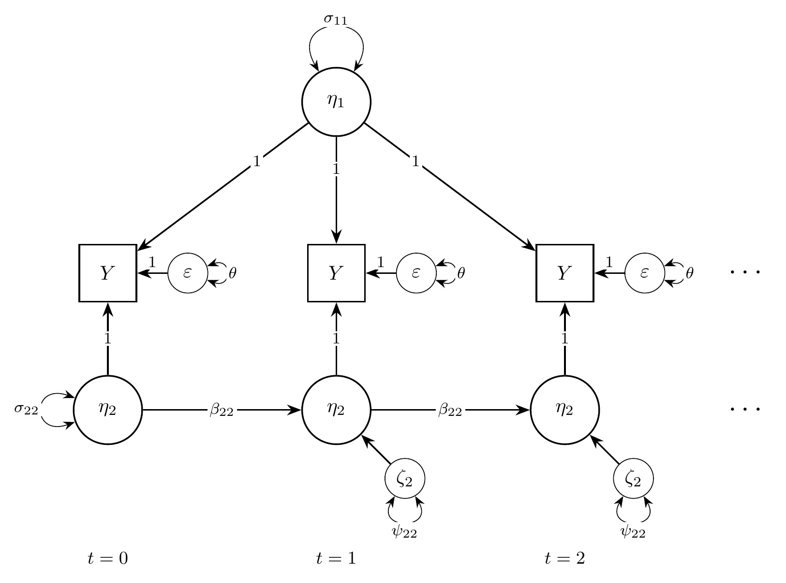
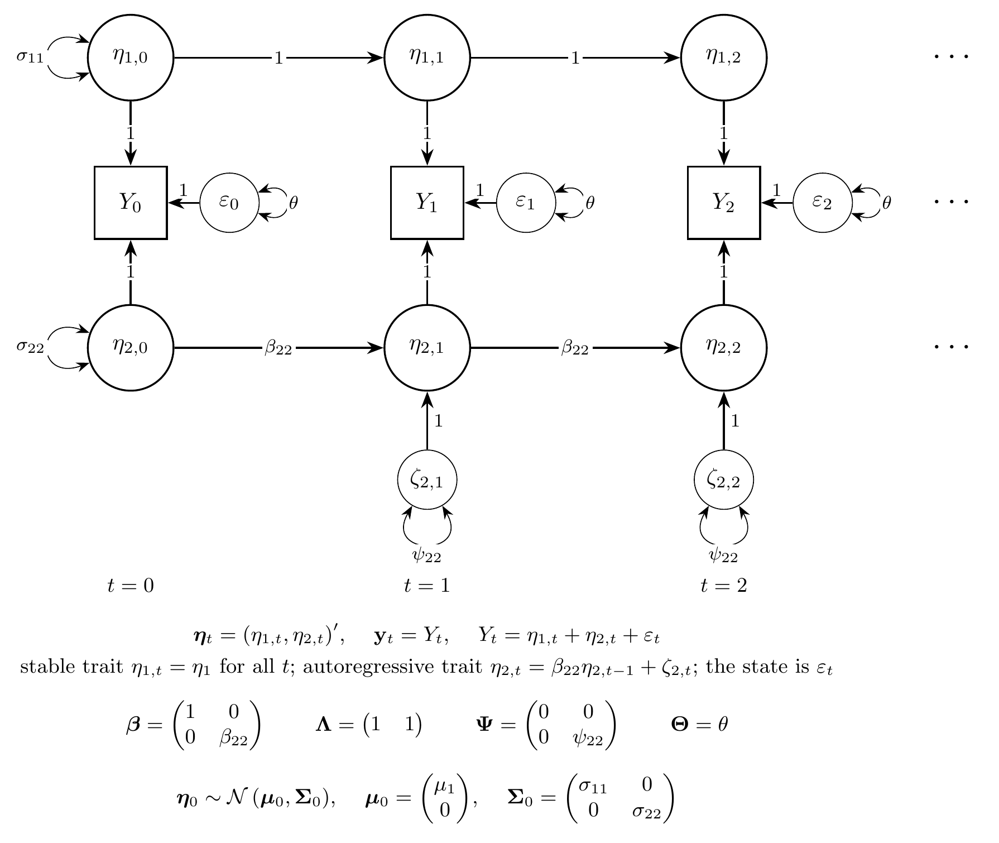
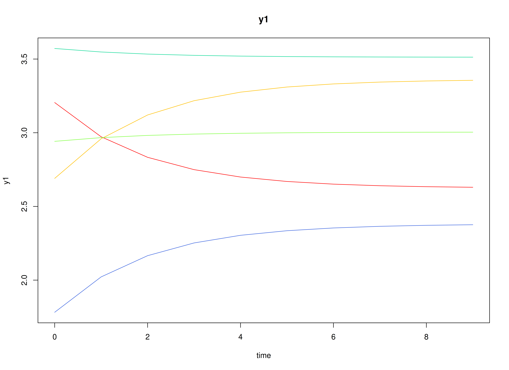
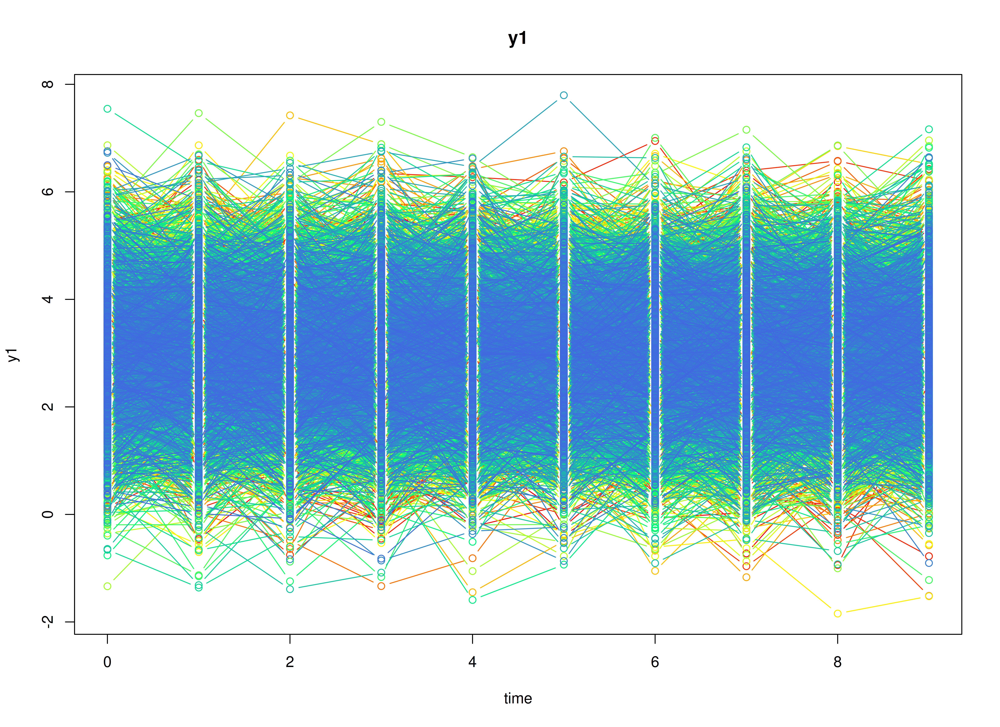
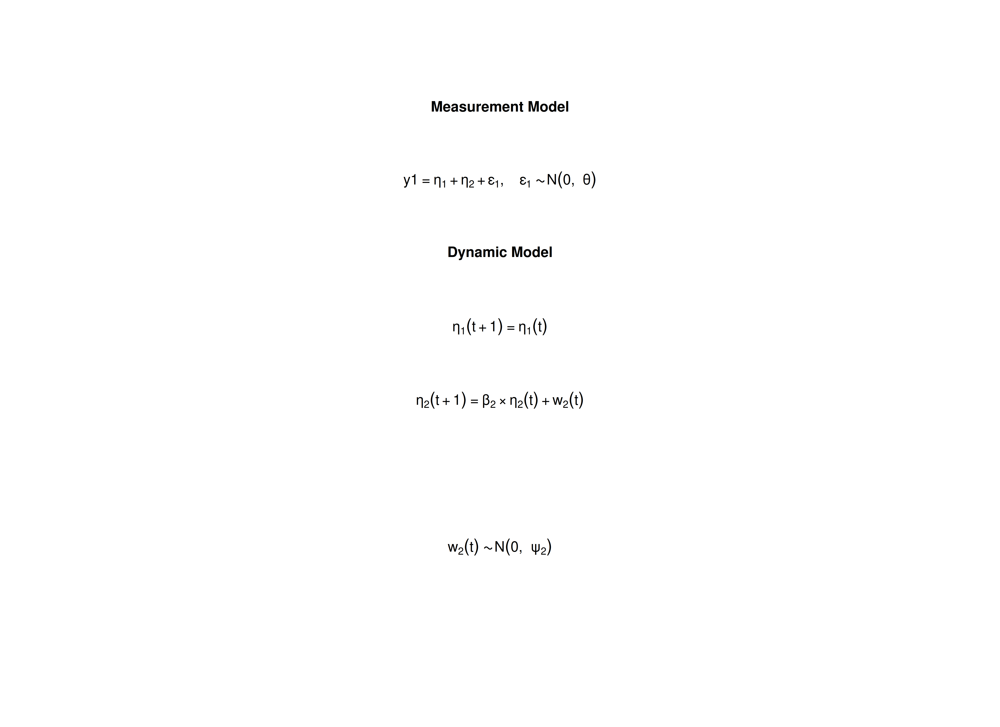

## Overview

The stable trait, autoregressive trait, and state (STARTS) model
divides a variable measured repeatedly on the same individuals
into three parts [@Kenny-Zautra-1995; @Kenny-Zautra-2001].
Take life satisfaction measured once a year.
Part of it is a stable trait that does not change over the study.
Part of it is an autoregressive trait that changes slowly:
a good year tends to be followed by a fairly good year.
The rest is a state that belongs to one occasion only,
such as the mood on the day of the survey or measurement error.
The model estimates how much of the variance belongs to each part
and how strongly the autoregressive part carries over.

The STARTS model is usually fitted
as a structural equation model (SEM).
It can also be written as a state space model:
the stable trait is a latent state that never changes,
the autoregressive trait is a latent state with first-order dynamics,
and the state part is the measurement error.

This tutorial does three things:

1. It writes the STARTS model as a state space model.
2. It simulates data from the model with `SimSSMFixed()`.
3. It fits the model to the simulated data
   as a state space model with `dynr` and `OpenMx`
   and as a structural equation model (SEM) with `lavaan` and `OpenMx`,
   and compares every set of estimates with the values used to simulate the data.

No prior knowledge of state space models is needed.


## Model

The measurement model is given by
$$
  Y_{i, t}
  =
  \left(
  \begin{array}{cc}
    1 & 1 \\
  \end{array}
  \right)
  \left(
  \begin{array}{c}
    \eta_{1_{i, t}} \\
    \eta_{2_{i, t}} \\
  \end{array}
  \right)
  +
  \varepsilon_{i, t},
  \quad
  \mathrm{with}
  \quad
  \varepsilon_{i, t}
  \sim
  \mathcal{N}
  \left(
  0,
  \theta
  \right)
$$
where $Y_{i, t}$ is the observed variable
at time $t$ and individual $i$,
$\eta_{1_{i, t}}$ is the stable trait,
$\eta_{2_{i, t}}$ is the autoregressive trait,
and $\varepsilon_{i, t}$ is the state.
$\theta$ is the variance of the state.

In words,
the observed score is the sum of the three parts.
The state $\varepsilon_{i, t}$ is new on every occasion
and does not carry over,
so it plays the role of measurement error in a state space model.

The dynamic structure is given by
$$
  \left(
  \begin{array}{c}
    \eta_{1_{i, t}} \\
    \eta_{2_{i, t}} \\
  \end{array}
  \right)
  =
  \left(
  \begin{array}{cc}
    1 & 0 \\
    0 & \beta_{22} \\
  \end{array}
  \right)
  \left(
  \begin{array}{c}
    \eta_{1_{i, t - 1}} \\
    \eta_{2_{i, t - 1}} \\
  \end{array}
  \right)
  +
  \left(
  \begin{array}{c}
    0 \\
    \zeta_{2_{i, t}} \\
  \end{array}
  \right),
  \quad
  \mathrm{with}
  \quad
  \zeta_{2_{i, t}}
  \sim
  \mathcal{N}
  \left(
  0,
  \psi_{22}
  \right) .
$$

In words,
the stable trait stays the same over time.
The autoregressive trait keeps a proportion $\beta_{22}$
of its previous value and adds a new part with variance $\psi_{22}$.
The closer $\beta_{22}$ is to 1,
the more slowly the autoregressive trait changes.

The initial condition is given by
$$
  \boldsymbol{\eta}_{i, 0}
  \sim
  \mathcal{N}
  \left(
  \left(
  \begin{array}{c}
    \mu_{1} \\
    0 \\
  \end{array}
  \right),
  \left(
  \begin{array}{cc}
    \sigma_{11} & 0 \\
    0 & \sigma_{22} \\
  \end{array}
  \right)
  \right) .
$$

Here, $\mu_{1}$ is the average stable trait
and $\sigma_{11}$ is how much individuals differ in it.
The autoregressive trait has mean zero,
because the stable trait carries the mean,
and $\sigma_{22}$ is its variance at the first occasion.
The two traits are uncorrelated.

### Diagrams


{width=100%}

The STARTS model as a path diagram, for the first three occasions ($t = 0, 1, 2$).
The stable trait $\eta_{1}$, with variance $\sigma_{11}$, loads on every occasion with a loading of 1.
The autoregressive trait $\eta_{2}$, with variance $\sigma_{22}$ at $t = 0$, carries over from one occasion to the next with the autoregressive effect $\beta_{22}$ and gets a new part $\zeta_{2}$, with variance $\psi_{22}$, on each occasion.
The state $\varepsilon$, with variance $\theta$, is new on every occasion.
A loop on a variable is its variance and a curved two-headed arrow a covariance.

{width=100%}

The same model in state space form, for the first three occasions, with every element of the state drawn.
The stable trait is a state with a transition of 1 and no process noise, so $\eta_{1, t} = \eta_{1}$ for all $t$;
the autoregressive trait $\eta_{2, t}$ receives the process noise $\zeta_{2, t}$ from $t = 1$ on;
the state $\varepsilon_{t}$ is the measurement error of the state space model.
Each $Y_{t}$ is the sum of the three, all with a loading of 1.
At $t = 0$, the initial condition $\boldsymbol{\eta}_{0} \sim \mathcal{N} \left( \boldsymbol{\mu}_{0}, \boldsymbol{\Sigma}_{0} \right)$ gives the variances $\sigma_{11}$ and $\sigma_{22}$ at $t = 0$; the two traits do not covary.
Below the diagram, $\boldsymbol{\beta}$ carries the state from one occasion to the next, $\boldsymbol{\Lambda}$ maps the state to the observed variable, $\boldsymbol{\Psi}$ is the covariance matrix of the process noise $\boldsymbol{\zeta}_{t}$, and $\boldsymbol{\Theta}$ is the variance of the state.
`SimSSMFixed()` takes `beta`, `lambda`, `mu0`, and the Cholesky factors of $\boldsymbol{\Psi}$, $\boldsymbol{\Theta}$, and $\boldsymbol{\Sigma}_{0}$ (`psi_l`, `theta_l`, and `sigma0_l`).

## Data Generation

### Notation

Let $t = 10$ be the number of time points and $n = 5000$ be the number of individuals.
The STARTS model needs many occasions
to tell the three parts apart,
so this example has more occasions than the other vignettes.

Let the stable trait have mean $\mu_{1} = 3$
and variance $\sigma_{11} = 0.5$.
Let the autoregressive effect be $\beta_{22} = 0.6$,
the process noise variance $\psi_{22} = 0.32$,
and the state variance $\theta = 0.3$.

The autoregressive trait starts from its stationary distribution,
so its variance at the first occasion is the variance it keeps
at every later occasion,

$$
\sigma_{22}
=
\frac{\psi_{22}}{1 - \beta_{22}^{2}}
=
0.5 .
$$

With these values, the stable trait, the autoregressive trait,
and the state contribute
0.5, 0.5, and 0.3
to the variance of the observed score on every occasion.

### R Function Arguments

The simulation functions take covariance matrices
as lower triangular Cholesky factors (the arguments ending in `_l`).
Because the stable trait has no process noise,
`psi` has a row and a column of zeros,
and its Cholesky factor is written directly.


``` r
n
#> [1] 5000
time
#> [1] 10
mu0
#> [1] 3 0
sigma0
#>      [,1] [,2]
#> [1,]  0.5  0.0
#> [2,]  0.0  0.5
sigma0_l # sigma0_l <- t(chol(sigma0))
#>           [,1]      [,2]
#> [1,] 0.7071068 0.0000000
#> [2,] 0.0000000 0.7071068
alpha
#> [1] 0 0
beta
#>      [,1] [,2]
#> [1,]    1  0.0
#> [2,]    0  0.6
psi
#>      [,1] [,2]
#> [1,]    0 0.00
#> [2,]    0 0.32
psi_l
#>      [,1]      [,2]
#> [1,]    0 0.0000000
#> [2,]    0 0.5656854
nu
#> [1] 0
lambda
#>      [,1] [,2]
#> [1,]    1    1
theta
#>      [,1]
#> [1,]  0.3
theta_l # theta_l <- t(chol(theta))
#>           [,1]
#> [1,] 0.5477226
```

### Visualizing the Dynamics Without Process Noise and Measurement Error (n = 5 with Different Initial Condition)

Without process noise and the state,
each individual's autoregressive trait decays toward zero,
so each trajectory settles at the individual's stable trait.



### Using the `SimSSMFixed` Function from the `simStateSpace` Package to Simulate Data

Now we add the process noise and the state
and simulate the full data set.
`as.data.frame()` returns the data in long format,
one row per individual and time point,
with the columns `id`, `time`, and `y1`.


``` r
library(simStateSpace)
sim <- SimSSMFixed(
  n = n,
  time = time,
  mu0 = mu0,
  sigma0_l = sigma0_l,
  alpha = alpha,
  beta = beta,
  psi_l = psi_l,
  nu = nu,
  lambda = lambda,
  theta_l = theta_l,
  type = 0
)
data <- as.data.frame(sim)
head(data)
#>   id time       y1
#> 1  1    0 2.724102
#> 2  1    1 2.554146
#> 3  1    2 2.834498
#> 4  1    3 1.952812
#> 5  1    4 1.715812
#> 6  1    5 1.798422
summary(data)
#>        id            time           y1        
#>  Min.   :   1   Min.   :0.0   Min.   :-1.844  
#>  1st Qu.:1251   1st Qu.:2.0   1st Qu.: 2.215  
#>  Median :2500   Median :4.5   Median : 2.993  
#>  Mean   :2500   Mean   :4.5   Mean   : 2.996  
#>  3rd Qu.:3750   3rd Qu.:7.0   3rd Qu.: 3.764  
#>  Max.   :5000   Max.   :9.0   Max.   : 7.797
plot(sim)
```



## Model Fitting

The same simulated data are fitted
as a state space model with `dynr` and `OpenMx`
and as a structural equation model (SEM) with `lavaan` and `OpenMx`.
All of them estimate the parameters by maximum likelihood.
The section Population Values and Estimates
compares their estimates with the population values.

### dynr

We fit the model with `dynr`,
which estimates state space models by maximum likelihood
using the Kalman filter.

A `dynr` model is built from pieces that match the equations above:
the data, the initial condition, the measurement model,
the dynamic model, and the noise.
Each parameter gets a name (for example, `beta_2_2` for $\beta_{22}$),
and the same name used in two places means one shared parameter.
The starting values are set to the population values for convenience;
with real data, they would be rough guesses.

#### Prepare Data

Tell `dynr` which columns hold the individual, the time, and the observed variables.


``` r
dynr_data <- dynr::dynr.data(
  dataframe = data,
  id = "id",
  time = "time",
  observed = "y1"
)
```

#### Prepare Initial Condition

The mean of the stable trait and the variances of both traits
at the first occasion are estimated.
The mean of the autoregressive trait
and the covariance of the two traits are fixed at zero.


``` r
dynr_initial <- dynr::prep.initial(
  values.inistate = mu0,
  params.inistate = c("mu0_1_1", "fixed"),
  values.inicov = sigma0,
  params.inicov = matrix(
    data = c(
      "sigma0_1_1", "fixed",
      "fixed", "sigma0_2_2"
    ),
    nrow = 2
  )
)
```

#### Prepare Measurement Model

The loadings $\left( 1, 1 \right)$ are fixed.


``` r
dynr_measurement <- dynr::prep.measurement(
  values.load = lambda,
  params.load = matrix(data = "fixed", nrow = 1, ncol = 2),
  state.names = c("eta_1", "eta_2"),
  obs.names = "y1"
)
```

#### Prepare Dynamic Process

The stable trait carries over unchanged;
the autoregressive trait has the autoregressive effect $\beta_{22}$.


``` r
dynr_dynamics <- dynr::prep.formulaDynamics(
  formula = list(
    eta_1 ~ eta_1,
    eta_2 ~ beta_2_2 * eta_2
  ),
  startval = c(beta_2_2 = beta[2, 2]),
  isContinuousTime = FALSE
)
```

#### Prepare Process Noise

Only the autoregressive trait has process noise.
The state variance $\theta$ is estimated.


``` r
dynr_noise <- dynr::prep.noise(
  values.latent = psi,
  params.latent = matrix(
    data = c(
      "fixed", "fixed",
      "fixed", "psi_2_2"
    ),
    nrow = 2
  ),
  values.observed = theta,
  params.observed = "theta"
)
```

#### Prepare the Model

The pieces are put together into one model.
`dynr` writes the model as C code to `outfile` and compiles it.


``` r
model <- dynr::dynr.model(
  data = dynr_data,
  initial = dynr_initial,
  measurement = dynr_measurement,
  dynamics = dynr_dynamics,
  noise = dynr_noise,
  outfile = "starts.c"
)
```

The plot below shows the model equations with the parameter names.



#### Fit the Model


``` r
results <- dynr::dynr.cook(
  model,
  debug_flag = TRUE,
  verbose = FALSE
)
#> [1] "Get ready!!!!"
#> using C compiler: ‘gcc (Ubuntu 15.2.0-16ubuntu1) 15.2.0’
#> Optimization function called.
#> Starting Hessian calculation ...
#> Finished Hessian calculation.
#> Original exit flag:  3 
#> Modified exit flag:  3 
#> Optimization terminated successfully: ftol_rel or ftol_abs was reached. 
#> Original fitted parameters:  0.6027093 -1.105952 -1.224083 2.996103 -0.6966334 
#> -0.713488 
#> 
#> Transformed fitted parameters:  0.6027093 0.3308957 0.2940272 2.996103 
#> 0.4982599 0.4899323 
#> 
#> Doing end processing
#> Successful trial
#> Total Time: 25.01403 
#> Backend Time: 24.60459
```

#### Summary

The summary lists each estimate with its standard error,
$t$ value, confidence interval, and $p$ value.


``` r
summary(results)
#> Coefficients:
#>            Estimate Std. Error t value ci.lower ci.upper            Pr(>|t|)
#> beta_2_2    0.60271    0.01815   33.21  0.56714  0.63828 <0.0000000000000002
#> psi_2_2     0.33090    0.01398   23.68  0.30350  0.35829 <0.0000000000000002
#> theta       0.29403    0.01168   25.18  0.27114  0.31692 <0.0000000000000002
#> mu0_1_1     2.99610    0.01174  255.15  2.97309  3.01912 <0.0000000000000002
#> sigma0_1_1  0.49826    0.01563   31.89  0.46763  0.52889 <0.0000000000000002
#> sigma0_2_2  0.48993    0.02206   22.21  0.44670  0.53316 <0.0000000000000002
#>               
#> beta_2_2   ***
#> psi_2_2    ***
#> theta      ***
#> mu0_1_1    ***
#> sigma0_1_1 ***
#> sigma0_2_2 ***
#> ---
#> Signif. codes:  0 '***' 0.001 '**' 0.01 '*' 0.05 '.' 0.1 ' ' 1
#> 
#> -2 log-likelihood value at convergence = 130172.19
#> AIC = 130184.19
#> BIC = 130237.11
```

### OpenMx: State Space Model

`OpenMx` [@Neale-Hunter-Pritikin-etal-2016] fits the same state space model
with its own Kalman filter (`OpenMx::mxExpectationStateSpace()`; @Hunter-2018).
Its matrices have the names used in engineering:
`A` is the transition matrix $\boldsymbol{\beta}$,
`B` holds the intercepts of the dynamic model,
`C` is the loading matrix $\boldsymbol{\Lambda}$,
`D` holds the intercepts of the measurement model,
`Q` is the process noise covariance matrix,
and `R` is the measurement error covariance matrix.
The parameter labels are the dynr names;
as in dynr, a label used in two places is one shared parameter,
and the starting values are the population values.

Two details differ from dynr.
First, OpenMx reads the data as a single time series.
To start the filter again at the first occasion of every individual,
each individual gets a group,
and all groups use the matrices of one parent model,
so every individual has the same parameters.
Second, OpenMx starts the filter one occasion before the first row,
so the first row has the state mean $\mathbf{A} \mathbf{x}_{0} + \mathbf{B} \mathbf{u}$
and the state covariance $\mathbf{A} \mathbf{P}_{0} \mathbf{A}^{\prime} + \mathbf{Q}$,
with the constant input $\mathbf{u} = 1$.
Setting
$\mathbf{x}_{0} = \mathbf{A}^{-1} \left( \boldsymbol{\mu}_{0} - \mathbf{B} \mathbf{u} \right)$
and
$\mathbf{P}_{0} = \mathbf{A}^{-1} \left( \boldsymbol{\Sigma}_{0} - \mathbf{Q} \right) \left( \mathbf{A}^{-1} \right)^{\prime}$
gives the first occasion the initial condition of the model,
so the likelihood is the same as in dynr.
This needs an invertible $\mathbf{A}$, which holds here.

The two helper functions below are the same in every vignette of the package.
`MxMat()` makes an OpenMx matrix from values and dynr-style labels
(`"fixed"` marks a fixed element),
and `FitMxSSM()` builds the groups and fits the model.


``` r
MxMat <- function(values, labels, name) {
  values <- as.matrix(values)
  labels <- matrix(
    data = labels,
    nrow = nrow(values),
    ncol = ncol(values)
  )
  free <- labels != "fixed"
  labels[!free] <- NA
  OpenMx::mxMatrix(
    type = "Full",
    values = values,
    free = free,
    labels = labels,
    name = name
  )
}
FitMxSSM <- function(data, observed, matrices, name) {
  # the groups refer to the matrices of the parent model
  shared <- function(x) {
    paste0(name, ".", x)
  }
  expectation <- OpenMx::mxExpectationStateSpace(
    A = shared("A"),
    B = shared("B"),
    C = shared("C"),
    D = shared("D"),
    Q = shared("Q"),
    R = shared("R"),
    x0 = shared("x0"),
    P0 = shared("P0"),
    u = shared("u")
  )
  # OpenMx needs the names of the observed variables and of the states on C
  for (i in seq_along(matrices)) {
    if (matrices[[i]]$name == "C") {
      dimnames(matrices[[i]]) <- list(
        observed,
        paste0("eta_", seq_len(ncol(matrices[[i]]$values)))
      )
    }
  }
  persons <- split(
    x = data[, observed, drop = FALSE],
    f = data[, "id"]
  )
  groups <- paste0("id_", names(persons))
  submodels <- lapply(
    X = seq_along(persons),
    FUN = function(i) {
      OpenMx::mxModel(
        name = groups[i],
        expectation,
        OpenMx::mxFitFunctionML(),
        OpenMx::mxData(
          observed = persons[[i]],
          type = "raw"
        )
      )
    }
  )
  model <- OpenMx::mxModel(
    name = name,
    matrices,
    OpenMx::mxMatrix(
      type = "Unit",
      nrow = 1,
      ncol = 1,
      name = "u"
    ),
    # the first occasion gets the initial condition of the model
    OpenMx::mxAlgebra(
      expression = solve(A) %*% (mu0 - B %*% u),
      name = "x0"
    ),
    OpenMx::mxAlgebra(
      expression = solve(A) %*% (sigma0 - Q) %*% t(solve(A)),
      name = "P0"
    ),
    submodels,
    OpenMx::mxFitFunctionMultigroup(groups = groups)
  )
  # retries from perturbed starting values only if the first run fails
  OpenMx::mxTryHard(
    model = model,
    extraTries = 5,
    silent = TRUE
  )
}
```

The matrices of the model, with the dynr labels.


``` r
mx_matrices <- list(
  MxMat(
    values = beta,
    labels = c("fixed", "fixed", "fixed", "beta_2_2"),
    name = "A"
  ),
  MxMat(values = alpha, labels = "fixed", name = "B"),
  MxMat(values = lambda, labels = "fixed", name = "C"),
  MxMat(values = nu, labels = "fixed", name = "D"),
  MxMat(
    values = psi,
    labels = c("fixed", "fixed", "fixed", "psi_2_2"),
    name = "Q"
  ),
  MxMat(values = theta, labels = "theta", name = "R"),
  MxMat(values = mu0, labels = c("mu0_1_1", "fixed"), name = "mu0"),
  MxMat(
    values = sigma0,
    labels = c("sigma0_1_1", "fixed", "fixed", "sigma0_2_2"),
    name = "sigma0"
  )
)
```


``` r
fit_mx_ssm <- FitMxSSM(
  data = data,
  observed = "y1",
  matrices = mx_matrices,
  name = "starts"
)
#> 
Beginning initial fit attempt
Fit attempt 0, fit=130172.19038846, new current best! (was 130175.551473008)
                                                                            
#> 
#>  Solution found!  Final fit=130172.19 (started at 130175.55)  (1 attempt(s): 1 valid, 0 errors)
summary(fit_mx_ssm)
#> Summary of starts 
#>  
#> free parameters:
#>         name matrix row col  Estimate  Std.Error A
#> 1   beta_2_2      A   2   2 0.6029308 0.01842698  
#> 2    psi_2_2      Q   2   2 0.3307593 0.01423413  
#> 3      theta      R   1   1 0.2941579 0.01189362  
#> 4    mu0_1_1    mu0   1   1 2.9961528 0.01174301  
#> 5 sigma0_1_1 sigma0   1   1 0.4982005 0.01568720  
#> 6 sigma0_2_2 sigma0   2   2 0.4898306 0.02226156  
#> 
#> Model Statistics: 
#>                |  Parameters  |  Degrees of Freedom  |  Fit (-2lnL units)
#>        Model:              6                  49994              130172.2
#>    Saturated:             NA                     NA                    NA
#> Independence:             NA                     NA                    NA
#> Number of observations/statistics: 50000/50000
#> 
#> Information Criteria: 
#>       |  df Penalty  |  Parameters Penalty  |  Sample-Size Adjusted
#> AIC:       30184.19               130184.2                 130184.2
#> BIC:     -410751.81               130237.1                 130218.0
#> To get additional fit indices, see help(mxRefModels)
#> timestamp: 2026-11-02 06:52:19 
#> Wall clock time: 82.59456 secs 
#> optimizer:  SLSQP 
#> OpenMx version number: 2.22.11 
#> Need help?  See help(mxSummary)
```

### lavaan: Structural Equation Model

The same model in SEM form, fitted with `lavaan`,
should give nearly the same estimates.
In SEM, each occasion is a separate observed variable
in one row per individual (wide format).
The stable trait is a factor with loadings of 1 on all occasions,
and the autoregressive trait is a factor on each occasion
with a loading of 1 on that occasion.

#### Wide Data Set

`as.data.frame()` with `long = FALSE` returns the data in wide format.


``` r
data_wide <- as.data.frame(sim, long = FALSE)
head(data_wide)
#>   id     y1_0      y1_1     y1_2     y1_3     y1_4         y1_5      y1_6
#> 1  1 2.724102 2.5541457 2.834498 1.952812 1.715812  1.798422003 2.6524161
#> 2  2 1.398728 1.5898005 2.078358 3.136913 3.420155  1.656597551 1.7696126
#> 3  3 5.130244 3.5302297 3.728487 3.017891 5.113005  4.727711315 3.2796103
#> 4  4 1.891987 1.9632526 3.094126 1.995233 2.613028  2.185718347 3.3743940
#> 5  5 1.725919 0.5120299 0.753101 2.145500 2.795792  2.154440779 1.9059497
#> 6  6 2.957243 1.4160208 1.596537 1.762764 1.159233 -0.005812339 0.8095458
#>        y1_7      y1_8      y1_9
#> 1 2.0029863 2.4650079 2.7663724
#> 2 0.6304025 1.7566680 0.4364570
#> 3 2.7692017 3.2305090 3.4921984
#> 4 2.7263657 0.8028354 1.1643963
#> 5 1.7443716 1.6288711 0.7896516
#> 6 1.5117643 1.3294805 2.4095639
```

#### Model

The model has the same structure for every occasion,
so we write it with `paste0()`.
The parameter labels match the dynr names.
Giving the autoregressive effect, the process noise variance,
and the state variance the same label on every occasion
constrains them to be equal over time,
as in the state space model.


``` r
waves <- 0:(time - 1)
now <- waves[-1]
before <- waves[-time]
model <- paste(
  c(
    "# stable trait: loadings fixed at 1",
    paste0("eta_1 =~ ", paste0("1 * y1_", waves, collapse = " + ")),
    "# autoregressive trait on each occasion",
    paste0("ar_", waves, " =~ 1 * y1_", waves),
    "# autoregressive effect",
    paste0("ar_", now, " ~ beta_2_2 * ar_", before),
    "# autoregressive trait at the first occasion",
    "ar_0 ~~ sigma0_2_2 * ar_0",
    "# process noise at later occasions",
    paste0("ar_", now, " ~~ psi_2_2 * ar_", now),
    "# stable trait: mean and variance",
    "eta_1 ~ mu0_1_1 * 1",
    "eta_1 ~~ sigma0_1_1 * eta_1",
    "# the two traits are uncorrelated",
    "eta_1 ~~ 0 * ar_0",
    "# state variance, equal over time; no observed intercepts",
    paste0("y1_", waves, " ~~ theta * y1_", waves),
    paste0("y1_", waves, " ~ 0 * 1")
  ),
  collapse = "\n"
)
cat(model)
#> # stable trait: loadings fixed at 1
#> eta_1 =~ 1 * y1_0 + 1 * y1_1 + 1 * y1_2 + 1 * y1_3 + 1 * y1_4 + 1 * y1_5 + 1 * y1_6 + 1 * y1_7 + 1 * y1_8 + 1 * y1_9
#> # autoregressive trait on each occasion
#> ar_0 =~ 1 * y1_0
#> ar_1 =~ 1 * y1_1
#> ar_2 =~ 1 * y1_2
#> ar_3 =~ 1 * y1_3
#> ar_4 =~ 1 * y1_4
#> ar_5 =~ 1 * y1_5
#> ar_6 =~ 1 * y1_6
#> ar_7 =~ 1 * y1_7
#> ar_8 =~ 1 * y1_8
#> ar_9 =~ 1 * y1_9
#> # autoregressive effect
#> ar_1 ~ beta_2_2 * ar_0
#> ar_2 ~ beta_2_2 * ar_1
#> ar_3 ~ beta_2_2 * ar_2
#> ar_4 ~ beta_2_2 * ar_3
#> ar_5 ~ beta_2_2 * ar_4
#> ar_6 ~ beta_2_2 * ar_5
#> ar_7 ~ beta_2_2 * ar_6
#> ar_8 ~ beta_2_2 * ar_7
#> ar_9 ~ beta_2_2 * ar_8
#> # autoregressive trait at the first occasion
#> ar_0 ~~ sigma0_2_2 * ar_0
#> # process noise at later occasions
#> ar_1 ~~ psi_2_2 * ar_1
#> ar_2 ~~ psi_2_2 * ar_2
#> ar_3 ~~ psi_2_2 * ar_3
#> ar_4 ~~ psi_2_2 * ar_4
#> ar_5 ~~ psi_2_2 * ar_5
#> ar_6 ~~ psi_2_2 * ar_6
#> ar_7 ~~ psi_2_2 * ar_7
#> ar_8 ~~ psi_2_2 * ar_8
#> ar_9 ~~ psi_2_2 * ar_9
#> # stable trait: mean and variance
#> eta_1 ~ mu0_1_1 * 1
#> eta_1 ~~ sigma0_1_1 * eta_1
#> # the two traits are uncorrelated
#> eta_1 ~~ 0 * ar_0
#> # state variance, equal over time; no observed intercepts
#> y1_0 ~~ theta * y1_0
#> y1_1 ~~ theta * y1_1
#> y1_2 ~~ theta * y1_2
#> y1_3 ~~ theta * y1_3
#> y1_4 ~~ theta * y1_4
#> y1_5 ~~ theta * y1_5
#> y1_6 ~~ theta * y1_6
#> y1_7 ~~ theta * y1_7
#> y1_8 ~~ theta * y1_8
#> y1_9 ~~ theta * y1_9
#> y1_0 ~ 0 * 1
#> y1_1 ~ 0 * 1
#> y1_2 ~ 0 * 1
#> y1_3 ~ 0 * 1
#> y1_4 ~ 0 * 1
#> y1_5 ~ 0 * 1
#> y1_6 ~ 0 * 1
#> y1_7 ~ 0 * 1
#> y1_8 ~ 0 * 1
#> y1_9 ~ 0 * 1
```

`lavaan::lavaan()` adds nothing to the model by itself,
so every parameter above is exactly the one written.


``` r
fit_lavaan <- lavaan::lavaan(
  model = model,
  data = data_wide
)
lavaan::summary(fit_lavaan)
#> lavaan 0.7-3 ended normally after 36 iterations
#> 
#>   Estimator                                         ML
#>   Optimization method                           NLMINB
#>   Number of model parameters                        31
#>   Number of equality constraints                    25
#> 
#>   Number of observations                          5000
#> 
#> Model Test User Model:
#>                                                       
#>   Test statistic                                53.844
#>   Degrees of freedom                                59
#>   P-value (Chi-square)                           0.665
#>                                                       
#>   Browne's residual (NT model-based) test             
#>   Test statistic                                53.517
#>   Degrees of freedom                                59
#>   P-value (Chi-square)                           0.677
#> 
#> Parameter Estimates:
#> 
#>   Standard errors                             Standard
#>   Information                                 Expected
#>   Information saturated (h1) model          Structured
#> 
#> Latent Variables:
#>                    Estimate  Std.Err  z-value  P(>|z|)
#>   eta_1 =~                                            
#>     y1_0              1.000                           
#>     y1_1              1.000                           
#>     y1_2              1.000                           
#>     y1_3              1.000                           
#>     y1_4              1.000                           
#>     y1_5              1.000                           
#>     y1_6              1.000                           
#>     y1_7              1.000                           
#>     y1_8              1.000                           
#>     y1_9              1.000                           
#>   ar_0 =~                                             
#>     y1_0              1.000                           
#>   ar_1 =~                                             
#>     y1_1              1.000                           
#>   ar_2 =~                                             
#>     y1_2              1.000                           
#>   ar_3 =~                                             
#>     y1_3              1.000                           
#>   ar_4 =~                                             
#>     y1_4              1.000                           
#>   ar_5 =~                                             
#>     y1_5              1.000                           
#>   ar_6 =~                                             
#>     y1_6              1.000                           
#>   ar_7 =~                                             
#>     y1_7              1.000                           
#>   ar_8 =~                                             
#>     y1_8              1.000                           
#>   ar_9 =~                                             
#>     y1_9              1.000                           
#> 
#> Regressions:
#>                    Estimate  Std.Err  z-value  P(>|z|)
#>   ar_1 ~                                              
#>     ar_0    (b_2_)    0.603    0.018   34.402    0.000
#>   ar_2 ~                                              
#>     ar_1    (b_2_)    0.603    0.018   34.402    0.000
#>   ar_3 ~                                              
#>     ar_2    (b_2_)    0.603    0.018   34.402    0.000
#>   ar_4 ~                                              
#>     ar_3    (b_2_)    0.603    0.018   34.402    0.000
#>   ar_5 ~                                              
#>     ar_4    (b_2_)    0.603    0.018   34.402    0.000
#>   ar_6 ~                                              
#>     ar_5    (b_2_)    0.603    0.018   34.402    0.000
#>   ar_7 ~                                              
#>     ar_6    (b_2_)    0.603    0.018   34.402    0.000
#>   ar_8 ~                                              
#>     ar_7    (b_2_)    0.603    0.018   34.402    0.000
#>   ar_9 ~                                              
#>     ar_8    (b_2_)    0.603    0.018   34.402    0.000
#> 
#> Covariances:
#>                    Estimate  Std.Err  z-value  P(>|z|)
#>   eta_1 ~~                                            
#>     ar_0              0.000                           
#> 
#> Intercepts:
#>                    Estimate  Std.Err  z-value  P(>|z|)
#>     eta_1   (m0_1)    2.996    0.012  255.138    0.000
#>    .y1_0              0.000                           
#>    .y1_1              0.000                           
#>    .y1_2              0.000                           
#>    .y1_3              0.000                           
#>    .y1_4              0.000                           
#>    .y1_5              0.000                           
#>    .y1_6              0.000                           
#>    .y1_7              0.000                           
#>    .y1_8              0.000                           
#>    .y1_9              0.000                           
#> 
#> Variances:
#>                    Estimate  Std.Err  z-value  P(>|z|)
#>     ar_0    (s0_2)    0.490    0.022   22.617    0.000
#>    .ar_1    (p_2_)    0.331    0.014   23.895    0.000
#>    .ar_2    (p_2_)    0.331    0.014   23.895    0.000
#>    .ar_3    (p_2_)    0.331    0.014   23.895    0.000
#>    .ar_4    (p_2_)    0.331    0.014   23.895    0.000
#>    .ar_5    (p_2_)    0.331    0.014   23.895    0.000
#>    .ar_6    (p_2_)    0.331    0.014   23.895    0.000
#>    .ar_7    (p_2_)    0.331    0.014   23.895    0.000
#>    .ar_8    (p_2_)    0.331    0.014   23.895    0.000
#>    .ar_9    (p_2_)    0.331    0.014   23.895    0.000
#>     eta_1   (s0_1)    0.498    0.016   32.127    0.000
#>    .y1_0    (thet)    0.294    0.011   25.598    0.000
#>    .y1_1    (thet)    0.294    0.011   25.598    0.000
#>    .y1_2    (thet)    0.294    0.011   25.598    0.000
#>    .y1_3    (thet)    0.294    0.011   25.598    0.000
#>    .y1_4    (thet)    0.294    0.011   25.598    0.000
#>    .y1_5    (thet)    0.294    0.011   25.598    0.000
#>    .y1_6    (thet)    0.294    0.011   25.598    0.000
#>    .y1_7    (thet)    0.294    0.011   25.598    0.000
#>    .y1_8    (thet)    0.294    0.011   25.598    0.000
#>    .y1_9    (thet)    0.294    0.011   25.598    0.000
```

### OpenMx: Structural Equation Model

The same SEM in `OpenMx`, written with `OpenMx::mxPath()`
on the wide data.
One-headed arrows are loadings and regressions,
two-headed arrows are variances and covariances,
and arrows from `"one"` are means.
A path that is not written is fixed at zero,
so the zero residual variances, covariances, and intercepts
of the lavaan model need no lines here.
The labels are the dynr names,
and the starting values are the population values.


``` r
waves <- 0:(time - 1)
manifest <- paste0("y1_", waves)
ar <- paste0("ar_", waves)
mx_sem <- OpenMx::mxModel(
  name = "starts_sem",
  type = "RAM",
  manifestVars = manifest,
  latentVars = c("eta_1", ar),
  OpenMx::mxData(observed = data_wide[, manifest], type = "raw"),
  # stable trait: loadings fixed at 1
  OpenMx::mxPath(from = "eta_1", to = manifest, free = FALSE, values = 1),
  # autoregressive trait on each occasion
  OpenMx::mxPath(from = ar, to = manifest, free = FALSE, values = 1),
  # autoregressive effect
  OpenMx::mxPath(
    from = ar[-time],
    to = ar[-1],
    labels = "beta_2_2",
    values = beta[2, 2]
  ),
  # autoregressive trait at the first occasion, process noise later
  OpenMx::mxPath(
    from = "ar_0",
    arrows = 2,
    labels = "sigma0_2_2",
    values = sigma0[2, 2]
  ),
  OpenMx::mxPath(
    from = ar[-1],
    arrows = 2,
    labels = "psi_2_2",
    values = psi[2, 2]
  ),
  # stable trait: mean and variance
  OpenMx::mxPath(
    from = "one",
    to = "eta_1",
    labels = "mu0_1_1",
    values = mu0[1]
  ),
  OpenMx::mxPath(
    from = "eta_1",
    arrows = 2,
    labels = "sigma0_1_1",
    values = sigma0[1, 1]
  ),
  # state variance, equal over time
  OpenMx::mxPath(
    from = manifest,
    arrows = 2,
    labels = "theta",
    values = theta[1, 1]
  )
)
```


``` r
fit_mx_sem <- OpenMx::mxRun(
  model = mx_sem,
  silent = TRUE
)
summary(fit_mx_sem)
#> Summary of starts_sem 
#>  
#> free parameters:
#>         name matrix   row   col  Estimate  Std.Error A
#> 1   beta_2_2      A  ar_1  ar_0 0.6029308 0.01845227  
#> 2      theta      S  y1_0  y1_0 0.2941579 0.01190797  
#> 3 sigma0_1_1      S eta_1 eta_1 0.4982005 0.01569699  
#> 4 sigma0_2_2      S  ar_0  ar_0 0.4898306 0.02226597  
#> 5    psi_2_2      S  ar_1  ar_1 0.3307593 0.01425239  
#> 6    mu0_1_1      M     1 eta_1 2.9961528 0.01174332  
#> 
#> Model Statistics: 
#>                |  Parameters  |  Degrees of Freedom  |  Fit (-2lnL units)
#>        Model:              6                  49994              130172.2
#>    Saturated:             65                  49935                    NA
#> Independence:             20                  49980                    NA
#> Number of observations/statistics: 5000/50000
#> 
#> Information Criteria: 
#>       |  df Penalty  |  Parameters Penalty  |  Sample-Size Adjusted
#> AIC:       30184.19               130184.2                 130184.2
#> BIC:     -295636.37               130223.3                 130204.2
#> To get additional fit indices, see help(mxRefModels)
#> timestamp: 2026-11-02 06:55:24 
#> Wall clock time: 0.03077316 secs 
#> optimizer:  SLSQP 
#> OpenMx version number: 2.22.11 
#> Need help?  See help(mxSummary)
```

## Population Values and Estimates

Each table below puts the population values used to simulate the data
next to the estimates of one method.
Bias is the estimate minus the population value.
Because each model is fitted to a single simulated data set,
this is the error of one estimate, not a Monte Carlo bias,
which would average over many replications.
The 95% confidence interval is the Wald interval,
$\hat{\theta} \pm 1.96 \times \mathrm{SE}$,
unless the caption says otherwise,
and `Covers` shows whether it contains the population value.
The parameter names are the dynr names in every table.


``` r
EstimatesTable <- function(population, estimate, se, ll = NULL, ul = NULL) {
  z <- stats::qnorm(p = 0.975)
  if (is.null(ll)) {
    ll <- estimate - z * se
  }
  if (is.null(ul)) {
    ul <- estimate + z * se
  }
  data.frame(
    Parameter = names(population),
    Population = unname(population),
    Estimate = unname(estimate),
    SE = unname(se),
    Bias = unname(estimate - population),
    `2.5%` = unname(ll),
    `97.5%` = unname(ul),
    Covers = unname(population >= ll & population <= ul),
    check.names = FALSE
  )
}
```


``` r
population <- c(
  mu0_1_1 = mu0[1],
  sigma0_1_1 = sigma0[1, 1],
  sigma0_2_2 = sigma0[2, 2],
  beta_2_2 = beta[2, 2],
  psi_2_2 = psi[2, 2],
  theta = theta[1, 1]
)
```

### dynr


``` r
dynr_est <- coef(results)
dynr_se <- sqrt(diag(vcov(results)))
knitr::kable(
  x = EstimatesTable(
    population = population,
    estimate = dynr_est[names(population)],
    se = dynr_se[names(population)]
  ),
  digits = 3,
  caption = "Population values and dynr estimates (one simulated data set)"
)
```


Table: Population values and dynr estimates (one simulated data set)

|Parameter  | Population| Estimate|    SE|   Bias|  2.5%| 97.5%|Covers |
|:----------|----------:|--------:|-----:|------:|-----:|-----:|:------|
|mu0_1_1    |       3.00|    2.996| 0.012| -0.004| 2.973| 3.019|TRUE   |
|sigma0_1_1 |       0.50|    0.498| 0.016| -0.002| 0.468| 0.529|TRUE   |
|sigma0_2_2 |       0.50|    0.490| 0.022| -0.010| 0.447| 0.533|TRUE   |
|beta_2_2   |       0.60|    0.603| 0.018|  0.003| 0.567| 0.638|TRUE   |
|psi_2_2    |       0.32|    0.331| 0.014|  0.011| 0.304| 0.358|TRUE   |
|theta      |       0.30|    0.294| 0.012| -0.006| 0.271| 0.317|TRUE   |


### OpenMx: State Space Model


``` r
mx_ssm_est <- OpenMx::omxGetParameters(fit_mx_ssm)
mx_ssm_se <- fit_mx_ssm$output$standardErrors[, 1]
knitr::kable(
  x = EstimatesTable(
    population = population,
    estimate = mx_ssm_est[names(population)],
    se = mx_ssm_se[names(population)]
  ),
  digits = 3,
  caption = paste(
    "Population values and OpenMx state space estimates",
    "(one simulated data set)"
  )
)
```


Table: Population values and OpenMx state space estimates (one simulated data set)

|Parameter  | Population| Estimate|    SE|   Bias|  2.5%| 97.5%|Covers |
|:----------|----------:|--------:|-----:|------:|-----:|-----:|:------|
|mu0_1_1    |       3.00|    2.996| 0.012| -0.004| 2.973| 3.019|TRUE   |
|sigma0_1_1 |       0.50|    0.498| 0.016| -0.002| 0.467| 0.529|TRUE   |
|sigma0_2_2 |       0.50|    0.490| 0.022| -0.010| 0.446| 0.533|TRUE   |
|beta_2_2   |       0.60|    0.603| 0.018|  0.003| 0.567| 0.639|TRUE   |
|psi_2_2    |       0.32|    0.331| 0.014|  0.011| 0.303| 0.359|TRUE   |
|theta      |       0.30|    0.294| 0.012| -0.006| 0.271| 0.317|TRUE   |


### lavaan: Structural Equation Model


``` r
pe <- lavaan::parameterEstimates(fit_lavaan)
# a label shared by several paths is one parameter
pe <- pe[pe$label != "" & !duplicated(pe$label), ]
lavaan_est <- stats::setNames(object = pe$est, nm = pe$label)
lavaan_se <- stats::setNames(object = pe$se, nm = pe$label)
knitr::kable(
  x = EstimatesTable(
    population = population,
    estimate = lavaan_est[names(population)],
    se = lavaan_se[names(population)]
  ),
  digits = 3,
  caption = "Population values and lavaan estimates (one simulated data set)"
)
```


Table: Population values and lavaan estimates (one simulated data set)

|Parameter  | Population| Estimate|    SE|   Bias|  2.5%| 97.5%|Covers |
|:----------|----------:|--------:|-----:|------:|-----:|-----:|:------|
|mu0_1_1    |       3.00|    2.996| 0.012| -0.004| 2.973| 3.019|TRUE   |
|sigma0_1_1 |       0.50|    0.498| 0.016| -0.002| 0.468| 0.529|TRUE   |
|sigma0_2_2 |       0.50|    0.490| 0.022| -0.010| 0.447| 0.532|TRUE   |
|beta_2_2   |       0.60|    0.603| 0.018|  0.003| 0.569| 0.637|TRUE   |
|psi_2_2    |       0.32|    0.331| 0.014|  0.011| 0.304| 0.358|TRUE   |
|theta      |       0.30|    0.294| 0.011| -0.006| 0.272| 0.317|TRUE   |


### OpenMx: Structural Equation Model


``` r
mx_sem_est <- OpenMx::omxGetParameters(fit_mx_sem)
mx_sem_se <- fit_mx_sem$output$standardErrors[, 1]
knitr::kable(
  x = EstimatesTable(
    population = population,
    estimate = mx_sem_est[names(population)],
    se = mx_sem_se[names(population)]
  ),
  digits = 3,
  caption = "Population values and OpenMx SEM estimates (one simulated data set)"
)
```


Table: Population values and OpenMx SEM estimates (one simulated data set)

|Parameter  | Population| Estimate|    SE|   Bias|  2.5%| 97.5%|Covers |
|:----------|----------:|--------:|-----:|------:|-----:|-----:|:------|
|mu0_1_1    |       3.00|    2.996| 0.012| -0.004| 2.973| 3.019|TRUE   |
|sigma0_1_1 |       0.50|    0.498| 0.016| -0.002| 0.467| 0.529|TRUE   |
|sigma0_2_2 |       0.50|    0.490| 0.022| -0.010| 0.446| 0.533|TRUE   |
|beta_2_2   |       0.60|    0.603| 0.018|  0.003| 0.567| 0.639|TRUE   |
|psi_2_2    |       0.32|    0.331| 0.014|  0.011| 0.303| 0.359|TRUE   |
|theta      |       0.30|    0.294| 0.012| -0.006| 0.271| 0.317|TRUE   |


### All Methods

The estimates of every method side by side.
The methods maximize the same likelihood,
so their estimates should agree closely.


``` r
knitr::kable(
  x = data.frame(
    Parameter = names(population),
    Population = unname(population),
    `dynr` = unname(dynr_est[names(population)]),
    `OpenMx (SSM)` = unname(mx_ssm_est[names(population)]),
    `lavaan` = unname(lavaan_est[names(population)]),
    `OpenMx (SEM)` = unname(mx_sem_est[names(population)]),
    check.names = FALSE
  ),
  digits = 3,
  caption = "Population values and the estimates of every method"
)
```


Table: Population values and the estimates of every method

|Parameter  | Population|  dynr| OpenMx (SSM)| lavaan| OpenMx (SEM)|
|:----------|----------:|-----:|------------:|------:|------------:|
|mu0_1_1    |       3.00| 2.996|        2.996|  2.996|        2.996|
|sigma0_1_1 |       0.50| 0.498|        0.498|  0.498|        0.498|
|sigma0_2_2 |       0.50| 0.490|        0.490|  0.490|        0.490|
|beta_2_2   |       0.60| 0.603|        0.603|  0.603|        0.603|
|psi_2_2    |       0.32| 0.331|        0.331|  0.331|        0.331|
|theta      |       0.30| 0.294|        0.294|  0.294|        0.294|


## References


